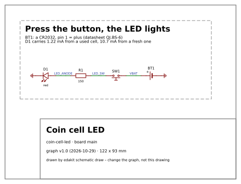
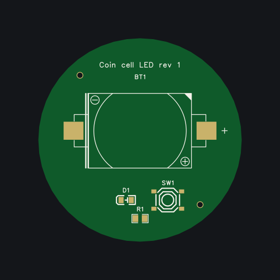

# edakit

[](https://github.com/tgd1975/edakit/actions/workflows/tests.yml)
[](https://github.com/tgd1975/edakit/releases/latest)
[](LICENSE)
[](https://tgd1975.github.io/edakit/)

**Circuit design as code.** edakit takes a circuit from an idea to a board ready to order. It is a plugin for Claude
Code and a command line, and everything it works on is text in your repository. In today's words, it specializes an
agent [harness](https://tgd1975.github.io/edakit/develop/architecture/) for circuit design. The documentation:
<https://tgd1975.github.io/edakit/>.

| The circuit, drawn by `edakit schematic draw` | The board, from its Gerber files |
| --- | --- |
|  |  |

The walkthrough's example: a coin cell, a button and a red LED, drawn in EasyEDA Pro – every file of it is text in
[examples/coin-cell-led](examples/coin-cell-led/). The same on KiCad: a 555 blinker in
[examples/blinker-555](examples/blinker-555/), with
[its walkthrough](https://tgd1975.github.io/edakit/handbook/18-walkthrough-kicad/).

## Try it in two minutes

In a clone of this repository, without the plugin and without an EDA program:

```bash
cd examples/coin-cell-led
uvx --from git+https://github.com/tgd1975/edakit edakit check
```

It checks the walkthrough's circuit in a fraction of a second and shows a finding that was accepted, with its reason.
The [quickstart](https://tgd1975.github.io/edakit/start/quickstart/) goes on from there: a finding explained, the simulation,
the drawn schematic.

- **Makers.** A checked circuit and its drawing, or a board from it: start with the
  [quickstart](https://tgd1975.github.io/edakit/start/quickstart/), then follow [the steps](https://tgd1975.github.io/edakit/circuit/).
- **Engineers.** A rule of your own for edakit's checks:
  [adding a rule](https://tgd1975.github.io/edakit/extend/adding-a-rule/).
- **Developers.** Work on edakit itself: [working on edakit](https://tgd1975.github.io/edakit/develop/working-on-edakit/).

## What it does

You bring the idea, what the board must do, and the decisions on money, purpose and looks. Claude and edakit bring the
rest: the parts with their datasheets, the values, the rules, the simulation, the schematic and the PCB in EasyEDA Pro
or KiCad, and the manufacturing files. They take the order up to the cart at JLCPCB, PCBWay, Eurocircuits or AISLER.
Each maker's quote comes with its price, the parts it has in stock and its lead time, checked by edakit. You order, pay
and hold the boards.

The [walkthrough](https://tgd1975.github.io/edakit/handbook/17-walkthrough/) shows it on a small board: 14 steps, six of
them yours, seven decisions. Every step is checked by [rules](https://tgd1975.github.io/edakit/catalog/) and reviewers,
but that is no guarantee. The regulatory review is support, not legal advice.

At least that is the vision, and we are close. [How it works](https://tgd1975.github.io/edakit/start/how-it-works/#state) says
what has run live, what has not, and where it goes next.

**What it needs.** Claude Code; uv and ngspice; for a board EasyEDA Pro desktop with Node 24, the default, or KiCad 10
([which one](https://tgd1975.github.io/edakit/handbook/16-kicad/#161-easyeda-pro-or-kicad)). Tested on Linux; Windows
and macOS are untested. An account at the maker you order from.

**What it costs.** The checks, the simulation and the drawings run offline. Claude's part is paid in tokens: six
typical tasks of the evals cost 0.55 USD together with Sonnet 5.5 and 1.48 USD with Opus 5.5
([evals](https://tgd1975.github.io/edakit/inside/evals/)). The board itself is quoted by each maker side by side.

**What it is not.** No editor of its own: it draws in EasyEDA Pro or KiCad. Two copper layers. The simulation is DC
operating points with a few transient and AC runs.

## Install

In Claude Code in the terminal:

```text
/plugin marketplace add tgd1975/edakit
/plugin install edakit@edakit
```

In VS Code, and to update:
[handbook 2.3](https://tgd1975.github.io/edakit/handbook/02-setup/#23-claude-code-the-plugin). Without Claude Code:
`uvx --from git+https://github.com/tgd1975/edakit edakit <command>`. The rest of the tool chain is in
[handbook 2](https://tgd1975.github.io/edakit/handbook/02-setup/). Which version runs, and what a new one changes for a
project: [How it works](https://tgd1975.github.io/edakit/start/how-it-works/#state), "Versions".

## Read on

- [How it works](https://tgd1975.github.io/edakit/start/how-it-works/) – the steps, who does what, the words, the state and
  the future work.
- [Projects](https://tgd1975.github.io/edakit/start/projects/) – the boards built with edakit, with their schematics and
  boards.
- [The handbook](https://tgd1975.github.io/edakit/handbook/) – the guides: the circuit, the board, troubleshooting.
- [The rule catalog](https://tgd1975.github.io/edakit/catalog/) – every check edakit runs: its rule, why it exists, what
  to do and its sources.
- [The reference](https://tgd1975.github.io/edakit/handbook/10-reference/) – every key and every command.

## What it runs, sends, fetches

edakit runs on your machine and collects no usage data. Your design leaves it only where a command below says so.

**Programs.** The plugin starts these:

- the `edakit` command line, in a Python environment that uv builds from the plugin's `uv.lock` (packages from PyPI);
- easyeda-mcp-pro 1.8.0, the MCP server for EasyEDA Pro, installed once with npm into `~/.easyeda-mcp-pro/runtime/`;
  it talks to EasyEDA Pro on your machine through the bridge extension you import in the setup;
- ngspice, Freerouting (Java), kicad-cli, git and the GitHub CLI `gh`, where a command needs them.

**Hooks.** The plugin has two:

- at the start of a session, in a project with an edakit.toml, it adds the working agreements (handbook 11.4) and
  the project's own scripts and agents to the session. It reads files only (`edakit/agreements.py`);
- before each EasyEDA tool call, it claims EasyEDA for the session, so that two sessions never drive it at once
  (`edakit/lock.py`, state in `~/.local/state/edakit/`).

**The network.** These commands go online:

| Command | Where to | What leaves your machine |
| --- | --- | --- |
| `edakit route` | github.com: Freerouting's release, once, into `~/.local/share/freerouting/` | nothing |
| `edakit part import` | easyeda.com: EasyEDA's public component data | the LCSC number |
| `edakit part fetch` | LCSC and the datasheet's own site | the LCSC number, the URL |
| `edakit part search`, `edakit stock` | jlcpcb.com: the public assembly catalogue and part pages | the search words, the LCSC numbers |
| `edakit version`, `/edakit:version` | github.com: the version tags and the newest CHANGELOG.md | nothing |
| `edakit release publish` | GitHub through `gh` | the release files – into your own repository |
| `/edakit:propose-rule`, `/edakit:propose-feature` | GitHub through `gh` | an issue in tgd1975/edakit with the text you approved |
| `/edakit:cart` | the maker's website, in your Chrome through Claude in Chrome | the order files and form fields; it stops at the cart and never orders or pays |

The checks, the simulation, the drawings, the routing and the gate run offline.

**Your project's files.** `/edakit:new-project` writes, after your OK, besides edakit.toml and `hardware/`:

- `.claude/settings.json`, which enables the edakit marketplace and plugin for every session in the repository;
- a pre-commit hook in `.githooks/` from `edakit hook install`, which also sets `git config core.hooksPath .githooks`;
- a CI workflow that runs the same checks on every pull request.

## Questions and bugs

A question, a bug or a board you built with edakit: open an
[issue](https://github.com/tgd1975/edakit/issues/new/choose) with its form. edakit is kept by one person with Claude,
and answers come as time allows.

## Licence

MIT – see [LICENSE](LICENSE) –, except for third-party material the tests use. Each folder of
[tests/open_designs/](tests/open_designs/) names its source, licence and changes in its README:

| Path | Source | Licence |
| --- | --- | --- |
| `tests/open_designs/guitarml-classic-boost/`, `guitarml-ts-rat-combo/` | Keith Bloemer (GuitarML), *GuitarPedalPCBs* | MIT, notice in the README |
| `tests/open_designs/corne-cherry-v3-left/` | foostan, *Corne Cherry* v3 | MIT, notice in the README |
| `tests/open_designs/corne-cherry-left/` | foostan, *Corne keyboard* v4 | [CC BY 4.0](https://creativecommons.org/licenses/by/4.0/) |
| `tests/open_designs/sparkfun-logic-level-converter/` | SparkFun Electronics, *Logic Level Converter* | [CC BY-SA 3.0](https://creativecommons.org/licenses/by-sa/3.0/) |
| `tests/open_designs/adafruit-microlipo-usb-c/` | Limor Fried/Ladyada for Adafruit Industries, *Adafruit Micro-Lipo Charger with USB Type C Jack* | [CC BY-SA 3.0](https://creativecommons.org/licenses/by-sa/3.0/), the text Adafruit asks for in the README |
| `tests/open_designs/atoomnetmarc-adlsc/` | atoomnetmarc, *ADLSC* (a WLED controller) | [Apache 2.0](https://www.apache.org/licenses/LICENSE-2.0), the licence's text in the folder's LICENSE |
| `tests/open_designs/esp32-devkitc-v4/` | Espressif Systems, *ESP32-DevKitC V4* schematic | none stated – only the circuit's facts are transcribed, not the drawing |
| `tests/open_designs/whbeers-fuzz-face/` | whbeers, *Random Input* (a Fuzz Face) | [CC0 1.0](https://creativecommons.org/publicdomain/zero/1.0/) |
| `tests/fixtures/jlcpcb/`, `easyeda/`, `datasheets/`, `makers/` | short excerpts of the pages and API answers of JLCPCB, LCSC, EasyEDA, AISLER, Eurocircuits and PCBway, with source and date, for the parsers' tests | the sites' own; not under MIT |

This is a reading of the sources' licences, not legal advice.
