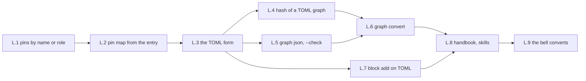

# Implementation plan: pins by name or role, the graph as TOML

Status 2026-10-31: settled. L.1 to L.8 built on the owner's word of 2026-10-31 ("bitte … bearbeiten"), merged on
the branch `ccr-f80e23dc-ak6668` with the suite green – section "State after the build"; L.9, the bell converting, is
the bell's, on the owner's word and not during an order (the owner's answer of the same day), kept in `TODO.md`.
Plan for the decisions of [circuit-language.md](circuit-language.md) (its table of 2026-10-31). The ground rules of
[implementation-plan.md](../new/implementation-plan.md) hold: one step, one branch, built with add-feature – a failing test
first, then the interface, the code, the handbook, `pytest` and `ruff` –; no key, no change; hashes named; the bell told
before a step changes its gate result or hashes.

## What is built

Pins by name or role, `U1.PD6` and `LED5.anode`, resolved through the parts entries; the pin map from the entry; the
graph as TOML with names, `hardware/graph.toml`, named by `[project] graph`; the circuit hash over the form's data as
canonical JSON, sorted; `edakit graph json` and the resolved `hardware/graph.json` generated beside the form and
checked in the pre-commit hook; `edakit graph convert` for a project that moves; `block add` on a TOML graph; the
handbook and the skills. The language of the sketch stays deferred; its prototypes in
[prototypes/circuit-language](prototypes/circuit-language/) stay the record of the sketch at `75d5c32`, and the
round trip they ran moves into the tests of L.6.

## Overview

| Step | What | Decision | Size | Waits for | State |
| --- | --- | --- | --- | --- | --- |
| L.1 | Pins by name or role in the loader; findings name pins by the word rule | 1, 6; confirmed 1–3 | M | – | built |
| L.2 | The pin map from the parts entry | 3 | S | L.1 | built |
| L.3 | The TOML form, read by `load_graph()` | 1; confirmed 4, 5 | M | L.1 | built |
| L.4 | The circuit hash of a TOML graph | 2 | S | L.3 | built |
| L.5 | `edakit graph json`, the resolved `graph.json`, `--check` in the pre-commit hook | 4; confirmed 5 | M | L.3 | built |
| L.6 | `edakit graph convert`, the sign-offs carried over, the round trip as its test | confirmed 6 | M | L.4, L.5 | built |
| L.7 | `block add` on a TOML graph | 1 | M | L.3 | built |
| L.8 | Handbook, reference, skills, README, the catalog's text of STRUCT.entry and STRUCT.pin | 1 | M | L.5, L.6, L.7 | built |
| L.9 | The bell converts, in its repository | – | S | L.8, the user's word | open – the bell's, on the owner's word |

No EasyEDA in any step. The KiCad tool chain reads the Design, not the file: nothing to do there.

## The steps

**L.1 Pins by name or role.** In `edakit/design.py` the Design resolves every pin word of the graph once, when it is
built – in the nets, `nc`, `locks.pins`, `layout.loops` (`a`, `b`) and the `pins` of a cable – to `DES.NUM` with the
reading rule: the number first, then the name of one pin, then the role of one pin, then a name or role several pins
share, which stands for all of them. The engines, the simulation, the schematic, the hand-over and the firmware
contract keep reading numbers as today. A word that names no pin of its part is a STRUCT.pin finding that names the
net and the word, not a loading error, so that the rest is checked. The rule the other way, `Design.word(des, num)`:
the first word that reads back as exactly that pin, else the number; a finding names a pin by its word, with the
number in brackets where it differs. A JSON graph with numbers loads and hashes as today. Tests: led-bar with its pins
rewritten to names and roles gives the same findings; the cases of the concept's rules table – a shared name, a
shared role, `pin3`, "GND (USB)", the Nano's swapped labels – as unit tests. Size M.

**L.2 The pin map from the parts entry.** A component without `pins` takes the entry's `{number: name}`; one with
`pins` keeps it. Without an entry and without `pins`, the loader builds the map from the numbers its nets and `nc`
use, so that the structure is checked, and STRUCT.entry reports the missing entry as today. STRUCT.entry: where the
map is the entry's, the comparison graph = entry has nothing left, the comparison with the library's symbol stays
(the text in `edakit/catalog/codes.toml`, the handbook generated from it). Tests: led-bar's U1 without `pins` is the
same design; a part without entry and map gives STRUCT.entry and nothing else for it. Size S.

**L.3 The TOML form.** `load_graph()` reads by extension: a `.toml` graph through `tomllib` – `[components.<des>]`,
`[nets.<name>]` and `[cables.<name>]` keyed tables become the lists in the order of the file, `designator` and `name`
from the key; everything else as it is in the JSON: `purpose`, `conventions`, `accept`, `layout`, `locks`, `ground`,
`grounds`. A key twice is a TOML error with its line; null does not exist. `[project] graph` names the file; the
default stays `hardware/graph.json`. Every reader goes through `load_graph` or the Design: `route.py` does, `block.py`
in L.7; `edakit convert --write` has nothing to do on a TOML graph, which is in the form of the restructuring by
construction; `gate.header` keeps hashing the file's bytes for `graph_sha256`. Tests: a small graph written as TOML
by hand loads to the dict the JSON gives; the errors with their lines. Size M.

**L.4 The circuit hash of a TOML graph.** `content()` in `edakit/release/gate.py`: a `.toml` graph is read as data
and hashed as canonical JSON – sorted keys, no whitespace, `hash_ignore` applied as for the JSON, `KEEP_WHOLE` as
today –, with the components sorted by designator, the nets by name and the pins of a net sorted. A JSON graph keeps
today's hash byte for byte. Tests: the hash of a TOML graph is unchanged by a comment, a blank line, a moved table
and a moved pin, and changed by a changed pin, a changed value and a changed `purpose.notes`. Size S.

**L.5 `edakit graph json`.** A command group `edakit graph`. `json` prints the resolved graph in today's format
exactly: `{"graph": …}`, pin numbers everywhere, the full `pins` map per component, lists in the order of the file.
`json --write` writes it to `hardware/graph.json` when the source is `hardware/graph.toml` – never over a JSON source
–; `json --check` exits 2 when the committed file differs and lists what differs, as `edakit firmware --check` does;
the pre-commit hook of a project with a TOML source runs it (new-project writes the line in L.8). The generated file
is derived: not in the circuit hash, not a data name of the scripts – `graph` stays the source. Tests: as
`test_cli_writes_and_check_finds_drift` in `tests/test_firmware.py`. Size M.

**L.6 `edakit graph convert`.** Writes `hardware/graph.toml` from the JSON source with the writer of the sketch:
tables keyed by designator and name, pins by the word rule, the pin map left out where it equals the entry's, `notes`
and long strings as multi-line strings, the order of the file the order of the JSON; rewrites
`conventions.pin_reference` ("'<designator>.<pin>' with the pin's name or role, else its symbol number – the parts
entry says which pin that is"); sets `[project] graph = "hardware/graph.toml"`; writes the resolved
`hardware/graph.json` in place of the source (L.5). When the files were the signed ones, the sign-offs of scope
`circuit` keep counting: the new hash goes into the sign-off file and `rehashed`, as `carry_signoffs` in
`edakit/convert.py` does. `--dry-run` prints what would change. Tests – the touchstone of the sketch moves here:
led-bar and the reference circuits of `tests/reference.py` converted in a scratch copy, `edakit graph json` equals
the original canonically, and the converted project passes `edakit check` with the same findings. Size M.

**L.7 `block add` on a TOML graph.** `block.py` reads through `load_graph` and writes a JSON source as today; a TOML
source with a line editor that keeps comments and arrangement – a new `[components.<des>]` after the last component
table, a new `[nets.<name>]` after the last net table, a pin on an existing net appended to its `pins` array, inline
or over several lines, the block's `accept` as keys of the table; the pattern is `write_place_rows` in
`edakit/pcb.py`. The blocks library stays JSON; parts entries are copied as today; `--dry-run` as today. Tests:
led-bar as TOML with comments, `block add led`, the comments stay, and `edakit graph json` equals what the JSON path
gives. Size M.

**L.8 Handbook, skills, README.** Handbook 3.1 with the TOML format on the led-bar snippet, pins by name or role, the
pin map from the entry and the generated `graph.json`; 3.2 the convention; 3.4 the hook line; 8.2 the hash rule of a
TOML graph; 10 with `[project] graph`, `edakit graph json|convert` and the file table; 2 the hook. The catalog's text
of STRUCT.entry and STRUCT.pin (`codes.toml`). Skills: circuit-design §5 with its examples in TOML, hardware-change
§1, own-part §4, new-project writes `hardware/graph.toml` and the hook line; the agents read the graph as before. The
README's status. The reference circuits of the tests and the evals stay JSON until a test needs them otherwise; the
prompt of `evals/add-led` names the file of its project. Size M.

**L.9 The bell converts.** In its repository, at the user's request: `edakit graph convert` in the main configuration
and the three variants, the sign-offs carried over; the bell's mentions of `graph.json` – `hardware/README.md`,
`docs/decisions.md`, a comment in the esp32 firmware – now name the generated file and are checked; the four round
trips of the sketch run once more, `edakit graph json` against the former `graph.json`. The bell's hashes do not move
before this step: a JSON graph hashes as today. Size S.

## Hashes and gate results

| Step | Circuit hash | Gate result |
| --- | --- | --- |
| L.1, L.2 | – (a JSON graph hashes as today) | STRUCT.pin for a word that names no pin; STRUCT.entry where the map is the entry's: only the library's symbol left to compare |
| L.3 | – | – |
| L.4 | a TOML graph: canonical, sorted, `hash_ignore` applied; a JSON graph unchanged | – |
| L.5 | – (the generated file is derived) | the hook's `edakit graph json --check`, exit 2 on drift |
| L.6 | changes once when a project converts; the sign-offs carried over (`rehashed`) | – |
| L.9 | the bell's four hashes change once, carried over | – |

## Order

L.1 → L.2 → L.3, then L.4, L.5 and L.7 side by side, then L.6, L.8, L.9. The first three are the part both forms
would have needed; from L.3 on it is the TOML form.

## Not in this plan

The language itself (deferred; what it would need, on which basis and when: [circuit-dsl.md](../new/circuit-dsl.md)); a
net in fragments (decision 7); an alias per pin (6); variants as differences (5); converting the reference circuits
of the tests and the evals to TOML – only where a test needs it.

## State after the build

Built on 2026-10-31 in worktrees, one or two steps each, test first; merged on `ccr-f80e23dc-ak6668` with the whole
suite green after every merge (2534 passed after L.8). A JSON graph loads and hashes as before.

| Step | State | Where |
| --- | --- | --- |
| L.1 | built: the Design reads every pin word once – nets, `nc`, `locks.pins`, `layout.loops`, a cable's `pins` – by number, name of one pin, role of one pin (the role of the part's config), then a shared name or role; a word that names no pin, or a shared word where one pin is meant, is STRUCT.pin; findings name a pin by the word rule (`Design.pin_text`, "U2.VDD (16)"), places stay numbers, so accepts keyed by place keep working | `edakit/design.py` (`resolve`, `word`, `words`, `pin_text`), `findings.py`, `tests/test_pin_words.py` |
| L.2 | built: a component without `pins` takes its entry's map; without an entry the numbers its nets and `nc` use, STRUCT.entry reports only the missing entry; where the map is the entry's only the comparison with the library symbol is left | `edakit/design.py`, `engines/struct.py`, catalog STRUCT.entry |
| L.3 | built: `load_graph()` reads a `.toml` graph – keyed tables in the order of the file, errors with file and line, an empty graph has empty lists; `edakit convert` leaves a TOML graph alone and names a key of before in it; the release notes read the purpose through `load_graph` | `edakit/design.py` (`graph_of_toml`), `convert.py`, `release/publish.py`, `tests/test_graph_toml.py` |
| L.4 | built: a TOML graph hashes as canonical sorted data – components by designator, nets and cables by name, a net's pins sorted, `hash_ignore` applied, `purpose` and `compliance` whole; a JSON graph's hash pinned byte for byte | `release/gate.py` (`content`, `arranged`), `scripts.py`, `requirements.py` |
| L.5 | built: `edakit graph json [--write\|--check]` – the resolved graph in the format of before, `--write` beside a TOML source only, `--check` exit 2 with what differs; the generated file is in no hash and no data name | `edakit/graph_form.py`, `cli.py`, `tests/test_graph_form.py` |
| L.6 | built: `edakit graph convert [--dry-run]` – the TOML written by the word rule, the pin map left out where it is the entry's, `[project] graph` set by a line edit, the resolved `graph.json` written, the sign-offs of scope `circuit` carried over (`rehashed`); refuses null, a name twice, a word that names no pin, an existing `graph.toml`, and reads its own TOML back before writing. The touchstone ran on led-bar and the seven reference circuits. Not carried over: script stamps (scripts that read `graph` show as outdated once) and the firmware contract's `state_sha256` (convert says to run `edakit firmware`) – handbook 3.1, 10.5 | `edakit/graph_form.py`, `convert.py` (`carry_signoffs`) |
| L.7 | built: `block add` on a TOML graph through a line editor that keeps comments and arrangement – tables after the last of their kind, a pin appended in the style of its array, `accept` as keys, grounds; the new text is written only if it reads back as the graph with the block; the block's pin maps left out where they are the entries' (decision 3) | `edakit/toml_edit.py`, `block.py`, `tests/test_block_toml.py` |
| L.8 | built: handbook 1, 2.7, 3 (the form on led-bar, the generated file, moving a project, 3.2, 3.4), 7.4, 8.2, 8.6, 10, 14.3, 14.5; catalog STRUCT.entry and STRUCT.pin; skills new-project (writes `hardware/graph.toml`, the hook line), circuit-design, hardware-change, own-part; the agents; README; `evals/add-led`; one TOML value writer for convert and block add | handbook, `skills/`, `agents/`, `tests/test_plugin.py` |
| L.9 | open: the bell converts in its repository – on the owner's word, in the bell's session, not during an order | `TODO.md` |

Seen on the way and left: the walkthrough of handbook 17 and `examples/coin-cell-led` stay JSON as the record of a
run; the reference circuits and the evals stay JSON (decision of the plan). Two old mentions of the key `checks` in
circuit-design §2 and the agent project-surveyor predate this plan.

