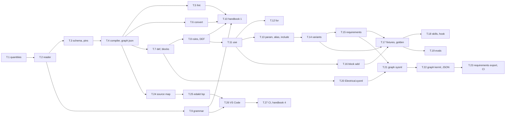

# Implementation plan: the circuit language toolchain

Status 2026-10-31: plan for [circuit-dsl.md](circuit-dsl.md) and its detail concept
[circuit-dsl-language.md](circuit-dsl-language.md), asked for by the owner the same day; nothing of the language
built yet. It is written for one session that builds all four stages – the reader, the compiler, the quantities
and derivation rules, the engine DEF, the formatter, the converter, the block library as definitions, the editor
grammar; the project constructs, `block add` on the language, the fixtures, evals and skills; the SysML v2 and
KerML exports with the electrical library; the language server and the VS Code extension – without a question
answered in between. What the language is, statement by statement, is the detail concept's; this plan says which
module, which function, which command, which test and which handbook section each step adds, and in which order.
The ground rules of [implementation-plan.md](implementation-plan.md) hold – one step, one commit, add-feature's
order, no key no change, hashes named, the bell told –; the TOML form of
[circuit-language-plan.md](../done/circuit-language-plan.md) is built and settled (L.1 to L.8 on 2026-10-31,
merged in `2f4628a`): the Design resolves pin words, `edakit graph json` writes the resolved graph beside a TOML
source and `--check` finds its drift, `edakit graph convert` moves a project, `block add` writes TOML through a
line editor, the hook line and the handbook are there; the language builds on these, and every step names what
it reuses. Sizes as in the plans: S a day, M a few days, L a week or more, in a human's measure.

## The session's protocol

- **One branch, one commit per step.** Everything on the branch the session is given; a commit per step, named
  `T.n: …` with what it adds; main is the owner's, merged on the owner's word after the closing report. The branch is
  listed in the report as the one unmerged branch, as CLAUDE.md asks.
- **Each step in add-feature's order** (`.claude/skills/add-feature/SKILL.md`): the failing test first, then the
  interface – a key in `edakit/config.py` with a default that changes nothing, a command in `edakit/cli.py` –, the
  code, the test green with its counterpart, the projects at hand unchanged, the handbook, and `uv run --group dev
  pytest -q`, `uvx ruff check edakit tests`, led-bar's `edakit check`, `edakit sim` and `edakit gate` (offline, exit
  2 without EasyEDA) green before the commit. A step is done when its "Done when" holds.
- **No key, no change.** `tests/fixtures/led-bar` stays a JSON project and reports what it reports today in every
  step; every existing test stays; the plugin's hooks, the proposals workflow and the bell are not touched. A new
  dependency is optional (`pygls`, `systree`) and never in edakit's default install.
- **Decisions.** What circuit-dsl-language.md and this plan say is decided. Where the code forces a choice neither
  names, the session decides by the section "Defaults for the session", writes the decision with date and reason
  into "Decisions of the session" at the end of this file, and goes on. It stops to ask only for a choice that
  changes a hash rule, the name of a file a project commits, or the surface of a statement – and asks at the end,
  in the closing report, after every other step is built; nothing waits in the middle.
- **Never:** file an issue or a proposal, open a pull request unless asked, push to main, skip or weaken a check to
  get green, change the proposals workflow, state a fact about a tool or an API that was not read from the tool's
  own output or documentation (working agreement 17: the grammar file, the standard reader's output, pygls's and
  VS Code's documentation as read, not as remembered).
- **Evals** are written as cases; they run with `claude plugin eval` only where the harness is at hand and the
  owner's budget allows (`evals/README.md`); otherwise the report says "written, not run".
- **The closing report:** one line per step – commit, tests added, what changed in led-bar's report (nothing, or
  what) –, the decisions of the session, what the owner has to do (merge, run the evals, the SysON import by hand,
  the bell's conversion in its repository), and the closing question of the decision-round skill for what the
  session decided itself.

## What is built

A package `edakit/lang/` that reads `.circuit` files, resolves and expands them and writes the resolved graph;
`edakit graph json|fmt|convert|derive|sysml|kerml` as actions of the existing `graph` command; `[project] graph`
naming a `.circuit` file, `[project] parts` as a list for variants; the engine DEF with `DEF.derive`; SYNC.graph for
a stale resolved graph; the block library as definitions with the generated JSON held equal by a test; `block add
--set` and `--part`; `block add` writing a usage on a language source; `edakit req` reading `.circuit` requirements
files; the fixture `tests/fixtures/led-bar-circuit`; three evals; the handbook chapter 18 with the generated tables
of rules and DEF codes; `edakit/lang/library/Electrical.sysml` and the exports with their conformance test; `edakit
lsp` on pygls and `editors/vscode/`.

## Overview

| Step | What | Size | Waits for | Stage |
| --- | --- | --- | --- | --- |
| T.1 | Quantities, units, the E-series table | S | – | 1 |
| T.2 | Tokens, statements, the model, the reader | M | T.1 | 1 |
| T.3 | The attribute table; pin words through the Design | S | T.2 | 1 |
| T.4 | The compiler for flat statements; `load_graph` and `edakit graph json` on a `.circuit` source; the hash; SYNC.graph | M | T.3 | 1 |
| T.5 | `edakit graph fmt` | S–M | T.4 | 1 |
| T.6 | `edakit graph convert --to circuit`, the sign-offs carried over | S | T.4 | 1 |
| T.7 | Definitions; the block library as `.circuit` with the generated JSON | M | T.4 | 1 |
| T.8 | Derivation rules and records; `block add --set` and `--part`; `edakit graph derive`; the engine DEF | M | T.7 | 1 |
| T.9 | The TextMate grammar | S | T.2 | 1 |
| T.10 | Handbook chapter 18, reference, README – stage 1 | M | T.5–T.9 | 1 |
| T.11 | Usages | M | T.8 | 2 |
| T.12 | Repetition | S | T.11 | 2 |
| T.13 | `param`, `alias`, `include` | S–M | T.11 | 2 |
| T.14 | Variants; `[project] parts` as a list; the hash over the entries used | M | T.13 | 2 |
| T.15 | Requirements in the notation; `edakit req` on `.circuit`; DOCS.ref on `subject`, `satisfies`, `decision` | M | T.14 | 2 |
| T.16 | `block add` on a language source writes a usage | M | T.11 | 2 |
| T.17 | The fixture led-bar-circuit; golden, determinism and round-trip tests; the bell's sources, optional | M | T.14, T.16 | 2 |
| T.18 | Skills, the hook line, handbook of stage 2 | S–M | T.17 | 2 |
| T.19 | Evals: add-led in the language, a repetition task, a variant task | S | T.17 | 2 |
| T.20 | `Electrical.sysml` and the conformance test with a standard reader | M | T.7 | 3 |
| T.21 | `edakit graph sysml` | M | T.15, T.20 | 3 |
| T.22 | `edakit graph kerml` and the JSON serialization of clause 10.4 | M | T.21 | 3 |
| T.23 | The requirements export; the SysON import documented; the optional CI job | S–M | T.22 | 3 |
| T.24 | The source map written on request; a finding located in the source | S | T.4 | 4 |
| T.25 | The language server, `edakit lsp` | M | T.24 | 4 |
| T.26 | The VS Code extension | M | T.9, T.25 | 4 |
| T.27 | The CI job of the extension; handbook of stage 4 | S | T.26 | 4 |

No EasyEDA in any step; nothing of the layout, the simulation or the gate changes beyond what the resolved graph
carries.

## The steps

Each step names its files, its interface, what it builds, its tests, its handbook section and when it is done. The
sections of circuit-dsl-language.md are cited as "language 5.6" and so on.

### Stage 1: edakit's own data

**T.1 Quantities, units, the E-series table.** Files: `edakit/lang/__init__.py` (the package's docstring: what
the language is, the commands, the phases of language 6), `edakit/lang/units.py`, `edakit/lang/series.py`,
`edakit/catalog/tables/series.toml`. `units.py`: `Quantity(lo, hi, unit)` – a frozen dataclass; `parse(text) ->
Quantity | None` for the forms of language 4 (a number with multiplier and unit, `4k7`, a range `a..b U` with the
unit on either end, `0 V`, a tolerance `x ± p %` and `x +/- p %`), built on `MULTIPLIERS` of `edakit/circuit.py`
and a unit table of its own – `V A W Ω F H Hz °C s m %` with the aliases `ohm`, `ohms`, `R` –; `format(q)` the
canonical text (`330 Ω`, `0..5.5 V`, `10 mA`) using `circuit.si`; `UnitError` for a unit where another is expected.
`series.py`: `values(name)` the mantissas of E6, E12, E24, E96 from the table; `nearest(value, name)` by the smallest
`|ln(candidate / value)|`; `window(value, name)` the series value below and above the derived value; the table's
`[table]` with `source` and `tag = "r"` as `catalog.table_problems` demands – the session reads the values from a
published source it names (IEC 60063's series are printed in every resistor maker's catalogue and on the standard's
summary pages) and tags them read. Tests: `tests/test_lang_units.py` – every example of language 4 parses to its
`(lo, hi, unit)`, the refusals (`v 10 mA` where a voltage is expected, `2 mA .. 5 V`), `format` round trip;
`nearest(260, "E24") == 270`, `window(260, "E24") == (240, 300)`, `nearest(15.9e-9, "E6") == 15e-9`;
`tests/test_catalog.py` already lints every table. Done when: the tests pass and `edakit rules` still runs (the
catalog loads the new table without complaint).

**T.2 Tokens, statements, the model, the reader.** Files: `edakit/lang/tokens.py`, `edakit/lang/model.py`,
`edakit/lang/reader.py`. `tokens.py`: `Tok(raw, kind, line, col, file)` with kinds word, string, group (a
parenthesis group with its items), comment; `tokenize(text, path) -> [[Tok]]` per line, comments kept as tokens so
that the formatter (T.5) can keep them; `statements(lines) -> [Statement]`, the prototype's grouping by indentation
(`docs/concepts/done/prototypes/circuit-language/translate.py`, `statements`), a `Statement` holding its head line,
its continuation lines and its body statements (for `def`, `use`, `for`, `variant`). `model.py`: one dataclass per
statement of language 5 – `GraphHead`, `Description`, `Purpose`, `Convention`, `Ground`, `Grounds`, `Accept`,
`Lock`, `Set`, `Include`, `Param`, `Part` (with `nc`, `pins`, `aliases`, `accepts`, `attrs` in order), `Net` (range
as a `Quantity`, a parameter name or `@PORT`; pins as words with the `locked` flag; `attrs`; `without`), `Cable`,
`Layout`, `Def` (params with defaults, ports with descriptions, body statements, `covers`, `optional`, `notes`,
`test`), `Use` (params, bindings in order, `without`), `For` (variable, range, body), `Derive`, `Variant`, `Need`,
`Requirement` –, each with `file` and `line`; `Source` holding the statements of one file. `reader.py`: `read(text,
path) -> Source`, every statement form of language 5.1 to 5.11 with the errors named there, errors collected into
`Source.errors` as `LangError(file, line, text)` and raised together by `check(source)`; `KEYWORDS`, the set of
language 5.12, exported for the grammar (T.9) and the server (T.25). The reader does syntax only: no entries, no pin
numbers, no expansion. The old statements of the prototype – `waive`, `hint`, `reverse_protect`, `convention`'s
pin numbers – are refused with the new form named (`waive` → `accept`). Tests: `tests/test_lang_reader.py` – each
statement form to its model object with its line; the examples of language 11 read without error; the errors:
unknown statement, unterminated string, a tab, a continuation line without a statement, `part` without a
designator, `net` without a name, `for` with `B < A`, `{x}` with an unknown name or operator, a `use` binding without
`=`, `variant` not first, `graph` in a variant, a requirement statement in a graph file (refused here already by
the file's role, which the reader is told). Done when: the examples of language 11 and the block JSONs' future
sources (T.7) read.

**T.3 The attribute table; pin words through the Design.** Files: `edakit/lang/schema.py`; nothing of its own
for pin words: the Design reads every pin word of a graph since L.1 (`Design.resolve`, `word`, `pin_text` and
`unresolved` in `edakit/design.py`), and the compiler hands it the words with a part's aliases replaced (T.4).
`schema.py`: the attribute table of language 6 – `GRAPH`, `COMPONENT`, `NET`, `CABLE`, `LAYOUT` as `{key: kind}`
with the keys of handbook 3.1 and the kinds word, string, number, boolean, quantity, range, list, table; `CABLE`
from `circuit.CABLE_KEYS`; `kind_of(table, key)`, `nearest(table, key)` with `difflib`; `UnknownKey`. Tests:
`tests/test_lang_schema.py` – every key of handbook 3.1's tables is in the table (the test parses the handbook's
tables, as `test_catalog.py` holds generated sections), `nearest("labl") == "label"`; the word rule stays tested
by `tests/test_pin_words.py`. Done when: the test passes.

**T.4 The compiler for flat statements; `load_graph` and `edakit graph json` on a `.circuit` source; the hash;
SYNC.graph.** Files: `edakit/lang/compile.py`, `edakit/lang/cli.py`, `edakit/design.py`, `edakit/graph_form.py`,
`edakit/release/gate.py`, `edakit/cli.py`, `edakit/config.py`, `edakit/engines/project.py`,
`edakit/catalog/codes.toml`. `compile.py`: `project_of(path) -> (root, parts_dirs)` – edakit.toml found upward
from the file, as `config.load` searches from the working directory, its `[project] parts` read; no Config is
built, `load_graph` has only the path –; `load_sources(path, root) -> [Source]` (the main file; includes and the
variant chain come in T.13 and T.14, this is the one function that grows); `resolve(sources) -> Model` (the
namespace of language 6, phase 2, with the duplicate checks); `expand(model) -> Model` (identity until T.11 and
T.12); `assemble(model, root, parts_dirs) -> (graph: dict, map: SourceMap)` (phases 7 and 9: the graph dict as
`graph_of_toml` gives a TOML graph's – components, nets and cables as lists in today's key order, pin words as
written with a part's aliases replaced, every `set` key where it was put, `derivations` from T.8 on –; the
Design built on it with `graph_form.design_of`, and every entry of `Design.unresolved` turned into a `LangError`
at its statement with the entry's names and roles and the aliases as candidates); `compile_path(path) -> dict`
for `load_graph`; `compile(cfg) -> (graph, map)`; `CompileError` with the list of `LangError`s, raised from
`load_graph` as `ConfigError` with every `PATH:LINE: TEXT`, as a broken TOML graph is; the `SourceMap` of
language 6, phase 10, filled from the start. `design.py`: `load_graph` reads a `.circuit` path through
`lang.compile.compile_path`. `graph_form.py`: `generated_path` gives the `.json` beside a `.circuit` source as
beside a `.toml`; `main_json` then prints, writes and checks a language project as it does a TOML one – the
resolved graph through `resolved`, drift through `firmware.differences` –, nothing else changes. `gate.py`:
`content(path, ignore, graph=True)` takes a `.circuit` graph as its compiled data, arranged, as it takes a TOML
graph (the scripts' data name `graph` goes through `file_hash(graph=…)` already). `config.py`: `[project] graph`
accepts the `.circuit` suffix where it validates the path; no new key. `cli.py`: `graph json` gains
`--map FILE`; `json` and `convert` stay with `graph_form`, the language's own actions – `fmt`, `derive`,
`sysml`, `kerml` – go to `lang.cli.main`. `engines/project.py`: `SYNC.graph` – for a TOML or a `.circuit` graph
with a generated file beside it, the generated file against `graph_form.resolved`, canonically; a difference is
an error of stage G (`f.stage = "G"` next to `SYNC.scripts`), a missing generated file too; a JSON project
nothing (language 12, item 16); `codes.toml` gets `[codes."SYNC.graph"]` with title, rule, why, fix
(`edakit graph json --write`), severity error, sources; the handbook's generated SYNC section follows
(`python -m edakit.catalog.handbook --write`). Tests: `tests/test_lang_compile.py` – the flat form of language
11's led-bar (the `for` written out, in a test string) compiles canonically equal to
`tests/fixtures/led-bar/hardware/graph.json` with the parts of the fixture (`graph_form.canonical`); the errors
with file and line: an unknown designator in a net, a pin word naming no pin (the candidates in the text), the
same pin in two nets or in a net and `nc` (both places), a range in the wrong unit, a missing entry naming
`edakit part add`, a duplicate designator and a duplicate net; `tests/test_lang_cli.py` – on a project whose
`[project] graph` is a `.circuit` file: `graph json` prints, `--write` writes beside the source and a second
`--write` changes no bytes, `--check` exits 2 with the differing designator named after a source edit and 0
after `--write` (the pattern of `tests/test_graph_form.py`), `--check` on led-bar exits 0 with its message;
`edakit check` on the same project reports what led-bar reports; the hash tests of `tests/test_graph_toml.py`
mirrored for the language – the hash takes the compiled data, a comment and a reordered statement change
nothing, a changed pin does, `graph_sha256` names the source's bytes, led-bar's `state_hash` unchanged;
`tests/test_sync_graph.py` – a TOML project and a language project with a stale generated file report SYNC.graph
as an error in `edakit check`, a current one nothing, led-bar nothing. Done when: the tests pass; led-bar's
`edakit check`, `sim` and `gate` report as before, and so does the TOML led-bar of `tests/test_graph_toml.py`
with its generated file current.

**T.5 `edakit graph fmt`.** Files: `edakit/lang/fmt.py`, `edakit/lang/cli.py`. `fmt.py`: `format(text) -> str`
from the tokens of T.2 with the comment tokens: statements in the source's order, never reordered; the head line of
a `part` as `part DES TYPE PARTNO [lcsc …] [value …] [no-bom] "label"`, the other attributes on continuation lines
in the attribute table's order, then `nc`, `pins`, `alias`, `accept`, `notes`; a `net` head as `net NAME RANGE PINS…`
up to the width, further pins on continuation lines, then attributes, `accept`, `notes`; two spaces per level; lines
wrapped at 118 characters, a string over several lines as language 3 reads it; blank lines kept, several collapsed
to one; an own-line comment before the line it preceded, an end-of-line comment on its line. `cli.py`: `edakit
graph fmt [--check] [FILE …]`, default the project's source set; `--check` exits 2 naming the first file and line
that would change. Tests: `tests/test_lang_fmt.py` – idempotence (`format(format(x)) == format(x)`) on the examples of
language 11 and on a deliberately misaligned source; the formatted text compiles to the same canonical graph;
comments kept in place and in number; `--check` exit codes. Done when: the tests pass and `edakit graph fmt
--check` on the block sources of T.7 exits 0 once they are written.

**T.6 `edakit graph convert --to circuit`.** Files: `edakit/lang/convert.py`, `edakit/graph_form.py`,
`edakit/cli.py`. `convert.py`: `to_circuit(source, design) -> str` – the prototype's `to_circuit` ported to the
forms of language 5, on the Design `graph_form.design_of` builds: pins by `graph_form.written` (the word rule, a
shared word once where all its pins stand in the net), the pin map omitted where it equals the entry's
(`graph_form.entry_map`), `accept` as `accept` lines, `locks.pins` as `(locked)` where the pin is on that net
and `lock` otherwise, attributes by the attribute table, `set KEY JSON` for tables and lists, `description` and
`notes` wrapped; the text formatted by T.5. `graph_form.main_convert` gains `--to toml|circuit` (default `toml`,
today's behaviour byte for byte): with `circuit`, from a JSON or a TOML source, it writes
`hardware/graph.circuit`, sets `[project] graph` (`set_graph`), writes the resolved `hardware/graph.json`, reads
its own text back through `load_graph` before writing anything (the TOML writer's own check), carries the
sign-offs of scope circuit over with `convert.carry_signoffs` – the hash changes once, from the JSON's bytes or
the TOML's data to the compiled data –, refuses an existing target; `--dry-run` as today. Tests:
`tests/test_lang_convert.py` – led-bar converted in a scratch copy: `edakit graph json` equals the original
canonically, `edakit check` reports the same findings, the sign-off file carries its circuit sign-offs
(`rehashed`, as `test_convert_carries_the_circuit_sign_offs_of_the_signed_files` tests it for TOML); the TOML
led-bar converted the same way; the round trip compile → convert → compile on the examples of language 11 is
canonically equal; the converted text of led-bar equals language 11's text up to the loop (a test with the loop
written out). Done when: the tests pass and `edakit graph convert` without `--to` behaves as before, test for
test.

**T.7 Definitions; the block library as `.circuit`.** Files: `edakit/lang/reader.py` (the `def` body of language
5.5, `port NAME "about"` lines for the port descriptions, `ports` on the head for the short form),
`edakit/lang/compile.py` (definitions collected in `resolve`: the project's files first, then
`edakit/blocks/*.circuit`; a project's definition shadows the library's with a note on stderr; definitions are
not expanded here – T.11 –), `edakit/lang/blocks.py`, `edakit/blocks/*.circuit`, `edakit/block.py`. `blocks.py`:
`block_json(definition, library_parts) -> dict` – today's block JSON from a definition: `name`, `title`,
`about`, `ports` with their descriptions, `components` with the local designators, `label`, `part`, `lcsc`,
`value`, `pins` from the library entry, `notes`; `nets` with `v` as a list or `"@port"`; `covers`, `optional`,
`notes`, `graph`, `test`; and two keys new to the JSON, `params` (`{name: {"default": "10 mA"}}`) and
`derivations` (the `derive` statements as `{"targets": […], "rule": "…", "args": {…}}`) –;
`python -m edakit.lang.blocks [--write]` writes every `<name>.json` from `<name>.circuit`, without `--write`
lists the differences; `from_json(block) -> str` writes a definition's text from a block JSON, the one-time tool
the session uses to write the 26 `.circuit` files, after which the JSON is generated. The session then gives a
parameter and a derivation to the blocks whose value a rule derives – `led` (`i`, default `10 mA`,
`derive R1.value series_resistor(i)`), `i2c-pullups` (`pullup` on both resistors), `battery-sense` (`divider`),
and others only where a rule of language 7 fits exactly – and leaves the fixed values as they are, since the
rule runs only with `--set` (language 12, item 7). `block.py`: `plan` and `add` ignore `params` and
`derivations` until T.8; `test_library_block_is_consistent` keeps passing. Tests: `tests/test_lang_blocks.py` –
every generated JSON equals the committed one (the pattern of `tests/test_catalog.py` for the handbook), every
`.circuit` reads and formats idempotently, a `def` with a port that is no net, a derive with an unknown target
and a duplicate part give their errors; `tests/test_block.py` unchanged and green. Handbook: 14.5 names the
`.circuit` sources and the generator. Done when: `edakit block add led --as STATUS --connect in=SIG` gives
today's result and the JSON files are byte-equal to the generator's output.

**T.8 Derivation rules and records; `block add --set` and `--part`; `edakit graph derive`; the engine DEF.**
Files: `edakit/lang/rules.py`, `edakit/engines/derive.py`, `edakit/engines/__init__.py`, `edakit/block.py`,
`edakit/cli.py`, `edakit/lang/cli.py`, `edakit/graph_show.py`, `edakit/catalog/codes.toml`,
`edakit/catalog/handbook.py`. `rules.py`: `Rule(name, inputs, outputs, series, window, fn)` with
`Input(name, kind, unit, default, bind)` – `bind` says how the compiler binds an input the statement does not
name: `"led"` the one part of kind led or led_rgb, `"port"` the one port that is not `gnd`,
`"table:i2c.pullup.sink_a"` a catalog value –; `RULES` with `series_resistor`, `divider`, `pullup`, `rc` as
language 7 defines them, formulas and windows included; `evaluate(rule, args, inputs) -> Record` (the record of
language 7 as a dict, `from`, `args`, `inputs` with sources, `derived`, `series` with `nearest` and `window`,
`chosen`, `predicts`) and `RuleError` with the numbers; `refresh(graph, design) -> [(record, changes)]`
re-evaluating every record of a graph with the entries as they are now;
`inputs_differ(record, design) -> [text]` comparing the record's input numbers with their sources (for DEF);
`describe()` the table of rules for the handbook. `engines/derive.py`: `run(ctx)` → `DEF.derive` where the
part's value (through its entry, as `circuit.value_problem` reads it) lies outside the record's window, text as
language 7; `DEF.derive` with grade `inputs` where `inputs_differ` says so; registered in `graph_findings` after
`parts`; `codes.toml` gets `[engines.DEF]` (prefix `DEF`, decides "every derived value is the value its record
derives") and `[codes."DEF.derive"]` with `grades = { inputs = "warning" }`, severity warning, title, rule, why,
fix, details and sources (language 7, this plan). `block.py`: `--set NAME=VALUE` (repeatable) and
`--part DES=KEY` (repeatable) on `block add`: for every derivation of the block whose inputs include a set
parameter, `plan` evaluates the rule with the block's own entries (`block.library_part`) and the target net's
range for the port; it prints the derived value, the nearest series value, the window and the library entries of
the same kind and package whose value lies in the window (`edakit/parts/*.json`, `values.value_ohm` etc.); when
the block's own part fits the window it is kept; else `--part DES=KEY` names the entry to use (the component's
`lcsc`, `part` and `value` become the entry's, its `pins` the entry's) and without it `add` stops with exit 1
and the candidates, or "no entry of the library in the window – part-search skill, then `--part`"; the record is
written into the graph's `derivations` – into a JSON graph as data, into a TOML graph through `toml_edit` as a
`[[derivations]]` table (`Doc` learns arrays of tables if it lacks them) – with `from: "block led, STATUS"`,
`chosen` the entry's value; `--dry-run` prints and writes nothing; without `--set` nothing of this runs.
`lang/cli.py`: `edakit graph derive [--write]`: `refresh` on the project's graph, prints every record whose
derived value or inputs changed, `--write` rewrites the records of a JSON graph; on a language source it says
`edakit graph json --write` and exits 1. `graph_show.py`: a part's records under `derived` with rule, derived,
window and chosen. `catalog/handbook.py`: the kind `rules` for `<!-- edakit:generated rules -->` from
`rules.describe()` (T.10 places it). Tests: `tests/test_lang_rules.py` – `series_resistor` with C2297's values,
`v_on` 5.5 V, `i` 10 mA: `vf(i)` 2.90 V, derived 260 Ω, nearest 270, window (240, 300), predicted with 330 Ω ±1
% (0.0071, 0.0088) A as language 7's record; `divider`, `pullup` with the I2C table's defaults, `rc` both ways
with numbers the test derives by hand; the errors (`v_on` below `vf`, a missing `vf_typ_v`, a zero current);
`tests/test_derive.py` – a graph with a record and a value outside the window gives `DEF.derive`, inside
nothing; an entry's `vf_typ_v` changed after the record gives `DEF.derive/inputs`; `accept` on the component
silences it; `tests/test_block.py` – `block add led --as STATUS --connect in=SIG --set i=4mA` on led-bar (SIG at
0..3.4 V: derived 140 Ω, window 130…160 Ω, the block's 150 Ω fits) writes the record and keeps C17471,
`--set i=10mA` (derived 50 Ω, window 47…56 Ω) stops with exit 1 and names the window,
`--set i=10mA --part R1=<KEY>` with a library entry in the window – the session adds one 51 Ω or 56 Ω entry to
`edakit/parts/` from its datasheet, with `edakit part import` and the entry's sources as the library asks
(handbook 4.1), or uses an existing entry whose value fits another `i` – writes the part and the record;
`edakit graph derive` reports a changed entry and `--write` rewrites; `tests/test_graph_show.py` – the record
shown. Handbook: 14.5 for `--set` and `--part`; chapter 18 (T.10) for the rules and DEF. Done when: all tests
pass, led-bar's report is unchanged, and `edakit rules` lists DEF.

**T.9 The TextMate grammar.** Files: `editors/vscode/syntaxes/circuit.tmLanguage.json`,
`editors/vscode/language-configuration.json`, `editors/README.md`. The grammar: scope `source.circuit`; comments,
strings with escapes, the statement keywords of `reader.KEYWORDS` at the start of a line, the attribute keywords,
pin words (`DES.WORD`), designators, quantities with units, codes (`LIM.v`), `(locked)`, `{n}` in a `for` body;
the configuration: `#` line comments, brackets, auto-closing quotes. No Pygments lexer (decided: the documentation
site shows `.circuit` as plain text until a lexer is registered; a lexer needs an entry point mkdocs sees, which
the site's build does not have); no `.gitattributes` in edakit (the handbook names `linguist-language` as an option
for projects). Tests: `tests/test_lang_grammar.py` – the grammar is valid JSON, every keyword of `reader.KEYWORDS`
is matched by a pattern of it, the language configuration names `#`. Done when: the test passes.

**T.10 Handbook chapter 18, reference, README – stage 1.** Files: `handbook/18-circuit-language.md` (new
chapter; `docs/pages.py` picks chapters up by its glob), `handbook/03-hardware-graph.md` (3.1: the language as
the third form of the graph, one paragraph after the TOML form, link to 18; 3.4: the hook line of the TOML form
holds for a `.circuit` graph too), `handbook/10-reference.md` (10.1: `[project] graph` may name a `.circuit`;
10.5: `edakit graph json|fmt|convert|derive`, `block add --set --part`; 10.6: the files),
`handbook/14-design.md` (14.5), `README.md` ("What is in here", "Status and limits"), `handbook/README.md` (the
chapter list). Chapter 18: the frame and the files (language 1 and 2), the lexical form and quantities (3 and
4), the statements of stage 1 – the graph, parts, nets, cables, layout, definitions, derivations – each with a
short example, the compiler's phases and errors (6), the rules with the generated table
`<!-- edakit:generated rules -->` and the DEF codes `<!-- edakit:generated codes DEF -->` (7), the resolved
graph and the hash (8), the commands, the block library as definitions, the editor grammar; the sections of
stage 2 to 4 are added by T.18, T.23 and T.27. Regulatory content: none moves; the chapter says once that the
review reads the resolved graph's `purpose` as today. Tests: `tests/test_catalog.py` holds the generated
sections; `tests/test_pages.py` builds the site's navigation with the new chapter. Done when: the handbook
builds and names every command and key the stage added.

### Stage 2: projects

**T.11 Usages.** Files: `edakit/lang/reader.py` (`use` of language 5.6), `edakit/lang/expand.py` (new: the
expansion of usages, called by `compile.expand`), `edakit/lang/compile.py`. `expand.py`: `expand_use(use, definition,
model) -> [statements]` – the definition's parts with the usage's designators and the bindings' attributes over the
definition's, its nets with pins renamed, ports joined to the bound nets (a net created at the usage's position
with the port's range, `@PORT` chains as `block.plan`'s `v_of`), internal nets named `<INSTANCE>_<NET>` in capitals
or as bound, optional parts left out with `block.without_parts`'s rules, a pin alone on an unbound optional port
into `nc`, `gnd` to the ground, the definition's `accept` keys with places renamed as `block.rename_accept` does,
`satisfies` and `decision` of the usage onto its parts; the derivations of the definition evaluated with the
usage's values, the bound nets' ranges and the bound parts' entries, their records collected for `assemble`; the
errors of language 5.6 with the usage's line and, where a definition's statement is at fault, both lines. Nothing
appended to `notes` (language 12, item 3). Tests: `tests/test_lang_use.py` – the bell's step as language 11 writes
it, with the library's entries in place of the bell's (`C17630`, `C2297`), compiles to the parts and nets of
circuit-dsl.md's example (two parts per usage with the bound attributes, the nets `LED_G1_A` by binding and
`STEP2_ANODE` by default, the ports on the project's nets, `locks.pins` from the project's net); `without` on an
optional part; an unbound port, an unbound part, a parameter the definition lacks, a designator bound twice – each
its error with the lines; a project definition shadowing a library one; the record at a usage with `from: "def led,
use step1"`. Done when: the tests pass.

**T.12 Repetition.** Files: `edakit/lang/reader.py` (`for` of language 5.7), `edakit/lang/expand.py`
(`expand_for`: substitution of `{VAR}`, `{VAR+k}`, `{VAR-k}`, `{VAR*k}` in every word and string of the body, once
per value; the body's statements then read as written). Tests: `tests/test_lang_for.py` – language 11's led-bar with
the loop compiles canonically equal to the flat form; `{n+2}` in designators, pin words and strings; `B < A`, a
nested `for`, `{m}` with an unknown name, `{n/2}` – the errors. Done when: the loop fixture equals the flat one.

**T.13 `param`, `alias`, `include`.** Files: `edakit/lang/reader.py`, `edakit/lang/compile.py` (`load_sources`
follows `include` with a file read once and cycles refused; `resolve` substitutes parameters and keeps alias
maps per part, and replaces a part's aliases before the Design reads the words, T.4). Tests:
`tests/test_lang_namespace.py` – a net with a parameter's range, a usage passing a parameter, a parameter
without a value; an alias used in a net, in `(locked)`, in `nc` and in a cable, an alias naming no pin; a
definition in an included file, a designator declared in two files with both places in the error, an include
cycle, a path outside the project refused. Done when: the tests pass.

**T.14 Variants; `[project] parts` as a list; the hash over the entries used.** Files: `edakit/lang/reader.py`
(`variant`, `without`, `bom yes`, `accept KEY -`), `edakit/lang/compile.py` (`load_sources` follows the chain;
`resolve_variant(base_model, variant) -> Model` applies the table of language 5.9 in order), `edakit/config.py`
(`[project] parts` a string or a list; `Config.parts` the first folder – the project's own –, `Config.parts_dirs`
the list; `_parts` validates as `_requirements` does), `edakit/design.py` (`load_parts(dirs)` over several folders,
the first wins; `Design.from_config` passes `cfg.parts_dirs`), `edakit/release/gate.py` (`state_files`: with a
list, the entries the resolved graph uses, each from the folder it was found in, named by its path relative to the
root; with a string, every entry of the folder as today), `edakit/library.py` and `edakit/block.py` (copies go into
`cfg.parts`, unchanged), `edakit/schema.py` (`part lint` over `parts_dirs`). Tests: `tests/test_lang_variants.py` –
a main source and two variants in `tmp_path` built from language 11's bell texts with library entries: a part
redefined with a new entry gets the new pin map; `without` takes pins off; `bom yes` restores the default; a
parameter set once reaches every net written with it; `accept KEY -` removes; a usage rebound; additions; a chain
of two; the errors (`without` on a pin not on the net, an unknown instance, an unknown parameter, a loop in the
chain, `graph` in a variant); the hash: a change in the base that does not reach the variant leaves the variant's
`state_hash`, one that does changes it; `tests/test_config.py` – the list form, the string form unchanged;
`tests/test_gate.py` – a project with a single folder hashes as before (byte-equal hash on led-bar). Handbook: 8.2
(the hash of a language project and of a list of folders), 10.1 (`[project] parts`). Done when: the tests pass and
led-bar's `state_hash` is unchanged.

**T.15 Requirements in the notation.** Files: `edakit/lang/reader.py` (`need`, `requirement` of language 5.11, only in
files the compiler is told are requirements files), `edakit/lang/requirements.py` (new: `read(path) -> [Entry]` to
`edakit/requirements.py`'s `Entry`), `edakit/requirements.py` (`read` dispatches by extension; `Entry` gains
`subject`, `require`, `satisfied_by`; the TOML form takes `subject`, `require` and nothing for `satisfied_by`, which
comes from the graph; `listing` and `chain` print them; `check`: DOCS.ref resolves `subject` against the resolved
graph's parts and nets and the source's usages and definitions, `satisfies` on components and nets against the
requirement IDs, `decision` against the headings `## D-n` of the file `[release] publish.decisions` names, each
unresolved one a DOCS.ref finding; `require` parsed by `edakit/lang/units.py` for its form, an unparsable one a
DOCS.ref finding), `edakit/lang/compile.py` (`satisfies` and `decision` pass through on parts and nets; a requirement
statement in a graph file is an error naming the requirements file). Tests: `tests/test_lang_requirements.py` –
language 11's `requirements.circuit` reads to the same entries as its TOML counterpart written in the test;
`edakit req` lists `subject` and `require`; DOCS.ref on an unknown subject, an unknown `satisfies`, an unknown
decision with the decisions file set, nothing without the keys; the hash takes the `.circuit` file's bytes as it takes
the TOML's. Handbook: 3.6 and 10.4 (the new keys, the `.circuit` form). Done when: the tests pass and led-bar's
requirements-free report is unchanged.

**T.16 `block add` on a language source.** Files: `edakit/block.py` (`add` on a `.circuit` graph – the suffix of
`cfg.graph`, as it tests `.toml` today –: the usage text instead of JSON or TOML), `edakit/lang/write.py` (new:
`insert_use(text, use_text) -> text` – after the last `part` or `use` statement of the main file and before the
first `net`, else at the end, keeping every other byte, as `block.write_toml` keeps a TOML graph's through
`toml_edit.Doc`; `use_text(block, instance, connect, designators, parts) -> str` – the `use` statement with the
parameters set, every part bound to its designator and, where the binding differs from the definition, its
`lcsc`, `value` and label on continuation lines). `add`: designators from `free_numbers` over the resolved
graph; the entries copied as today; after the insertion `compile` runs and `--write` rewrites the resolved
graph; `--dry-run` prints the statement; the output as today. Tests: `tests/test_lang_block_add.py` – on the
fixture of T.17 `block add led --as STATUS --connect in=SIG` inserts the statement at the right place, the
resolved graph equals the JSON path's result on led-bar canonically with the notes suffix of the JSON path
stripped, a second `block add` numbers on; `--set i=4mA` writes the parameter into the usage and the record into
the resolved graph; `--dry-run` changes nothing. Done when: the tests pass.

**T.17 The fixture led-bar-circuit; golden, determinism and round-trip tests; the bell's sources, optional.** Files:
`tests/fixtures/led-bar-circuit/edakit.toml` (`graph = "hardware/graph.circuit"`), `hardware/graph.circuit` (language
11's text), `hardware/graph.json` (compiled, committed), `tests/conftest.py` (a fixture `project_circuit` that copies
led-bar's parts, `sim.json`, boards, schematic and sign-off files beside the two files into `tmp_path`, so that the
fixture holds only what differs), `tests/reference.py` (the name `led-bar-circuit` for the evals' scaffold),
`tests/fixtures/bell/` (the four sources of circuit-dsl.md's model – main, smd, tht, esp32 – as text only, without
entries), `tests/test_lang_golden.py`. Tests: the fixture compiles canonically equal to led-bar's graph; two
compiles are byte-equal; the committed `graph.json` is byte-equal to the compile (`--check` exit 0); `edakit check`,
`edakit sim` and `edakit gate` (offline) on `project_circuit` report what led-bar reports; the round trip led-bar →
`graph convert` → compile is canonically equal; the bell's sources compile against a clone of the bell at
`BELL_ROOT` (the entries converted in a scratch copy with `edakit convert --write`) canonically equal to its four
graphs converted the same way – skipped without `BELL_ROOT`, run by the session when the bell can be cloned
read-only, reported either way. Done when: the golden tests pass; the bell test passes or is reported skipped with
the reason.

**T.18 Skills, the hook line, handbook of stage 2.** Files: `skills/circuit-design/SKILL.md` (§5: the language
as a source form, a usage and a loop as examples, link to 18), `skills/hardware-change/SKILL.md` (§1: edit the
source, `graph json --write`, the diff of the resolved graph), `skills/new-project/SKILL.md` (§4: the hook line
of the TOML form, `edakit graph json --check`, when `[project] graph` names a `.toml` or a `.circuit`; how a
project starts in the language: `edakit graph convert --to circuit`), `agents/project-surveyor.md` (the resolved
graph as a guard rail), `handbook/18-circuit-language.md` (the statements of stage 2: usages, repetition,
parameters, aliases, includes, variants, requirements; the bell's model as the worked example; `block add` on
the language), `handbook/03-hardware-graph.md` (3.4), `handbook/08-release-gate.md` (8.2),
`handbook/10-reference.md`, `handbook/17-walkthrough.md` (one sentence: the walkthrough stays JSON). Tests:
`tests/test_agents.py` and `tests/test_plugin.py` as they hold the skills' references today. Done when: every
command and key of stage 2 is in the reference and the skills name the language where they name the graph.

**T.19 Evals.** Files: `evals/add-led-circuit/` (the scaffold `led-bar-circuit`; the task of `evals/add-led` on a
language project: the `DONE:` line, the graders `used-the-block`, `graph-has-it` on the resolved graph, `ran-check`,
`ran-sim`), `evals/repeat-leds/` (four LEDs on free pins of U1 with one `for`; graders: the source has a `for`, the
resolved graph has the four, check and sim ran), `evals/variant-smd/` (a variant file that swaps two parts and sets
`bom yes`; graders: the variant file exists with `variant … of`, the variant's resolved graph differs only there,
check ran), `evals/README.md` (the rows). Runs: with `claude plugin eval` as `evals/README.md` runs it, three runs
each with Sonnet when the harness and the budget are at hand; the results into the README's table, or "written,
not run". Done when: the cases scaffold and their graders are consistent with `tests/reference.py`.

### Stage 3: the exports

**T.20 `Electrical.sysml` and the conformance test.** Files: `edakit/lang/library/Electrical.sysml` (language 9),
`pyproject.toml` (a dependency group `sysml = ["systree>=0.4.4a0"]`, never in the default install),
`tests/test_lang_export.py` (a marker `sysml` in `pytest.ini_options`, skipped when `systree` is not importable or its
CLI cannot be installed – it installs `syster-cli` from crates.io on first use and needs a Rust toolchain). The test:
`systree.analyze(path)` on the library with `error_count == 0`; the session corrects the library's text to what the
reader accepts and notes each correction in the library's `doc`. The pilot implementation's reader: the session reads
the installers' documentation in the release repository (`install/`) for a headless invocation; if one is documented
it joins the test as a second reader behind a marker `pilot`, if not the plan's "Decisions of the session" says so and
the pilot stays out. Done when: the library analyzes without error, or the reasons it cannot be run here are recorded.

**T.21 `edakit graph sysml`.** Files: `edakit/lang/export/__init__.py`, `edakit/lang/export/model.py` (an element
tree shared by the writers: `Element(id, type, name, props, children)`; the ids UUID version 5 of the project name
and the qualified name), `edakit/lang/export/sysml.py` (the mapping table of language 10 to the element tree and the
textual notation: the package, `part def <Name> :> Circuit`, the components as part usages with their attributes
and pin ports, the nets as n-ary connection usages with ends, cables, layout and accepts as metadata, locks on the
pins, definitions as `part def … :> Block`, usages as typed part usages with redefinitions, variants as
specializations of the base's package, derivations as `@Derivation`, quoted names for reserved words and special
characters, quantities in base SI units), `edakit/lang/cli.py` (`edakit graph sysml [--out DIR]`, default
`<artifacts>/sysml/`, writes `<project>.sysml` and a copy of `Electrical.sysml`). Tests: `tests/test_lang_export.py`
– structural, without a reader: every component a part usage with its designator, every net a connection with
its pins as ends, led-bar-circuit's `for` expanded, the bell step's definition and usage, a variant as a
specialization with `:>>`, reserved names quoted; with the marker: `systree.analyze` on the export of led-bar-circuit
and of the bell's sources of T.17 with `error_count == 0`. Done when: the structural tests pass and the conformance
test passes or is skipped with its reason.

**T.22 `edakit graph kerml` and the JSON serialization.** Files: `edakit/lang/export/kerml.py` (the same element tree
rendered with KerML's keywords – `struct`, `feature`, `connector`, `datatype`, `metaclass`, `function` –, and
`Electrical.kerml` generated from the library's element tree), `edakit/lang/export/json.py` (clause 10.4: an array of
element objects with `@id`, `@type` – the SysML metaclass names for `graph sysml`, KerML's for `graph kerml` –,
the metaclass's properties, references as `{"@id": …}`; the relationship elements – memberships, typings,
redefinitions, specializations – as elements of their own), `edakit/lang/cli.py` (`edakit graph kerml [--out DIR]`;
`graph sysml` writes `<project>.json` too). Tests: ids stable across two exports; every reference resolves; every
`@type` in the list of metaclasses the writer knows; the JSON of led-bar-circuit round-trips through
`systree.import_file` where its reader takes the format (marker), else the structural check only, recorded in the
decisions. Done when: the tests pass.

**T.23 The requirements export; the SysON import documented; the optional CI job.** Files: `edakit/lang/export/sysml.py`
(requirement usages with `doc`, `binding`, `status`, `subject`, `require constraint` with the condition as `doc`,
`verify` as strings, `satisfy … by …` from the graph's `satisfies`, the need-to-requirement derivation with the
Requirement Derivation library's `#derivation` metadata), `handbook/18-circuit-language.md` (the exports: files,
the mapping in short, the conformance test, the import into Eclipse SysON step by step as its README and changelog
describe the textual import – documented, marked "not run here" unless the session can run SysON),
`.github/workflows/tests.yml` (a job `sysml` with `continue-on-error: true`: `pip install systree`, `pytest -m
sysml`; Rust is on GitHub's Ubuntu runners), `README.md` (the exports in "What is in here"). Tests: the requirement
export of language 11's requirements, structural and with the marker. Done when: the handbook describes the exports
and the job runs on a push.

### Stage 4: the editor

**T.24 The source map written on request; a finding located in the source.** Files: `edakit/lang/compile.py` (the
`SourceMap` of language 6 serialized: `{"components": {des: {"file", "line"}}, "nets": …, "usages": …, "locks": …,
"accepts": …, "derivations": …}`), `edakit/lang/cli.py` (`edakit graph json --map FILE`), `edakit/lang/locate.py`
(new: `locate(map, finding) -> (file, line) | None` – a finding's place to the statement: a designator or pin to its
part, a net to its net, a derivation to its usage's `derive`, a graph-level accept to its line). Tests:
`tests/test_lang_map.py` – the map of led-bar-circuit names the loop's statement for every LED, a usage's line for
its parts; `locate` on findings built in the test. Done when: the tests pass.

**T.25 The language server.** Files: `edakit/lang/server.py` (on pygls: `pyproject.toml` gets
`[project.optional-dependencies] lsp = ["pygls>=1.3"]`; the server reads the project through `config.load` from
the document's path, compiles on open and change, and answers diagnostics – the reader's and compiler's errors,
and the findings of `engines.run_all` on the compiled graph located through T.24 –, definition – a pin word to
its entry file, a usage to its definition, a net to its first statement, an include to its file –, hover – a
part's entry with kind, limits and values, a net's range and pins, a pin's number, name and role –, completion –
pin words after `DES.`, designators, codes after `accept`, definition names after `use`, keywords –, and
formatting through T.5), `edakit/cli.py` (`edakit lsp`, stdio; without pygls a message that names the extra).
Tests: `tests/test_lang_server.py` – the functions behind the handlers (`diagnostics(root, path, text)`,
`definition(...)`, `hover(...)`, `completion(...)`) on the fixture, without the protocol; one smoke test that
starts the server over pipes and asks for diagnostics, skipped without pygls. Done when: the tests pass.

**T.26 The VS Code extension.** Files: `editors/vscode/package.json` (name `edakit-circuit`; contributes the language
`circuit` with the grammar of T.9 and the configuration, the commands `edakit.graphJson` (`graph json --write`),
`edakit.graphCheck` (`--check`), `edakit.graphShow` (the element under the cursor through the map, in a terminal),
`edakit.fmt`, a task provider for the two graph commands; `activationEvents` on the language; the setting
`edakit.command` for the executable, default `edakit`), `editors/vscode/src/extension.ts` (the client of
`vscode-languageclient` starting `edakit lsp`), `editors/vscode/tsconfig.json`, `package-lock.json`, `README.md`
(install from a `vsce package` file; not published), `.vscodeignore`. Format on save comes from the server's
formatting request. Tests: `npm run compile` succeeds; a test with `@vscode/test-electron` is not required
(decided: the extension is a thin client; its behaviour is the server's, tested in T.25). Done when: the extension
compiles and, on the session's machine or in the report's instructions, activates on a `.circuit` file.

**T.27 The CI job of the extension; handbook of stage 4.** Files: `.github/workflows/tests.yml` (a job `vscode`:
`actions/setup-node` 20, `npm ci` and `npm run compile` in `editors/vscode`), `handbook/18-circuit-language.md`
(the editor: install, the server, what each feature does, `graph show` at the cursor, the findings at their
statements), `handbook/02-setup.md` (one line to the chapter), `README.md`. Done when: the job runs on a push and
the handbook describes the editor.

## Hashes and gate results

| Step | Circuit hash | Gate result |
| --- | --- | --- |
| T.4 | a language project: its compiled data as a TOML graph's (L.4), arranged, `hash_ignore` applied, the generated file in no hash; a JSON and a TOML project unchanged | SYNC.graph, an error of stage G, on a stale generated file of a TOML or a language project |
| T.6 | changes once when a project converts; the circuit sign-offs carried over (`rehashed`) | – |
| T.8 | `derivations` in the resolved graph is data in the hash: a record changes when an entry or a parameter changes | DEF.derive and DEF.derive/inputs, warnings |
| T.14 | a project with a list of parts folders: the entries used, by path; a single folder unchanged | – |
| T.15 | a `.circuit` requirements file hashed byte for byte, as a TOML one | DOCS.ref on `subject`, `satisfies`, `decision` |
| T.16 | `block add` changes the source and the resolved graph: the hash as any graph change | – |

No step changes the hash of a project that does not use the language or the list of parts folders; led-bar's
`state_hash` is asserted unchanged in T.4, T.8 and T.14.

## Order

T.1 → T.2 → T.3 → T.4, then T.5, T.6, T.7 and T.9 side by side, T.8 after T.7, T.10 closes stage 1; T.11 → T.12,
T.13 → T.14 → T.15, T.16 after T.11, T.17 after T.14 to T.16, then T.18 and T.19; T.20 any time after T.7, T.21
after T.15 and T.20, T.22, T.23; T.24 any time after T.4, T.25, T.26, T.27. A session that has to stop early
stops after a closed stage, with the handbook of that stage written.

## Defaults for the session

Where the code forces a choice the documents do not name, these hold; each use is written into the decisions below.

- A name the grammar leaves open is the one circuit-dsl-language.md uses in its examples; a module or function not
  named here is named after what it returns, in the style of `edakit/block.py`.
- An error message starts with the file and line, then the statement's keyword and name, then what is wrong and the
  candidates, as edakit's findings start with the designator.
-  What L.1 to L.8 built is reused, never repeated: `Design.resolve` and `word`, `graph_form`'s `design_of`,
  `resolved`, `written`, `main_json` and `main_convert`, `toml_edit`, the hook line; where a function of this
  plan would duplicate one of `edakit/block.py` or `edakit/convert.py`, call it.
- A new key in a block JSON, a graph or edakit.toml has a default that changes nothing for a file without it.
- A test that needs a parts entry uses the library's (`project.use_library_part`) or builds a minimal entry in the
  test; no entry is invented with numbers that look like a datasheet's.
- A standard reader's objection to the library's or the export's text wins over the text in circuit-dsl-language.md
  9 and 10; the correction is recorded.
- An optional dependency that cannot be installed in the session's environment skips its tests with the reason
  printed; the step is still built.
- Sizes are not budgets: a step that turns out larger is built in full, and the report says so.

## Decisions of the session

Written by the session that builds the plan: number, date, decision, reason. Empty until then.

## Not in this plan

The bell's conversion and its variants in its repository (the owner's word, L.9 of the TOML plan, kept in
`TODO.md`); the tree and the pedal; the TOML form itself (built,
[circuit-language-plan.md](../done/circuit-language-plan.md)); free expressions (language 5.8 and circuit-dsl.md
item 4); part picking; a SysML v2 reader of edakit's own; a Pygments lexer; clients for editors other than VS
Code; publishing the extension; a second level of `for`; removing a part in a variant; the `variation` block of
SysML v2 in the export.

## Sources

-  [circuit-dsl.md](circuit-dsl.md) and [circuit-dsl-language.md](circuit-dsl-language.md) at main after
  `2f4628a`; [circuit-language-plan.md](../done/circuit-language-plan.md) (settled: L.1 to L.8 built on
  2026-10-31, its "State after the build"); [implementation-plan.md](implementation-plan.md) (the ground rules);
  [circuit-language.md](../done/circuit-language.md) (the decisions, the prototype's round trip).
-  edakit at `2f4628a`: `edakit/cli.py` (the `graph` parser, the routing), `edakit/graph_form.py` (`design_of`,
  `resolved`, `generated_path`, `main_json`, `to_toml`, `written`, `entry_map`, `set_graph`, `canonical`,
  `main_convert`), `edakit/toml_edit.py` (`Doc`, `literal`, `line`), `tests/test_pin_words.py`,
  `tests/test_graph_form.py`, `tests/test_graph_toml.py`, `tests/test_block_toml.py`, `edakit/graph_show.py`,
  `edakit/block.py` (`plan`, `add`, `without_parts`, `rename_accept`, `free_numbers`, `write_json`,
  `library_part`), `edakit/blocks/*.json`, `edakit/design.py` (`load_graph`, `graph_of_toml`, `load_parts`,
  `Design.resolve`, `word`, `pin_text`, `unresolved`), `edakit/config.py` (`PROJECT_KEYS`, `Config`,
  `_requirements`, `rel`), `edakit/engines/__init__.py` (`graph_findings`), `edakit/engines/project.py`
  (`Recorder`, the stage of SYNC codes), `edakit/engines/struct.py`, `edakit/findings.py`,
  `edakit/catalog/__init__.py` (`table_problems`, `lint`), `edakit/catalog/handbook.py` (generated sections),
  `edakit/catalog/codes.toml` (`[engines.*]`, the code entries), `edakit/catalog/kinds.toml`,
  `edakit/catalog/tables/i2c.toml`, `edakit/release/gate.py` (`state_files`, `arranged`, `content` with `graph`,
  `file_hash`), `edakit/convert.py` (`carry_signoffs`), `edakit/requirements.py` (`Entry`, `read`, `check`,
  `unresolved`), `edakit/firmware.py` (`--check`), `edakit/pcb.py` (`write_place_rows`), `edakit/circuit.py`,
  `edakit/schema.py`, `tests/conftest.py`, `tests/helpers.py`, `tests/reference.py`, `tests/test_block.py`,
  `tests/test_firmware.py` (`test_cli_writes_and_check_finds_drift`), `tests/test_graph_show.py`,
  `tests/test_catalog.py`, `evals/README.md`, `evals/add-led/`, `.github/workflows/tests.yml`, `docs/pages.py`,
  `.claude/skills/add-feature/SKILL.md`, `skills/new-project/SKILL.md` (the hook),
  `skills/decision-round/SKILL.md`, handbook 3, 8.2, 10, 11.4, 14.5.
- Syster's `systree` on [PyPI](https://pypi.org/pypi/systree/json) (the API, the CLI installed from crates.io on
  first use); [pygls](https://pypi.org/project/pygls/) as the language-server frame, named in circuit-dsl.md; the
  release repository of SysML v2 for the installers of the pilot implementation; Eclipse SysON's README and changelog
  for the textual import.
