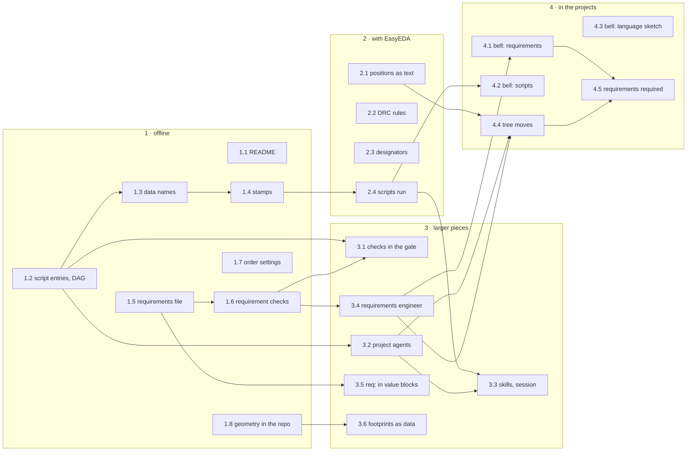

# Implementation plan: requirements, design as text, project scripts

Status 2026-10-28: plan; 1.1, 1.2, 1.3, 1.5, 1.6 and 1.7 are done. It builds the three concepts of this folder after the
user took their decisions on 2026-10-28 (e5caf42, 301fd90): [requirements.md](requirements.md),
[design-as-text.md](design-as-text.md) and [project-scripts.md](project-scripts.md). Each step starts when the user asks
for it.

## Ground rules

- **One step, one branch.** A step is built with the skill add-feature, a new check with add-rule: a failing test
  first, then the interface, the code, the handbook, `pytest` and `ruff`. It goes to main when the user says so, after
  a notice to pytree-27; then the shared tree follows, and the plugin when skills or code changed.
- **No key, no change.** Every new key, file and check leaves a project without it as it is. The bell and the
  reference project change only at the user's request, in their own repositories.
- **Hashes are named.** A step that changes a hash says which one, and for which sign-offs (table at the end).
- **The bell is told.** All sessions run the edakit of the shared tree. The user decided on 2026-10-28 not to wait for
  the bell's order: a step goes to main when it is ready, and one that changes the bell's gate result or hashes is
  announced to the bell's session first.
- **EasyEDA steps in one sitting.** Steps that need EasyEDA take its claim, probe on a throwaway document (working
  agreement 18) and run together while EasyEDA is free.
- **This file is the list.** The state of each step is in the overview; a finished step names its commit.

## Overview

| Step | What | Concept, decision | Size | EasyEDA | Waits for | State |
| --- | --- | --- | --- | --- | --- | --- |
| 1.1 | README: "circuit design as code", with "Status and limits" | design-as-text 1, 2 | S | no | – | done (ef6b2aa) |
| 1.2 | Read `[scripts.*]` and check that they resolve into a DAG | project-scripts block 1, decision 1 | M | no | – | done (37376e8) |
| 1.3 | Names for edakit's data, each with a hash | project-scripts block 2 | S | no | 1.2 | done (74279e8) |
| 1.4 | Stamps in `hardware/scripts.lock`; `edakit scripts` | project-scripts block 3, decision 2 | M | no | 1.3 | open |
| 1.5 | Requirements: format, parser, `edakit req` | requirements order 1, decisions 1–3 | M | no | – | done (ba4d28b, f7adcf4) |
| 1.6 | Requirements: checks, protocol section, `accept` lines, circuit hash | requirements order 2, decisions 4, 6, 8 | M | no | 1.5 | done (384385e) |
| 1.7 | `[order]`: mask and print colour, thickness from `thickness_mm` | design-as-text, smaller findings | S | no | – | done (80c750e) |
| 1.8 | The footprint geometry in the repository | project-scripts block 5, decision 5 | S | no | – | open |
| 2.1 | Positions of the auto-layout as text, one-time takeover, every part in the plan | design-as-text gap 1, decisions 3, 4 | M | yes | – | open |
| 2.2 | Rule set of EasyEDA's DRC | design-as-text decision 6 | S–M | yes | – | open |
| 2.3 | Positions of single designators in `[silk]` | design-as-text, smaller findings | S | yes | – | open |
| 2.4 | Outdated inputs run first; `edakit run` | project-scripts block 4, decision 7 | M | yes | 1.4 | open |
| 3.1 | Checks in the gate: `at`, phase `acceptance`; then `verify = script` | project-scripts block 6 | M | no | 1.2, 1.6 | open |
| 3.2 | Project agents: `[agents.*]`, `replaces`, their sign-offs required | project-scripts block 7, decisions 10, 11 | M | no | 1.2 | open |
| 3.3 | Skills and the SessionStart hook use `edakit scripts` | project-scripts block 8 | S–M | no | 2.4, 3.2 | open |
| 3.4 | Skill `requirements`, agent `requirements-engineer`, reviewers read the file | requirements order 3, decision 7 | M | no | 1.6 | open |
| 3.5 | `req:` as a source of value blocks | requirements order 4 | S | no | 1.5 | open |
| 3.6 | Own footprints as data in the parts entry | design-as-text gap 2, decision 5 | L | yes | 1.8 | open |
| 4.1 | Bell: requirements file | requirements order 5, decision 9 | M | no | 3.4, the bell's order | open |
| 4.2 | Bell: entries for `kunst` and `tdisplay` | project-scripts example | S | no | 2.4 | open |
| 4.3 | Bell: the circuit as a language and as TOML with names, then the choice | design-as-text decision 8 | M | no | – | open |
| 4.4 | Tree: its positions, scripts, agents and requirements | all three | M | yes | the tree's move, 2.1, 3.2, 3.4 | open |
| 4.5 | The requirements file becomes required | requirements decision 5 | S | no | 4.1, 4.4 | open |

S, M and L are the sizes the concepts give: small, medium, large.

## Phase 1: offline

**1.1 README.** The paragraph of design-as-text ("Circuit design as code. Everything a board is made of …") goes to
the head of `README.md`. "Status and limits" lists what is not text yet: the positions of the auto-layout (2.1), own
footprints (3.6), the DRC rule set (2.2), mask and print colour (1.7), single designators (2.3), and the two clicks
in EasyEDA. Each later step removes its line. Documentation only, so it may go to main at once.

**1.2 Script entries.** `edakit/config.py` reads `[scripts.<name>]` with the fields of the concept; a new module
resolves them together with edakit's fixed steps and reports R1–R9 in `edakit check`. `[[release.stages]]` and
`sim_plugin` count as the kinds `check` and `sim`, and the old keys keep working. Tests: one fault per rule, as the
concept's prototype did with 28 copies. The prototype is kept in
[prototypes/project-scripts](prototypes/project-scripts/); its README names what the decisions changed since.
Its rules and cases become `tests/test_scripts.py`.

**1.3 Data names.** `graph`, `parts`, `sim`, `board:<b>`, `footprints:<b>`, `routing:<b>`, `mech:<b>`, `gerber:<b>`,
`release` and `firmware`, each with its hash; `gerber:<b>` takes `fab_layers` of the fab hash. To settle on the way:
the name for the project library that `easyeda` scripts change (the concept proposes `project-library:<b>`).

**1.4 Stamps.** `hardware/scripts.lock` holds per script the hashes of its `reads` and of the script itself at its
last run, as `edakit sim` stamps its result (`inputs_sha256`). A difference is a finding in `edakit check` and in the
gate, with the `about` sentence. `edakit scripts` lists every script with `about` and its state: current, outdated,
never run.

**1.5 Requirements file.** `[project] requirements` (default: none) names `hardware/requirements.toml`; a variant
names the main project's file and its own. The parser reads `[[need]]` and `[[requirement]]`: `id`, `text`, `from`,
`binding`, `verify`, `status`, `reason`. `edakit req` lists them with status and evidence; `edakit req R-4` shows one
chain. The file covers only the circuit (decision 3). Test in `led-bar` with a small file.

**1.6 Requirement checks.** New catalog checks with add-rule: every reference resolves, every accepted need has a
requirement, every requirement has evidence, drafts warn. `must` without passing evidence blocks the release,
`should` warns, `may` informs. The gate protocol gets a section "Requirements"; `accept` steps join the acceptance
list of section 6 with their ID; the file joins the circuit hash byte for byte. The catalog letter for the new checks
must not be R or N, the prefixes of the requirement IDs. `verify = script` reports "not evaluated yet" until 3.1.

**1.7 Order settings.** `[order]` gets the colours of solder mask and silkscreen; the thickness comes from
`thickness_mm`, which feeds only the mechanical model today. F-6 and `order.md` name them.

**1.8 Geometry in the repository.** `pcb_geometry_<b>.json` moves from `build/` to a versioned place, so CI and a
fresh clone can compute the layout hash. The path counts in the hash, so the layout hash changes once and sign-offs
with scope `layout` are recorded again. The bell's M-5 has scope `fab` (D-20) and keeps counting.

## Phase 2: with EasyEDA

**2.1 Positions as text.** In this order:

1. `edakit pcb autolayout` writes position, rotation and side of every part it placed as `auto = true` rows into
   `[place]` of the board file, with `write_place_rows` from #57 (decision 3).
2. A one-time takeover reads the positions of a board placed before from EasyEDA and writes them as fixed rows,
   without a new auto-layout.
3. A check in stage L, as an error: every part of the graph has a row (decision 4). `led-bar` lacks D1 and R2 and
   gets them first; the bell has all 19 parts on all four boards.

The bell's session is told first, since board files change.

**2.2 DRC rules.** First a probe on a throwaway document of what `PCB_Drc` carries. Reading works
(`getCurrentRuleConfiguration`, with the bridge's return depth 12), and net rules can be written
(`overwriteNetRules`). If a whole rule set can be written, edakit writes it from the board file; otherwise it reads it
and checks it against the board file (decision 6).

**2.3 Single designators.** A position per designator in `[silk]`, as `[place]` has one per part; `silk apply` keeps
it.

**2.4 Scripts run.** `pcb apply`, `silk apply` and `gate` run the outdated `input` scripts they read first
(decision 7). `edakit run <name>` runs one script; an `easyeda` script runs only so, under the EasyEDA claim, and what
it changes makes the steps after it outdated.

## Phase 3: the larger pieces

**3.1 Checks in the gate.** A `check` script gets its place (`at`: before S, or after F to see the run's Gerber data)
and its phase (`export`, `order`, `acceptance`); `advisory` only warns. With this, `verify = script` of the
requirements counts.

**3.2 Project agents.** `[agents.<name>]` with `file`, `about`, `signs`, `replaces`, `scope`, `phase`, `after`, and
the rules R10 and R11. The gate requires their sign-offs. With `replaces`, a project's agent signs M-1, M-5 or M-6 in
place of edakit's and takes over the round review too.

**3.3 Skills and the session.** `start`, `pcb-round`, `hardware-change`, `release` and `new-project` call
`edakit scripts` at their steps and start project agents at their hook points. The SessionStart hook (#74) lists the
scripts with their `about`.

**3.4 Requirements engineer.** The skill `requirements` collects in the conversation, asks back in a decision round,
writes drafts and has them approved. The agent `requirements-engineer` makes the inventory and gives a second opinion;
it changes nothing. `circuit-design` §1 reads the file. The electrical reviewer judges the requirements with
`signoff = "M-1"`, the PCB reviewer those with M-5, the regulatory reviewer those with M-6. The plugin test that lets
the reviewer prompts name only catalog IDs learns N- and R-.

**3.5 `req:` in value blocks.** Documents in `[docs] files` quote a requirement by its ID, and G-19 finds a stale
quote (#71).

**3.6 Footprints as data.** The parts entry gets a footprint as data: origin, pads as `part import` caches them,
outline and print. A command builds the project's copy (a system part as carrier, then rebuilt), a check holds the
copy to the data, and a library footprint can become an own one. The data counts in the circuit hash, because M-1
checks polarity, and in the layout hash (decision 5). It would replace the bell's `tdisplay_device.py` and the tree's
`led_footprints.py`.

## Phase 4: in the projects

Each at the user's request, in the project's repository.

**4.1 Bell: requirements.** After its order: the agent's inventory, a decision round (the servo supply, D-3 against
the README), the file, only for the circuit. M-1 and M-6 open again, as decision 9 expects.

**4.2 Bell: scripts.** `kunst` for all four configurations and `tdisplay` for esp32, as in the concept's example.

**4.3 Bell: language sketch.** The whole bell written down twice, as a language of its own and as TOML with pin
names; then the user chooses (decision 8). Building the language would be a step of its own, size L.

**4.4 The tree moves.** When the reference project moves to edakit after its order (EK-1 of its concept): the
takeover of its positions (2.1), seven of its eight scripts – `review` only reads the release (decision 8) – with
`platine` writing into `tree.toml` (decision 4), its agents `elektrotechniker` and `pcb-pruefer` with `replaces`, and
its requirements file.

**4.5 Requirements required.** Once the bell and the tree have a file, a project without one fails the gate
(decision 5).

## Hashes and gate results

| Step | Circuit hash | Layout hash | Gate result |
| --- | --- | --- | --- |
| 1.6 | adds `requirements.toml`, where a project names it | – | new rows; `must` without evidence blocks, only in projects with the file |
| 1.8 | – | changes once (the geometry's path) | – |
| 2.1 | – | changes when rows are written | a new error for parts without a row |
| 3.2 | – | – | a project agent's sign-off is required, where a project registers one |
| 3.6 | changes where footprint data is added | changes likewise | a new check: the copy equals the data |
| 4.5 | – | – | a missing requirements file blocks |

## Working in parallel

Three tracks can run side by side, each in its own worktree:

- project scripts: 1.2 → 1.3 → 1.4 → 2.4 → 3.1, 3.2 → 3.3;
- requirements: 1.5 → 1.6 → 3.4 → 3.5;
- design as text: 1.1, 1.7, 1.8, 2.1–2.3, 3.6.

They meet in `edakit/release/gate.py` (1.6, 1.8, 3.1, 3.2, 4.5) and `edakit/config.py` (1.2, 1.5, 1.7, 2.3, 3.2).
Steps that share one of these files go to main one after the other, and the next one is rebased first.

## Start

1. 1.1, the README: documentation only, may go to main at once.
2. 1.2 and 1.5 side by side on branches. They need neither EasyEDA nor the bell.
3. Each step goes to main when it is ready; then 1.8 and 2.1.
