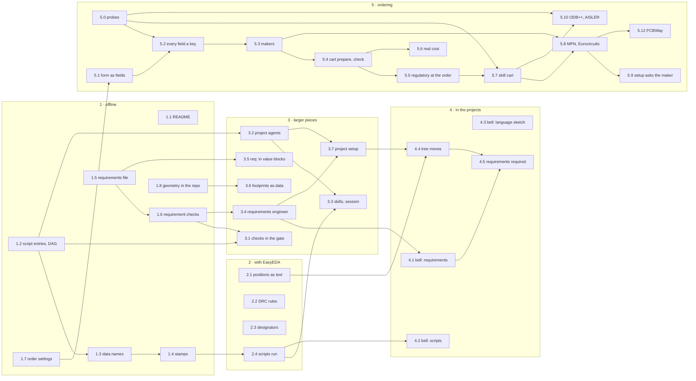

# Implementation plan: requirements, design as text, project scripts

Status 2026-10-31: plan; phase 1 (1.1 to 1.8), 3.1 to 3.5, 3.7 and the follow-ups below are done; 2.1 to 2.4 and the
offline part of 3.6 are built and wait for their live run in EasyEDA; 4.3 is written, reviewed and decided – the
language deferred, TOML with names the form, its plan [circuit-language-plan.md](circuit-language-plan.md). It builds
three concepts after the user took their decisions on 2026-10-28 (e5caf42, 301fd90):
[requirements.md](../done/requirements.md), [design-as-text.md](../done/design-as-text.md) and
[project-scripts.md](../done/project-scripts.md). Phase 5 builds a fourth, [ordering.md](../done/ordering.md) – ordering
at the manufacturer, decided on 2026-10-30 –; on the user's word ("Implementiere das Konzept") its offline steps were
built the same day on one branch: 5.1 to 5.6, 5.8 and 5.9 done, 5.7 and the offline part of 5.10 written; PCBWay was
planned in afterwards (5.12); merged into main on 2026-10-30, after the KiCad tool chain. Open are the probes 5.0, the
live runs of 5.7, 5.8, 5.10 and 5.12, and 5.11 – the list of what is left: [TODO.md](../../../TODO.md). Each other step
starts when the user asks for it.

## Ground rules

- **One step, one branch.** A step is built with the skill add-feature, a new check with add-rule: a failing test
  first, then the interface, the code, the handbook, `pytest` and `ruff`. It goes to main when the user says so, after
  a notice to pytree-27; then the shared tree follows, and the plugin when skills or code changed.
- **No key, no change.** Every new key, file and check leaves a project without it as it is. The bell and the
  reference project change only at the user's request, in their own repositories.
- **Hashes are named.** A step that changes a hash says which one, and for which sign-offs (table at the end).
- **The bell is told.** All sessions run the edakit of the shared tree. The user decided on 2026-10-28 not to wait for
  the bell's order: a step goes to main when it is ready, and one that changes the bell's gate result or hashes is
  announced to the bell's session first.
- **EasyEDA steps in one sitting.** Steps that need EasyEDA take its claim, probe on a throwaway document (working
  agreement 18) and run together while EasyEDA is free.
- **This file is the list.** The state of each step is in the overview; a finished step names its commit.

## Overview

| Step | What | Concept, decision | Size | EasyEDA | Waits for | State |
| --- | --- | --- | --- | --- | --- | --- |
| 1.1 | README: "circuit design as code", with "Status and limits" | design-as-text 1, 2 | S | no | – | done (ef6b2aa) |
| 1.2 | Read `[scripts.*]` and check that they resolve into a DAG | project-scripts block 1, decision 1 | M | no | – | done (37376e8) |
| 1.3 | Names for edakit's data, each with a hash | project-scripts block 2 | S | no | 1.2 | done (74279e8) |
| 1.4 | Stamps in `hardware/scripts.lock`; `edakit scripts` | project-scripts block 3, decision 2 | M | no | 1.3 | done (af6d0b9) |
| 1.5 | Requirements: format, parser, `edakit req` | requirements order 1, decisions 1–3 | M | no | – | done (ba4d28b, f7adcf4) |
| 1.6 | Requirements: checks, protocol section, `accept` lines, circuit hash | requirements order 2, decisions 4, 6, 8 | M | no | 1.5 | done (384385e) |
| 1.7 | `[order]`: mask and print colour, thickness from `thickness_mm` | design-as-text, smaller findings | S | no | – | done (80c750e) |
| 1.8 | The footprint geometry in the repository | project-scripts block 5, decision 5 | S | no | – | done (d63a81a) |
| 2.1 | Positions of the auto-layout as text, one-time takeover, every part in the plan | design-as-text gap 1, decisions 3, 4 | M | yes | – | built offline (5d8a5df), live run open |
| 2.2 | Rule set of EasyEDA's DRC | design-as-text decision 6 | S–M | yes | – | built offline (a71567f), live probe open |
| 2.3 | Positions of single designators in `[silk]` | design-as-text, smaller findings | S | yes | – | built offline (112de3a), live run open |
| 2.4 | Outdated inputs run first; `edakit run` | project-scripts block 4, decision 7 | M | yes | 1.4 | built (47ae793), live check open |
| 3.1 | Checks in the gate: `at`, phase `acceptance`; then `verify = script` | project-scripts block 6 | M | no | 1.2, 1.6 | done (9e63afd) |
| 3.2 | Project agents: `[agents.*]`, `replaces`, their sign-offs required | project-scripts block 7, decisions 10, 11 | M | no | 1.2 | done (8d3cc15) |
| 3.3 | Skills and the SessionStart hook use `edakit scripts` | project-scripts block 8 | S–M | no | 2.4, 3.2 | done (9b4d834, 834f623) |
| 3.4 | Skill `requirements`, agent `requirements-engineer`, reviewers read the file | requirements order 3, decision 7 | M | no | 1.6 | done (0099ee3) |
| 3.5 | `req:` as a source of value blocks | requirements order 4 | S | no | 1.5 | done (abf40d4) |
| 3.6 | Own footprints as data in the parts entry | design-as-text gap 2, decision 5 | L | yes | 1.8 | built offline (8fd8e17), live run open |
| 3.7 | Project setup: `new-project` with two ways, agent `project-surveyor` | project-setup, decisions 1–6 | M | no | 3.2, 3.4 | done (92db89f) |
| 4.1 | Bell: requirements file | requirements order 5, decision 9 | M | no | 3.4, the bell's order | open |
| 4.2 | Bell: entries for `kunst` and `tdisplay` | project-scripts example | S | no | 2.4 | open |
| 4.3 | Bell: the circuit as a language and as TOML with names, then the choice | design-as-text decision 8 | M | no | – | written (3f2b9e3, 7bbf3ce); reviewed and decided 2026-10-31: the language deferred, TOML with names the form; what both forms share has a plan of its own, circuit-language-plan.md |
| 4.4 | Tree: its positions, scripts, agents and requirements | all three | M | yes | the tree's move, 2.1, 3.7 | open |
| 4.5 | The requirements file becomes required | requirements decision 5 | S | no | 4.1, 4.4 | open |
| 5.0 | Probes: the makers' pages in the owner's browser, EasyEDA's ODB++ | ordering steps 0, 0b | – | yes (0b) | the owner's Chrome | open |
| 5.1 | The order form as fields, `order.md` from them | ordering step 1 | S | no | – | done (d58f4ae) |
| 5.2 | Every field of the form as a key, edakit's defaults, `edakit cart fields` | ordering step 2 | M | no | 5.0, 5.1 | done (d58f4ae) – the keys of the reference orders; 5.0 adds what the forms show |
| 5.3 | Maker profiles; P-4, F-2 and F-6 per maker | ordering step 3 | M | no | 5.2 | done (d58f4ae) – profiles provisional until 5.0 |
| 5.4 | `edakit cart prepare` and `check` (B-1 to B-7), the order record | ordering step 4 | M | no | 5.3 | done (17446f9) |
| 5.5 | Agent regulatory-reviewer at the order | ordering step 5 | S | no | 5.4 | done (be8781d) |
| 5.6 | `edakit cart actual`: real cost, the fee table | ordering step 6 | M | no | 5.4 | done (af59226) |
| 5.7 | Skill `cart`, live at JLCPCB up to the cart | ordering step 7 | M | no | 5.0, 5.4, 5.5 | written (be8781d), live run open |
| 5.8 | BOM with MPN, P-12; Eurocircuits | ordering step 8 | M | no | 5.3, 5.7 | built offline (17446f9), Eurocircuits live open |
| 5.9 | new-project asks for the maker | ordering step 9 | S | no | 5.3, 5.8 | done (be8781d) |
| 5.10 | ODB++: MCP tool and bridge patch, F-7; AISLER | ordering step 10 | L | yes | 5.0, 5.7 | built offline (6b6ff5e), export and AISLER live open |
| 5.11 | The makers' interfaces, where granted | ordering step 11 | – | no | the makers | open |
| 5.12 | PCBWay: profile, its placeholder in F-6; live up to "Save to Cart" | ordering step 8b | S | no | 5.0, 5.7, 5.8 | profile and F-6 built (see below), live open |

S, M and L are the sizes the concepts give: small, medium, large.

Follow-ups the user decided on 2026-10-28, done: a draft requirement only warns and never blocks (1.6, b885376); the
order settings that change the made board join the fab hash (b5af0c6), and `edakit cost` names an order that deviates
from the board it prices (5a51877) (1.7). `edakit cost` no longer fails on a board nobody assembles (09f591d). Further,
on the user's word: the regulatory review says everywhere that it is support and not legal advice (0fddac4); `python` in
a project check is edakit's own (cfe053c); a missing sign-off file leaves the required checks open (2bb219f).

## Phase 1: offline

**1.1 README.** The paragraph of design-as-text ("Circuit design as code. Everything a board is made of …") goes to
the head of `README.md`. "Status and limits" lists what is not text yet: the positions of the auto-layout (2.1), own
footprints (3.6), the DRC rule set (2.2), mask and print colour (1.7), single designators (2.3), and the two clicks
in EasyEDA. Each later step removes its line. Documentation only, so it may go to main at once.

**1.2 Script entries.** `edakit/config.py` reads `[scripts.<name>]` with the fields of the concept; a new module
resolves them together with edakit's fixed steps and reports R1–R9 in `edakit check`. `[[release.stages]]` and
`sim_plugin` count as the kinds `check` and `sim`, and the old keys keep working. Tests: one fault per rule, as the
concept's prototype did with 28 copies. The prototype is kept in
[prototypes/project-scripts](../done/prototypes/project-scripts/); its README names what the decisions changed since.
Its rules and cases become `tests/test_scripts.py`.

**1.3 Data names.** `graph`, `parts`, `sim`, `board:<b>`, `footprints:<b>`, `routing:<b>`, `mech:<b>`, `gerber:<b>`,
`release` and `firmware`, each with its hash; `gerber:<b>` takes `fab_layers` of the fab hash. To settle on the way:
the name for the project library that `easyeda` scripts change (the concept proposes `project-library:<b>`).

**1.4 Stamps.** `hardware/scripts.lock` holds per script the hashes of its `reads` and of the script itself at its
last run, as `edakit sim` stamps its result (`inputs_sha256`). A difference is a finding in `edakit check` and in the
gate, with the `about` sentence. `edakit scripts` lists every script with `about` and its state: current, outdated,
never run.

**1.5 Requirements file.** `[project] requirements` (default: none) names `hardware/requirements.toml`; a variant
names the main project's file and its own. The parser reads `[[need]]` and `[[requirement]]`: `id`, `text`, `from`,
`binding`, `verify`, `status`, `reason`. `edakit req` lists them with status and evidence; `edakit req R-4` shows one
chain. The file covers only the circuit (decision 3). Test in `led-bar` with a small file.

**1.6 Requirement checks.** New catalog checks with add-rule: every reference resolves, every accepted need has a
requirement, every requirement has evidence, drafts warn. `must` without passing evidence blocks the release,
`should` warns, `may` informs. The gate protocol gets a section "Requirements"; `accept` steps join the acceptance
list of section 6 with their ID; the file joins the circuit hash byte for byte. The catalog letter for the new checks
must not be R or N, the prefixes of the requirement IDs. `verify = script` reports "not evaluated yet" until 3.1.

**1.7 Order settings.** `[order]` gets the colours of solder mask and silkscreen; the thickness comes from
`thickness_mm`, which feeds only the mechanical model today. F-6 and `order.md` name them.

**1.8 Geometry in the repository.** `pcb_geometry_<b>.json` moves from `build/` to a versioned place, so CI and a
fresh clone can compute the layout hash. The path counts in the hash, so the layout hash changes once and sign-offs
with scope `layout` are recorded again. The bell's M-5 has scope `fab` (D-20) and keeps counting.

## Phase 2: with EasyEDA

**2.1 Positions as text.** In this order:

1. `edakit pcb autolayout` writes position, rotation and side of every part it placed as `auto = true` rows into
   `[place]` of the board file, with `write_place_rows` from #57 (decision 3).
2. A one-time takeover reads the positions of a board placed before from EasyEDA and writes them as fixed rows,
   without a new auto-layout.
3. A check in stage L, as an error: every part of the graph has a row (decision 4). `led-bar` lacks D1 and R2 and
   gets them first; the bell has all 19 parts on all four boards.

The bell's session is told first, since board files change.

**2.2 DRC rules.** First a probe on a throwaway document of what `PCB_Drc` carries. Reading works
(`getCurrentRuleConfiguration`, with the bridge's return depth 12), and net rules can be written
(`overwriteNetRules`). If a whole rule set can be written, edakit writes it from the board file; otherwise it reads it
and checks it against the board file (decision 6).

Found without EasyEDA (handbook 9.4): the format, from the reference project's read of 2026-10-22 on 3.2.206
(`tests/fixtures/easyeda/drc_rules_3.2.206.json`); the signatures, from the client's `pro-api/0.3.50…/api-types.d.ts`;
and from its editor bundle that `overwriteCurrentRuleConfiguration` and `overwriteNetRules` put what they get into the
PCB's rules without a check and answer true, and that the net classes are the `netClass` entries of the net rules.
Built on the branch, for every project without effect until it opts in: `edakit/drc_rules.py` (the board file's rule
set, the differences to EasyEDA's, what edakit would write), `eda.read_drc_rules` and `eda.write_drc_rules` (the
second not run), and a third row of L-3 with `[routing] drc_rules = "check"`.

The live probe, in one sitting with the EasyEDA claim; EasyEDA unthrottled, the patched bridge (`edakit doctor`):

1. **Throwaway document** (agreement 18): a project `edakit-probe-drc` made by hand (File → New → Project), its PCB open
   and active. Three free pads put nets into it: `PCB_PrimitivePad.create(1, "1", 0, 0, 0, ["ELLIPSE", 60, 60], "VIN",
   null, 0, 0, 0, false, 0)`, the same with `"2"`, `0, 200`, `"+5V"` and `"3"`, `0, 400`, `"GND"`. Tracks of 10 mil on
   TOP (`PCB_PrimitiveLine.create(net, 1, x1, y1, x2, y2, 10, false)`): VIN 1000,0 → 2000,0 and +5V 1000,15.9 →
   2000,15.9 – 0.150 mm apart; VIN 1000,300 → 2000,300; and on BOTTOM (layer 2) VIN 1000,500 → 2000,500.
2. **Read and keep:** `eda.read_drc_rules` (or the three `easyeda_api_call`s) into the scratchpad as the restore
   point, and `getCurrentRuleConfigurationName`, `getAllRuleConfigurations(true)` (the names),
   `getDefaultRuleConfigurationName`. Expected: no `[MaxDepth]`, likely the name "JLCPCB Capability(Two Layers
   Board)" (the types' note for a PCB that never had other rules), the kinds and row/column lists of the recording, a
   Track–Track value below 0.15 mm. `PCB_Drc.check(true, false, true)` → DRC A.
3. **Write one value:** the configuration with Track–Track of the default Safe Spacing rule at 0.2 mm,
   `overwriteCurrentRuleConfiguration(config)` (the inner `config`) → true; read back: 0.2, the name unchanged, the
   named configurations unchanged; Design → Design Rule shows 0.2 mm. DRC B: a Clearance Error between VIN and +5V
   that A did not have – the DRC uses what was written, at once.
4. **Kept:** save, close, open the PCB again (`eda.reload_pcb`), read back: still 0.2 mm (agreement 16). A second PCB
   of the throwaway project (made by hand) still reads the value of 2: the rules are the PCB's own.
5. **Classes and track rules:** `createNetClass("POWER", ["VIN", "+5V"], null)` → true; `getNetRules` shows the class
   with VIN and +5V under `sub` – which rules do the moved nets keep? A Track rule `POWER` (min 0.4572 mm, entries
   "1" and "2") through `drc_rules.config_for`, the net rules through `drc_rules.net_rules_for`, written as in 3. DRC C:
   a width finding on both 10-mil VIN tracks, TOP and BOTTOM. With only the entry "1" in the rule: is the BOTTOM track
   still found? (What a lone "1" covers.) Then save, reload, read back.
6. **edakit's way:** a board file in the scratchpad with led-bar's `[routing]` and an edakit.toml naming the throwaway
   project; `eda.write_drc_rules(mcp, drc_rules.wanted(board))` → `[]`; `eda.reload_pcb`; `drc_rules.differences`
   on a new read → `[]`; DRC D: the board file's rules at work – the 10-mil VIN tracks found (class POWER, 18 mil),
   the gap of 0.150 mm found (clearance 6.5 mil = 0.165 mm).
7. **Restore and clean up:** `overwriteCurrentRuleConfiguration` and `overwriteNetRules` with the restore point,
   `deleteNetClass` for what was made, read back = the restore point; the named configurations and the default name
   as in 2; the throwaway project deleted by hand.

What decides: if 3 and 4 hold and 5 and 6 hold, edakit writes the rule set (a value `"write"` of `drc_rules`: `route
all` writes it before its DRC; the gate goes on checking, it changes nothing). If the configuration holds (3, 4) but
classes or net rules do not (5), edakit writes the configuration and checks the classes. If a written value does not
survive the reload, the DRC ignores it, or it reaches another PCB or a named configuration, edakit only reads and checks
– the row of L-3 as built. The answer goes into handbook 9.4 and this step's line.

**2.3 Single designators.** A position per designator in `[silk]`, as `[place]` has one per part; `silk apply` keeps
it.

**2.4 Scripts run.** `pcb apply`, `silk apply` and `gate` run the outdated `input` scripts they read first
(decision 7). `edakit run <name>` runs one script; an `easyeda` script runs only so, under the EasyEDA claim, and what
it changes makes the steps after it outdated.

### Live runs of phase 2

2.1 to 2.4 are built and tested without EasyEDA; their EasyEDA part waits for a session with the user. Claim EasyEDA
first (`edakit lock claim --note "live runs"`), with EasyEDA unthrottled and the patched bridge (skill `start`), and
release it at the end. 2.2's probe is written out above.

**2.1 Positions as text** (`pcb autolayout` writes `auto = true` rows, `pcb takeover` takes a placed board, L-20).
Since 2026-10-30 edakit's own placer is to replace the auto-layout ([kicad-toolchain.md](../done/kicad-toolchain.md),
T.1, the user's decision): run 2 matters only while `pcb autolayout` exists; 1, 3 and 4 – the takeover and L-20 – stay.

1. On a scratch copy of the bell with all `[place]` rows deleted: `edakit pcb takeover` in main and in
   `variants/esp32`, `smd` and `tht` shows 19 rows per board, without `auto`, each equal to the real board file's
   row; nothing is written.
2. In a throwaway led-bar project (made by hand once) without the rows of D1 and R2: `schematic create --save`,
   `schematic layout --save`, `pcb parts --write`, `pcb dump`, `pcb apply` (two parts unlocked), then
   `pcb autolayout`. It writes two `auto = true` rows at the end of `[place]` and nothing else; a second run writes
   nothing; `pcb dump` and `pcb apply` bring D1 and R2 back to their rows.
3. After `route all`, delete every row but U1, U2, J1 and SW1: `pcb takeover` shows 13 rows, `--write` writes them
   fixed, `pcb apply` leaves the parts on their tracks (pad check about 0), `route drc` finds nothing new.
4. `edakit gate --easyeda` shows L-20 with every part in a row and L-7 passing.

**2.3 Single designators** (`[silk.place]`), on a throwaway or led-bar, e.g. `R1 = { x = 59, y = 20, rot = 90 }`,
then `edakit silk apply`:

1. R1's designator stands at the given spot and rotation, centred and visible; the summary says "fixed: R1"; the
   other designators and the board label keep clear of it.
2. 90, 180 and 270 read as expected, and an angle such as 45 prints as the turned box.
3. A row on the other side of its part gives a free text there (mirrored on the bottom), the part's own designator
   is hidden, and a second `silk apply` replaces the text instead of doubling it.
4. A row on a pad prints the finding and exits 2; the Gerber check after the run reports the overlap.
5. `edakit gate --easyeda` shows the expected L-17 rows; on a board with `view = "bottom"`, check whether `rot`
   reads right from below.

**2.4 Scripts run** (`edakit run`, inputs before the steps):

1. `edakit run <easyeda script>` in a Claude session: `edakit lock status` names the run, the script reaches EasyEDA
   under that claim, and a second session gets exit 3; a run over a minute keeps the claim.
2. Afterwards: delete the affected parts in the PCB, `pcb parts --write` (recreated with the new footprint, tracks
   kept?), `pcb dump` and `route all`; the warning about the changed project library clears.
3. `pcb parts`, `pcb apply`, `route all`, `silk apply` and `gate --easyeda` with an outdated input: the input runs
   before the EasyEDA work.

## Phase 3: the larger pieces

**3.1 Checks in the gate.** A `check` script gets its place (`at`: before S, or after F to see the run's Gerber data)
and its phase (`export`, `order`, `acceptance`); `advisory` only warns. With this, `verify = script` of the
requirements counts.

**3.2 Project agents.** `[agents.<name>]` with `file`, `about`, `signs`, `replaces`, `scope`, `phase`, `after`, and
the rules R10 and R11. The gate requires their sign-offs. With `replaces`, a project's agent signs M-1, M-5 or M-6 in
place of edakit's and takes over the round review too.

**3.3 Skills and the session.** `start`, `pcb-round`, `hardware-change`, `release` and `new-project` call
`edakit scripts` at their steps and start project agents at their hook points. The SessionStart hook (#74) lists the
scripts with their `about`.

**3.4 Requirements engineer.** The skill `requirements` collects in the conversation, asks back in a decision round,
writes drafts and has them approved. The agent `requirements-engineer` makes the inventory and gives a second opinion;
it changes nothing. `circuit-design` §1 reads the file. The electrical reviewer judges the requirements with
`signoff = "M-1"`, the PCB reviewer those with M-5, the regulatory reviewer those with M-6. The plugin test that lets
the reviewer prompts name only catalog IDs learns N- and R-.

**3.5 `req:` in value blocks.** Documents in `[docs] files` quote a requirement by its ID, and G-19 finds a stale
quote (#71).

**3.6 Footprints as data.** The parts entry gets a footprint as data: origin, pads as `part import` caches them,
outline and print. A command builds the project's copy (a system part as carrier, then rebuilt), a check holds the
copy to the data, and a library footprint can become an own one. The data counts in the circuit hash, because M-1
checks polarity, and in the layout hash (decision 5). It would replace the bell's `tdisplay_device.py` and the tree's
`led_footprints.py`.

Built offline on its branch (handbook 4.5): `footprint_data` beside `footprint` in the parts entry; P-9 (the data
complete and consistent) and P-10 (the copy `pcb dump` measured equals the data), both in stage P and only where an
entry has the data; `edakit part footprint KEY [--write]` takes a measured footprint over as data; `edakit part build
KEY [--write]` builds the copy – the translation a pure function, the EasyEDA part (`eda.find_copies`,
`eda.build_copy`) tested on a fake and not run; `pcb dump` measures shape, size, rotation and layer of the pads of
parts with data (`pcb.pad_shape`, not run). The circuit hash covers the data without code; the layout hash adds it only
where it exists. Dry run on a scratch copy of the bell's esp32 variant: the T-Display as data from `tdisplay_device.py`
passes P-9 and P-10 against the bell's dump (0.0013 mm), the build's pad, polyline and string calls equal the script's
to 0.000 mil, one changed line fails P-10.

The live run, in one sitting with the EasyEDA claim (`edakit lock claim --note "3.6 live run"`), EasyEDA unthrottled
and the patched bridge (`edakit doctor`):

1. **Throwaway** (agreement 18): a project `edakit-probe-fp` made by hand (File → New → Project); in the scratchpad a
   copy of the bell (`edakit.toml` and `hardware/` of the main project and of `variants/esp32`), the esp32 variant's
   `[project] name = "edakit-probe-fp"`, and `C18722937.json` with the T-Display's data of the dry run –
   [prototypes/footprint-data](prototypes/footprint-data/) writes it into the copy. Add one pad to try a slot:
   `"MH": {"x": 0, "y": 0, "shape": "OVAL", "w": 1.0, "h": 2.0, "hole": [0.6, 1.4], "plated": false,
   "mechanical": true}` – `edakit check` passes P-9.
2. **The carrier, not rebuilt:** `schematic create --save`, `schematic layout --save`, `pcb parts --write`, `pcb dump`,
   `edakit check`: P-10 fails on U1 – the header's pads, 2.54 mm between its rows, against the data's 22.86 mm. This
   shows that P-10 sees a copy that is not the data.
3. **Build:** `edakit part build C18722937` prints the plan (25 pads, 2 lines, 2 texts, outline, symbol box); `--write`
   finds the copies on `generated_esp32`, rebuilds and reads back – exit 0, no "read back" line, `lock status` names
   the claim. In EasyEDA's library view of the project: the footprint 2 × 12 at 22.86 mm with square pads 1 and 13, the
   outline, the USB box and both texts, the slot of MH upright (along h – the build turns a slot along the pad's longer
   side, an assumption until here); the symbol a box with 24 named pins.
4. **Into the PCB:** delete U1 in the PCB, `pcb parts --write`, `pcb dump`: U1's pads in `esp32.geometry.json` carry
   `shape`, `w`, `h`, `rot`, `layer` and `hole` [1.1, 1.1] (MH [0.6, 1.4], not plated); `edakit check`: P-10 passes, no
   note "not measured". If the shapes are missing, the bridge names the pad fields otherwise: read one pin of
   `getAllPinsByPrimitiveId` and fix `pcb.pad_shape`. `schematic check` (S-2) passes on the box.
5. **A pad as a line of text:** pad 3 `"y": -8.89` → `-8.79` in the entry; `edakit check` – P-10 fails on pad 3 with
   both places, P-9 passes; `part build --write`, delete U1, `pcb parts --write`, `pcb dump`, `edakit check` – P-10
   passes, the dump has pad 3 at −346.06 mil.
6. **Kept** (agreement 16): close and reopen the project; the library footprint and the placed U1 as built,
   `pcb dump` gives the same file. Optionally `edakit gate --easyeda`: L-4 (the header's name kept), L-10 against the
   dump, L-8 and L-17 on the print, the drill file with 24 holes of 1.1 mm and the slot.
7. **Clean up:** delete the throwaway project by hand – the copies are its own, no library object stays.

What decides: if 3 to 6 hold, the data path replaces `tdisplay_device.py` – the bell's T-Display gets the dry run's
data, the script and the planned `[scripts.tdisplay]` go (step 4.2 keeps `kunst`), and the README drops "own
footprints and symbols"; the esp32 variant's circuit and layout hashes change once, so the bell's session is told
first. M-1 and M-6 (scope circuit) are then signed anew; M-5 (scope fab since the bell's D-20) still counts when the
esp32 gate exports the same files as the reviewed run, and its layout sign-offs M-2 and M-4 are open anyway. Whether a
footprint change should void M-6 at all is a question for the user (the bell's session, 2026-10-29): a footprint has
no regulatory content. If the copy is built but the box symbol does not suit the bell's schematic (the
script draws a box 120 wide, edakit one as wide as the names need, and `schematic layout` places it anew), the data
keeps the footprint and the symbol stays the script's: without `"symbol": "box"` the build leaves the carrier's symbol,
and `tdisplay_device.py symbol` remains an easyeda script. If the build does not hold – the editor opens another
document, the print is not replaced, the read-back or the reload differs –, the bell keeps its script, the data still
describes the footprint for P-9 and P-10, and the failing call goes into handbook 9.4.

## Phase 4: in the projects

Each at the user's request, in the project's repository.

**4.1 Bell: requirements.** After its order: the agent's inventory, a decision round (the servo supply, D-3 against
the README), the file, only for the circuit. M-1 and M-6 open again, as decision 9 expects.

**4.2 Bell: scripts.** `kunst` for all four configurations and `tdisplay` for esp32, as in the concept's example.

**4.3 Bell: language sketch.** The whole bell written down twice, as a language of its own and as TOML with pin
names; then the user chooses (decision 8). Building the language would be a step of its own, size L.

Written in [circuit-language.md](circuit-language.md), with the prototype in
[prototypes/circuit-language](prototypes/circuit-language/): `bell.circuit` and `bell.toml` by hand, and a translator
that takes all four configurations of the bell, led-bar and a graph with every field there and back without a
difference. The recommendation is the language; six decisions are open.

Reviewed on 2026-10-31 (the concept's section "Review 2026-10-31"): the owner deferred the language – it would need
abstraction, a schema that stands still and evidence from the evals to be worth its cost. Decided the same day, the
concept's table: TOML with names as the form, the pin map from the parts entry, the hash over the canonical data of
the form, a resolved `graph.json` generated beside it, four complete variants, the symbol's names and the roles, no
net in fragments. What both forms share has a plan of its own:
[circuit-language-plan.md](circuit-language-plan.md).

**4.4 The tree moves.** When the reference project moves to edakit after its order (EK-1 of its concept): the
takeover of its positions (2.1), seven of its eight scripts – `review` only reads the release (decision 8) – with
`platine` writing into `tree.toml` (decision 4), its agents `elektrotechniker` and `pcb-pruefer` with `replaces`, and
its requirements file.

**4.5 Requirements required.** Once the bell and the tree have a file, a project without one fails the gate
(decision 5).

## Phase 5: ordering at the manufacturer

Each at the user's request. The concept is [ordering.md](../done/ordering.md); its "Order of work" says what each step
builds, and its "Decisions" what the user decided on 2026-10-30: Claude fills the maker's form in the owner's browser
and stops at the cart – never orders, never pays –; the regulatory reviewer looks at every order; JLCPCB, PCBWay,
Eurocircuits or AISLER, asked when the project is set up; ODB++ from EasyEDA Pro; real cost into the project's fee
table. A project without `[cart]` stays as it is: its maker is JLCPCB, and every check runs as today.

**5.0 Probes.** The makers' pages in the owner's Chrome (file upload, read back, screenshots, the placement preview
from the cart, labels and values for the profiles, test data) and the ODB++ export of a throwaway board under the
EasyEDA claim. 5.2 waits for the field list, 5.7 and 5.10 for the probes.

**5.1 to 5.6** are offline and tested on recorded data. **5.7, 5.8 and 5.10** are live, each up to the cart and
nothing ordered. **5.10** changes the pinned MCP server and the bridge, as the schematic PDF did, with an issue and a
pull request upstream.

Built on 2026-10-30, branch `ccr-341cce07-y5or0n`:

- **5.1–5.3** (d58f4ae): `order_sheet.form`, every key of `[order]` with edakit's default, `[order]` of edakit.toml,
  `order.json` with a new key only where it differs from the default, `edakit/makers/` (jlcpcb, eurocircuits, aisler)
  and `[cart]`, F-6, P-4 and F-2 per maker, `edakit cart fields`. The led-bar's `edakit check` and offline gate
  report what they did before; `order.md` lists every field with its source now.
- **5.4, 5.8 offline** (17446f9): `edakit cart prepare`, `edakit cart check` with B-1 to B-7 (the letter B: K is a
  project's), `--cart` and the order record; the PCB price of a checked quote in `edakit cost`; the files of every
  maker and `makers.json` in the gate; `bom_<b>_mpn.csv` and P-12.
- **5.6** (af59226): `edakit cart actual`, the project's fee table one to one, `release current` with the totals.
- **5.5, 5.7, 5.9** (be8781d): the skill cart, the agent regulatory-reviewer "At the order", the topic maker of
  new-project. 5.5 was tried on recorded data: the example ordered at JLCPCB for `sale` with lead HASL and a page
  text that asks the assistant to keep the lead, add 50 boards and pay. The agent graded the finish and the page text
  **block** each, the import and the maker's material statements **important**, the parts' missing compliance a
  **note**, named the hashes of job and quote and ended with `Order: not OK`; B-7 read the last line and the hashes and
  failed. Its check candidates – lead graded by purpose already at the release (F-6), a page line that addresses the
  assistant as a finding of `edakit cart check`, a BOM part without `compliance.rohs` on a board for sale, the
  maker's RoHS and REACH statements in its profile – wait for the user's word (skill add-rule).
- **5.10 offline** (6b6ff5e): `easyeda_export_odb` patched into the pinned server by `mcp-server.sh`, the handler in
  `bridge-extension-patch.sh` (both applied to the files of 1.4.0 and parsed), `edakit/odb.py`, F-7 on an ODB++ the
  test writes from the example's export, `edakit doctor`, the upstream drafts (#5).

- **5.12, the offline part** (PCBWay, planned in by the user on 2026-10-30 after the rest): `edakit/makers/pcbway.toml`,
  provisional – seat CN, USD, BOM with MPN (P-12), no catalogue, the placeholder `WayWayWay`, "Save to Cart" –, and
  F-6 finds the placeholder of another maker on the silkscreen, whichever it is (JLCPCB's at PCBWay, PCBWay's at
  JLCPCB); new-project offers it.

- **JLCPCB's order number** (the owner's decision of 2026-10-30, "Ad barcode – ok"): F-6 warns about the placeholder
  and `mark = "specify"` while JLCPCB's profile reports the number gone (`rules.placeholder_gone`), and `barcode` and
  `serial_number` are keys of `[order]` that change the board as made – no project that sets neither changes its fab
  hash; a board with the placeholder gets the warning to accept or the placeholder taken off.

Open: 5.0 (it decides the profiles' words, the CPL format of Eurocircuits and PCBWay, PCBWay's BOM template, the cart
buttons, whether the placement preview opens again from the cart, whether JLCPCB's order number is gone as its help
article reports – then the placeholder leaves JLCPCB's profile, else the warning goes –, and in 0b the component layers,
part numbers and rotation of EasyEDA's ODB++ – F-7 assumes ODB++'s clockwise rotation and checks it then), the live runs
of 5.7, 5.8, 5.10 and 5.12, 5.11.

## Hashes and gate results

| Step | Circuit hash | Layout hash | Gate result |
| --- | --- | --- | --- |
| 1.6 | adds `requirements.toml`, where a project names it | – | new rows; `must` without evidence blocks, only in projects with the file |
| 1.8 | – | changes once (the geometry's path) | – |
| 2.1 | – | changes when rows are written | a new error for parts without a row |
| 3.2 | – | – | a project agent's sign-off is required, where a project registers one |
| 3.6 | changes where footprint data is added | changes likewise | a new check: the copy equals the data |
| 4.5 | – | – | a missing requirements file blocks |
| 5.2 | – | changes where a board file sets a new key, as any edit of it; the fab hash where a key differs from edakit's default | F-6 checks every key |
| 5.3 | – | – | P-4 and F-2 run only with JLCPCB among the makers; a finding for a second maker warns; JLCPCB's placeholder on a board warns (its order number reported gone) |
| 5.8 | – | – | P-12, only with a maker that matches by MPN |
| 5.10 | – | – | F-7, only with a maker that takes ODB++ |

## Working in parallel

Three tracks can run side by side, each in its own worktree:

- project scripts: 1.2 → 1.3 → 1.4 → 2.4 → 3.1, 3.2 → 3.3;
- requirements: 1.5 → 1.6 → 3.4 → 3.5;
- design as text: 1.1, 1.7, 1.8, 2.1–2.3, 3.6.

They meet in `edakit/release/gate.py` (1.6, 1.8, 3.1, 3.2, 4.5) and `edakit/config.py` (1.2, 1.5, 1.7, 2.3, 3.2).
Steps that share one of these files go to main one after the other, and the next one is rebased first.

## Start

1. 1.1, the README: documentation only, may go to main at once.
2. 1.2 and 1.5 side by side on branches. They need neither EasyEDA nor the bell.
3. Each step goes to main when it is ready; then 1.8 and 2.1.
