# Project scripts and agents

Status 2026-10-28: being built; the state of each step is in [implementation-plan.md](implementation-plan.md). It was
checked against edakit `a8b6011` (with PRs #78 and #79); edakit had built pieces it builds on: the firmware contract
(#70), a stamp on the simulation result, the fab hash (#65) and the mechanical model (#62). All decisions are taken: 1–8
and 12 on 2026-10-28, 9 by #70. The rules that resolve a project's entries into a DAG were tried with a prototype on the
reference project and the Christmas bell ([prototypes/project-scripts](prototypes/project-scripts/)).

## Why

A project registers its own scripts in `edakit.toml`. edakit then runs them at the right time, notices outdated
results, and Claude knows what each one is for.

Today edakit knows project code in two places only: the project's own gate stages (`[[release.stages]]`) and the
simulation plugin. Every other script is run by the pre-commit hook, the CI, Claude following a skill, or a human. What
is known about it lives in skills, docstrings and READMEs.

That breaks as soon as a skill is replaced. The reference project's skill `pcb-iteration` runs `baum_druck.py` after
every routing, because the tree artwork keeps clear of the vias. When `/edakit:pcb-round` replaces that skill, nobody
runs it any more, and `edakit silk apply` places an outdated artwork.

## What is registered

Only what touches edakit's flow. A script belongs to it when it does at least one of these:

- write a file that edakit reads, such as the board file or artwork for the silkscreen
- derive something from edakit's data, such as the firmware's pin table, a picture for the documentation or the
  enclosure
- change EasyEDA, such as footprints in the project library
- hold up the release, as a check of its own

Everything else stays the project's business; in the reference project that is the calendar, music, versions and the
booklet.

## Kinds

Five kinds cover all eight groups that an inventory of the reference project and the Christmas bell found.

| Kind (`kind`) | When edakit runs it | Groups of the inventory | Examples |
| --- | --- | --- | --- |
| `input` | before a step reads its output, once an input has changed | 1 board file, 2 silkscreen artwork | reference project: `pcb_layout.py`, `bahnen_hinten.py`, `baum_druck.py`; bell: `make_art.py` |
| `derive` | `edakit check` reports outdated results, edakit makes them again | 4 derived files, 5 mechanics | `export_firmware.py`, pictures for the documentation, STL files of the stand |
| `check` | in the gate, at a fixed place and in a phase | 6 own gate stages, 8 acceptance after delivery | `sockel.py --pruefen` (stage K), camera test of the LEDs |
| `easyeda` | on command only, under the EasyEDA claim | 3 editing the EasyEDA library | `led_footprints.py`; bell: `tdisplay_device.py` |
| `sim` | in `edakit sim` | exists as `sim_plugin` | the reference project needs none any more |

Group 7, consumers of the release such as `review_paket.py`, does not fit: they only read what edakit made, and edakit
needs nothing from them (decision 8). The EasyEDA claim of the reference project's git coordination tool is
coordination, not a kind.

## The entry

An entry says what a script does, why it exists and what its result is made from. When it has to run, edakit works out
from that by itself, so nobody has to copy this rule by hand.

| Field | Needed | Meaning |
| --- | --- | --- |
| `kind` | always | `input`, `derive`, `check`, `easyeda` or `sim` |
| `cmd` | always | the command as a list, run in the project directory |
| `about` | always | one sentence why the script exists, citing a decision or concept |
| `reads` | `input`, `derive` | what the result is made from: files and edakit's own data. The script itself always counts |
| `writes` | `input`, `derive`, `easyeda` | what it makes: files, or edakit's own data |
| `after` | optional | scripts this one runs after. Needed when several scripts write the same file or change the same EasyEDA data; otherwise the order follows from `reads` and `writes` |
| `check` | optional | an exact check command, when the stamp is not enough |
| `id`, `phase`, `at`, `advisory` | `check` | ID in the protocol, phase (`export`, `order`, `acceptance`), place in the gate (before S or after F), warns only |

edakit's own data get fixed names, so that `reads` and `writes` can name them. `<b>` is the board's name; `release`
and `firmware` exist once per project.

| Name | What | Made by |
| --- | --- | --- |
| `graph`, `parts`, `sim` | graph, parts database, simulation scenarios | by hand, `edakit block`, `edakit part` |
| `board:<b>` | board file | by hand, `edakit pcb place --write` (rows with `auto = true`) or an `input` script |
| `project-library:<b>` | the project library in EasyEDA, which `pcb parts` takes the parts from | `edakit schematic create`, `easyeda` scripts |
| `footprints:<b>` | footprint geometry with pads (`<b>.geometry.json` beside the board file, step 1.8) | `edakit pcb dump` |
| `routing:<b>` | tracks and vias | `edakit route` |
| `mech:<b>` | the board as a mechanical model (`<artifacts>/mech_<b>.json`, #62) | `edakit pcb plan` |
| `gerber:<b>` | the gate run's manufacturing files, hashed per file (`fab_layers`, #65) | `edakit gate`, stage F |
| `release` | the current release, one per project (#64) | `edakit gate`, `edakit release withdraw` |
| `firmware` | the firmware contract (`[firmware] out`, #70) | `edakit firmware` |

## What edakit does with it

From `reads` and `writes` edakit builds a chain. When a link changes, everything after it is outdated, and before the
next step whatever is missing runs. A new footprint from `led-footprints` makes parts, routing and tree artwork
outdated; before `silk apply` the tree artwork runs again, and the gate checks the stamps of all scripts.

- **Order:** before a step that reads a file, edakit runs the file's maker if its inputs changed. `edakit silk apply`
  first runs `baumgrafik` when `routing:tree` changed since its last run.
- **Outdated:** for each script edakit keeps the hashes of its `reads` at the last run. This stamp is versioned in
  `hardware/scripts.lock`, so that the CI sees it too. A difference is a finding in `edakit check` and in the gate,
  with the `about` sentence: "baumgrafik outdated: routing:tree changed – tree artwork on the silkscreen, clear of pads
  and vias".
- **Hash:** what edakit reads goes into the hash of its scope by itself. Board files and the artwork they place belong
  to the layout hash, the simulation plugin to the circuit hash. The artwork also reaches the fab hash through the gate
  run's silkscreen (#65); documents, the firmware contract and the stock snapshot are in no hash. A script's code does
  not count, only its result (decision 3).
- **Display:** `edakit scripts` lists every script with `about`, state (current, outdated, never run) and its last
  run. The skills `start`, `pcb-round`, `hardware-change` and `release` call it at their steps, and the SessionStart
  hook that brings the working agreements into every session (#74) lists the scripts too. So Claude knows what exists
  and why.
- **EasyEDA:** `edakit run <name>` claims EasyEDA before an `easyeda` script runs. What it writes (e.g.
  `project-library:tree`) makes everything after it outdated: parts, routing, artwork. edakit has no hash of the
  project library offline; that it ran is what tells edakit it changed.
- **Limit:** an input the author forgets is not noticed – for example the system font the bell's `make_art.py` draws
  with.

## Agents

A project can register its own agents too. An agent delivers a sign-off, and a sign-off is bound to a hash; so an agent
can be checked like a script. It either signs a sign-off of its own, in addition to edakit's, or explicitly takes over
one of edakit's reviews.

| Field | Needed | Meaning |
| --- | --- | --- |
| `file` | always | the agent file, e.g. `.claude/agents/pcb-pruefer.md` |
| `about` | always | one sentence what the agent checks |
| `signs` | always | the sign-off its OK is: an ID of its own such as `M-7`, or a review of edakit (`M-1`, `M-5`, `M-6`) |
| `replaces` | with `M-1`, `M-5`, `M-6` | the edakit agent it replaces: `electrical-reviewer`, `pcb-reviewer` or `regulatory-reviewer` |
| `scope` | with an ID of its own | `circuit`, `layout` or `fab`: the hash the sign-off is bound to |
| `phase` | always | `export` holds up the release, `acceptance` counts after delivery |
| `after` | optional | agents this one reviews after |

When an agent reviews follows from `scope` and `phase`. With an ID of its own it hangs at one of the four hook points
for agents: the circuit review before the layout (`circuit`), the round review after a layout round (`layout`), the
layout review between the first and the second gate run (`fab`), or after delivery. Since #73 every layout round that
changed placement, routing or pours ends with pcb-reviewer on the round's Gerber export; that review is no sign-off.
With `replaces` an agent takes the place of edakit's agent: one that replaces pcb-reviewer reviews the rounds too and
signs M-5 on the fab hash. In phase `order` the owner checks at JLCPCB; no agent gets there.

The reference project would take over the two reviews it already has agents for:

```toml
[agents.elektrotechniker]
file     = ".claude/agents/elektrotechniker.md"
about    = "Checks circuit and hand-over with the project's knowledge: graph, parts, simulation, datasheets"
signs    = "M-1"
replaces = "electrical-reviewer"
phase    = "export"

[agents.pcb-pruefer]
file     = ".claude/agents/pcb-pruefer.md"
about    = "Checks the tree board for manufacturability, mechanics, operation and looks"
signs    = "M-5"
replaces = "pcb-reviewer"
phase    = "export"
```

Its agents `easyeda-operator`, `firmware-pruefer`, `lektor` and `python-anfaenger` stay unregistered: they sign
nothing that edakit releases. The bell has no agents of its own.

Skills are not registered (decision 11). A skill is not a step but the instruction that orders steps; it has no inputs
and outputs that could be checked, and Claude Code finds a project's skills by itself.

## The flow and its hook points

The flow has twelve hook points: eight for project scripts, four for agents. Two of them exist today: `sim_plugin` and
the project's own gate stages (`[[release.stages]]`). Without project scripts and agents of its own they stay empty,
and the flow is the same.

```mermaid
flowchart TD
  subgraph SCH["Circuit · skill circuit-design or hardware-change"]
    direction TB
    c1("Claude changes<br/>graph and parts")
    h1>"derive<br/>from the graph"]
    chk["edakit check"]
    h2>"sim<br/>sim_plugin"]
    sim["edakit sim"]
    ag1{{"Agent<br/>electrical-reviewer<br/>M-1"}}
    ag6{{"Agent<br/>regulatory-reviewer<br/>M-6"}}
    c1 --> chk --> sim
    h1 -.-> chk
    h2 -.-> sim
    sim --> ag1
    sim --> ag6
    h9>"agent<br/>circuit review"]
    sim --> h9
  end

  subgraph LAY["Layout · skill pcb-round"]
    direction TB
    ho["edakit handover"]
    sc["edakit schematic<br/>create"]
    h3>"easyeda<br/>project library"]
    sl["edakit schematic<br/>layout"]
    plan("Claude writes<br/>the board file")
    pq["edakit pcb place<br/>--write"]
    h4>"input<br/>board file"]
    pp["edakit pcb parts<br/>--write"]
    pd["edakit pcb dump"]
    pn["edakit pcb plan"]
    pa["edakit pcb apply"]
    ra["edakit route all"]
    h5>"input<br/>silkscreen artwork"]
    sa["edakit silk apply"]
    ho --> sc --> h3
    h3 --> sl
    sl --> pp
    ho --> plan --> pq --> pp
    h4 -.-> pp
    pp --> pd --> pn --> pa --> ra --> sa
    h5 -.-> sa
    ag5r{{"Agent<br/>pcb-reviewer<br/>round review"}}
    sa --> ag5r
    h12>"agent<br/>round review"]
    sa --> h12
  end

  subgraph REL["Release · skill release"]
    direction TB
    h6>"derive<br/>from the layout"]
    h7>"check<br/>gate stage<br/>between E and S"]
    g1["edakit gate --easyeda<br/>P, G, E, S, L, F<br/>NOT RELEASED, M-5 open"]
    ag1b{{"Agent<br/>electrical-reviewer<br/>polarity sheet, M-1"}}
    ag5{{"Agent<br/>pcb-reviewer<br/>M-5"}}
    g2["edakit gate --easyeda<br/>P, G, E, S, L, F<br/>RELEASED"]
    h6 -.-> g1
    h7 -.-> g1
    h7 -.-> g2
    g1 --> ag1b --> g2
    g1 --> ag5 --> g2
    h10>"agent<br/>layout review"]
    g1 --> h10 --> g2
  end

  subgraph NACH["After the release · owner"]
    direction TB
    best(["owner orders<br/>at JLCPCB, M-2"])
    h8>"check<br/>after delivery"]
    m4(["owner accepts<br/>M-4"])
    best --> h8 --> m4
    h11>"agent<br/>after delivery"]
    best --> h11 --> m4
  end

  SCH --> LAY --> REL --> NACH
  classDef edakit stroke:#64748b,stroke-width:1.5px
  classDef projekt stroke:#2563eb,stroke-width:2px
  classDef agent stroke:#9333ea,stroke-width:2px
  classDef claude stroke:#ea580c,stroke-width:2px
  classDef mensch stroke:#16a34a,stroke-width:2px
  classDef hook stroke:#0891b2,stroke-width:2px,stroke-dasharray:5 3
  class chk,sim,ho,sc,sl,pp,pq,pd,pn,pa,ra,sa,g1,g2 edakit
  class ag1,ag6,ag1b,ag5,ag5r agent
  class plan,c1 claude
  class best,m4 mensch
  class h1,h2,h3,h4,h5,h6,h7,h8,h9,h10,h11,h12 hook
```



| Shape | What | Who starts it |
| --- | --- | --- |
| rectangle, grey | edakit command | Claude, as the skill of the frame says |
| flag, dashed, teal | hook point; the first word says what may hang there: a kind of project script, or an agent | at a dashed arrow the edakit command it points to; in the chain Claude (scripts with `edakit run`) or the owner |
| parallelogram, blue | project script from `[scripts.*]` (in the examples) | as its hook point |
| hexagon, purple | agent in a session of its own; its OK is the sign-off, the round review returns findings only | Claude, as the skill says |
| hexagon, blue | project agent in the place of the edakit agent it replaces (`replaces`) | Claude, as the skill says |
| rounded, orange | Claude changes a file by hand | Claude, as the skill says |
| stadium, green | human | the owner |
| frame | phase and the skill that drives it | – |

A solid arrow means: the lower step starts only when the upper one is done. Between two frames, the next phase starts
when the one before is done completely. A dashed arrow means: the edakit command starts what hangs at the hook point –
`input` and `derive` before it works and only when they are outdated, `sim` and `check` at their place inside the
command. A dashed line without arrow ties a project script to its hook point.

States such as `graph`, `board:tree` or the sign-off file are not nodes; what each step reads and writes is in the
entries and the names above. Shown is the run without findings. Left out are the commands that only show or document
(`hints`, `schematic check`, `schematic draw`, `export`), `edakit stock` before the gate (P-4 reads its snapshot),
`edakit sim` once more after the routing when sim.json has `copper`, and the gate's quick offline run without
`--easyeda`.

## Example: the reference project

Eight entries. `platine` writes its sections into the tree's board file, next to what is written by hand (decision 4).

```mermaid
flowchart TD
  subgraph SCH["Circuit · skill circuit-design or hardware-change"]
    direction TB
    c1("Claude changes<br/>graph and parts")
    h1>"derive<br/>from the graph"]
    chk["edakit check"]
    h2>"sim<br/>sim_plugin"]
    sim["edakit sim"]
    ag1{{"Agent elektrotechniker<br/>M-1, instead of<br/>electrical-reviewer"}}
    ag6{{"Agent<br/>regulatory-reviewer<br/>M-6"}}
    c1 --> chk --> sim
    h1 -.-> chk
    h2 -.-> sim
    sim --> ag1
    sim --> ag6
    h9>"agent<br/>circuit review"]
    sim --> h9
    fw[/"firmware"/] -.- h1
  end

  subgraph LAY["Layout · skill pcb-round"]
    direction TB
    ho["edakit handover"]
    sc["edakit schematic<br/>create"]
    h3>"easyeda<br/>project library"]
    sl["edakit schematic<br/>layout"]
    plan("Claude writes<br/>tree.toml")
    pq["edakit pcb place<br/>--write"]
    h4>"input<br/>board file"]
    pp["edakit pcb parts<br/>--write"]
    pd["edakit pcb dump"]
    pn["edakit pcb plan"]
    pa["edakit pcb apply"]
    ra["edakit route all"]
    h5>"input<br/>silkscreen artwork"]
    sa["edakit silk apply"]
    ho --> sc --> h3
    h3 --> sl
    sl --> pp
    ho --> plan --> pq --> pp
    h4 -.-> pp
    pp --> pd --> pn --> pa --> ra --> sa
    h5 -.-> sa
    ag5r{{"Agent pcb-pruefer<br/>round review<br/>instead of pcb-reviewer"}}
    sa --> ag5r
    h12>"agent<br/>round review"]
    sa --> h12
    led[/"led-footprints"/] -.- h3
    pl[/"platine"/] -.- h4
    bg[/"baumgrafik"/] -.- h5
  end

  subgraph REL["Release · skill release"]
    direction TB
    h6>"derive<br/>from the layout"]
    h7>"check<br/>gate stage<br/>between E and S"]
    g1["edakit gate --easyeda<br/>P, G, E, K, S, L, F<br/>NOT RELEASED, M-5 open"]
    ag1b{{"Agent elektrotechniker<br/>polarity sheet, M-1"}}
    ag5{{"Agent pcb-pruefer<br/>M-5<br/>instead of pcb-reviewer"}}
    g2["edakit gate --easyeda<br/>P, G, E, K, S, L, F<br/>RELEASED"]
    h6 -.-> g1
    h7 -.-> g1
    h7 -.-> g2
    g1 --> ag1b --> g2
    g1 --> ag5 --> g2
    h10>"agent<br/>layout review"]
    g1 --> h10 --> g2
    so[/"sockel"/] -.- h6
    mk[/"mechanik K"/] -.- h7
  end

  subgraph NACH["After the release · owner"]
    direction TB
    best(["owner orders<br/>at JLCPCB, M-2"])
    h8>"check<br/>after delivery"]
    m4(["owner accepts<br/>M-4"])
    best --> h8 --> m4
    h11>"agent<br/>after delivery"]
    best --> h11 --> m4
    ab[/"abnahme A"/] -.- h8
    m3(["owner: fit test,<br/>hill, M-3"])
    best --> m3
  end

  SCH --> LAY --> REL --> NACH
  classDef edakit stroke:#64748b,stroke-width:1.5px
  classDef projekt stroke:#2563eb,stroke-width:2px
  classDef agent stroke:#9333ea,stroke-width:2px
  classDef claude stroke:#ea580c,stroke-width:2px
  classDef mensch stroke:#16a34a,stroke-width:2px
  classDef hook stroke:#0891b2,stroke-width:2px,stroke-dasharray:5 3
  class chk,sim,ho,sc,sl,pp,pq,pd,pn,pa,ra,sa,g1,g2 edakit
  class ag6 agent
  class ag1,ag1b,ag5,ag5r projekt
  class plan,c1 claude
  class best,m4,m3 mensch
  class h1,h2,h3,h4,h5,h6,h7,h8,h9,h10,h11,h12 hook
  class fw,led,pl,bg,so,mk,ab projekt
```



The reference project uses seven of the eight hook points for scripts; only `sim_plugin` stays empty. Its agents
`elektrotechniker` and `pcb-pruefer` take over M-1 and M-5, `pcb-pruefer` the round reviews as well; the four hook
points for further agents stay empty.
`review` is missing, because it reads the release (decision 8).

```toml
# reference project – edakit.toml (draft of its move; [scripts.*] exists since step 1.2)

# --- inputs for edakit ----------------------------------------------------------------------------------------
[scripts.platine]
kind   = "input"
cmd    = ["uv", "run", "hardware/easyeda/pcb_layout.py", "platine"]   # new subcommand
about  = "Outline, holes, LED spots and fixed tracks are computed (fixed tracks: D-48)"
reads  = ["hardware/easyeda/bahnen_hinten.py", "versionen.toml"]
writes = ["board:tree"]                         # its sections of hardware/boards/tree.toml (decision 4)

[scripts.baumgrafik]
kind   = "input"
cmd    = ["uv", "run", "hardware/easyeda/baum_druck.py", "svg"]       # new subcommand
about  = "Tree artwork on the silkscreen, clear of pads and vias"
reads  = ["hardware/easyeda/pcb_layout.py", "footprints:tree", "routing:tree"]
writes = ["hardware/art/baum_vorne.svg", "hardware/art/baum_hinten.svg"]

# --- in EasyEDA, on command only ------------------------------------------------------------------------------
[scripts.led-footprints]
kind   = "easyeda"
cmd    = ["uv", "run", "hardware/easyeda/led_footprints.py", "apply"]
about  = "The same polarity print on every LED footprint (owner, 2026-10-25)"
reads  = ["hardware/easyeda/pcb_layout.py"]
writes = ["project-library:tree"]               # afterwards parts, routing and artwork are outdated

# --- derived from edakit's data -------------------------------------------------------------------------------
[scripts.firmware]
kind   = "derive"
cmd    = ["uv", "run", "hardware/graph/export_firmware.py"]
about  = "Pins, driver chain, channels and LED spots for the firmware"
reads  = ["firmware", "hardware/easyeda/pcb_layout.py"]   # the contract of #70 instead of the graph
writes = ["firmware/board.py"]
check  = ["uv", "run", "hardware/graph/export_firmware.py", "--check"]

[scripts.sockel]
kind   = "derive"
cmd    = ["uv", "run", "hardware/sockel/sockel.py"]
about  = "Print model of the hill, fitting the board (D-36)"
reads  = ["hardware/sockel/huegel.py", "hardware/easyeda/pcb_layout.py", "footprints:tree"]
writes = ["hardware/sockel/stl/"]

[scripts.review]
kind   = "derive"
cmd    = ["uv", "run", "hardware/review/review_paket.py"]
about  = "Review package for circuit experts from the last released run"
reads  = ["graph", "parts", "release"]
writes = ["build/review/"]                      # borderline case: resolves into a cycle (decision 8)

# --- checks in the gate ---------------------------------------------------------------------------------------
[scripts.mechanik]
kind     = "check"
id       = "K"
cmd      = ["uv", "run", "hardware/sockel/sockel.py", "--pruefen"]
about    = "The tree fits the stand: slot, hill, cable, feet (D-36)"
phase    = "export"
advisory = true                                 # does not hold up the release (D-37)

[scripts.abnahme]
kind  = "check"
id    = "A"                                     # any free letter
cmd   = ["uv", "run", "simulator/pico/pruefstand.py", "mitlesen"]
about = "Camera test of every tree after delivery: each LED at its place, the chain in order"
phase = "acceptance"                            # output format still to adapt
```

Left out on purpose are the calendar card, music and versions: they read nothing of edakit. The pictures of the LED side
for the documentation would join as further `derive` entries once their call is fixed. Today the reference project
hashes the stand's scripts into the layout; by D-37 the hill is adapted after delivery anyway, so that is missing here.
Since #62 `pcb plan` writes the board as a mechanical model, `mech:tree`; `sockel` and `mechanik` can read it instead
of the layout script.

## Example: the Christmas bell

Two entries, one of them in the variant esp32. Its artwork depends on nothing but the script itself.

```mermaid
flowchart TD
  subgraph SCH["Circuit · skill circuit-design or hardware-change"]
    direction TB
    c1("Claude changes<br/>graph and parts")
    h1>"derive<br/>from the graph"]
    chk["edakit check"]
    h2>"sim<br/>sim_plugin"]
    sim["edakit sim"]
    ag1{{"Agent<br/>electrical-reviewer<br/>M-1"}}
    ag6{{"Agent<br/>regulatory-reviewer<br/>M-6"}}
    c1 --> chk --> sim
    h1 -.-> chk
    h2 -.-> sim
    sim --> ag1
    sim --> ag6
    h9>"agent<br/>circuit review"]
    sim --> h9
  end

  subgraph LAY["Layout · skill pcb-round"]
    direction TB
    ho["edakit handover"]
    sc["edakit schematic<br/>create"]
    h3>"easyeda<br/>project library"]
    sl["edakit schematic<br/>layout"]
    plan("Claude writes<br/>the board file")
    pq["edakit pcb place<br/>--write"]
    h4>"input<br/>board file"]
    pp["edakit pcb parts<br/>--write"]
    pd["edakit pcb dump"]
    pn["edakit pcb plan"]
    pa["edakit pcb apply"]
    ra["edakit route all"]
    h5>"input<br/>silkscreen artwork"]
    sa["edakit silk apply"]
    ho --> sc --> h3
    sc2["edakit schematic<br/>create, 2nd run"]
    h3 -->|"main, smd, tht"| sl
    h3 -->|"esp32 only"| sc2 --> sl
    sl --> pp
    ho --> plan --> pq --> pp
    h4 -.-> pp
    pp --> pd --> pn --> pa --> ra --> sa
    h5 -.-> sa
    ag5r{{"Agent<br/>pcb-reviewer<br/>round review"}}
    sa --> ag5r
    h12>"agent<br/>round review"]
    sa --> h12
    td[/"tdisplay"/] -.-|"esp32 only"| h3
    ku[/"kunst"/] -.- h5
  end

  subgraph REL["Release · skill release"]
    direction TB
    h6>"derive<br/>from the layout"]
    h7>"check<br/>gate stage<br/>between E and S"]
    g1["edakit gate --easyeda<br/>P, G, E, S, L, F<br/>NOT RELEASED, M-5 open"]
    ag1b{{"Agent<br/>electrical-reviewer<br/>polarity sheet, M-1"}}
    ag5{{"Agent<br/>pcb-reviewer<br/>M-5"}}
    g2["edakit gate --easyeda<br/>P, G, E, S, L, F<br/>RELEASED"]
    h6 -.-> g1
    h7 -.-> g1
    h7 -.-> g2
    g1 --> ag1b --> g2
    g1 --> ag5 --> g2
    h10>"agent<br/>layout review"]
    g1 --> h10 --> g2
  end

  subgraph NACH["After the release · owner"]
    direction TB
    best(["owner orders<br/>at JLCPCB, M-2"])
    h8>"check<br/>after delivery"]
    m4(["owner accepts<br/>M-4"])
    best --> h8 --> m4
    h11>"agent<br/>after delivery"]
    best --> h11 --> m4
  end

  SCH --> LAY --> REL --> NACH
  classDef edakit stroke:#64748b,stroke-width:1.5px
  classDef projekt stroke:#2563eb,stroke-width:2px
  classDef agent stroke:#9333ea,stroke-width:2px
  classDef claude stroke:#ea580c,stroke-width:2px
  classDef mensch stroke:#16a34a,stroke-width:2px
  classDef hook stroke:#0891b2,stroke-width:2px,stroke-dasharray:5 3
  class chk,sim,ho,sc,sl,pp,pq,pd,pn,pa,ra,sa,g1,g2,sc2 edakit
  class ag1,ag6,ag1b,ag5,ag5r agent
  class plan,c1 claude
  class best,m4 mensch
  class h1,h2,h3,h4,h5,h6,h7,h8,h9,h10,h11,h12 hook
  class td,ku projekt
```



The bell uses two hook points for scripts and has no agents of its own. The DAG holds for each of its four
configurations main, esp32, smd and tht; the labels on three edges are conditions. `tdisplay` hangs only in esp32, and
only there a second `schematic create` follows. `kunst` writes the SVGs once for all four.

```toml
# Christmas bell – edakit.toml, in addition to what is there today
[scripts.kunst]
kind   = "input"
cmd    = ["python", "hardware/art/make_art.py"]   # python = edakit's Python (decision 6)
about  = "Bell, greeting, star and snowflake as shapes for the silkscreen"
writes = ["hardware/art/bell.svg", "hardware/art/greeting.svg", "hardware/art/small_bell.svg",
          "hardware/art/chevron.svg", "hardware/art/star.svg", "hardware/art/snowflake.svg"]

# variants/esp32/edakit.toml
[scripts.tdisplay]
kind   = "easyeda"
cmd    = ["python", "hardware/lib/tdisplay_device.py"]
about  = "Symbol and footprint of the LILYGO T-Display, rebuilt from the stand-in C18722937 (D-13)"
writes = ["project-library:esp32"]
```

`kunst` has no `reads`, so edakit runs it again only when `make_art.py` changes. Today nobody runs it automatically,
and neither a hook nor the CI checks the SVGs; with the entry, `edakit check` reports an outdated artwork. `tdisplay`
has to run after the first `edakit schematic create`. Today that is written in `variants/README.md`; as an `easyeda`
entry it runs on command only anyway.

## Checking the TOML

edakit refuses a TOML that does not resolve into a DAG. It builds a graph from its fixed steps and all entries and
checks eleven rules. `edakit check` does that on every run; `edakit scripts` shows the resolved order.

| Rule | What is checked | Example of a finding |
| --- | --- | --- |
| R1 | `kind` is input, derive, easyeda or check, and the fields of that kind are there | `about` missing |
| R2 | every data name with `:<b>` names a board of `[boards]` | `routing:baum`, but no board baum |
| R3 | only edakit writes its data and the sources graph, parts, sim; a script writes files, an easyeda script changes the project library in EasyEDA | a script writes `routing:tree` |
| R4 | several writers of one file or of the same EasyEDA data only in a fixed order through `after`; a writer that also reads the file gets the version of the one before it | two scripts write the same SVG, without `after` |
| R5 | what an input writes is read by an edakit step: the board file or `[[silk.art]]` | otherwise it is a derive |
| R6 | what a derive writes is read by no edakit step | otherwise it is an input |
| R7 | edakit's steps in their fixed order, the scripts with their `reads`, `writes` and `after`, and the agents' `after` make no cycle; edakit's own read-backs (`check` reads the footprints for P-7, `sim` the routing with `copper`) are known and not counted | the cycle, with the data on every edge |
| R8 | a check has an `id` of its own, a valid `phase`, and reads Gerber data only with `at` after F | `id = "S"` |
| R9 | `after` names other registered scripts only, for an agent other registered agents | `after = ["baumgrafk"]` |
| R10 | an agent has `file` (the file exists), `about`, `signs`, and as `phase` export or acceptance; with an ID of its own also `scope` | the agent file is missing |
| R11 | `signs` is used once per project; a review of edakit (M-1, M-5, M-6) only with `replaces` naming the agent that signs it otherwise; never a sign-off of a human (M-2, M-4) | `signs = "M-5"` without `replaces` |

Every rule was seen red: the prototype got 28 copies with one fault each, and each found exactly its rule. Green are the
copy without a fault, two copies with agents (the reference project's `elektrotechniker` and `pcb-pruefer`; an agent
with a sign-off of its own) and two chains with `after`.

`after` also orders scripts with the same `reads` and `writes`. `led_footprints.py`, for example, changes the same LED
footprints with `apply`, `bohrungen` and `plus`. As the chain led-footprints → led-bohrungen → led-plus that resolves;
without `after`, R4 reports the three writers.

The bell resolves, main and esp32 alike; `kunst` runs before `silk apply`. The reference project as written above does
not: the gate writes `release`, `review` reads it, and the gate checks `review`'s stamp. Without `review` it
resolves into the DAG above, which supports decision 8.

A second finding concerned the names, and is settled (decision 12). `led-footprints` and `tdisplay` wrote
`footprints:<b>`, but that is the geometry `pcb dump` measures. The scripts change the project library that `pcb parts`
creates the parts from. With `footprints:<b>`, edakit would hold only `check` (P-7 reads the footprint geometry),
`pcb plan` and later for outdated, but `pcb parts` is affected already, because placed parts keep their old copy. So
they write `project-library:<b>`; plain `library:` would read like the cache `<artifacts>/library/` of
`edakit part import`. An `easyeda` script that writes `footprints:<b>` is a finding of R3, like any script that writes
edakit's data.

## What would change in edakit

Eight building blocks; the order is also the order to build them in, and
[implementation-plan.md](implementation-plan.md) has the state of each.

1. **Read the entries:** read `[scripts.*]` in `config.py` and check that they resolve into a DAG with edakit's steps
   (Checking the TOML). `[[release.stages]]` and `sim_plugin` become the kinds `check` and `sim`; the old keys keep
   working.
2. **Names for edakit's data:** `graph`, `board:<b>`, `footprints:<b>`, `routing:<b>`, `mech:<b>`, `gerber:<b>`,
   `release`, `firmware`, each with a hash; `gerber:<b>` takes the fab hash's `fab_layers`. `project-library:<b>` has
   no hash offline: running an `easyeda` script is what tells edakit it changed (block 4).
3. **Stamps:** write `hardware/scripts.lock` when a script runs. A difference is a finding in `edakit check` and in the
   gate. `edakit sim` already stamps its result this way (`inputs_sha256` in `<artifacts>/sim/result.json`).
4. **Order and commands:** steps such as `pcb apply`, `silk apply` and `gate` run outdated `input` scripts first. New
   are `edakit scripts` (list with state) and `edakit run <name>`.
5. **Version the footprint geometry:** `pcb_geometry_<b>.json` lay in `build/` but was hashed, so a fresh clone and
   the CI could not compute the layout hash. Since step 1.8 it is `<b>.geometry.json` beside the board file.
6. **Checks in the gate:** a place (`at`, also after F, to see the Gerber data of the own run) and the phase
   `acceptance`.
7. **Agents:** read and check `[agents.*]` (R9–R11). The gate requires their sign-offs; the skills start them at their
   hook point or in the place of the agent they replace.
8. **Skills and the session:** `start`, `pcb-round`, `hardware-change`, `release` and `new-project` use
   `edakit scripts`; the SessionStart hook lists the scripts.

Built and on main (4161350): the SVGs of `[[silk.art]]` count in the layout hash, a special case of block 2. Since #65
the gate run's silkscreen is in the fab hash as well, so a new motif voids M-5 with its default scope `fab` anyway; the
layout hash matters for sign-offs of scope `layout`. The bell has since bound M-5 in all four variants to the fab hash
of the run its reviewer checked (D-20).

## Decisions

1–8 and 12 taken on 2026-10-28. "Accepted" is the user's yes to the recommendation; "decided by Claude" marks a
technical point the user left to Claude and then confirmed.

| No. | Question | Recommendation | Decision |
| --- | --- | --- | --- |
| 1 | Where do the fields live: in `edakit.toml`, or as a header block in the script (like `# /// script`)? | In `edakit.toml`, as `[scripts.*]` next to `[[release.stages]]` and `sim_plugin`: one file shows the whole flow, and a script with subcommands gives several entries | accepted; the first recommendation, a header block in the script, was dropped |
| 2 | How does edakit know "outdated": a stamp over the inputs, or a check command per script? | The stamp as default, `check` optional for an exact check | decided by Claude: `edakit sim` stamps its result this way already |
| 3 | What goes into the hash: the result or the script's code? | The result. Who wants the code to count names it in `layout_files` | decided by Claude: a sign-off depends on what is built |
| 4 | Split the board file into a part by hand and a generated part? | No, the board file stays one file. edakit's `auto` rows and the sections a project script generates go into it; every writer keeps the lines of the others, as `pcb place --write` does | the user's choice, with decision 3 of design-as-text; the first recommendation was to split it with one owner per file, and a file `<b>.auto.toml` beside it was weighed too |
| 5 | Version the footprint geometry? | Yes, otherwise CI and a fresh clone lack the layout hash | decided by Claude |
| 6 | Which Python runs the scripts? | `cmd` stays free; edakit passes itself on, so that `from edakit import …` works in every call | decided by Claude |
| 7 | Does edakit run `input` scripts itself or only report them? | It runs them; `easyeda` scripts on command only | accepted |
| 8 | Register consumers of the release such as `review_paket.py`? | No, as long as edakit needs nothing from them | decided by Claude: registered, they close a cycle (gate → release → review → gate) |
| 9 | Feature proposal F12 `edakit firmware`: a fixed command with a neutral contract, the rendering in the project? | Yes | settled by #70: `edakit firmware` writes the contract, the rendering stays in the project |
| 10 | May a project agent take over a review of edakit (`replaces`)? | Yes, but only explicitly with `replaces`; otherwise an ID of its own. The reference project needs it for `elektrotechniker` and `pcb-pruefer` | accepted |
| 11 | Register a project's skills? | No: no step, no inputs and outputs to check, and Claude Code finds them by itself | accepted |
| 12 | What does an `easyeda` script change: `footprints:<b>` or a name of its own? | `project-library:<b>`, the library `pcb parts` takes the parts from; `footprints:<b>` stays the geometry `pcb dump` measures | decided by Claude on 2026-10-28, built in step 1.3 |

## Sources

- an inventory of the reference project's scripts, 2026-10-26: eight groups, for each script its call, inputs, outputs,
  hash and EasyEDA use
- the reference project's concept for moving onto edakit
- edakit a8b6011: [gate.py](../../../edakit/release/gate.py) (circuit and layout hash, project stages, current
  release), [fab.py](../../../edakit/release/fab.py) (fab hash), [firmware.py](../../../edakit/firmware.py) (the
  contract), [agreements.py](../../../edakit/agreements.py) (the SessionStart hook), [pcb.py](../../../edakit/pcb.py)
  (`pcb place`), [sim/run.py](../../../edakit/sim/run.py) (the stamp of the result), skill
  [pcb-round](../../../skills/pcb-round/SKILL.md) (the round review), handbook [7.4](../../../handbook/07-pcb.md) (the
  mechanical model) and [8.2](../../../handbook/08-release-gate.md) (hashes)
- the [Christmas bell](https://github.com/tgd1975/automatic_christmas_bell) as the second project

On hold: feature proposal F19 (a `cmd` on `[[silk.art]]`), which this concept takes up.
