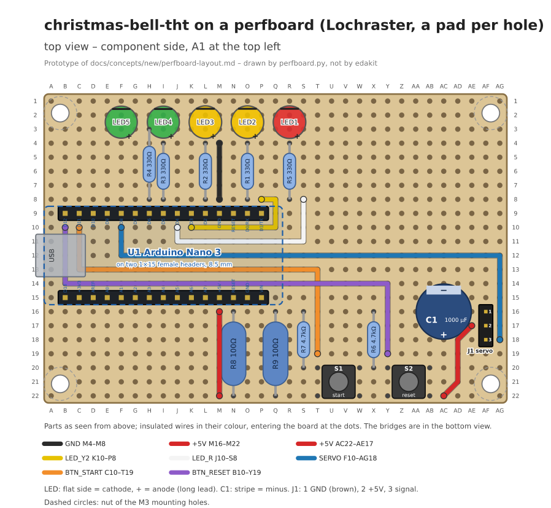
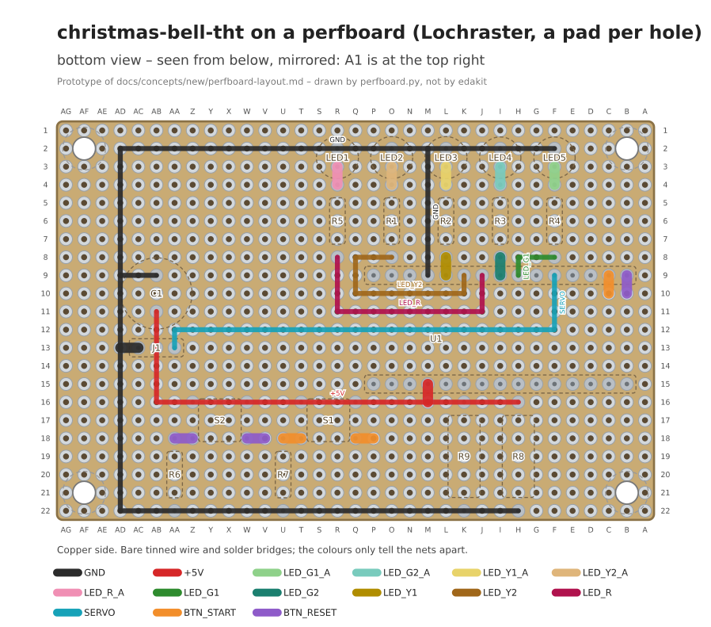

# Prototype: the bell on a perfboard

Written on 2026-11-09 for the concept [perfboard-layout.md](../../perfboard-layout.md), on the owner's request for an
example board "damit wir wissen, dass wir vom gleichen reden", and accepted the same day ("jetzt passts"). Its rounds
brought the concept's decisions 11 to 21 – straight bridges below and wires on top, the bottom view in the top's
orientation, hole names as printed, parts by role, mounting holes in mm and the rest –; this version follows all of
them and is the reference for the steps LR.1 to LR.4.

Nothing of the steps LR.1 to LR.8 is built. A script does the check and the drawings, as the scripts of
[footprint-data](../footprint-data/README.md) do; it is no edakit code, and edakit's pytest does not collect it.

| File | What | Stands in for |
| --- | --- | --- |
| [bell-perfboard.toml](bell-perfboard.toml) | The plan as text: `[perfboard]`, `[place]`, `[near]`, `[[wire]]`. It is for the bell's THT circuit (`automatic_christmas_bell`, `variants/tht`), whose graph and parts stay unchanged. | The board file of a hand-wired variant (LR.8) |
| [pad-per-hole.toml](pad-per-hole.toml) | The kind as data: pitch, pads, the tolerances for bending leads | LR.1 |
| [perfboard.py](perfboard.py) | Builds the nets the plan makes and compares them with the graph's. Checks the grid, the bodies, the wires, the mounting holes and `near`, then draws and writes the lists. | LR.2 to LR.4 |
| [bell-perfboard.build.md](bell-perfboard.build.md) | Its output: the findings, the build list from low to high, the test list for the multimeter and the material | LR.4 |

```bash
python3 perfboard.py bell-perfboard.toml <automatic_christmas_bell>/variants/tht
```





## The layout in short

The board is 33 × 22 holes, which is the size of the bell's 85 × 56 mm PCB, cut from a Euro board.

- **Nano:** on the left with its USB socket at the edge, as on the THT PCB.
- **LED row:** along the back edge in countdown order (R-13). The cathodes sit in row 2 and are joined by a row of
  bridges, the anodes in row 3. Each series resistor stands upright below its LED, bridged to the anode above and to
  the Nano's pin below; R4 stands right above its pin (D6) and reaches row 3, where a straight row of bridges leads
  to LED5's anode.
- **Wires under the Nano:** the Nano's pins D6, D5, D4, D3 and D2 carry G1, G2, R, Y2 and Y1, which is not the
  countdown order G1, G2, Y1, Y2, R. So Y2 and R go as wires on top, under the Nano between its sockets, and come up
  at its right end. The servo signal and the two button lines take the same way.
- **Power:** below the Nano, ground runs as a row of bridges along row 16 and +5 V along row 22. R8, R9, the two
  pull-downs and the buttons stand across or on them; C1 and J1 sit at the right end, C1's plus in J1's row 17.
  Short wires on top bring +5 V from the Nano's 5V pin down to row 22 and from there around C1 into row 17; another
  one joins the LED cathodes to the Nano's GND (pin 4).
- **In all:** 8 insulated wires (46 cm) and 76 solder bridges, 46 of them in the three long rows (cathodes, ground,
  +5 V). Every row of bridges is straight.

## What the check says

On the plan it finds no error and gives three notes:

- the buttons' leads (6.5 × 4.5 mm) are bent by 0.63 mm into the 7.62 × 5.08 mm grid;
- the LED cathodes reach the rest of ground only inside the Nano (its GND pins 4 and 29). The test list therefore
  shows ground as two groups that beep together once U1 is plugged in.

A copy of the plan with three typical mistakes: the bridge L8–L9 forgotten, the ground row started one hole too early
(M16 instead of N16, where the +5 V wire comes through), and LED3 the wrong way round (`anode = "L2", cathode = "L3"`):

```text
error   PERF.short     +5V (9 pins) and GND (12 pins) and LED_Y1_A (LED3.anode in L2) in one piece of copper
error   PERF.short     GND (LED3.cathode in L3) and LED_Y1_A (R2.2 in L4) in one piece of copper
error   PERF.open      GND is open between 12 pins | LED3.cathode in L3
error   PERF.open      LED_Y1 is open between R2.1 in L8 | U1.PD2 in L9
error   PERF.open      LED_Y1_A is open between LED3.anode in L2 | R2.2 in L4
error   PERF.meet      L2 joins GND bridges F2 … R2 with LED3.anode (LED_Y1_A)
error   PERF.meet      L3 joins LED_Y1_A bridge L3–L4 with LED3.cathode (GND)
error   PERF.meet      M16 joins GND bridges M16 … AF16 with +5V bridge M15–M16 with +5V wire M16–M22
```

`PERF.meet` names the hole where two nets touch, which is where the soldering iron goes. `PERF.corner` names the
hole where bridges turn – within a row of them or where two rows end in the same empty hole; the plan's previous
version had three such corners (AC22, AE18/AE17 and H8). The codes `PERF.*` are the
prototype's own names, not edakit's.

## Decided on the prototype

What the first versions left open is decided in the concept (its decisions 11 to 21):

- On the bottom only straight bridges between neighbouring holes; rows of them meet at a lead or in the middle of
  another row; everything else is a wire on top, its ends in free holes beside the pins with a bridge below
  (11, 16, 17). `PERF.corner` finds a bridge that turns.
- The bottom view in the orientation of the top view, soldered leads clearly marked (12).
- Holes written as the board prints them; the lists say "hole R8" (13).
- Parts with two leads by the holes of their roles, as the LEDs and C1 here (14); `PERF.place` finds leads that do
  not span the holes named.
- Mounting holes in mm, as `[[holes]]` of a PCB's board file: here the bell frame's, 78 × 49 mm apart, centred on
  the board and drilled between the holes (15).
- Pins a part joins inside count as one node, through a key `joined` in the parts entry (18) – the script still
  infers them from the pin name, or on a button from the role.
- A module on sockets is raised, and the test list measures without it (19); `near` is the gap between body boxes
  (20); the bridges are soldered once the leads are in (21).

The tolerances in [pad-per-hole.toml](pad-per-hole.toml) are still assumptions without a source: 0.8 mm for bending a
lead, 1.5 mm of straight lead for an axial part, and no copper rating – LR.1 takes them from a board's datasheet.

The prototype does not cover:

- the current per wire and bridge;
- the kind `3-hole-strips`;
- stage L: the layout hash, the gate and M-5;
- the `[[extra]]` items for `edakit order`;
- the hand-over's `edge`.

The footprints are a table in the script, not `footprint_data` or the library cache. `near` is measured as on a PCB,
the gap between the parts' body boxes.
