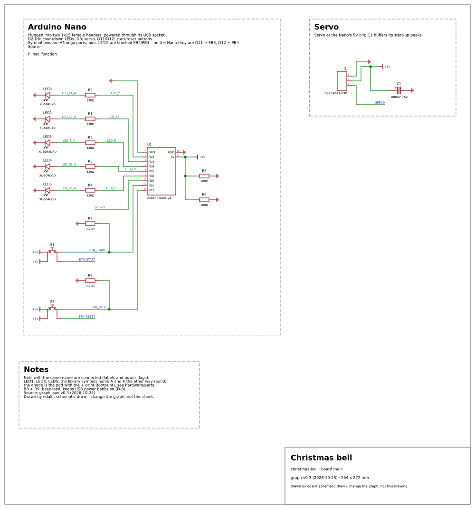
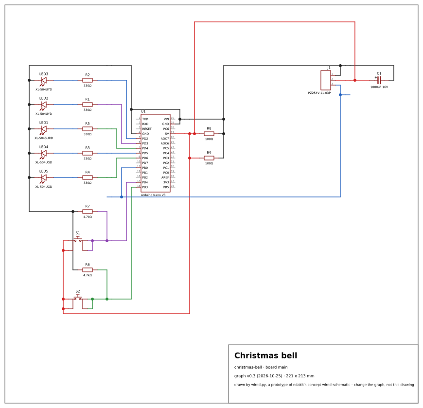
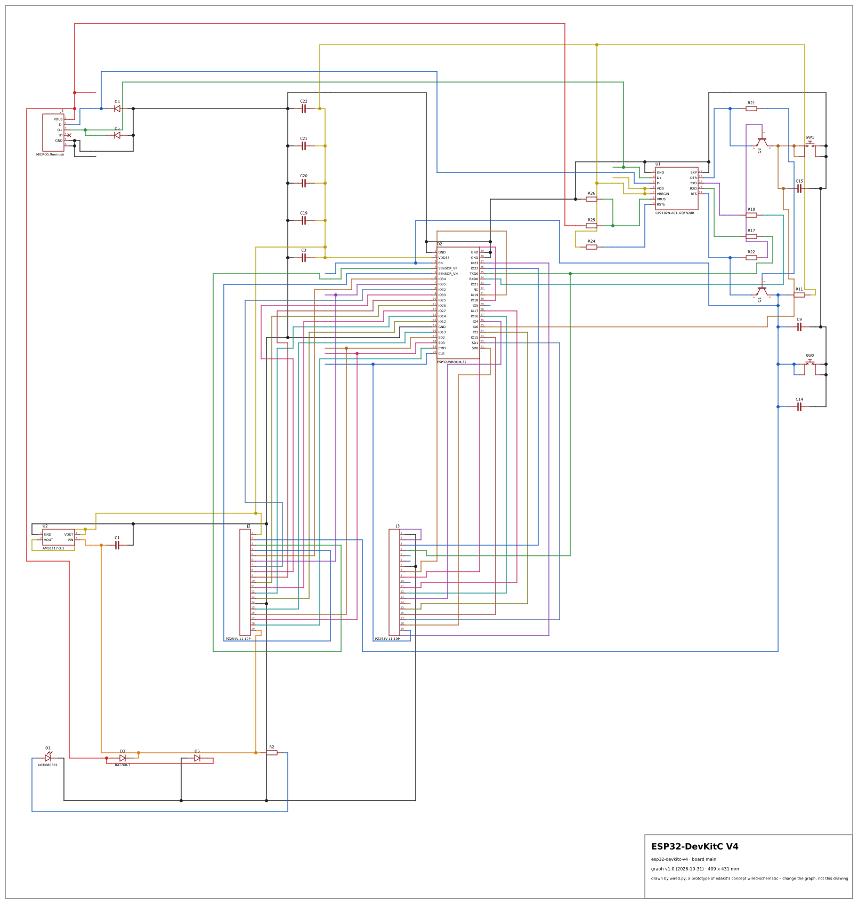
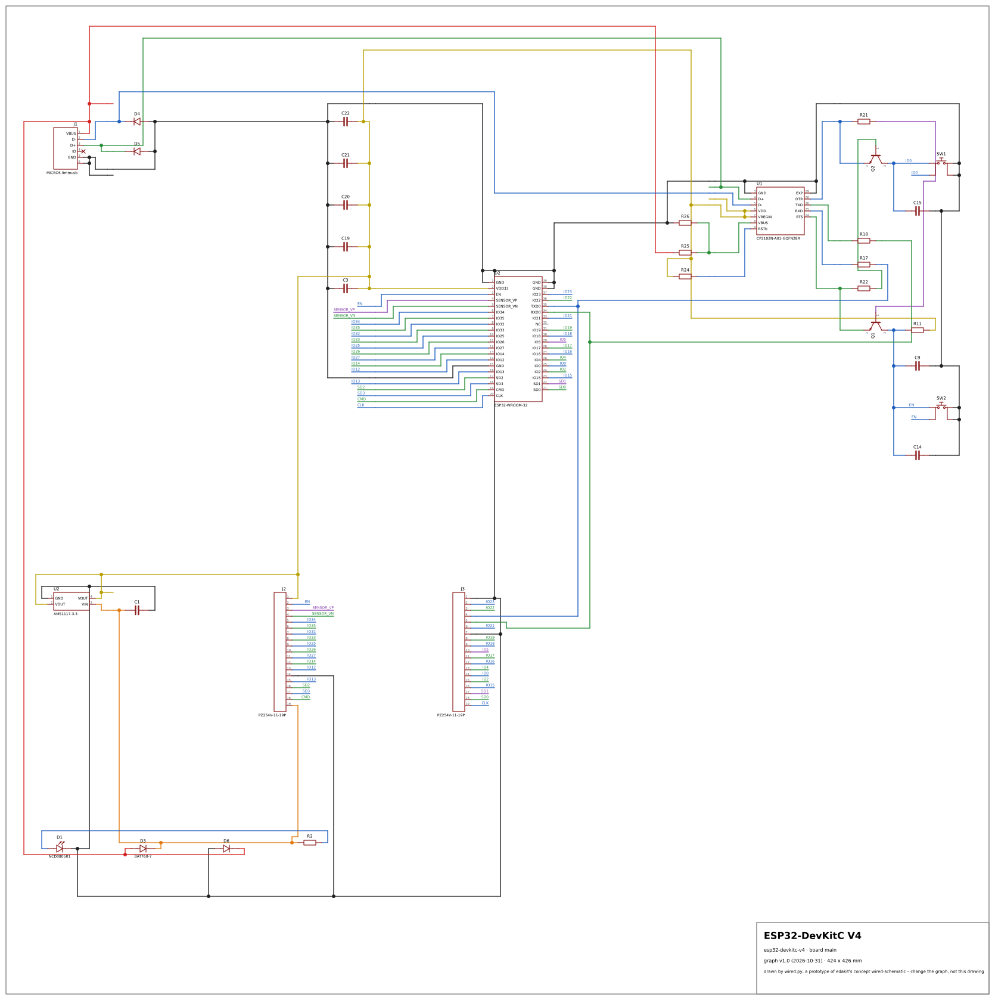

# Prototype: the schematic with every connection drawn through

For [wired-schematic.md](../../wired-schematic.md). `wired.py` draws a board's schematic the way Fritzing's schematic
view and the drawings of the maker scene do it: one sheet, every connection a wire from pin to pin, no net labels, no
power flags, a colour per net. It imports edakit (`edakit/schematic_draw.py`, `edakit/schematic_layout.py`) and
changes nothing in it: the symbols, the trees of parts on the pins of the modules and the page are edakit's; new are
the leads instead of labelled stubs, the rails for the power nets, a router on the schematic grid, the colours and
the measures. The module's pins are all drawn, as on the board, the unused ones grey.

```bash
uv run --project ../../../../.. python wired.py ../../../../../examples/coin-cell-led            # out/coin-cell-led_main.svg
uv run --project ../../../../.. python wired.py <project> --board main --mixed --names --no-frame --row
```

`--mixed`: the mixed style – a net stays a labelled stub when nothing but modules, ICs and connectors hang on it (a
pin passed through to a header, a bus line) or when it has six pins or more (a key matrix, a shared line); the power
nets are rails anyway. `--names` prints every net's name once. `--no-frame` leaves out the sheet border and the title
block. `--row` prints the measures as a table row. `--gap` is the room between edakit's blocks (120 units of 10 mil;
edakit's own drawing uses 60), `--connected-pins` draws modules as edakit does.

## The measures

Every project at hand, both styles, on edakit main at `6139c4c`, the same numbers at `b15a3ac` (the bell converted
to the current form of the graph in a scratch copy). *pin connections*: pins in nets; *nets labelled*: nets the mixed style keeps as stubs; *wire m*:
the length of the routed wires in metres on the page; *crossings*: cells where two nets cross; *unrouted*: pieces of
a net the router could not join (the rest of the net is joined); *colour clashes*: nets that cross or run beside a
net of the same colour because ten colours were not enough; *s*: the run on this machine.

| design (board) | style | parts | nets | pin connections | nets labelled | wire m | crossings | bends | unrouted | colour clashes | page mm | s |
| --- | --- | ---: | ---: | ---: | ---: | ---: | ---: | ---: | ---: | ---: | --- | ---: |
| coin-cell-led (main) | wires through | 4 | 4 | 8 | 0 | 0.0 | 0 | 0 | 0 | 0 | 122 x 95 | 0.0 |
| coin-cell-led (main) | mixed | 4 | 4 | 8 | 0 | 0.0 | 0 | 0 | 0 | 0 | 122 x 95 | 0.0 |
| christmas-bell (main) | wires through | 19 | 15 | 52 | 0 | 0.8 | 5 | 9 | 0 | 0 | 221 x 213 | 0.5 |
| christmas-bell (main) | mixed | 19 | 15 | 52 | 1 | 0.6 | 2 | 8 | 0 | 0 | 221 x 213 | 0.4 |
| sparkfun-logic-level-converter (main) | wires through | 14 | 11 | 40 | 0 | 1.3 | 16 | 27 | 0 | 0 | 188 x 245 | 0.5 |
| sparkfun-logic-level-converter (main) | mixed | 14 | 11 | 40 | 1 | 1.2 | 11 | 21 | 0 | 0 | 188 x 255 | 0.4 |
| led-bar (main) | wires through | 17 | 18 | 61 | 0 | 2.2 | 12 | 29 | 0 | 0 | 185 x 343 | 1.2 |
| led-bar (main) | mixed | 17 | 18 | 61 | 3 | 1.5 | 7 | 21 | 0 | 0 | 185 x 343 | 1.1 |
| guitarml-classic-boost (main) | wires through | 19 | 11 | 32 | 0 | 1.0 | 1 | 14 | 0 | 0 | 355 x 283 | 0.3 |
| guitarml-classic-boost (main) | mixed | 19 | 11 | 32 | 0 | 1.0 | 1 | 14 | 0 | 0 | 355 x 283 | 0.4 |
| guitarml-classic-boost (wiring) | wires through | 4 | 9 | 14 | 0 | 0.5 | 1 | 8 | 0 | 0 | 203 x 179 | 0.3 |
| guitarml-classic-boost (wiring) | mixed | 4 | 9 | 14 | 0 | 0.5 | 1 | 8 | 0 | 0 | 203 x 179 | 0.4 |
| esp32-devkitc-v4 (main) | wires through | 33 | 48 | 157 | 0 | 10.4 | 261 | 164 | 4 | 0 | 409 x 431 | 12.6 |
| esp32-devkitc-v4 (main) | mixed | 33 | 48 | 157 | 31 | 4.4 | 28 | 61 | 0 | 0 | 424 x 426 | 3.9 |
| corne-cherry-v3-left (main) | wires through | 73 | 64 | 219 | 0 | 19.8 | 221 | 246 | 0 | 0 | 655 x 739 | 31.1 |
| corne-cherry-v3-left (main) | mixed | 73 | 64 | 219 | 33 | 10.8 | 155 | 116 | 0 | 0 | 655 x 723 | 10.9 |
| corne-cherry-left (main) | wires through | 84 | 75 | 301 | 0 | 25.3 | 227 | 249 | 0 | 0 | 719 x 982 | 67.1 |
| corne-cherry-left (main) | mixed | 84 | 75 | 301 | 36 | 11.6 | 73 | 105 | 0 | 0 | 729 x 982 | 25.8 |
| guitarml-ts-rat-combo (main) | wires through | 86 | 50 | 181 | 0 | 11.1 | 44 | 101 | 0 | 0 | 856 x 586 | 14.7 |
| guitarml-ts-rat-combo (main) | mixed | 86 | 50 | 181 | 2 | 11.2 | 44 | 102 | 0 | 0 | 856 x 596 | 14.2 |
| guitarml-ts-rat-combo (wiring) | wires through | 7 | 18 | 26 | 0 | 0.7 | 2 | 16 | 0 | 0 | 196 x 252 | 0.2 |
| guitarml-ts-rat-combo (wiring) | mixed | 7 | 18 | 26 | 0 | 0.7 | 2 | 16 | 0 | 0 | 196 x 252 | 0.3 |

For comparison, edakit's own drawing (`edakit schematic draw`, blocks with labelled stubs and flags) of the same
boards: coin-cell-led 122 x 93 mm; the bell 20 wires, 19 flags, 254 x 272 mm; the logic level converter 178 x 275
mm; led-bar 31 wires, 30 flags, 276 x 320 mm; the boost pedal 327 x 258 mm; the ESP32 DevKitC 99 wires, 46 flags,
404 x 389 mm; the Corne v3 117 wires, 63 flags, 582 x 661 mm; the TS/Rat pedal 79 wires, 44 flags, 858 x 524 mm.
The two hand-wired boards (`wired = true`) edakit refuses to draw; the prototype draws them like any other.

## The drawings

The bell, three ways: [its original Fritzing drawing](https://github.com/tgd1975/automatic_christmas_bell/blob/main/docs/old/weihnachtsglocke_Schaltplan.png)
(drawn by hand), edakit's drawing today, the prototype's.





The ESP32 DevKitC – a module whose pins go to two 19-pin headers – with every connection drawn through, and in the
mixed style, where the pass-through nets keep their labels:





The other drawings of the table are in `out/` as `<project>_<board>_wired.svg` and `_mixed.svg` where the mixed
style differs, with edakit's own `_labels.svg` for the bell and the DevKitC – except the keyboard halves and the
TS/Rat pedal's main board, 200 KB each; the command above regenerates them.

## What the prototype leaves out

- **Placement.** The parts stand where edakit's layout puts them – blocks in rows, the trees of parts on the pins of
  the modules –, only further apart. A drawing with wires through wants the module in the middle and its
  neighbours by connection around it; the wire length, the crossings and the page size of the table are those of
  today's placement, an upper bound.
- **The pin names** are the symbol's (`PD2`), not the board's print (`D2`) – the drawing has no other name.
- **Notes and the pin table** of the schematic file are not drawn; the title block is.
- **No check** of the drawing: edakit's geometry check takes a crossing of two nets for a short and is not run.
- **Speed.** The router is plain Python on a dict of cells: a second for the bell, half a minute for a keyboard half.
