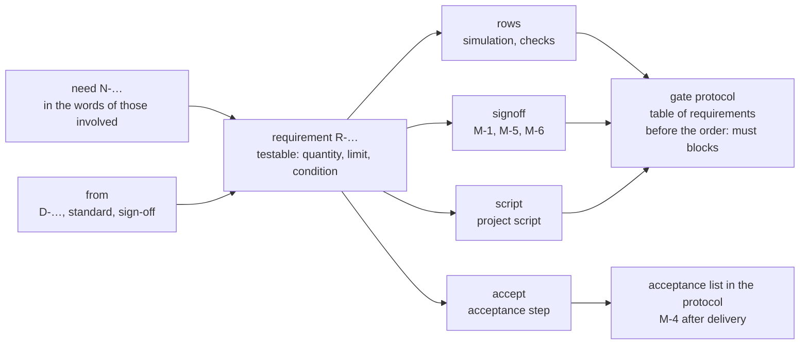

# Requirements for the circuit

Status 2026-10-28: being built; all nine decisions are taken (table at the end), and the state of each step is in
[implementation-plan.md](implementation-plan.md). The findings come from reading edakit at `a8b6011` (with PRs #78
and #79) and the repositories of the reference project and the Christmas bell.

## Goal

Every edakit project gets a text file that says what the circuit must do – each requirement with an ID and a criterion
to test it by. An agent leads there: it asks until a vague idea has become a sentence that can be tested, and the user
approves it.

Two questions show whether the goal is reached:

1. **What should the circuits of the reference project's tree and of the Christmas bell do?** The answer is in one
   file per project, not spread over READMEs, decisions and chats. What firmware and mechanics must do stays in the
   projects' own documents (decision 3).
2. **Does the circuit do it, and how do we know?** Every requirement points to its evidence – simulation, check or
   measurement – and edakit shows which ones have none yet.

It complements the concept [design-as-text.md](design-as-text.md): that one is about the circuit being text, this one
about what the circuit should do.

## Where it stands

All three projects state requirements, but scattered, mostly without an ID and almost never with a pointer to their
evidence. Exactly two are traceable today: FW-4 and FW-5 of the reference project.

| Where | What it says | ID | Evidence linked |
| --- | --- | --- | --- |
| edakit, skill `circuit-design` §1 | asks for supply, inputs and outputs, quantity, enclosure, purpose and "what matters to the user" | – | partly: `purpose` goes into the graph, the touch limit into `touch_c` (E-2), a budget into `[cost] budget`; the rest stays in the report in the chat |
| edakit, skill `decision-round` | "… is a must" counts as a hard requirement | D-… | as a decision, not as a requirement |
| edakit, acceptance M-4 | test steps after delivery | M-4 | names parts and functions, not requirements |
| bell, `README.md` and `docs/IMPLEMENTIERUNG.md` | Christmas Eve step by step: press start, the bell rings mechanically after 65 s | – | no |
| bell, `docs/decisions.md` | requirements inside decisions: power bank (D-8), timer 10 s to 24 h (D-17), "Requirements from the M-1 review" (D-13) | D-… | partly: D-8 as `i_min_a` 0.1 A in `sim.json` (E-3) |
| reference project, `docs/schaltungsbeschreibung.md` | "Daraus ergeben sich die Anforderungen an die Schaltung" (the requirements for the circuit): six points, e.g. 0.5 A from a USB 2.0 port | – | indirectly: `usb_i_max_a` 0.5 in the simulation, whose note points to `usb_baum.md` |
| reference project, `docs/kalender.md` | constraints and the behaviour of every element of the tree | – | no |
| reference project, `firmware/ANFORDERUNGEN.md` | FW-4 buzzer never high permanently, FW-5 defined start; FW-1 to FW-3 kept as dropped | FW-… | yes: the rule watcher `simulator/regeln.py` |
| reference project, `hardware/release/abnahme.md` | acceptance steps with target values from the simulation | 1.1 … | to decisions and checks, not to requirements |

FW-4 and FW-5 are the pattern in small: an ID, one testable sentence, the reason, the test – and a dropped requirement
stays with its reason. This concept extends it to everything the circuit should do.

## The gap

There is no place where every requirement stands with an ID, and from there a pointer to its evidence. The consequences
show in both projects already:

- **The answer takes six files.** What the tree should do is in `kalender.md`, `baum_tage.md`,
  `schaltungsbeschreibung.md`, `hardware.md` (D-1 to D-48), `usb_baum.md` and `ANFORDERUNGEN.md`.
- **Contradictions stay.** The bell's README and `IMPLEMENTIERUNG.md` say "Servo separat (5V, 1A)" (a supply of its own
  for the servo), D-3 puts the servo on the Nano's 5V pin. In the reference project, `firmware_test.md` ("Mit vollen
  Zellen schaltet der Baum nie ab": with full cells the tree never switches off) contradicted decision D-38; only a
  risk review found it.
- **The acceptance test checks parts, not requirements.** The bell's M-4 asks for "the servo swings". Whether the bell
  runs on a power bank (D-8), it does not test.
- **Requirements hide in decisions.** D-13 holds "Requirements from the M-1 review" for the ESP32 firmware. The
  firmware cites D-13 in a comment; no test checks it.
- **Collected and lost.** `circuit-design` asks for the requirements in a decision round. Only a few find a home:
  `purpose` in the graph, the touch limit in `touch_c` (E-2), a budget in `[cost] budget` (skill `new-project`). The
  rest is in the report and goes with the chat.

So the gate knows no requirements: a changed requirement voids no sign-off, and no check reports a requirement without
evidence.

## Proposal: the requirements file

Every project gets `hardware/requirements.toml`, named in `edakit.toml` under `[project] requirements`. The file
describes the circuit: what the boards must do and withstand, each requirement with its evidence. What firmware and
mechanics must do stays in the project's own documents, such as the tree's `firmware/ANFORDERUNGEN.md` (decision 3).

It has two levels, along the gap between wish and circuit:

| Level | ID | Content | Evidence |
| --- | --- | --- | --- |
| need | N-1 … | what someone wants, in their words: who, in which situation, what for | through the requirements that follow from it |
| requirement | R-1 … | one testable sentence with quantity, limit and condition; binding as `must`, `should` or `may` | check, simulation, sign-off, acceptance or project script |

```toml
[[need]]
id = "N-2"
text = "The bell runs from a USB port or a power bank."
who = "parents"
source = "graph.json purpose, D-8"
status = "accepted"

[[requirement]]
id = "R-4"
text = "In operation the circuit draws 100 to 500 mA from USB, in every state of countdown and ringing."
from = ["N-2", "D-3", "D-8"]
binding = "must"
verify = [{ rows = "E-3 * U1 *" },
          { accept = "on a power bank: press start, the bell rings" }]
status = "accepted"
```

- **One sentence, one statement.** Numbers come with unit and condition. Words like "loud", "reliable" or
  "inconspicuous" the agent turns into numbers by asking.
- **`from` says where it comes from:** a need, a decision, a standard (USB 2.0: 500 mA) or a sign-off (the radio
  conditions of M-6).
- **`verify` says what tests it.** `rows` are rows of the gate protocol, matched as `accepted_warnings` are ("ID
  scenario item check"). `signoff` is a manual check, `accept` a step of the acceptance test, `script` a project script
  of the kind check (concept [project-scripts.md](project-scripts.md)).
- **IDs are stable,** as in the rule catalog. A dropped requirement stays with its reason (`status = "dropped"`,
  `reason = "D-47: no cells"`), like FW-1 to FW-3 of the reference project.
- **The agent drafts, the user approves.** Drafts carry `draft`; only the user sets `accepted`. Approving a requirement
  joins the user's real decisions in working agreement 4 (handbook 11.4), next to accepting a warning and money. A
  change to an accepted requirement is a decision in the decision log.

TOML as for the board and schematic files: readable by people and LLMs, no JSON. Variants read the main project's file
and add entries for what only they have.

## The agent

The requirements engineer is a new role in two parts, because asking back needs a conversation, and an agent in its own
session does not talk to the user.

- **Skill `requirements`**, in the session with the user: collects, asks back in a decision round, writes drafts into
  the file and has them approved. It writes only `requirements.toml` and decisions, never the graph.
- **Agent `requirements-engineer`**, in its own context, changes nothing: reads every document of a project and returns
  candidates with the place it found them, contradictions, vague words and requirements without evidence. It does the
  first inventory and checks a finished file as a second opinion.

It asks these questions until the idea has become requirements for the circuit; what it learns about firmware or
mechanics, it leaves to the project's documents.

| Topic | Question | Example: the bell |
| --- | --- | --- |
| people | Who uses, builds, gets it? Who must not notice it? | parents; children, who should not discover the bell |
| course | How does one use go, step by step? | start, the parents leave, it rings after 65 s |
| surroundings | Where does it stand, where does the power come from, how often and how long does it run? | a shelf, USB or a power bank, once a year for about 15 min (D-10) |
| operation | What does one press, see, hear? | two buttons, five LEDs, the bell |
| limits | What must never happen? | a stalled servo does not overload USB permanently (D-3) |
| frame | purpose, quantity, budget, date | private (D-16), ready before Christmas Eve |
| non-goals | What is explicitly not wanted? | no electronic sound |

Four rules keep it honest:

1. **Vague words become numbers.** "Loud" becomes a question with a proposal, for instance: audible in the next room
   with the door open?
2. **Contradictions become questions, never resolved silently** – in a decision round, as working agreement 5 has it
   for every open question. "Servo separat (5V, 1A)" against D-3 is an item of that round.
3. **What it does not know stays open.** A draft carries the open question, not an invented number.
4. **Every requirement gets evidence,** existing or proposed: a scenario, an acceptance step, an item for a review or a
   project script.

After that `circuit-design` reads the file instead of asking in §1 itself. A new function starts with its requirement,
and the designer's report says which parts meet which requirement.

## Traceability and the gate

edakit reads the file and checks the chain both ways: every need leads to requirements, and every requirement ends in
evidence that passes.



| `verify` | passes when | blocks the release |
| --- | --- | --- |
| `rows` | at least one protocol row matches and none failed | yes, for `must` |
| `signoff` | the manual check is signed for the current hash of its scope (circuit, layout or fab) and names the ID | yes, if its phase is `export` |
| `script` | the project script passes in the gate | yes, for `must` |
| `accept` | M-4 is signed; the step is on the protocol's acceptance list | no, phase `acceptance` |

What can only be tested at acceptance does not hold up the release. The protocol already has an acceptance list
(#42): section 6 lists M-4 under "after delivery", and below it every open datasheet point with
`when = "acceptance"` as an unchecked line. An `accept` step joins it the same way, with its ID:
`- [ ] R-4: on a power bank: press start, the bell rings`. M-4 works through the list. New in edakit:

- **`edakit req`** lists needs and requirements with status and evidence. `edakit req R-4` shows the chain of one
  requirement.
- **New checks in the catalog:** every reference resolves. Every accepted need has a requirement, every requirement
  evidence. Drafts warn as long as the user has not approved them.
- **A section "Requirements" in the gate protocol:** per requirement its evidence and the result. It answers the second
  question without another file.
- **The file counts in the circuit hash,** byte for byte like `purpose`: `[release] hash_ignore` does not reach into
  it, because the reviews read it whole. A changed requirement voids M-1 and M-6, as the new purpose of D-16 voided
  M-1. In a project with `[firmware]`, the firmware contract shows drift as well, because it carries the circuit hash.
- **The reviewers get the file as a source.** The electrical reviewer judges the requirements with `signoff = "M-1"`,
  the PCB reviewer those with `"M-5"`, the regulatory reviewer those with `"M-6"`. Each names the ID in its result.
  For the electrical reviewer the file replaces "requirements the firmware relies on", which it reads today.

## Trial on the bell and the reference project

The first entries are almost word for word in the existing documents. What is missing is nearly always the pointer to
the evidence – even where the evidence has existed for a while.

**The Christmas bell**

| Draft | Source today | Evidence today | Evidence with this concept |
| --- | --- | --- | --- |
| **N-2** The bell runs from a USB port or a power bank. | `purpose`, D-8 | – | through R-4 |
| **R-4** In operation the circuit draws 100 to 500 mA from USB. | D-3, D-8 | E-3 in `sim.json`, not linked | `rows = "E-3 * U1 *"`, `accept` on a power bank |
| **R-5** A stalled servo loads USB for one bell phase at most. | D-3 | scenario `servo-stalled` as information; the firmware cites D-3 | `signoff = "M-1"` |
| **R-6** The main board, SMD and THT do not transmit. | `purpose`, M-6 | M-6 | `signoff = "M-6"` |

N-1 and R-1 to R-3 of the first draft – the bell rings 65 s after start, the countdown runs on five LEDs, the bell is
struck mechanically – are firmware and mechanics. They stay in the README and `IMPLEMENTIERUNG.md` (decision 3), and
so do two questions of the first draft: 65 s or 30 to 45 s, and how loud. The question the agent would ask: the servo
on a 5 V, 1 A supply of its own (README, `IMPLEMENTIERUNG.md`) or on the Nano's 5V pin (D-3)? Proposal: D-3 holds,
and the two texts are corrected.

**The reference project**

| Draft | Source today | Evidence today | Evidence with this concept |
| --- | --- | --- | --- |
| **N-1** The recipient enters a code every day, and the tree wakes up one stage further. | `kalender.md`, `schaltungsbeschreibung.md` | – | through R-1 to R-3 |
| **R-1** 0.5 A from a USB 2.0 port is enough in every state. | `schaltungsbeschreibung.md` | `usb_i_max_a` in the simulation; its note points to `usb_baum.md` | `rows` of the simulation |
| **R-2** Swapped wires do no harm. | `schaltungsbeschreibung.md` | the tree's check G-10, acceptance step 2.4 | `rows`, `accept` |
| **R-3** Nothing lights or hums before the firmware runs. | `schaltungsbeschreibung.md`, FW-5 | rule watcher | `script` |

R-4 and R-5 of the first draft – the buzzer is never high permanently (FW-4), the progress survives unplugging – are
firmware and stay in `ANFORDERUNGEN.md` and `kalender.md`. "With full cells the tree never switches off" from
`firmware_test.md` would go in as dropped, with the reason D-47: the USB tree has no cells. The inventory itself is the
agent's work: read, return candidates with the place it found them, ask the contradictions as questions.

## Scope

- **Only the circuit.** What the boards must do and withstand belongs in the file. The codes the tree accepts, the
  bell's countdown and the fit in the stand stay in the projects' documents (decision 3).
- **edakit checks everything in the file:** protocol rows, sign-offs, project scripts of the kind check and acceptance
  steps. It does not run firmware tests.
- **No silent import.** The agent proposes, the user approves; nothing is taken over from documents unasked.
- **No tool for large projects:** no ReqIF, no baselines, no access rights. Git is the history, the decision log the
  reasoning.
- **The documents stay.** README, circuit description and calendar go on telling the story. They quote a requirement
  by its ID, as they quote a value since #71: a value block with the source `req:R-4` in a file of `[docs] files`
  (handbook 6.6), and G-19 finds a stale quote.

## Order

1. Format, parser and `edakit req`, tested on the example project `led-bar`.
2. Checks, the section "Requirements" and the `accept` lines in the gate protocol, the file in the circuit hash.
3. Skill `requirements` and agent `requirements-engineer`; `circuit-design` and the reviewers read the file. The
   plugin test that lets the reviewer prompts name only catalog IDs learns N- and R-.
4. `req:` as a source of the value blocks (G-19).
5. Trial on the bell after its order: inventory, decision round, file – in the bell's repository, at the user's
   request. Before the order the file would reopen M-1 and M-6.
6. The reference project, once it has moved to edakit (after its order, EK-1 of its concept).

## Decisions

All taken on 2026-10-28. "Accepted" is the user's yes to the proposal; "decided by Claude" marks a technical point the
user left to Claude and then confirmed.

| # | Decision | Taken | State |
| --- | --- | --- | --- |
| 1 | Two levels | need N-… and requirement R-…; the hyphen tells R-4 from R4, as it tells D-8 from D8 today | accepted |
| 2 | Place and format | `hardware/requirements.toml` in `[project] requirements`; variants read the main project's file too | decided by Claude: TOML like the board files |
| 3 | Scope | only the circuit: what the boards must do and withstand; firmware and mechanics stay in the projects' documents | the user's choice; the proposal was the whole device |
| 4 | Binding | `must` without passing evidence blocks the release, `should` warns, `may` informs | accepted |
| 5 | Required | optional until the bell and the reference project have a file; then required, as M-1, M-5 and M-6 are | accepted |
| 6 | Hash | the whole file counts in the circuit hash, byte for byte like `purpose`; `hash_ignore` does not reach into it | accepted |
| 7 | Role | skill `requirements` in the conversation, agent `requirements-engineer` for the inventory and a second opinion | decided by Claude: asking back needs the conversation, reading every document a context of its own |
| 8 | Acceptance | `accept` steps join the protocol's acceptance list (section 6, after delivery); M-4 names the IDs it tested | decided by Claude: the list exists since #42, a second one would compete with it |
| 9 | Trial | first on the bell after its order, then on the reference project | accepted |
| 10 | Drafts | a draft only warns: it blocks neither the release nor a commit; errors and blocking start once the user accepts it | the user's choice on 2026-10-28, built as a follow-up of step 1.6 |

## Sources

- edakit at `a8b6011`: skills [circuit-design](../../../skills/circuit-design/SKILL.md),
  [decision-round](../../../skills/decision-round/SKILL.md) and [new-project](../../../skills/new-project/SKILL.md),
  agents [electrical-reviewer](../../../agents/electrical-reviewer.md) and
  [pcb-reviewer](../../../agents/pcb-reviewer.md), handbook [6.6](../../../handbook/06-schematic.md) (value blocks,
  G-19), [8](../../../handbook/08-release-gate.md) (8.2 hashes and sign-offs, `hash_ignore`, the acceptance list, M-4),
  [11.4](../../../handbook/11-working-with-claude.md) (working agreements) and [14](../../../handbook/14-design.md)
  (roles), [gate.py](../../../edakit/release/gate.py) (`key_of`, `state_files`, `state_hash`, `REQUIRED`, protocol
  section 6), [firmware.py](../../../edakit/firmware.py) (the contract carries the circuit hash),
  [run.py](../../../edakit/sim/run.py) (E-3, `i_min_a`), [test_plugin.py](../../../tests/test_plugin.py) (IDs in the
  reviewer prompts).
- The Christmas bell: `README.md`, `docs/IMPLEMENTIERUNG.md`, `docs/decisions.md`, `hardware/graph.json`,
  `hardware/sim.json`, `hardware/signoff.json`, `src/firmware/buttons.ino`,
  `variants/esp32/firmware/test/test_bell_timer/test_main.cpp`.
- The reference project: `firmware/ANFORDERUNGEN.md`, `docs/schaltungsbeschreibung.md`, `docs/kalender.md`,
  `docs/verifikation.md`, `hardware/release/abnahme.md`, `hardware/sim/config.json`,
  `docs/concepts/erledigt/mvp_risiken.md`, `docs/concepts/offen/edakit.md`.
