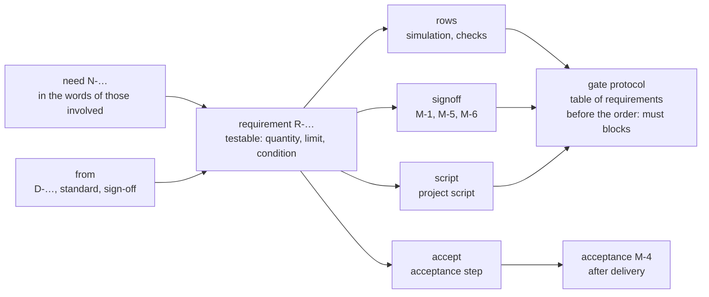

# Requirements for the circuit

Status 2026-10-27: proposal. Nothing of it is built, and every decision is open. The findings come from reading edakit
at `f24084a` and the repositories of the reference project and the Christmas bell.

## Goal

Every edakit project gets a text file that says what the circuit must do – each requirement with an ID and a criterion
to test it by. An agent leads there: it asks until a vague idea has become a sentence that can be tested, and the user
approves it.

Two questions show whether the goal is reached:

1. **What should the tree of the reference project do, and what the Christmas bell?** The answer is in one file per
   project, not spread over READMEs, decisions and chats.
2. **Does the circuit do it, and how do we know?** Every requirement points to its evidence – simulation, check or
   measurement – and edakit shows which ones have none yet.

It complements the concept `design-as-text.md`: that one is about the circuit being text, this one about what the
circuit should do.

## Where it stands

All three projects state requirements, but scattered, mostly without an ID and almost never with a pointer to their
evidence. Exactly two are traceable today: FW-4 and FW-5 of the reference project.

| Where | What it says | ID | Evidence linked |
| --- | --- | --- | --- |
| edakit, skill `circuit-design` §1 | asks for supply, inputs and outputs, quantity, enclosure, purpose and "what matters to the user" | – | no: only `purpose` goes into the graph, the rest stays in the report in the chat |
| edakit, skill `decision-round` | "… is a must" counts as a hard requirement | D-… | as a decision, not as a requirement |
| edakit, acceptance M-4 | test steps after delivery | M-4 | names parts and functions, not requirements |
| bell, `README.md` and `docs/IMPLEMENTIERUNG.md` | Christmas Eve step by step: press start, the bell rings mechanically after 65 s | – | no |
| bell, `docs/decisions.md` | requirements inside decisions: power bank (D-8), timer 10 s to 24 h (D-17), "Requirements from the M-1 review" (D-13) | D-… | partly: D-8 as `i_min_a` 0.1 A in `sim.json` (E-3) |
| reference project, `docs/schaltungsbeschreibung.md` | "Daraus ergeben sich die Anforderungen an die Schaltung" (the requirements for the circuit): six points, e.g. 0.5 A from a USB 2.0 port | – | indirectly: `usb_i_max_a` 0.5 in the simulation, whose note points to `usb_baum.md` |
| reference project, `docs/kalender.md` | constraints and the behaviour of every element of the tree | – | no |
| reference project, `firmware/ANFORDERUNGEN.md` | FW-4 buzzer never high permanently, FW-5 defined start; FW-1 to FW-3 kept as dropped | FW-… | yes: the rule watcher `simulator/regeln.py` |
| reference project, `hardware/release/abnahme.md` | acceptance steps with target values from the simulation | 1.1 … | to decisions and checks, not to requirements |

FW-4 and FW-5 are the pattern in small: an ID, one testable sentence, the reason, the test – and a dropped requirement
stays with its reason. This concept extends it to everything the circuit should do.

## The gap

There is no place where every requirement stands with an ID, and from there a pointer to its evidence. The consequences
show in both projects already:

- **The answer takes six files.** What the tree should do is in `kalender.md`, `baum_tage.md`,
  `schaltungsbeschreibung.md`, `hardware.md` (D-1 to D-48), `usb_baum.md` and `ANFORDERUNGEN.md`.
- **Contradictions stay.** The bell's README and `IMPLEMENTIERUNG.md` say "Servo separat (5V, 1A)" (a supply of its own
  for the servo), D-3 puts the servo on the Nano's 5V pin. In the reference project, `firmware_test.md` ("Mit vollen
  Zellen schaltet der Baum nie ab": with full cells the tree never switches off) contradicted decision D-38; only a
  risk review found it.
- **The acceptance test checks parts, not requirements.** The bell's M-4 asks for "the servo swings". Whether the bell
  rings 65 s after start and lasts on a power bank (D-8), it does not test.
- **Requirements hide in decisions.** D-13 holds "Requirements from the M-1 review" for the ESP32 firmware. The
  firmware cites D-13 in a comment; no test checks it.
- **Collected and lost.** `circuit-design` asks for the requirements in a decision round but writes only `purpose`
  into the graph. The rest is in the report and goes with the chat.

So the gate knows no requirements: a changed requirement voids no sign-off, and no check reports a requirement without
evidence.

## Proposal: the requirements file

Every project gets `hardware/requirements.toml`, named in `edakit.toml` under `[project] requirements`. The file
describes the device, not only the board: what firmware and mechanics must do is in it too, each with its evidence.

It has two levels, along the gap between wish and circuit:

| Level | ID | Content | Evidence |
| --- | --- | --- | --- |
| need | N-1 … | what someone wants, in their words: who, in which situation, what for | through the requirements that follow from it |
| requirement | R-1 … | one testable sentence with quantity, limit and condition; binding as `must`, `should` or `may` | check, simulation, sign-off, acceptance or project script |

```toml
[[need]]
id = "N-2"
text = "The bell runs from a USB port or a power bank."
who = "parents"
source = "graph.json purpose, D-8"
status = "accepted"

[[requirement]]
id = "R-4"
text = "In operation the circuit draws 100 to 500 mA from USB, in every state of countdown and ringing."
from = ["N-2", "D-3", "D-8"]
binding = "must"
verify = [{ rows = "E-3 * U1 *" },
          { accept = "on a power bank: press start, the bell rings" }]
status = "accepted"
```

- **One sentence, one statement.** Numbers come with unit and condition. Words like "loud", "reliable" or
  "inconspicuous" the agent turns into numbers by asking.
- **`from` says where it comes from:** a need, a decision, a standard (USB 2.0: 500 mA) or a sign-off (the radio
  conditions of M-6).
- **`verify` says what tests it.** `rows` are rows of the gate protocol, matched as `accepted_warnings` are ("ID
  scenario item check"). `signoff` is a manual check, `accept` a step of the acceptance test, `script` a project script
  of the kind check (concept `project-scripts.md`).
- **IDs are stable,** as in the rule catalog. A dropped requirement stays with its reason (`status = "dropped"`,
  `reason = "D-47: no cells"`), like FW-1 to FW-3 of the reference project.
- **The agent drafts, the user approves.** Drafts carry `draft`; only the user sets `accepted`. A change to an accepted
  requirement is a decision in the decision log.

TOML as for the board and schematic files: readable by people and LLMs, no JSON. Variants read the main project's file
and add their own entries – the ESP32 bell, for instance, its web page (D-17).

## The agent

The requirements engineer is a new role in two parts, because asking back needs a conversation, and an agent in its own
session does not talk to the user.

- **Skill `requirements`**, in the session with the user: collects, asks back in a decision round, writes drafts into
  the file and has them approved. It writes only `requirements.toml` and decisions, never the graph.
- **Agent `requirements-engineer`**, in its own context, changes nothing: reads every document of a project and returns
  candidates with the place it found them, contradictions, vague words and requirements without evidence. It does the
  first inventory and checks a finished file as a second opinion.

It asks these questions until the idea has become requirements:

| Topic | Question | Example: the bell |
| --- | --- | --- |
| people | Who uses, builds, gets it? Who must not notice it? | parents; children, who should not discover the bell |
| course | How does one use go, step by step? | start, the parents leave, it rings after 65 s |
| surroundings | Where does it stand, where does the power come from, how often and how long does it run? | a shelf, USB or a power bank, once a year for about 15 min (D-10) |
| operation | What does one press, see, hear? | two buttons, five LEDs, the bell |
| limits | What must never happen? | a stalled servo does not overload USB permanently (D-3) |
| frame | purpose, quantity, budget, date | private (D-16), ready before Christmas Eve |
| non-goals | What is explicitly not wanted? | no electronic sound |

Four rules keep it honest:

1. **Vague words become numbers.** "Loud" becomes a question with a proposal, for instance: audible in the next room
   with the door open?
2. **Contradictions become questions, never resolved silently.** "Servo separat (5V, 1A)" against D-3 is an item of the
   decision round.
3. **What it does not know stays open.** A draft carries the open question, not an invented number.
4. **Every requirement gets evidence,** existing or proposed: a scenario, an acceptance step, an item for a review or a
   project script.

After that `circuit-design` reads the file instead of asking in §1 itself. A new function starts with its requirement,
and the designer's report says which parts meet which requirement.

## Traceability and the gate

edakit reads the file and checks the chain both ways: every need leads to requirements, and every requirement ends in
evidence that passes.



| `verify` | passes when | blocks the release |
| --- | --- | --- |
| `rows` | at least one protocol row matches and none failed | yes, for `must` |
| `signoff` | the manual check is signed for the current hash and names the ID | yes, if its phase is `export` |
| `script` | the project script passes in the gate | yes, for `must` |
| `accept` | M-4 is signed; the step is on the acceptance list | no, phase `acceptance` |

What can only be tested at acceptance does not hold up the release; it is on the acceptance list that M-4 works
through. New in edakit:

- **`edakit req`** lists needs and requirements with status and evidence. `edakit req R-4` shows the chain of one
  requirement, `--acceptance` prints the acceptance list from all `accept` steps.
- **New checks in the catalog:** every reference resolves. Every accepted need has a requirement, every requirement
  evidence. Drafts warn as long as the user has not approved them.
- **A section "Requirements" in the gate protocol:** per requirement its evidence and the result. It answers the second
  question without another file.
- **The file counts in the circuit hash.** A changed requirement voids M-1 and M-6, as the new purpose of D-16 voided
  M-1.
- **The reviewers get the file as a source.** What a requirement with `signoff = "M-1"` asks for, the electrical
  reviewer judges, and it names the ID in its result.

## Trial on the bell and the reference project

The first entries are almost word for word in the existing documents. What is missing is nearly always the pointer to
the evidence – even where the evidence has existed for a while.

**The Christmas bell**

| Draft | Source today | Evidence today | Evidence with this concept |
| --- | --- | --- | --- |
| **N-1** The parents start the bell and leave the room; the children hear it ring. | README, `IMPLEMENTIERUNG.md` | – | through R-1 to R-3 |
| **R-1** The bell rings 65 s after start is pressed. | README, `buttons.ino` (60 s + 5 s) | ESP32: host test `test_countdown_warning_ring_idle`, not linked; Nano: none | `script` (host tests), `accept` with a stopwatch |
| **R-2** The countdown shows the time left on five LEDs; in the last 5 s all of them blink. | `IMPLEMENTIERUNG.md` | M-4 "every LED", without the sequence | `accept` |
| **R-3** The bell is struck mechanically; there is no electronic sound. | README | – | `accept` |
| **N-2** The bell runs from a USB port or a power bank. | `purpose`, D-8 | – | through R-4 |
| **R-4** In operation the circuit draws 100 to 500 mA from USB. | D-3, D-8 | E-3 in `sim.json`, not linked | `rows = "E-3 * U1 *"`, `accept` on a power bank |
| **R-5** A stalled servo loads USB for one bell phase at most. | D-3 | scenario `servo-stalled` as information; the firmware cites D-3 | `signoff = "M-1"` |
| **R-6** The main board, SMD and THT do not transmit. | `purpose`, M-6 | M-6 | `signoff = "M-6"` |

Three questions the agent would ask:

1. The servo on a 5 V, 1 A supply of its own (README, `IMPLEMENTIERUNG.md`) or on the Nano's 5V pin (D-3)? Proposal:
   D-3 holds, and the two texts are corrected.
2. 65 s (README) or the 30 to 45 s that `IMPLEMENTIERUNG.md` recommends? Proposal: 65 s, which D-17 sets as default.
3. How loud must it be? Proposal: audible in the next room with the door open, tested at acceptance.

**The reference project**

| Draft | Source today | Evidence today | Evidence with this concept |
| --- | --- | --- | --- |
| **N-1** The recipient enters a code every day, and the tree wakes up one stage further. | `kalender.md`, `schaltungsbeschreibung.md` | – | through R-1 to R-5 |
| **R-1** 0.5 A from a USB 2.0 port is enough in every state. | `schaltungsbeschreibung.md` | `usb_i_max_a` in the simulation; its note points to `usb_baum.md` | `rows` of the simulation |
| **R-2** Swapped wires do no harm. | `schaltungsbeschreibung.md` | the tree's check G-10, acceptance step 2.4 | `rows`, `accept` |
| **R-3** Nothing lights or hums before the firmware runs. | `schaltungsbeschreibung.md`, FW-5 | rule watcher | `script` |
| **R-4** The buzzer is never high permanently. | FW-4 | rule watcher | `script` |
| **R-5** The progress survives unplugging. | `kalender.md` | – | `accept` |

"With full cells the tree never switches off" from `firmware_test.md` would go in as dropped, with the reason D-47: the
USB tree has no cells. The inventory itself is the agent's work: read, return candidates with the place it found them,
ask the contradictions as questions.

## Scope

- **Only the device.** The codes the tree accepts belong in the file, the learning path of the advent calendar does
  not.
- **edakit checks what it sees.** Requirements on firmware and mechanics are in the file; their evidence runs as a
  project script or at acceptance. edakit does not run firmware tests itself.
- **No silent import.** The agent proposes, the user approves; nothing is taken over from documents unasked.
- **No tool for large projects:** no ReqIF, no baselines, no access rights. Git is the history, the decision log the
  reasoning.
- **The documents stay.** README, circuit description and calendar go on telling the story, but point to IDs instead of
  repeating requirements.

## Order

1. Format, parser and `edakit req`, tested on the example project `led-bar`.
2. Checks, the section in the gate protocol, the file in the circuit hash.
3. Skill `requirements` and agent `requirements-engineer`; `circuit-design` and the reviewers read the file.
4. `edakit req --acceptance`: the acceptance list from the `accept` steps.
5. Trial on the bell: inventory, decision round, file – in the bell's repository, at the user's request.
6. The reference project, once it has moved to edakit (after its order, EK-1 of its concept).

## Decisions

| # | Decision | Proposal | State |
| --- | --- | --- | --- |
| 1 | Two levels | need N-… and requirement R-…; the hyphen tells R-4 from R4, as it tells D-8 from D8 today | open |
| 2 | Place and format | `hardware/requirements.toml` in `[project] requirements`; variants read the main project's file too | open |
| 3 | Scope | the whole device; edakit checks what it sees, a project script or the acceptance test the rest | open |
| 4 | Binding | `must` without passing evidence blocks the release, `should` warns, `may` informs | open |
| 5 | Required | optional until the bell and the reference project have a file; then required, as M-6 is | open |
| 6 | Hash | the whole file counts in the circuit hash, like the graph | open |
| 7 | Role | skill `requirements` in the conversation, agent `requirements-engineer` for the inventory and a second opinion | open |
| 8 | Acceptance | `edakit req --acceptance` makes the acceptance list; M-4 names the IDs it tested | open |
| 9 | Trial | first on the bell, then on the reference project | open |

## Sources

- edakit at `f24084a`: skills [circuit-design](../../../skills/circuit-design/SKILL.md),
  [decision-round](../../../skills/decision-round/SKILL.md) and [new-project](../../../skills/new-project/SKILL.md),
  agent [electrical-reviewer](../../../agents/electrical-reviewer.md), handbook
  [8](../../../handbook/08-release-gate.md) (M-4, `accepted_warnings`) and [14](../../../handbook/14-design.md)
  (roles), [gate.py](../../../edakit/release/gate.py) (`key_of`, `state_files`), [run.py](../../../edakit/sim/run.py)
  (E-3, `i_min_a`).
- The Christmas bell: `README.md`, `docs/IMPLEMENTIERUNG.md`, `docs/decisions.md`, `hardware/graph.json`,
  `hardware/sim.json`, `hardware/signoff.json`, `src/firmware/buttons.ino`,
  `variants/esp32/firmware/test/test_bell_timer/test_main.cpp`.
- The reference project: `firmware/ANFORDERUNGEN.md`, `docs/schaltungsbeschreibung.md`, `docs/kalender.md`,
  `docs/verifikation.md`, `hardware/release/abnahme.md`, `hardware/sim/config.json`,
  `docs/concepts/erledigt/mvp_risiken.md`, `docs/concepts/offen/edakit.md`.
