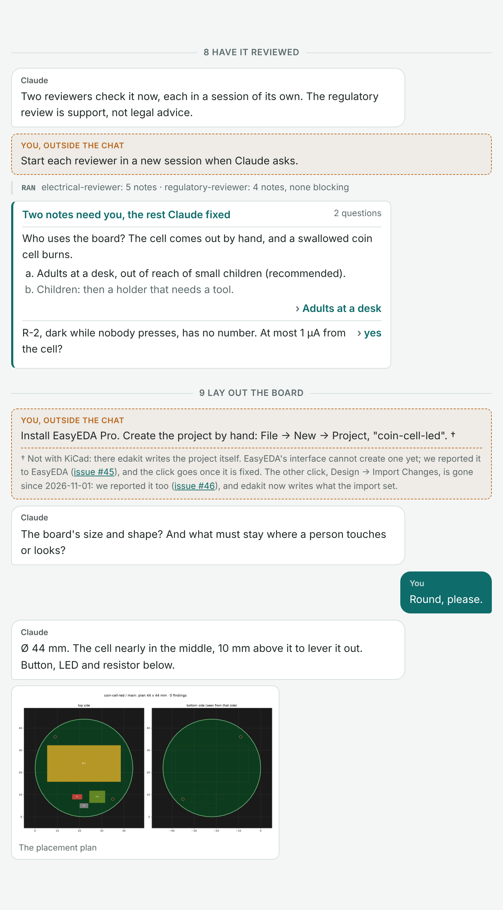
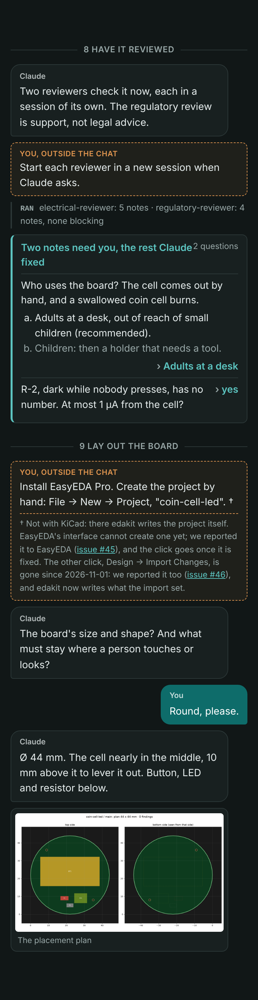

# A session as a chat: what a person types, what Claude asks

Status 2026-11-03: concept, asked for by the owner the same day ("beim Herzeigen der GitHub Pages ist mir aufgefallen,
dass die Beschreibung sehr technisch ist … was fehlt ist ein typischer Chatablauf … auch so gelayoutet … dann sehen
die potentiellen Anwender, dass das wirklich im besten Fall ein Auftrag und ein paar Fragen sind, die zu beantworten
sind"). Written against main at `ae2b400`. A prototype of page, parser and styles is in
[prototypes/session-chat](prototypes/session-chat/README.md). Decided the same day in a decision round in Claude
Code's form (the table at the end): decisions 1, 2, 3 and 5 as recommended; decision 4, the format, and what Claude
set itself left to Claude by the owner the same day ("du wirst für beide eine gute Idee haben") – taken as
recommended. Nothing built on the site: every step starts on the owner's word.

## Why

The site shows what edakit *runs*, not what a person *does*. The entry pages – the start page, the quickstart, How it
works, the ten steps – quote 14 outputs of `$ edakit …` and one exchange between a person and Claude: the five lines of
a decision round in How it works. The steps pages say "What you are asked" as a list of questions, without the answers
and without what comes before and after them.

A visitor who does not know Claude Code reads that as a tool chain to learn: commands, files, codes. What edakit is
meant to be is the other thing – you say what the board must do, Claude asks back where only you can decide, and
everything else happens without you. The walkthrough proves it on a real board (14 steps, six of them yours, seven
decisions), but in 714 lines of a handbook chapter that a visitor does not open.

A chat shows it at a glance: few bubbles on the right, the forms Claude puts in front of you, and the quiet lines of
what ran in between.

**The yardstick.** The chat is text in the repository, the page's source, held by a test to the example's files.
Nothing of it exists only in EasyEDA or in someone's head. It also makes visible what is not yet chat – the install,
the click in EasyEDA, the new sessions, paying – instead of hiding it.

## The proposal

### 1. One page "A session", and a short excerpt on the start page

- **`docs/session.md`**, in the tab Start after the start page: "A session" (Start then has six of eight entries).
  The walkthrough's board from the first sentence to the cart, as a chat: about 50 entries, ten step dividers that link
  the steps pages, three pictures from the example. An entry page by the style guide: two paragraphs before the chat,
  sentences of at most 20 words on average – a chat line counts as a sentence.
- **The start page** gets six lines of it under "What it does": the first sentence, the form as one line, one question
  of the decision round, "Round, please.", "Stopped at the cart.", and the tally – with the link "the whole session".
  The start page's budget (120 words before the first picture) is untouched: the excerpt stands below the pictures.
- **How it works** keeps its decision round; it becomes a `chat` fence with the same five lines, so it looks as on the
  new page.

### 2. What the chat says

- **The record, not an invention.** Every line comes from the example `examples/coin-cell-led/` – its
  `docs/decisions.md`, its graph, requirements and outputs – and from the walkthrough. Claude's lines are shortened;
  the page says so once, in its intro, and links the walkthrough for the full story.
- **Honest about the rest.** What a person does outside the chat stands in the chat, set apart ("You, outside the
  chat"): the install, creating the EasyEDA project by hand, a new session for the layout, starting
  the reviewers, checking the preview, ordering and paying, testing the boards. Each such line is also a requirement
  E-… in `upstream/README.md` or a step of the steps pages; when one goes away, its line goes.
- **A click in EasyEDA gets a footnote** (the owner, 2026-11-03): that KiCad does without it, and that it is reported
  to EasyEDA so it goes – the issue linked, the same as in the requirement E-… of `upstream/README.md`. Today that is
  one click, *File → New → Project* (E-1, [easyeda-api-sdk#45](https://github.com/easyeda/easyeda-api-sdk/issues/45));
  its footnote also says that the second, *Design → Import Changes*, is gone since 2026-11-01 (E-2,
  [#46](https://github.com/easyeda/easyeda-api-sdk/issues/46), TD-37), so it has no line of its own any more.
- **The tally** under the chat: "Your part: 8 messages typed, 15 answers in 5 forms, 6 things done outside the chat."
  Counted from the entries when the site is assembled, never typed by hand. That is the owner's point in one line – a
  task and a few questions – and its limits beside it.
- **Not legal advice.** The reviewers' entry says once that the regulatory review is support, not legal advice
  (CLAUDE.md, "Regulatory content").
- **Order of a new run.** The chat follows a session with today's edakit on the example, not the dates of the record:
  LIM.i on the cell's current comes up in the first decision round (step 5), where a new project meets it, though D-7
  was taken after the reviews. The chat names no decision numbers, so the two orders do not clash.

### 3. The format: a `chat` fence, turned into HTML on assembly

The page's source is Markdown with one fenced block in a small line format – readable as it is on GitHub, where the
fence shows as a plain transcript:

```text
--- 5 Decide on what was found
form: Two findings, one to confirm
  ? PATH.reverse: a CR2032 put in upside down reaches R1 and D1. Protect against it?
  - No protection (recommended): D1 blocks, 3.2 V against its rated 5 V.
  - A Schottky diode in series: it costs 0.3 V, the margin a used cell needs.
  > No protection
claude: Written to docs/decisions.md, each with its reason and date.
```

Seven kinds of entry: `---` a step divider, `you:`, `claude:`, `ran:` (what Claude ran, a quiet line), `do:` (outside
the chat), `img:` (a picture Claude shows), `form:` with `?` question, `-` option (the recommended first) and `>`
answer. Under a `do:`, an indented line starting with `†` is its footnote, with links as `[text](url)`. An indented
line continues the entry above.

`docs/pages.py` turns each `chat` fence into HTML while it assembles the pages (it rewrites links there already), and
appends the tally. No MkDocs plugin and no Python function in `mkdocs.yml`: the build stays the two commands of
`pages.yml`. The prototype's `chat.py` is that step in 130 lines.

### 4. The layout

In the brand's tokens (`docs/brand/tokens.json`), in `docs/brand/edakit.css`, for light and dark:

- **You** – a bubble on the right in the accent teal, white text.
- **Claude** – a bubble on the left on the surface colour, a thin line.
- **The form** – a card like Claude Code's question form: title and count, each question with its options, the
  recommended one first and darker, the answer right-aligned in teal. A question without options is one row.
- **Ran** – a small grey line with a left rule, commands in mono; no bubble, so the eye skips it.
- **Outside the chat** – a dashed box in copper across the width: it must stand out, not hide. Its footnote stands
  inside the box under a dashed line, small and grey, the issues linked; the line it belongs to ends in †.
- **A step** – a divider with the step's name, linked to its steps page.
- **Pictures** – a card on Claude's side, at most 24 rem wide.

At 390 px the bubbles take 92 % of the width; nothing scrolls sideways. The prototype's screenshots of the whole
session: `out/session-light.png` (900 px, light, up to step 6) and `out/session-dark-phone.png` (390 px, dark, steps 8
and 9).

#### A concrete example

Steps 8 and 9 of the session, shortened – every kind of entry once: a step divider, Claude, you, a form with options
and a one-row question, a line of what ran, two things outside the chat – the second, the click in EasyEDA, with its
footnote –, a picture. The source, as it stands in the
page's Markdown ([prototypes/session-chat/example.md](prototypes/session-chat/example.md)):

```text
--- 8 Have it reviewed
claude: Two reviewers check it now, each in a session of its own. The regulatory review is support, not legal advice.
do: Start each reviewer in a new session when Claude asks.
ran: electrical-reviewer: 5 notes · regulatory-reviewer: 4 notes, none blocking
form: Two notes need you, the rest Claude fixed
  ? Who uses the board? The cell comes out by hand, and a swallowed coin cell burns.
  - Adults at a desk, out of reach of small children (recommended).
  - Children: then a holder that needs a tool.
  > Adults at a desk
  ? R-2, dark while nobody presses, has no number. At most 1 µA from the cell?
  > yes

--- 9 Lay out the board
do: Install EasyEDA Pro. Create the project by hand: File → New → Project, "coin-cell-led".
  † Not with KiCad: there edakit writes the project itself. EasyEDA's interface cannot create one yet; we reported
  it to EasyEDA ([issue #45](https://github.com/easyeda/easyeda-api-sdk/issues/45)), and the click goes once it is
  fixed. The other click, Design → Import Changes, is gone since 2026-11-01: we reported it too
  ([issue #46](https://github.com/easyeda/easyeda-api-sdk/issues/46)), and edakit now writes what the import set.
claude: The board's size and shape? And what must stay where a person touches or looks?
you: Round, please.
claude: Ø 44 mm. The cell nearly in the middle, 10 mm above it to lever it out. Button, LED and resistor below.
img: ../../examples/coin-cell-led/docs/pcb_plan_main.png | The placement plan
```

What the site shows, rendered by the prototype's `chat.py` with `chat.css` – on a desktop at 720 px in the light
scheme, on a phone at 390 px in the dark one:

| Desktop, light | Phone, dark |
| --- | --- |
|  |  |

The HTML `docs/pages.py` writes for it, in part – one class a kind of entry, nothing inline, so the styles live in
`docs/brand/edakit.css` alone:

```html
<div class="chat">
<div class="chat-step"><span>8 Have it reviewed</span></div>
<div class="chat-do"><span class="chat-do-label">You, outside the chat</span><p>Start each reviewer …</p></div>
<div class="chat-ran"><span>ran</span> electrical-reviewer: 5 notes · …</div>
<div class="chat-form"><div class="chat-form-title">Two notes need you, the rest Claude fixed<span>2 questions</span></div>
  <div class="chat-q"><p>Who uses the board? …</p>
    <ol><li class="chat-rec">Adults at a desk, … (recommended).</li><li>Children: …</li></ol>
    <p class="chat-a">Adults at a desk</p></div>
  <div class="chat-q chat-q-row"><p>R-2, dark while nobody presses, …</p><p class="chat-a">yes</p></div></div>
<div class="chat-do"><span class="chat-do-label">You, outside the chat</span><p>Install EasyEDA Pro. … †</p>
  <p class="chat-note">† Not with KiCad: … (<a href="https://github.com/easyeda/easyeda-api-sdk/issues/45">issue #45</a>) …</p></div>
<div class="chat-msg chat-you"><span class="chat-who">You</span><p>Round, please.</p></div>
<figure class="chat-img"><figcaption>The placement plan</figcaption></figure>
</div>
```

An excerpt like this one gets no tally; the tally stands only under a whole session, one that starts with step 1.

### 5. The test

`tests/test_session_page.py`, like the steps' test holds quoted outputs:

- every fence parses; every step divider names a steps page;
- every code (`PATH.reverse`, `LIM.i`) is in the catalog; every `/edakit:` command is a skill; every `edakit …`
  command exists;
- every number with a unit in a Claude, form or ran line appears in the example's files or in chapter 17 (1.22 mA,
  10.7 mA, 52.60 USD, Ø 44 mm …);
- every `do:` line is matched by a requirement E-… of `upstream/README.md` or by a "What you do" of a steps page;
  a `do:` with a click in EasyEDA has a footnote, and its issue is the one its E-… row names – a row whose click is
  gone ("none") fails the test while its line still stands;
- the page within the entry register of `tests/test_style.py`.

## The chat, as drafted

The full draft is [prototypes/session-chat/session.md](prototypes/session-chat/session.md). Its course, by step:

| Step | You | Claude asks | Outside the chat |
| --- | --- | --- | --- |
| 1 Install | – | – | the plugin, uv, ngspice, once |
| 2 Start a project | the idea in one sentence; "ok" | one form, 8 questions | – |
| 3 What it must do | "fine", "yes", "accept" | 1 mA? 2.5 V? accept the drafts? | – |
| 4 Design | – | – (the red LED, said, not asked) | – |
| 5 Findings | – | one form: PATH.reverse, LIM.i, the red LED to confirm | – |
| 6 Parts and cost | – | one form: who places BT1 | – |
| 7 Drawing | "a board" | stop here or a board? | – |
| 8 Reviews | – | one form: who uses it, R-2's number | start the reviewers |
| 9 Layout | "Round, please." | size and shape? | install EasyEDA, create the project (with its footnote), a new session |
| 10 Order | "Release it and put it into the cart." | one form: shipping | check the preview, order and pay; test the boards |

## Steps

| Step | What | Size | Waits for |
| --- | --- | --- | --- |
| S.1 | The page `docs/session.md` from the prototype's draft, its place in `NAV`, the link from the steps index | S | the decisions |
| S.2 | The fence in `docs/pages.py`, the tally; How it works' decision round as a fence | S | S.1 |
| S.3 | The styles in `docs/brand/edakit.css`; checked at 1440 and 390 px, light and dark | S | S.2 |
| S.4 | `tests/test_session_page.py` | S | S.1 |
| S.5 | The excerpt on the start page | XS | S.1–S.3 |
| S.6 | A live run: a session on a fresh copy of the example, its first questions held against the chat; differences fixed in the chat or reported | S, a session on the owner's machine | S.1, decision 3 |

S.1 to S.5 are one branch and one pull request, a `patch` (`docs/`, `README.md` and the site are outside a project's
reading, but `docs/pages.py` is code: a fragment all the same). About one session. Each step starts on the owner's word
and comes into `TODO.md` when it does.

## Measures – done when

- A visitor on the start page sees, without scrolling past the second screen, one sentence typed by a person and a
  question of Claude's.
- The session page: at most 1,000 words, the chat's tally under it, every `do:` line matched, every number held.
- The site's build strict and green; the page right at 390 px, light and dark.
- On GitHub, `README.md` and `docs/session.md` read as plain text without a broken line.

## Alternatives

- **A recorded session**, cut and pasted. Authentic, but Claude's real lines are long, the numbers move with each run,
  and a recording cannot be held by a test. Recommended as the check (S.6), not as the text.
- **A video or an animated terminal** (asciinema). Shows the pace, but is no text: no search, no test, out of date with
  the next version, and against the yardstick. Possible later for the outreach (`outreach.md`), not on the site.
- **Screenshots of Claude Code.** Look real, read badly on a phone, cannot be searched or tested.
- **Bubbles written as HTML** in the Markdown (`md_in_html`). No change to `pages.py`, but a page of `<div>`s that
  reads badly on GitHub and is easy to break.
- **The chat inside the steps pages**, a piece per page. Each page gains, but nobody sees the whole – the point is
  that it is short from end to end. A later step, once the fence exists.
- **Circuit only** (steps 2 to 7). Shorter and without a single click, but it hides the board, which is what most
  visitors want.

## Costs and risks

- **Work.** About one session for S.1 to S.5, the owner's tokens; S.6 a session on the owner's machine.
- **Drift.** A changed interview or output leaves the chat behind. Held by the test for numbers, codes, commands and
  `do:` lines; the wording of a question is not held – the live run (S.6) and a look once a version.
- **A promise too good.** The chat shows the best case. The `do:` lines and the tally keep it honest; the intro says
  that Claude's answers are shortened, and the walkthrough has the three gate runs and the second review round.
- **A second format** to know beside Markdown. Seven kinds of entry, documented in the style guide's section on entry
  pages.

## Decisions

Taken by the owner on 2026-11-03 in a decision round in Claude Code's form, the recommendation first.

| # | Question | Recommendation | Alternatives | Decision |
| --- | --- | --- | --- | --- |
| 1 | Where | a page "A session" in Start, six lines of it on the start page, How it works' round as a fence | only on the start page; only the page; inside the steps pages | 2026-11-03: as recommended |
| 2 | Which session | the walkthrough's board from the first sentence to the cart | the circuit only (steps 2–7); two chats, a short circuit and a long board | 2026-11-03: as recommended |
| 3 | Where the lines come from | the example's record, shortened, held by a test; a live run checks it once (S.6) | a recorded session, cut; the record alone, no live run | 2026-11-03: as recommended |
| 4 | The format | a `chat` fence, turned into HTML by `docs/pages.py`, plain text on GitHub | HTML bubbles in the Markdown; screenshots | 2026-11-03: left to Claude by the owner; as recommended |
| 5 | What is not chat | in the chat as "outside the chat", with the tally | left out for a shorter page; in a list under the chat | 2026-11-03: as recommended |

Set by Claude and left to it by the owner on 2026-11-03, kept as it stands: the seven kinds of entry; the layout of section 4; the tally's wording; the page's
name "A session" and its place after the start page; the budget of 1,000 words; no decision numbers in the chat.

## A finding on the way

`docs/steps/09-lay-out-the-board.md` still says "In EasyEDA one click is left for you: *Design → Import Changes*,
once". By `upstream/README.md`, E-2, that click is gone since 2026-11-01 (TD-37): edakit writes the Channel ID the
import set, and the click is needed only if the DRC still reports the item. A finding for the documentation, for the
owner – not changed here.

## Sources

- edakit at `ae2b400`: `README.md`, `docs/quickstart.md`, `docs/how-it-works.md` ("A decision round"),
  `docs/steps/*.md`, `docs/pages.py` (`NAV`, the assembly, `markdown_extensions`), `docs/brand/edakit.css`,
  `docs/brand/tokens.json`, `docs/style.md`, `docs/organisation.md`.
- The record: `handbook/17-walkthrough.md`, `examples/coin-cell-led/docs/decisions.md` (D-1 to D-7), the example's
  pictures.
- The counts: `$ edakit` at the start of a line and `You:`/`Claude:` in the entry pages, by `grep`; the tally by the
  prototype's `chat.py`.
- [documentation-newcomer.md](../done/documentation-newcomer.md) – the steps, the tabs, the entry's budgets;
  [outreach.md](outreach.md) – where edakit is shown.
