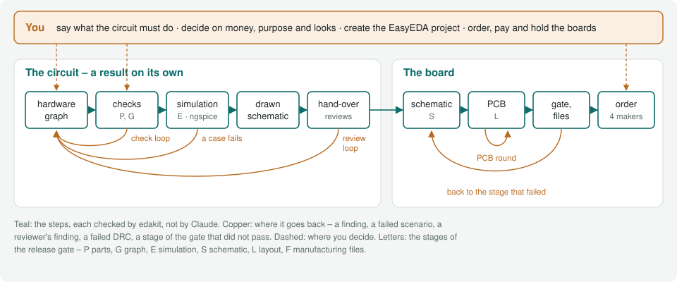

# How it works

For everyone, once. After this page you know the steps from an idea to a board, who does each one and what is not done
yet. The words: the [glossary's first section](glossary.md#the-ten-words-first).



## Two stations

**The circuit.** You say what the circuit must do. Claude writes it as a [hardware graph](glossary.md#hardware-graph):
parts, nets, pins, each part with its datasheet's limits. edakit checks it, simulates it and draws the schematic. The
circuit is handed over in writing, a result on its own: enough to wire by hand,
[build on a perfboard](steps/prototype.md) or put into a document.

**The board.** From the hand-over, Claude draws the schematic and the PCB in EasyEDA Pro or KiCad, routes it and
releases the manufacturing files. A release gate checks those files, not the drawing. The order goes into a maker's
cart at JLCPCB, PCBWay, Eurocircuits or AISLER. You order and pay.

## Who does what

The [walkthrough](../handbook/17-walkthrough.md) takes the smallest board through every step. Of its 14 steps, you act
in six:

| | Step | Who |
| --- | --- | --- |
| 1 | Set up | you answer, Claude writes |
| 2 | What it must do | you and Claude |
| 3 | Parts | Claude |
| 4 | Circuit | Claude as the circuit designer |
| 5 | What the checks found | Claude proposes, you decide |
| 6 | Stock and cost | Claude |
| 7 | Drawing and hand-over | Claude |
| 8 | Reviews | the reviewers, in sessions of their own |
| 9 | The gate offline | Claude |
| 10 | EDA project | EasyEDA: you, once; KiCad: edakit |
| 11 | Layout | Claude as the PCB designer, in its own session |
| 12 | Release | Claude |
| 13 | Order | Claude up to the cart, you order and pay |
| 14 | Acceptance | you, with the boards in your hand |

## How it is checked

Claude proposes. Checks that are not Claude decide whether it holds: the rules of the catalog, the simulation, the
PCB's design rules, the gate on the exported files. Reviewers judge what a rule cannot see. You decide where a
decision is due.

Every step loops back when it fails:

- **The check loop.** A [finding](glossary.md#finding) of `edakit check` or a failed scenario of `edakit sim` sends
  the circuit back to the graph. It is fixed, or accepted with a reason you agree to.
- **The review loop.** The electrical, regulatory and layout reviewers return numbered findings. Each is fixed or
  decided before the [sign-off](glossary.md#sign-off).
- **The PCB round.** Placement, routing and the design rules repeat until the board is clean and its reviewer agrees.
- **The gate.** A stage that fails sends the work back to that stage. Nothing is released while one fails.

## A decision round

Where a decision is due, Claude asks in Claude Code's question form, the recommended alternative first and the
consequence of each. From the walkthrough's third decision, shortened:

```chat
form: The third decision
  ? PATH.reverse on LED_SW: a CR2032 put in upside down reaches R1 and D1. Protect against it?
  - No protection (recommended): D1 blocks, the simulation shows 3.2 V against its rated 5 V.
  - A Schottky diode in series: costs about 0.3 V, the margin a used cell needs for 1 mA.
  > No protection
claude: D-3 written to docs/decisions.md; PATH.reverse accepted on LED_SW with that reason.
```

The answer goes into the project's decision log with its reason and date. The place where it applies names its number.

## What it does not give you

A guarantee. You get a check for every error class edakit knows, a list of what a reviewer judges and by whom, and an
acceptance test after delivery for the rest. The regulatory review is support, not legal advice: nothing in it is
legally guaranteed, and it may be wrong.

## State

What runs offline and what has run live, so that you know how close it is.

- **Ordering.** edakit and Claude in Chrome put a released board into the maker's cart and stop there. Nothing orders
  or pays. Live at all four makers ([live runs](../tests/fixtures/makers/LIVE.md)), and the first real order went
  through it: pytree's tree at JLCPCB. No order has gone through `edakit cart actual` yet.
- **EasyEDA.** Live in throwaway projects: the auto-layout's positions, own footprints as data, the DRC's rule set,
  designators at a fixed spot, the ODB++ export (handbook 4.5, 7.4, 7.5, 7.7). Creating the EasyEDA project stays a
  click by hand ([upstream](../upstream/README.md) lists each click).
- **The circuit as TOML.** Built and tested on the examples and the reference circuits. The Christmas bell's five
  boards were released on it. A JSON graph keeps working.
- **KiCad.** Tested in CI against KiCad 10. The 555 blinker of the [KiCad
  walkthrough](../handbook/18-walkthrough-kicad.md) went through it to a release.
- **Limits.** Two copper layers. The simulation runs DC operating points, the transient scenarios of plug, unplug and
  switch-over, and small-signal AC for audio and guitar circuits where an expectation is named. Spikes and fast edges
  are left to the acceptance test.
- **Versions.** Every change comes as a version with its own number, 1.0.0 at the first order. The
  [changelog](../CHANGELOG.md) says what each changed and what a project has to do when the middle number goes up.
  `edakit --version` names the one that runs.
- **Licences.** [easyeda-mcp-pro](https://github.com/oaslananka/easyeda-mcp-pro) 1.11.0, as pinned, is MIT (since
  1.7.0; 1.1.0 to 1.6.0 were PolyForm Noncommercial). EasyEDA Pro is proprietary, Freerouting GPL-3.0, ngspice BSD. None of
  them is bundled.

## Future work

Three changes would alter how a project works; smaller ones are not listed.

- **Ordering through the makers' interfaces.** Through a maker's API the steps up to the cart would run without a
  browser, with the same checks. You still order and pay. What each maker offers: handbook 8.4, "Future work".
- **The circuit in a language of its own.** A notation of edakit's own instead of the TOML graph, compiled to the graph
  the checks read. Blocks take parameters, and a second board is a few lines on top of the first. What it would be:
  [circuit-dsl](concepts/new/circuit-dsl.md).
- **Claude independence.** Today the plugin runs in Claude Code. Made portable, it would run in GitHub Copilot, Qwen
  Code, Mistral Vibe and OpenCode too, or with a model on your own machine where the evals show it works. What it
  takes: [claude-independence](concepts/new/claude-independence.md).
