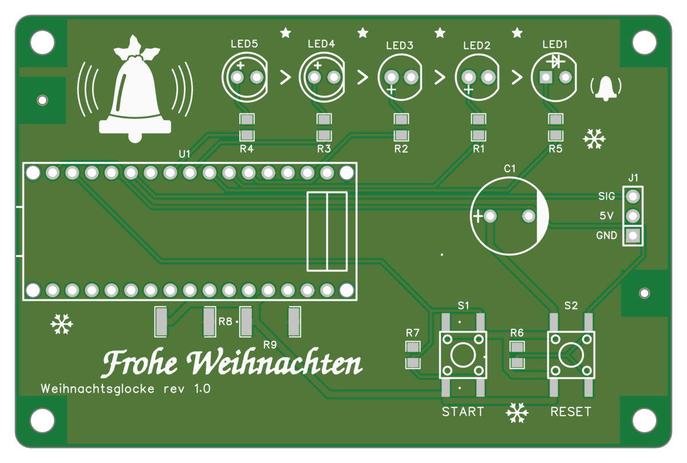
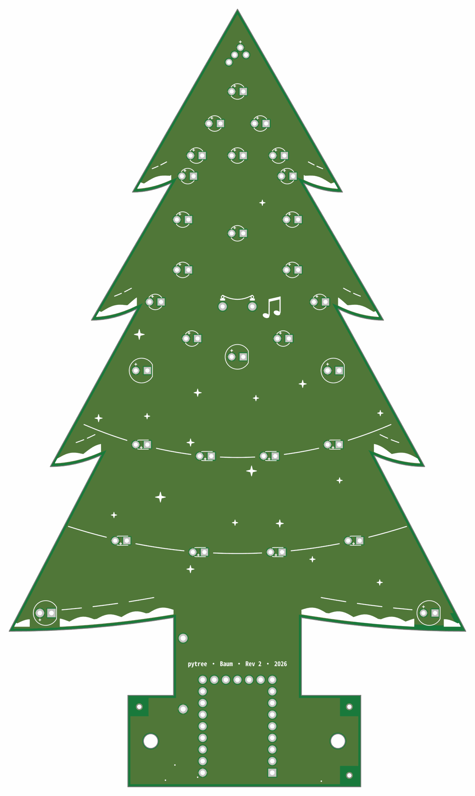
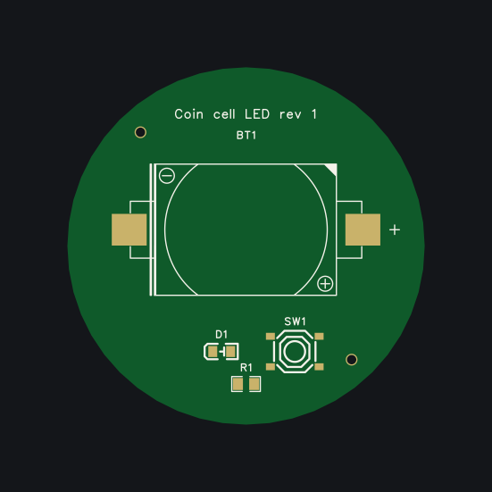
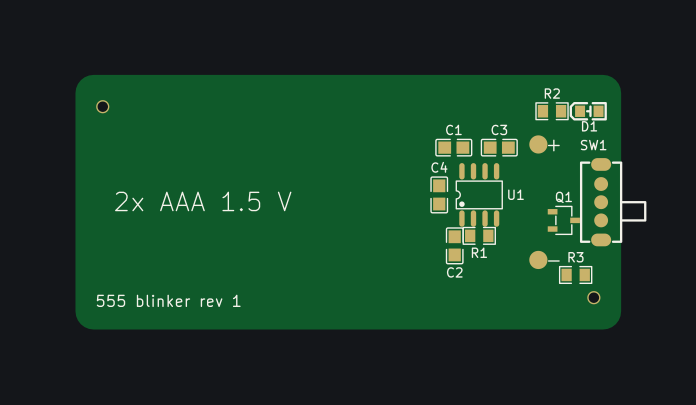

# Projects

The boards built with edakit, each with what it is, its circuit, its board and what edakit found on the way. The
pictures come from each project's release, drawn by edakit.

## The Christmas bell

An Arduino Nano counts down on five LEDs, then a servo strikes a real bell. One circuit on five boards, released
together. [The page](christmas-bell.md).

## pytree

A programming advent calendar: a Christmas tree of circuit boards whose 30 LEDs wake day by day as Python tasks are
solved. The project edakit was grown on. [The page](pytree.md).

## The examples

The two walkthroughs each take a small board through every step, with every file in the repository.

| | |
| --- | --- |
|  | **A coin cell, a button, an LED.** Press the button and a red LED lights from a CR2032. Drawn in EasyEDA Pro. [Walkthrough](../../handbook/17-walkthrough.md). |
|  | **A 555 blinker.** A red LED blinks about once a second from two AAA cells. Drawn in KiCad. [Walkthrough 2](../../handbook/18-walkthrough-kicad.md). |

## Your board here

Built a board with edakit? Open an issue with the form "built with edakit". A page is written from the project's
release, and it names the edakit version that released the board.
