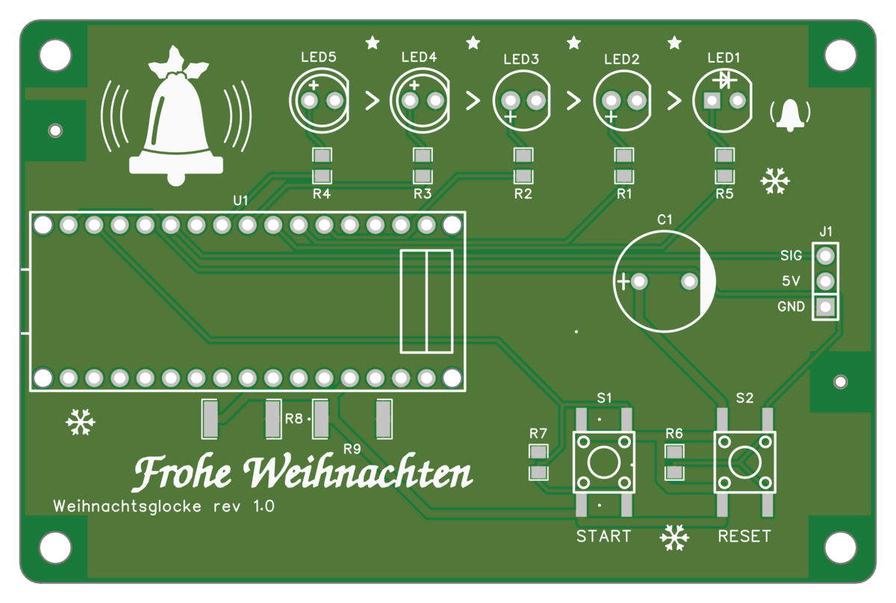
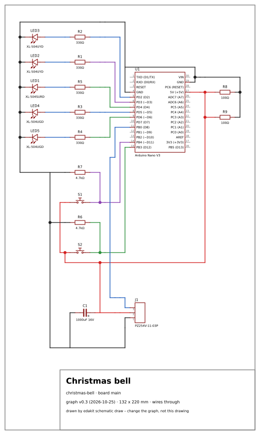
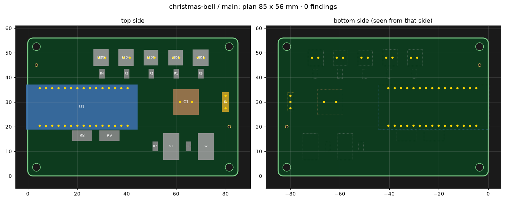
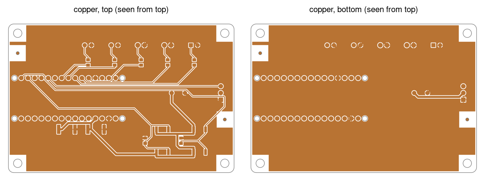
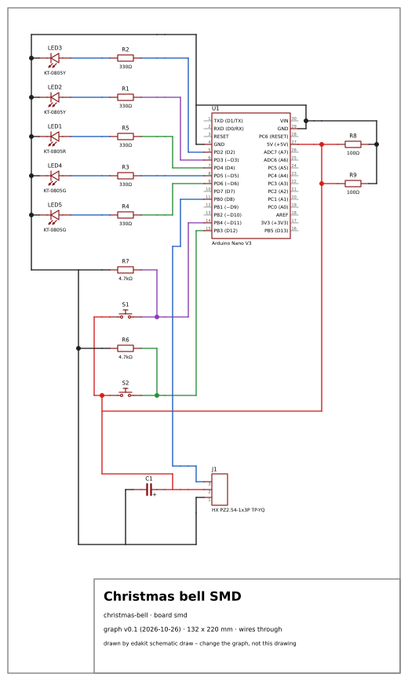
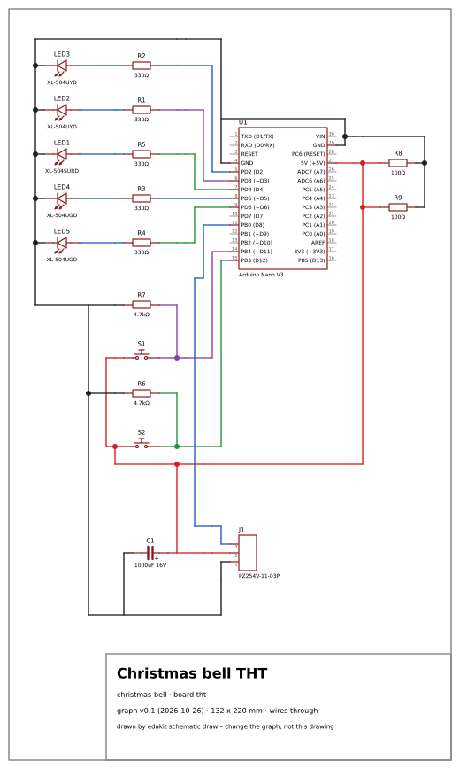
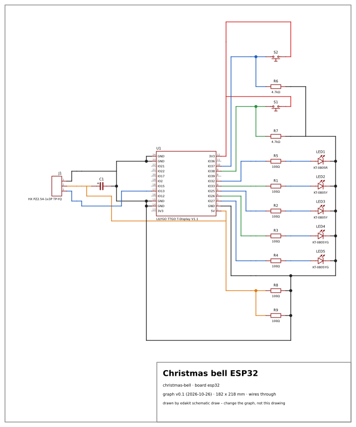
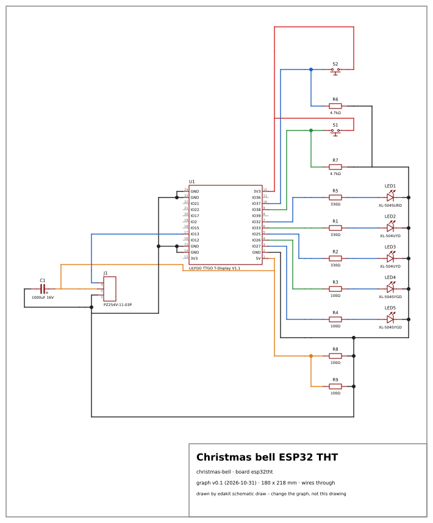

# The Christmas bell

An Arduino Nano counts down on five LEDs, then a servo strikes a real bell. Parents press the start button on
Christmas Eve, leave the room, and after 65 seconds the bell rings for the children. It is the second project built
with edakit, and it started as a Fritzing breadboard drawing. Its repository is public:
[automatic_christmas_bell](https://github.com/tgd1975/automatic_christmas_bell).

## What it is

One circuit, five boards. The main board carries a plugged-in Arduino Nano, a servo connector, a buffer capacitor,
five 5 mm LEDs and two buttons, on 85 × 56 mm with four M3 holes. JLCPCB assembles the SMD parts on the top side. The
Nano's sockets, the LEDs, the capacitor and the servo header are soldered by hand. Four variants share the outline:
one for assembly, one with through-hole parts only, two with an ESP32 module instead of the Nano.

**State 2026-11-02:** all five boards released; main, smd and esp32 in gate runs 20261101-142527, -142626 and
-142730, tht and esp32tht in -005606 and -005734. The through-hole variants tht and esp32tht are ordered bare at
JLCPCB, five each, in one order with pytree's tree; main, smd and esp32 are not ordered. The pictures on this page
come from the main board's release 20261101-142527 and the repository at commit 49f3373.

## The circuit

The Nano drives everything from USB power. Its blocks:

- **Countdown LEDs.** Two green, two yellow and one red LED, each on its own pin with a series resistor. They show the
  time left.
- **Buttons.** Start and reset, each switching 5 V into a Nano input. The Fritzing drawing had 3.3 V there, only
  0.28 V above the level the ATmega328P reads as high; 5 V gives 1.7 V of margin (its decision D-4).
- **Servo.** A 9 g servo on a three-pin header, powered from the Nano's 5 V pin. A 1000 µF capacitor buffers its start
  current; the servo's start is simulated as a transient run (D-33).
- **Base load.** Two 100 Ω resistors in parallel draw 100 mA, so that a USB power bank does not switch off in the
  middle of the countdown. The simulation checks every scenario against that minimum (D-8).

## The board

| | |
| --- | --- |
| Size | 85 × 56 mm, two layers, four M3 holes |
| Parts and nets | 17 parts in the schematic, 15 nets |
| Routing | Freerouting from a placement plan, DRC 0 |
| Assembly | JLCPCB Economic, top side: the SMD parts; the rest by hand |

The fixed parts – the Nano, the LED row at the back edge, the buttons, the servo header – are placed from a plan in the
board file. Freerouting routes the rest, and edakit writes the result back into EasyEDA.

## What edakit found

At its first release:

- **Offline:** `edakit check` 0 errors, `edakit sim` 1112 checks.
- **Schematic:** equal to the graph (17 parts, 15 nets), ERC clean.
- **PCB:** 85 × 56 mm from a placement plan, routed by Freerouting with 3 vias, DRC 0, silkscreen without findings.
- **Release gate:** released. Two of its reviews failed first and were fixed:
  - **GEO.hole:** the first Nano footprint's 0.9 mm holes were too small for the header tails. A footprint with
    1.1 mm holes replaced it ([GEO.hole](../catalog/geo.html#GEO.hole)).
  - **M-5, the layout review:** printed texts below 1 mm and copper close to the mounting holes. Both were fixed in
    edakit itself.

Later, the pictures of the released copper showed bare spots in the ground pour. Stitching vias closed them on three
boards (D-41), and GEO.pour now measures the bare area too. Creating the EasyEDA project and the decisions were the
manual steps. The repository's `docs/decisions.md` holds every decision, including two the simulation brought up.

## Variants

The bell is one circuit as main, smd, tht, esp32 and esp32tht. Each variant is an edakit project of its own below the
main one, with its own graph, parts and sign-offs, released and published together.

| | smd | tht | esp32 | esp32tht |
| --- | --- | --- | --- | --- |
| Controller | Arduino Nano | Arduino Nano | LILYGO T-Display (ESP32) | as esp32 |
| LEDs | 0805 | 5 mm through-hole | 0805 | 5 mm through-hole |
| Series resistors | 330 Ω 0805 | 330 Ω ¼ W | 100 Ω 0805 | 100 Ω ¼ W |
| Assembly | JLCPCB, all but the sockets | none, all by hand | JLCPCB, all but the sockets | none, all by hand |

The esp32 boards follow from 3.3 V logic: the buttons switch 3.3 V, and the LEDs are driven from 3.3 V outputs. The
T-Display is in no library. Its footprint is data in its parts entry, checked against the board.

| smd | tht |
| --- | --- |
|  |  |

| esp32 | esp32tht |
| --- | --- |
|  |  |

## What it changed in edakit

Taking the bell through EasyEDA showed gaps, and closing them is part of what edakit is today
([lessons learned, 13.6](../../handbook/13-lessons-learned.md)):

- pin names checked against the symbols;
- a new project's default board;
- LEDs in a row pointing the same way;
- off-board loads and input levels in the simulation;
- a guard against writing into the wrong project;
- later, the board's layers drawn into every gate run, and GEO.pour measuring bare copper.
