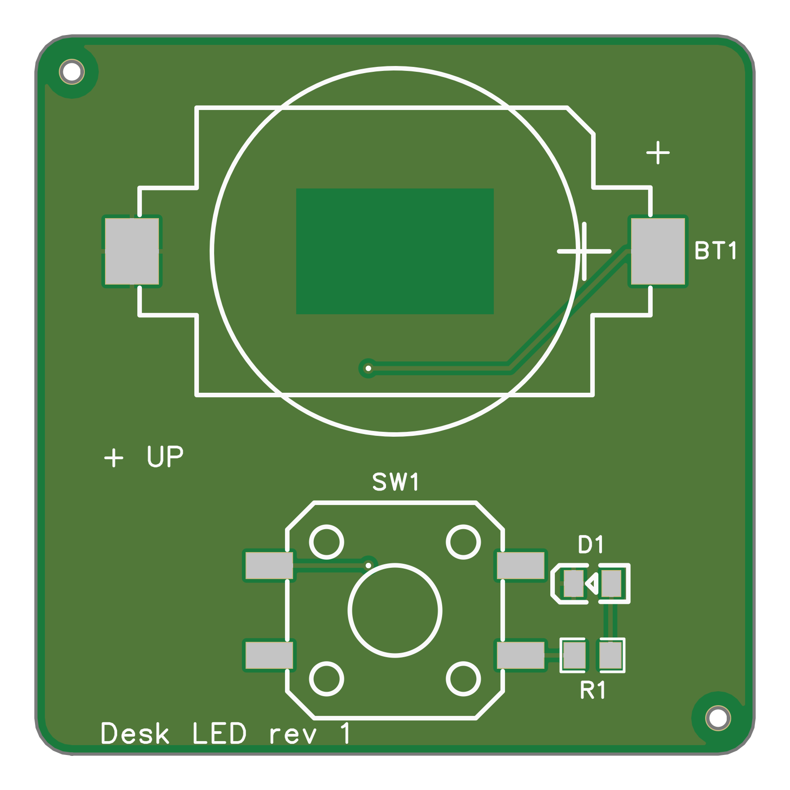
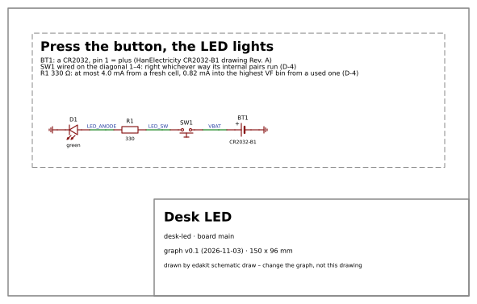
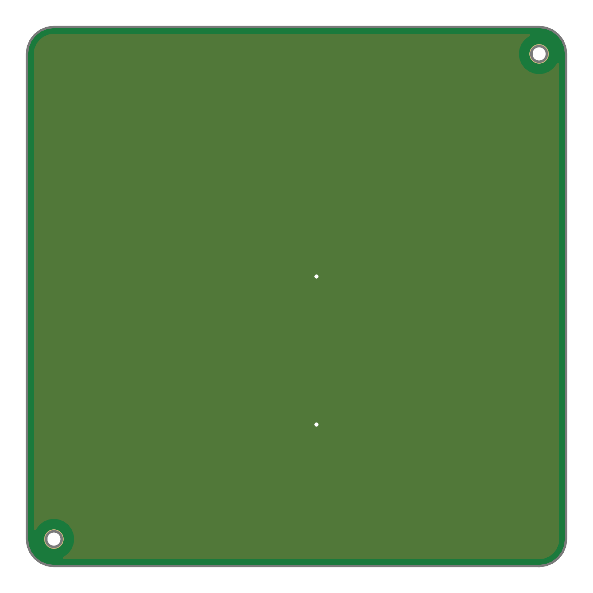
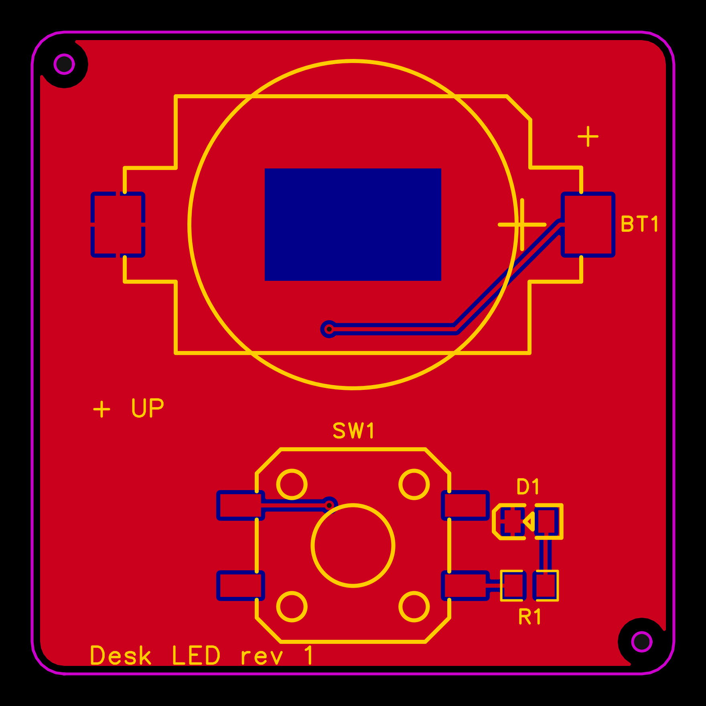

# Desk LED

A small board for the desk: a CR2032 coin cell, a push button and a green LED. Press the button and the LED lights. It
was made as an example repository for edakit, with every file edakit works on in it, from the requirements to the
routed board. Its repository is public: [desk-led](https://github.com/tgd1975/desk-led).

**State 2026-11-23:** board main released in gate run 20261123-083610 with edakit 1.3.4 and published as release
[2026-11-23](https://github.com/tgd1975/desk-led/releases/tag/2026-11-23). It is not ordered (its decision D-8). The pictures
on this page are that release's.

## What it is

Four parts on 40 × 40 mm, two layers. The cell sits in an SMD holder centred at the top, the 12 × 12 mm button below
it on the same axis, the LED and its resistor beside the button. JLCPCB is to place all four on the top side in
Economic assembly; nothing is soldered by hand.

What it must do is written in the owner's words, one need and five requirements. The LED lights only while the
button is held (R-1), from a CR2032 (R-2), and it is green (R-4). JLCPCB places the parts (R-3), and the button is a
12 × 12 mm tactile switch (R-5).

## The circuit

- **The LED.** A Lite-On LTST-C170KGKT, AlInGaP green with a forward voltage of 1.9 to 2.4 V. The common InGaN green
  needs 2.6 to 3.1 V and stays dark on a used cell at 2.5 V. This one is a yellowish green that lights from it.
- **The resistor.** 330 Ω, so that the LED still gets about 1 mA from a used cell at its highest forward voltage. A
  fresh cell drives about 4 mA, more than the CR2032's 3 mA of continuous current. That finding is accepted: a press
  is short, and 4 mA is far below the cell's pulse current.
- **No reverse-polarity protection.** A cell put in upside down reverses the LED at 3.2 V, within its 5 V. A Schottky
  diode would cost the 0.3 V the used cell needs. The simulation runs that case as its own scenario.

## The board

| The top side | The bottom side, seen from below |
| --- | --- |
|  |  |

| | |
| --- | --- |
| Size | 40 × 40 mm, two layers, two JLCPCB tooling holes |
| Parts and nets | 4 parts, 4 nets |
| Routing | Freerouting, 2 vias, both under a body; DRC 0 |
| Copper | GND poured on top (87 %), VBAT on the bottom (94 %) |
| Assembly | JLCPCB Economic, top side: all four parts |

GND has no track at all: both its pads sit in the top pour. The cell holder's drawing hatches 11 × 7 mm
between its pads where no copper may be. A keep-out in the board file keeps tracks, vias and the pour out of it.
The silkscreen draws the cell's outline and marks plus twice, so that the polarity stays visible with the cell in.

Both copper layers over each other, in the colours of the EasyEDA editor:

## What edakit found

At its release:

- **Offline:** stage P (parts) 8 checks, G (graph) 38, E (simulation) 111. The simulation runs nine scenarios: a
  fresh, a used and a reversed cell, the button pressed and released, the LED's forward voltage at both ends.
- **Schematic:** equal to the graph, 4 parts and 4 nets.
- **Board and manufacturing files:** stage L (board) 39 checks, F (manufacturing) 22, no failure and no warning.
- **Reviews:** the datasheet check (M-1) and the regulatory review (M-6) at the hand-over of the circuit, the layout
  review (M-5) on the release's manufacturing files, each by edakit's agent.

The project's own check `licence` runs in the gate as a stage of its own. It holds the repository to MIT: every file
of a kind that usually comes from someone else must be named in the README with its licence.

## What it changed in edakit

Its first layout round, with edakit 1.1.0, found eight gaps, and the project proposed each as an issue. All eight are
built:

- keep-outs keep a copper pour out too, with `pour = false` – the project had set the region with a script of its own
  ([#335](https://github.com/tgd1975/edakit/issues/335));
- pours fill again on easyeda-mcp-pro 1.8.0, and `route fill` fills them one by one after a failure
  ([#336](https://github.com/tgd1975/edakit/issues/336));
- three error messages in place of a traceback or a dead end
  ([#337](https://github.com/tgd1975/edakit/issues/337) to [#339](https://github.com/tgd1975/edakit/issues/339));
- GEO.pour measures bare copper on a seen face without a pour too
  ([#340](https://github.com/tgd1975/edakit/issues/340));
- vias keep a distance from reflowed SMD pads, and no track runs between the two pads of a small chip part
  ([#341](https://github.com/tgd1975/edakit/issues/341), [#342](https://github.com/tgd1975/edakit/issues/342)).

For the release the project dropped its script: the keep-out under the cell holder says `pour = false` itself, the
copper stayed the same, and GEO.pour leaves the area out.
