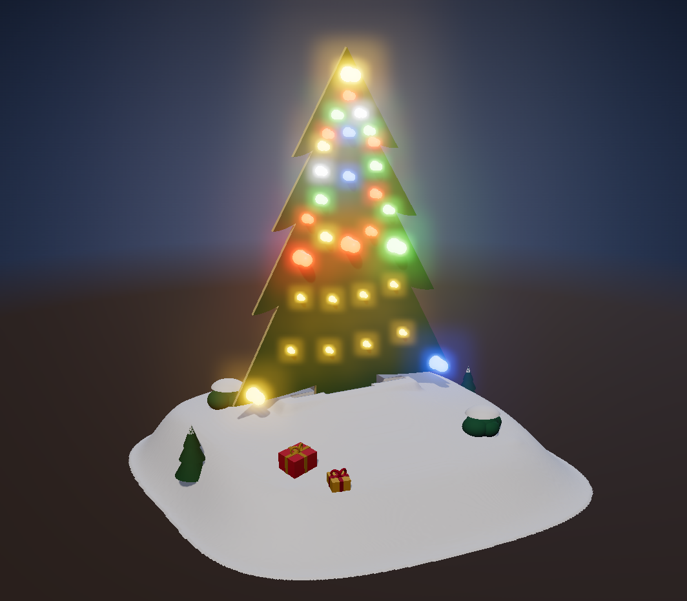
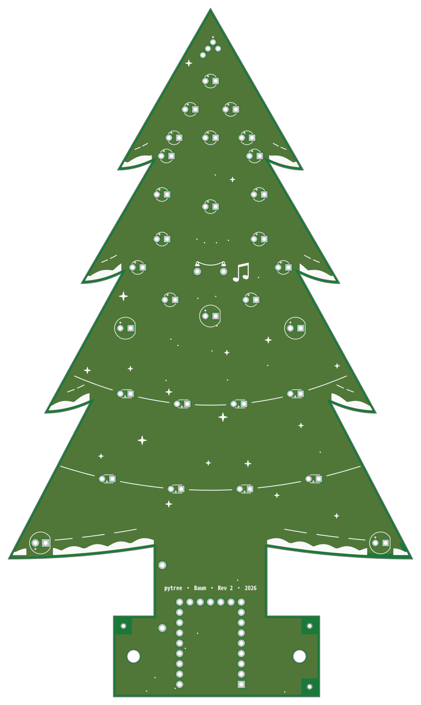
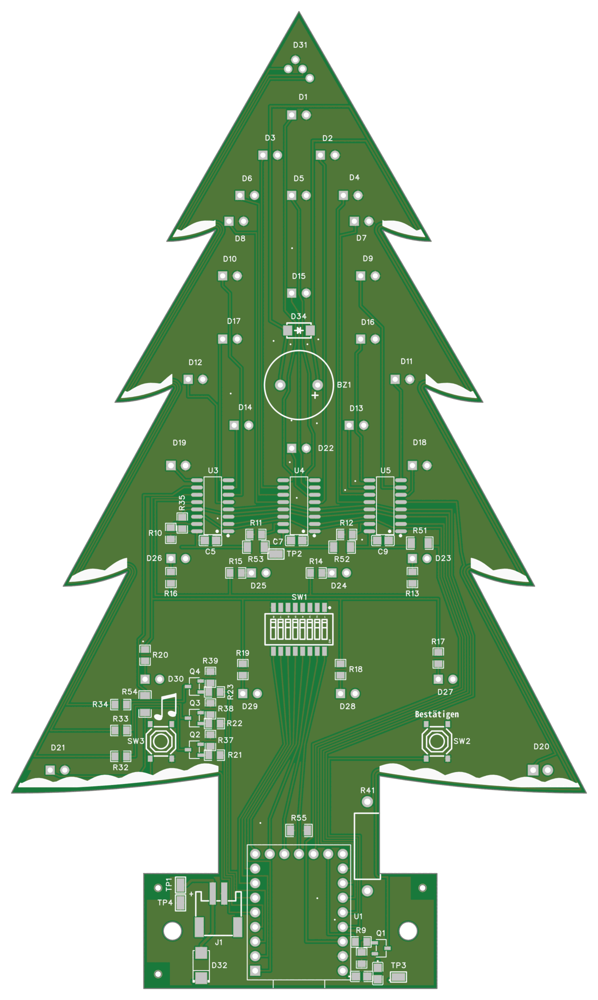
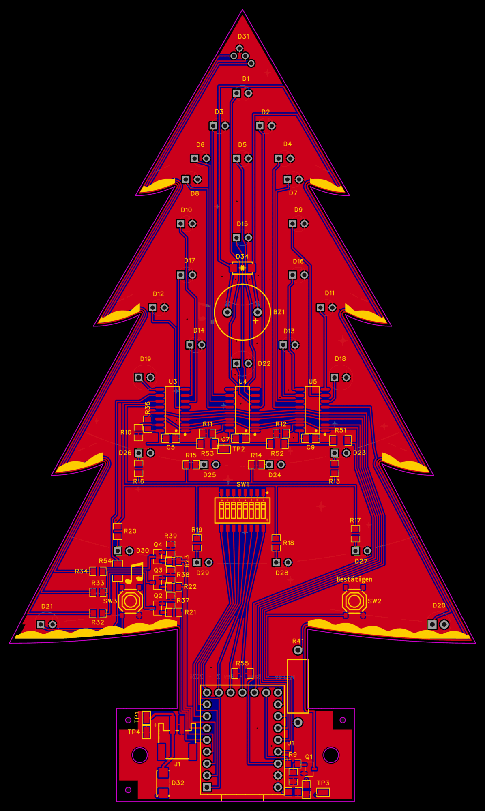
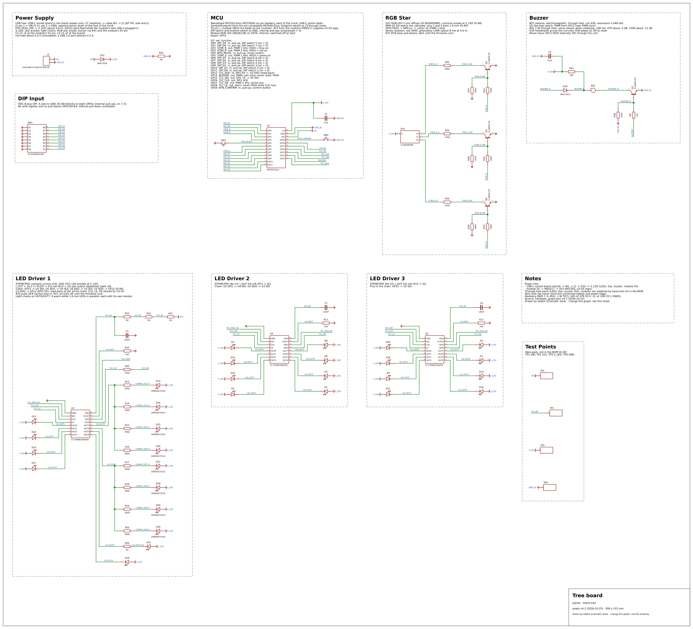
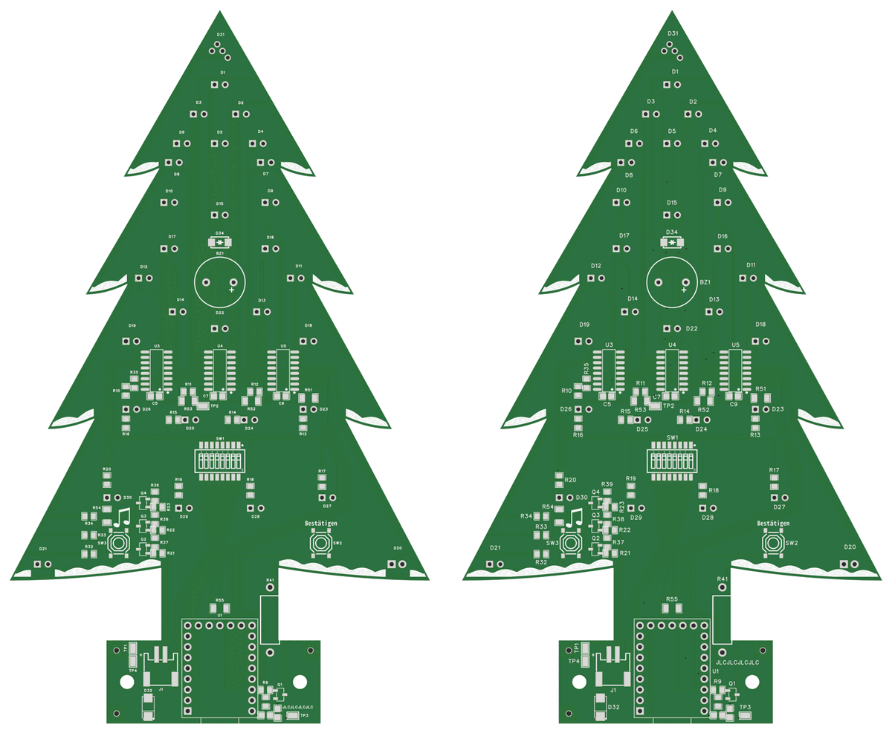

# pytree

A programming advent calendar. Every day it sets a small Python task; the answer is an 8-bit code, set on the DIP
switch of a Christmas tree made of circuit boards. With each code the tree wakes a little more: one LED on the first
of December, the whole tree with its golden star and a melody from the buzzer on the 24th. Its repository is private;
this page is the one description of it in edakit.

**State 2026-11-02:** the tree board released in gate run 20261101-225744 and ordered at JLCPCB on 2026-11-02.
Five boards, assembled on the back, from the cart the skill cart filled and checked; the parts from LCSC ship with
them.

## What it is

- **The tree.** A Waveshare RP2350-Zero on a pin header, three STP08CP05 LED drivers, 30 through-hole LEDs on 24
  outputs, an RGB star, a buzzer, an 8-way DIP switch for the day's code and two buttons. It is powered over USB-C in a
  3D-printed hill.
- **The board.** Two layers, cut as a tree. All tracks run on the back: the front carries only the LEDs, the star, the
  print and a copper area. Routed by Freerouting, DRC 0.
- **The assembly.** JLCPCB makes the board and assembles the back side; the through-hole parts are soldered by hand.

The board and schematic pictures are edakit's, drawn by the gate into the protocol of release 20261101-225744 – the
board from its Gerber files, the schematic from its graph. The render of the tree in its hill is the project's own,
from the 3D model of the printed hill; a photo of the delivered tree will replace it.

## The board

| The front, with the LEDs | The back, with the electronics |
| --- | --- |
|  |  |

Both copper layers over each other, in the colours of the EasyEDA editor – the back's tracks blue, the front's copper
red:

## The circuit

Its blocks, as the drawing names them:

- **Power supply.** USB from the socket board in the stand through a cable to J1; a Schottky diode feeds the LED supply
  and blocks back-feed while the module's own USB is plugged in.
- **MCU.** The RP2350-Zero; its pin table in the drawing names every GPIO's function. The two buttons sit with it:
  one confirms the code, the other plays music.
- **DIP input.** The eight switches straight to eight GPIOs, with the module's internal pull-ups – no shift register.
- **LED drivers 1 to 3.** Three constant-current sinks in a chain on SPI, about 9.6 mA per output, the LEDs' anodes at
  the LED supply.
- **RGB star.** One RGB LED whose three cathodes NPN transistors switch from PWM outputs.
- **Buzzer.** The melody on the 24th.

## What it changed in edakit

edakit was grown on this project: the first released manufacturing files came five days after the first graph. The
simulation ran 41 scenarios with about 11 000 single checks in about 3 seconds. What went wrong on the way, and what
edakit learned from it, is in [lessons learned](../../handbook/13-lessons-learned.md).

One of those lessons in a picture. The back of the earlier release 20261031-110510, left, had copper islands without a
pad, which EasyEDA drops when it fills the pours. Gate, DRC and the layout review all passed it. The copper review of
2026-11-01 found them; on the right the back after the review, where seams of the LED supply close the channels.
GEO.pour measures the bare area since.

