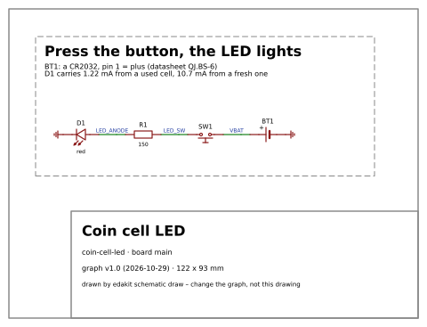

# Quickstart: a checked circuit in fifteen minutes

For you if you want to see what edakit does before you install anything. After this page you have run the checks,
read a finding, simulated the circuit and drawn its schematic. You need no EasyEDA, no KiCad and no Claude Code for
it.

## What you need

- [uv](https://docs.astral.sh/uv/), the Python tool that runs edakit without installing it.
- [ngspice](https://ngspice.sourceforge.io/) for the simulation, from your package manager (`apt install ngspice`).
- git, to fetch the example.

## 1. Fetch the example

The example is the circuit of the walkthrough: a CR2032 coin cell, a push button, a red LED and its resistor.

```bash
git clone https://github.com/tgd1975/edakit
cd edakit/examples/coin-cell-led
alias edakit='uvx --from git+https://github.com/tgd1975/edakit edakit'
```

The alias runs the newest edakit through uv. The first call takes a minute, every later one a fraction of a second.

## 2. Look at the circuit

The circuit is text: `hardware/graph.json` holds four parts and four nets. Each part points to a
[parts entry](glossary.md#parts-entry) with the limits from its datasheet. Ask for one part:

```text
$ edakit graph show D1
D1  led on main – LED (red 0805)
  part      C84256, entry C84256 (led)
  value     red
  limits    if_max_a = 0.025, vr_max_v = 5, p_max_w = 0.065
  values    color = red, vf_typ_v = 2.0, vf_min_v = 1.5, vf_max_v = 2.6, vf_at_a = 0.02
  pins
    1    -            cathode    GND
    2    +            anode      LED_ANODE
  findings  none
```

## 3. Run the checks

```text
$ edakit check
domains: core, power (suggested by the graph – edakit domains)
PATH.reverse – reverse polarity blocked: 1 error (accepted)
  G  R1.1 on LED_SW: a reversed source reaches this pin without a blocking device   (catalog/paths.toml [reverse])   → a series Schottky diode, or a PMOS with its gate to ground (block reverse-pmos)
…
4 components, 4 nets, 4 parts entries; 3 accepted; requirements: 2 needs, 2 requirements
```

Each [finding](glossary.md#finding) has a [code](glossary.md#code), the place and what to do. This one says that a
cell put in upside down reaches the resistor. The designer looked at it and accepted it with a reason. You see the
reason under the finding.

## 4. Read a finding

```text
$ edakit explain PATH.reverse
PATH.reverse (reverse polarity blocked): What a reversed source (a battery holder, a source marked reversible) reaches through fuses, switches and push buttons is only capacitors without polarity, holders, connectors – their contacts are separate, a connector hands nothing on from one pin to another –, the anode of a blocking diode – on a negative rail (the protected net declared at or below 0 V) its cathode – or the drain of a PMOS whose source and gate are outside; an N-MOSFET in the ground return – drain on the source's return, source on ground, gate from the plus side – cuts the board's ground off, and then only the parts between the source's own nets count; a polarized capacitor it reaches is reverse biased (grade polarized).
    why: A battery inserted the wrong way drives the supply negative; every IC on that rail conducts through its substrate diodes and dies within milliseconds.
…
```

Every code of the [catalog](glossary.md#catalog) explains itself this way: the rule, why it exists, what to do and
its source.

## 5. Simulate it

```text
$ edakit sim

112 comparisons: pass 109, waived 3
…
```

ngspice ran every [scenario](glossary.md#scenario): a fresh and a used cell, the button pressed and released, the
LED at its extremes, the cell upside down. The three waived comparisons are the cell's current while the button is
held. The designer accepted them, with the datasheet's pulse rating as the reason.

## 6. Draw the schematic

```text
$ edakit schematic draw
drawn: 4 parts, 3 wires, 2 flags, 122 x 93 mm
…
```

The drawing lands in `build/edakit/schematic_main.svg`. It quotes the simulation's currents in its notes:



## What you did not need

You read no datasheet and computed no value. Each finding came with its reason, and each number with its source.

This is a result on its own: a checked circuit with its drawing. It is enough to wire it by hand, build it on a
perfboard or put it into a document. The [hand-wired board](glossary.md#hand-wired-board) goes through the same
checks.

## Next

- **Your own circuit.** [The steps](steps/README.md) take you from the plugin's install to a checked circuit of your
  own, and on to an ordered board: what you do, what Claude asks, what you decide. The same checks run on it.
- **A board from it.** The [walkthrough](../handbook/17-walkthrough.md) takes this example on to EasyEDA Pro, the
  manufacturing files and the order. The same on KiCad: the [KiCad walkthrough](../handbook/18-walkthrough-kicad.md).
- **How it fits together.** [How it works](how-it-works.md) shows the steps, who does what and what is not done yet.
