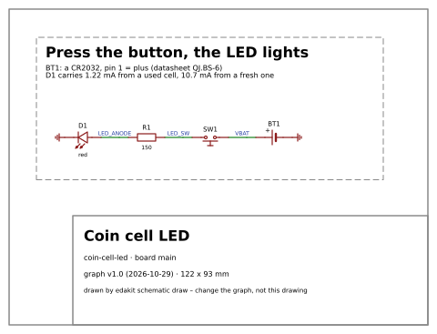

# 7 Draw and hand over

After this step you have your circuit as a drawing, and whoever lays out the board has what they must know.

## What you do

Look at the drawing. Claude draws the schematic from the circuit's text alone, without EasyEDA or KiCad:

```text
$ edakit schematic draw
drawn: 4 parts, 3 wires, 2 flags, 122 x 93 mm
…
```



## What you decide

Where you stop. A checked circuit and its drawing are a result of their own: you can wire it by hand, build it on a
perfboard or put it into a document. A [hand-wired board](../glossary.md#hand-wired-board) goes through the same
checks. Or you go on to a board.

## What you are asked

For a board: what the layout must keep. A part a person touches or looks at gets a fixed place, such as the LED
beside its button.

## What you have

The [hand-over](../glossary.md#hand-over): the fixed parts and the notes for the layout, in writing.

```text
$ edakit handover
board main – the plan keeps this (SYNC.plan: edakit pcb plan, the gate)
  fixed  BT1, SW1, D1
notes for the layout:
…
  - D1 next to SW1: the LED shows the press
```

Next: [Have it reviewed](08-have-it-reviewed.md).

## Read on

- The walkthrough: [Drawing and hand-over](../../handbook/17-walkthrough.md#178-drawing-and-hand-over)
- The handbook: [Drawn without EasyEDA](../../handbook/06-schematic.md#65-drawn-without-easyeda)
