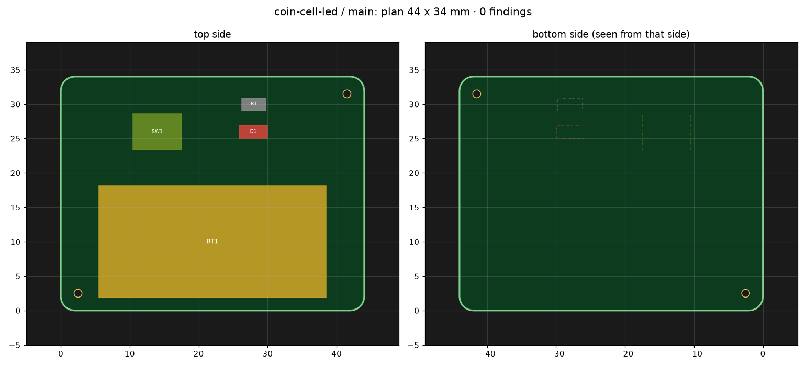
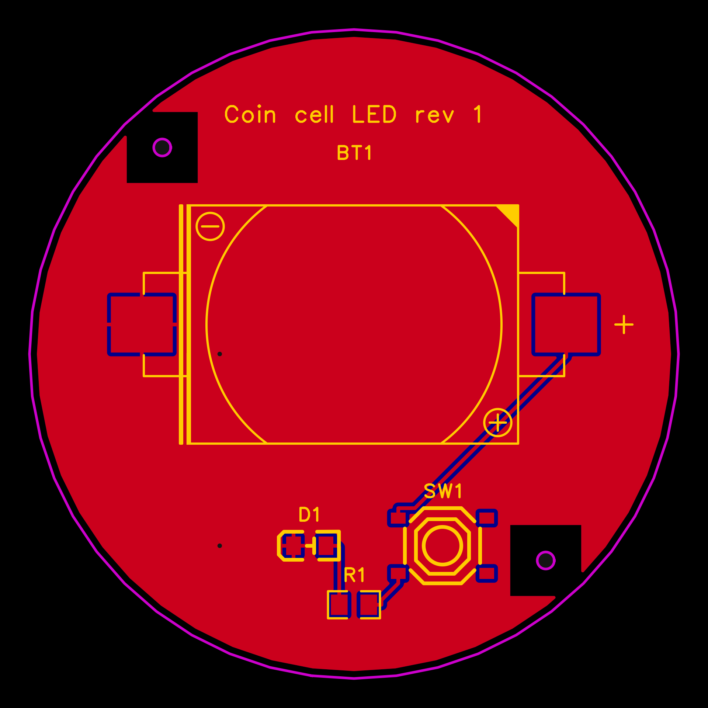

# 9 Lay out the board

After this step your board is placed, routed and checked, in EasyEDA Pro or in KiCad.

## What you do

Install the program you chose once: EasyEDA Pro desktop with Node 24, or KiCad 10. For EasyEDA you create the
project by hand, *File → New → Project*, with your project's name. Its interface cannot do that. With KiCad there is
nothing to create: Claude writes the project.

Then start a new session and type `/edakit:pcb-round`. Claude works from what the last steps handed over. It plans the
places and checks the plan offline:

```text
$ edakit pcb plan
…
  4 fixed parts, 0 for the auto-layout; airline length of the fixed parts (without GND): 0.02 m
```



Then it places the parts, routes with Freerouting, pours the ground, prints the labels and runs the design rule check.
In EasyEDA one click is left for you: *Design → Import Changes*, once. Claude says when.



## What you are asked

What only you can say: the board's size and shape, its holes, where the parts go that a person touches, and how it
looks. In the walkthrough you wanted it round.

## What you decide

Looks, size, holes and colours. A wish for the board stays in the board's file. A wish that changes the circuit goes
back to the circuit, through its own steps.

## What you have

`hardware/boards/main.toml`, the board as text, and the board itself in EasyEDA or KiCad. The reviewer pcb-reviewer
reads it next. Next: [Order the board](10-order-the-board.md).

## Read on

- The walkthrough: [EasyEDA and the layout](../../handbook/17-walkthrough.md#1711-easyeda-and-the-layout)
- The handbook: [PCB](../../handbook/07-pcb.md)
