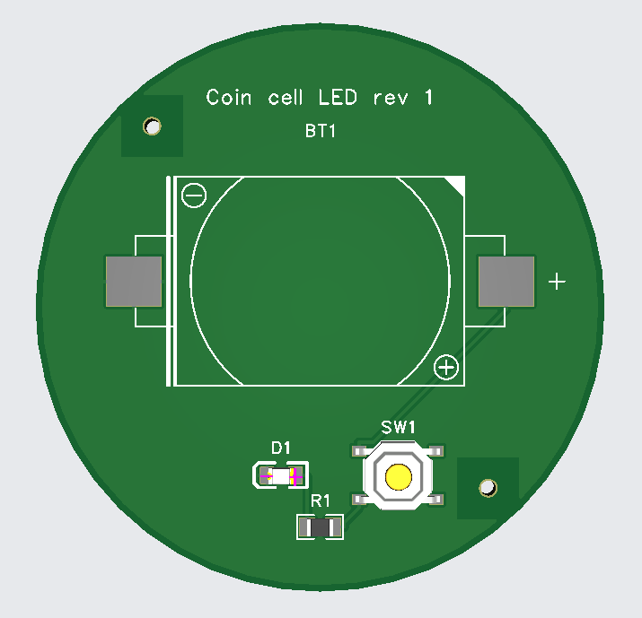
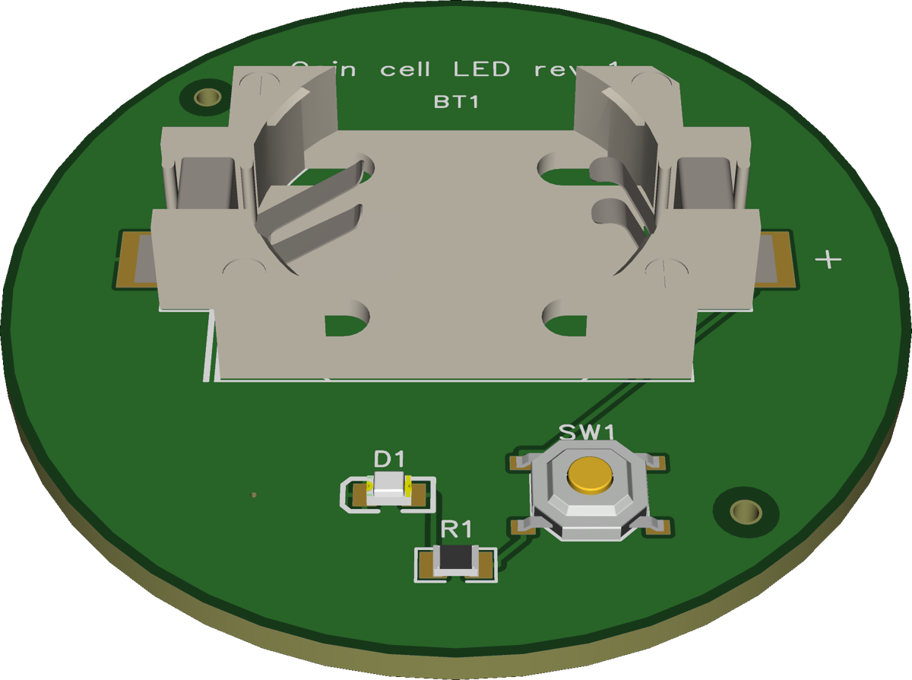

# 10 Order the board

After this step your boards are ordered, paid, delivered and tested.

## What you do

Ask for the [release](../glossary.md#release). Claude runs every check again, now on the files that go to the
manufacturer. Only a run that ends with `RELEASED` may go out.

### Parts you solder yourself

The manufacturer places only what it has in stock and what you let it assemble. Everything else you solder yourself.
`edakit order` lists those parts in `hand_assembly.md` and puts them into a cart at LCSC.

Do you keep parts in a drawer? Then keep a table of them, your [inventory](../glossary.md#inventory). `edakit order`
takes from it first and orders only the rest. `hand_assembly.md` then says what to take out of the drawer. edakit
never changes your table. How to set it up:
[handbook 8.4](../../handbook/08-release-gate.md#parts-on-hand-the-inventory).

Here only the cell holder BT1 is soldered by hand, so the walkthrough takes nothing from a drawer.

### The manufacturer's form

Then `/edakit:cart` fills the manufacturer's form in your Chrome, with Claude in Chrome. Every field comes from your
project:

```text
$ edakit cart fields
PCB
…
  PCB Qty                   5                           [project] quantity quantity = 5
  PCB Thickness             1.6 mm                      edakit       thickness_mm = 1.6
…
```

Claude reads every field back, checks the quote against the estimate and stops at the cart.

## What you are asked

Once: the country you ship to and the shipping method.

## What you decide

- Ordering and paying. Nothing in edakit orders or pays.
- M-2: the parts' orientation in the manufacturer's preview, before you pay.
- M-4: when the boards arrive, you test each one against the list the last run wrote.

For M-2 JLCPCB shows the board with its parts as they will be placed, here the walkthrough's:



BT1 comes in the LCSC cart. You solder its two tabs yourself, then the board is done:



## What you have

Boards in your hand, and a record of the order in `hardware/orders/`. Once paid, `edakit cart actual` puts the real
cost beside the estimate.

## Read on

- The walkthrough: [Release, order, acceptance](../../handbook/17-walkthrough.md#1712-release-order-acceptance)
- The handbook: [Ordering](../../handbook/08-release-gate.md#84-ordering-at-the-manufacturer-up-to-the-cart-you-order-and-pay)
