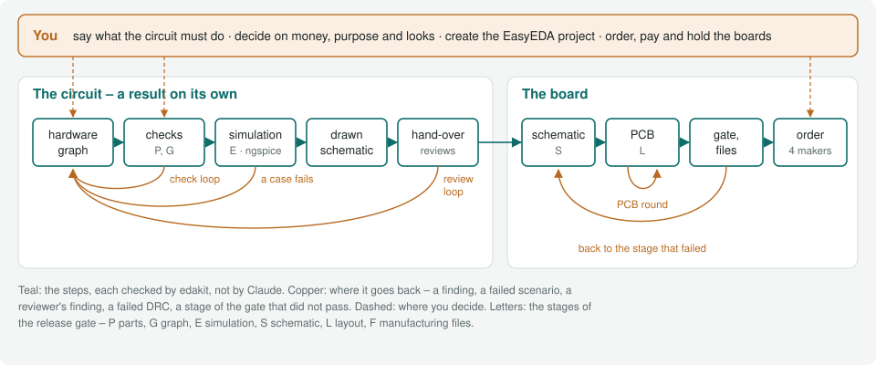

# The steps: from an idea to a board

For you if you want to make a circuit or a board with Claude. Ten steps lead from the idea to the boards in your
hand. Each page says what you do, what you are asked, what you decide and what you have at the end.

| | Step | Who acts |
| --- | --- | --- |
| 1 | [Install the tools](01-install.md) | you |
| 2 | [Start a project](02-start-a-project.md) | you answer, Claude writes |
| 3 | [Say what it must do](03-say-what-it-must-do.md) | you and Claude |
| 4 | [Design the circuit](04-design-the-circuit.md) | Claude |
| 5 | [Decide on what was found](05-decide-on-what-was-found.md) | Claude asks, you decide |
| 6 | [Settle parts and cost](06-settle-parts-and-cost.md) | Claude asks the shop, you decide who solders |
| 7 | [Draw and hand over](07-draw-and-hand-over.md) | Claude |
| 8 | [Have it reviewed](08-have-it-reviewed.md) | reviewers, each in a session of its own |
| 9 | [Lay out the board](09-lay-out-the-board.md) | Claude; you say how it looks |
| 10 | [Order the board](10-order-the-board.md) | Claude up to the cart; you order, pay and test |

Steps 1 to 7 give a checked circuit and its drawing. That is enough to wire it by hand or to build it on a perfboard.
Steps 8 to 10 make a board from it.

Three texts, three uses. The steps say what you do. The [walkthrough](../../handbook/17-walkthrough.md) shows every
step once, on a real board. The [handbook](../../handbook/README.md) has everything, for Claude and for looking
things up. New here? The [quickstart](../quickstart.md) shows the checks in fifteen minutes, before you install
anything.
