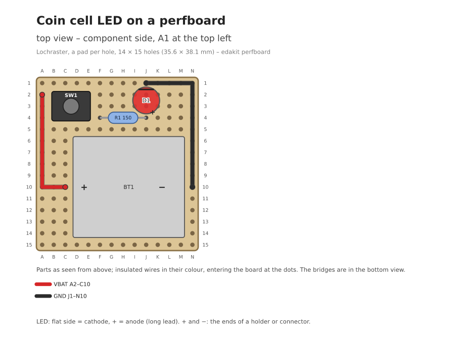
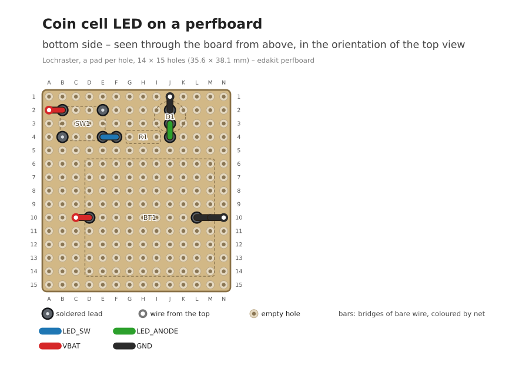
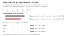

# Build it on a perfboard

After this step you have the plan of your circuit on a perfboard, checked against the circuit, and the lists to
solder it from.

!!! note "State"
    Built and checked offline; no prototype has been soldered from such a plan yet.

A prototype comes after [Draw and hand over](07-draw-and-hand-over.md), before a board or instead of one. No EDA
program takes part.

## What you do

Say that you build the board by hand on a perfboard, and which kind: a pad per hole, or a pad over three holes. The
board becomes a [hand-wired board](../glossary.md#hand-wired-board). Its parts must be through-hole, so a circuit in
SMD first gets through-hole parts.

Claude writes the [perfboard plan](../glossary.md#perfboard-plan): each part on the grid, bare wire below, insulated
wires on top. edakit holds it to the circuit and draws both sides:

```text
$ edakit perfboard
main: Lochraster, a pad per hole, 14 × 15 holes, 4 parts, 2 wires, 7 bridges
  note     PERF.grid/bent   SW1: leads bent by 0.63 mm into the 2.54 mm grid (allowed 0.8 mm)
  …
  0 errors; -> build/edakit/perfboard/main/top.svg, build/edakit/perfboard/main/bottom.svg, build/edakit/perfboard/main/cut.svg, build/edakit/perfboard/main/build.md
```





The walkthrough's example as a prototype: [its plan and parts](../../examples/coin-cell-led/variants/perfboard/README.md).

## What you are asked

What the plan must keep, as for a board: the parts you touch or look at, the size of the piece you cut. Claude fixes
every error itself and runs the check again.

## What you decide

Whether the drawings read right before you solder. The reviewer pcb-reviewer reads the plan as it reads a board, for
the check M-5 of [Have it reviewed](08-have-it-reviewed.md).

## What you have

Three drawings and `build.md`'s four lists. First the example's cut list. The insulated wires on top:

| Colour | Length | Holes | Net |
| --- | --- | --- | --- |
| red | 45 mm | A2–C10 | VBAT |
| black | 50 mm | J1–N10 | GND |

Strip 5 mm at each end: through its hole and over onto the pad of the lead beside it. Bare wire below, one piece per
straight row:

| Length | Pieces | Holes |
| --- | --- | --- |
| 10 mm | 1 | L10 … N10 GND |
| 5 mm | 2 | E4–F4 LED_SW, J4–J3 LED_ANODE |

`cut.svg` draws it at 1:1: printed at 100 %, lay each piece on its row.



The build list goes from low parts to high. The test list says what the multimeter must read, and the material list
what to buy. `edakit gate` checks the plan as the layout, without EasyEDA.

Then you solder and test. A board from the same circuit: [Have it reviewed](08-have-it-reviewed.md).

## Read on

- The handbook: [A perfboard](../../handbook/07-pcb.md#79-a-perfboard)
- The keys: [The plan of a perfboard](../../handbook/10-reference.md#the-plan-of-a-perfboard)
