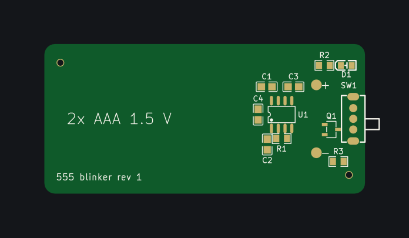

# Example: blinker-555

Switch it on and a red LED blinks about once a second, from two AAA cells; switch it off and the cells deliver nothing –
the project of the KiCad walkthrough in [handbook chapter 18](../../handbook/18-walkthrough-kicad.md), drawn in KiCad
(`toolchain = "kicad"`). One board, 60 × 28 mm: the 2×AAA holder on the bottom and the slide switch at the edge are
soldered by hand, JLCPCB assembles the CMOS 555, the reverse-polarity MOSFET, the LED and the passives on the top side
(Economic).



| File | |
|---|---|
| [edakit.toml](edakit.toml) | the table of contents: project, KiCad as the tool chain, the graph as TOML, requirements, assembly |
| [hardware/requirements.toml](hardware/requirements.toml) | two needs, four requirements with their evidence – R-2, the blink rate, only by the count at the acceptance |
| [hardware/graph.toml](hardware/graph.toml) | 12 parts, 10 nets, the purpose, what is accepted and why, the hand-over to the layout; [graph.json](hardware/graph.json) is generated from it |
| [hardware/parts/](hardware/parts/) | 11 parts entries, each signed against its datasheet |
| [hardware/sim.json](hardware/sim.json) | fresh and used cells × switch on and off × the LED's corners × the spread of U1's discharge pin and Q1, and both cells upside down |
| [hardware/stock.json](hardware/stock.json) | what JLCPCB said about the assembled parts on 2026-10-31 |
| [hardware/schematic.toml](hardware/schematic.toml) | the blocks of the drawing and their notes |
| [hardware/boards/main.toml](hardware/boards/main.toml) | the board: outline, placement plan, the hand-solder keep, silkscreen texts |
| [hardware/boards/main.geometry.json](hardware/boards/main.geometry.json) | the footprints as `edakit pcb dump` measured them in the KiCad file |
| [hardware/signoff.json](hardware/signoff.json) | the manual checks: M-1, M-6 and M-5 signed by the review agents; M-2 (before paying) and M-4 (the delivered boards) open |
| [docs/decisions.md](docs/decisions.md) | D-1 to D-9: the timing computation (D-5) and the dark phase (D-7) among them |
| [docs/schematic.svg](docs/schematic.svg), [docs/pcb_plan_main.png](docs/pcb_plan_main.png), [docs/silk_main_top.png](docs/silk_main_top.png), [docs/silk_main_bottom.png](docs/silk_main_bottom.png) | drawn by `edakit schematic draw`, `edakit pcb plan` and `edakit silk apply` |

Offline, from this folder:

```bash
edakit check      # 0 errors; six hints accepted with their reasons (D-6)
edakit sim        # 688 comparisons, all pass: 7.6 mA at most from fresh cells (R-4), 0.52 mA at least into D1 at 2.2 V (R-1)
edakit gate       # P, G, E pass; NOT RELEASED offline: stages S, L, F need KiCad
```

With KiCad 10 (`kicad-cli`), ngspice and Freerouting installed, `edakit schematic create`, `edakit pcb apply`,
`edakit route all`, `edakit silk apply` write the KiCad project into `build/edakit/kicad/main/`, and
`edakit gate --eda` says RELEASED (handbook 18.10 to 18.12). Not done: the order and the delivered boards (M-2, M-4).
