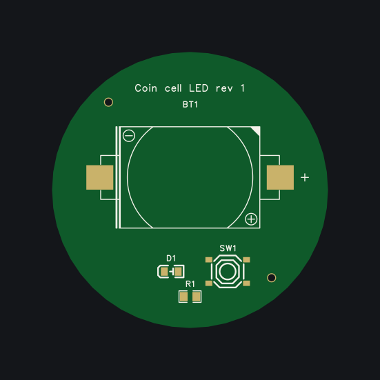

# Example: coin-cell-led

Press the button and a red LED lights, from a CR2032 coin cell – the project of the walkthrough in
[handbook chapter 17](../../handbook/17-walkthrough.md), which tells step by step how it came about. One round board,
Ø 44 mm (D-6); JLCPCB assembles the button, the LED and its resistor (Economic, top side), the coin cell holder is
soldered by hand (D-4). Released on 2026-10-31.



| File | |
|---|---|
| [edakit.toml](edakit.toml) | the table of contents: project, board, requirements, assembly |
| [hardware/requirements.toml](hardware/requirements.toml) | two needs, two requirements with their evidence |
| [hardware/graph.json](hardware/graph.json) | 4 parts, 4 nets, the purpose, what is accepted and why, the hand-over to the layout |
| [hardware/parts/](hardware/parts/) | 4 parts entries, each signed against its datasheet |
| [hardware/sim.json](hardware/sim.json) | a fresh and a used cell × button pressed and released × the LED's corners, and a cell upside down |
| [hardware/stock.json](hardware/stock.json) | what JLCPCB said about the assembled parts on 2026-10-29 |
| [hardware/schematic.toml](hardware/schematic.toml) | the block of the drawing and its notes |
| [hardware/boards/main.toml](hardware/boards/main.toml) | the board: round outline, tooling holes, placement plan, silkscreen, looks, a remark for JLCPCB |
| [hardware/boards/main.geometry.json](hardware/boards/main.geometry.json) | the footprints as placed in EasyEDA (`edakit pcb dump`) |
| [hardware/signoff.json](hardware/signoff.json) | the manual checks: M-1, M-6 and M-5 signed by the review agents; M-2 (before paying) and M-4 (the delivered boards) open |
| [docs/decisions.md](docs/decisions.md) | D-1 to D-6 |
| [docs/schematic.svg](docs/schematic.svg), [docs/pcb_plan_main.png](docs/pcb_plan_main.png), [docs/silk_main_top.png](docs/silk_main_top.png) | drawn by `edakit schematic draw`, `edakit pcb plan` and `edakit silk apply` |

Offline, from this folder:

```bash
edakit check      # 0 errors; PATH.reverse accepted (a cell upside down: D1 blocks it, D-3) and three hints
edakit sim        # 9 scenarios, 104 comparisons
edakit gate       # P, G, E pass; NOT RELEASED offline: stages S, L, F and M-5 (bound to the Gerber files) need EasyEDA
```

With the EasyEDA project `coin-cell-led` open, `edakit gate --easyeda` exports the manufacturing files and says
RELEASED (handbook 17.11, 17.12). Not done: the order and the delivered boards (M-2, M-4).
