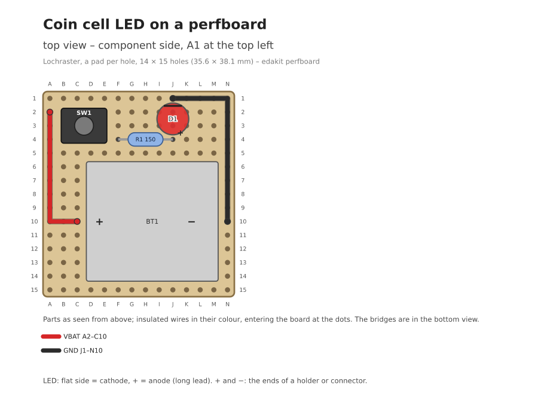

# Variant: coin-cell-led on a perfboard

The circuit of [coin-cell-led](../../README.md) with through-hole parts, soldered by hand on a perfboard with a pad
per hole – the example of [handbook 7.9](../../../../handbook/07-pcb.md#79-a-perfboard). No EDA program, no PCB, no
maker: the plan is text, edakit holds it to the circuit and draws it.



| File | |
|---|---|
| [edakit.toml](edakit.toml) | the board `main`, hand-wired; the requirements are the example's |
| [hardware/graph.json](hardware/graph.json) | the example's circuit with the through-hole parts (D-8) |
| [hardware/parts/](hardware/parts/) | 4 parts entries with their footprints as data |
| [hardware/sim.json](hardware/sim.json) | the example's scenarios |
| [hardware/boards/main.toml](hardware/boards/main.toml) | the plan: the parts on the grid, the bridges below, the wires on top (D-9) |
| [hardware/signoff.json](hardware/signoff.json) | M-1, M-6 and M-5 signed by the review agents; M-4, the soldered board, open |
| [docs/decisions.md](docs/decisions.md) | D-8 and D-9; D-1 to D-7 are the example's |

Offline, from this folder:

```bash
edakit check        # 0 errors; the example's three accepted findings
edakit perfboard    # 0 errors: the drawings and the cut, build and test lists in build/edakit/perfboard/main/
edakit gate         # RELEASED offline: stage L is the plan, M-1, M-6 and M-5 signed by the review agents
```
