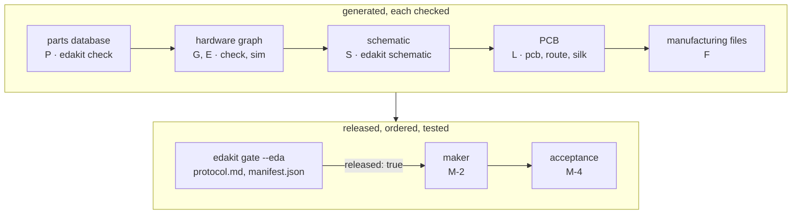

# 1 The approach: one source, generated EDA, a check at every hand-over

For anyone who wants to know why edakit works as it does: after it you know the pipeline, its ten principles and what it
cannot promise. The short way: [the steps](../docs/steps/README.md).

## The idea in one paragraph

The circuit is written down once, as a **hardware graph** in TOML (JSON in a project not yet converted): every part
with its LCSC number, every net with its pins – by name or role, through the parts entries – and voltage range.
Everything else is **generated** from it and **checked** against it: rule checks, an ngspice simulation of every
operating case, the schematic in EasyEDA Pro, the PCB's parts and nets, the BOM and the Gerber files. Nobody draws a
wire by hand. A change starts in the graph and runs through the pipeline again. A **release gate** runs every check on
the files to be uploaded and writes a test protocol; only a RELEASED run goes to the maker.

A project without a PCB needs no EDA program: checks, simulation and a drawn schematic (6.5) work from the graph
alone. For a board, EasyEDA Pro is the default and KiCad 10 the other choice, with the rest the same – when to take
which, 16.1.

## Why not just draw it in EasyEDA?

The drawing is not the design, and Claude cannot see it: Claude Code works on text, with tools. In a drawing, a wire
one grid step from a pin looks connected and is not; a footprint printing "+" at the cathode looks fine; a label typed
"VLED" instead of "V_LED" splits a net. On a real project each happened or nearly did, and a comparison against the
graph caught it, not looking.

With the graph as the only source:

- **Claude can reason about the circuit.** A language model reads pins and nets reliably, and a check like "every IC
  supply pin has a capacitor" is a few lines of Python over the file.
- **Every artifact can be regenerated** – schematic, PCB parts, nets, tracks, pours, silkscreen. That makes EasyEDA
  safe to automate: anything broken is deleted and rebuilt, without asking.
- **Every hand-over has a comparison.** Graph ↔ schematic (SYNC.schematic), graph ↔ PCB pads (SYNC.pcb), plan ↔ PCB
  (SYNC.plan), graph ↔ Gerber copper (GEO.copper), graph ↔ BOM (SYNC.bom). An error has to slip past an independent
  comparison to reach the manufacturer.
- **Changes are cheap and complete.** Swapping a part is a line in the graph plus `create → layout → pcb parts →
  route → gate`; nothing is forgotten in a corner of the schematic.

## Principles

1. **One source.** The graph for parts, values and connections, the parts database for what the datasheets say, a
   board file per board for placement and rules, the schematic file for the blocks; `edakit.toml` says where each is.
   The schematic and the PCB are outputs.
2. **Generated content may be deleted.** Everything in the EasyEDA project comes from scripts. When something is off,
   delete it and generate it again – no backups, no questions.
3. **A check at every hand-over, and the last one on the real files.** The gate does not trust EasyEDA: connectivity
   is recomputed from the exported Gerber copper, the BOM generated from the graph, the stock asked from JLCPCB's
   catalogue where JLCPCB builds the board, and another maker's part matching held to the release.
4. **Every check was seen red once.** A check that never failed may not work, so for every rule a negative test builds
   the fault into a copy and expects the check to find it.
5. **Sign-offs belong to a state.** A manual check – a second datasheet review, the layout review – is recorded with
   the hash of what it checked; change the circuit or the layout and the sign-off no longer counts.
6. **An independent agent's result is the sign-off.** A check that needs judgement – is pin 1 really pin 1, is the
   layout manufacturable and usable – is done by a separate agent in its own session. If it says OK, it is signed;
   if not, the cause is fixed and it checks again. You are asked for decisions, not for checklists.
7. **Decisions are numbered.** D-12 is written down with reason, date and alternatives and cited where it applies, so
   a later session knows why the 18-mil tracks are below the class width and that this was accepted.
8. **Tooling over clicking.** When EasyEDA needs a click, look for the API path first – parts without the import
   dialog, pad nets set directly, an own DSN instead of the DSN export. A dialog that remains must be a plain OK.
9. **Every rule says why.** Each check has a catalog entry with its reason, what to do and its sources, and a finding
   comes with it. A review finding that a rule could have found becomes a check (designing a circuit, chapter 14).
10. **Roles hand over in writing.** The circuit designer and the PCB designer work in sessions of their own. What the
    layout must know is in the graph (`layout`), not in a conversation, and a check holds the plan to it (roles, 14.1).

## What it achieved

On a real project of about 120 parts, the first graph became released manufacturing files in five days; a redesign of
the power concept went through graph, schematic, PCB and routing in one more day. With budget for one order and no
prototype round, the gate had to catch everything that would hit all boards alike.

Its checks found a library footprint with "+" at the cathode pad, holes too tight for the leads of two parts, a
generated schematic pin drifted onto two nets and a 61 mm detour in a switching regulator's current loop. The layout
review agent found a run released without a layout review. Each became a check (lessons learned, chapter 13).

What it does not give you: a guarantee. It gives you a check for every error class you know of, an explicit list of
what is checked by judgement and by whom, and an acceptance test after delivery for what neither can see.

## How the rest of this handbook is organised

| Chapter | |
|---|---|
| [2 Setup](02-setup.md) | EasyEDA Pro with Node, the MCP server and the bridge patch, or KiCad 10; Claude Code plugin, a project |
| [3 Hardware graph](03-hardware-graph.md) | format, conventions, the rule checks, the firmware contract, requirements |
| [4 Parts database](04-parts-database.md) | one file per part, sourcing, sign-off, own parts, datasheets |
| [5 Simulation](05-simulation.md) | ngspice from the graph, behaviour models, scenarios |
| [6 Schematic](06-schematic.md) | generate, check, copy, lay out – or draw it without an EDA program |
| [7 PCB](07-pcb.md) | placement plan, parts without dialogs, Freerouting, pours, silkscreen |
| [8 Release gate](08-release-gate.md) | stages, sign-offs, manifest, ordering at the manufacturer, acceptance, project scripts and agents, requirements |
| [9 EasyEDA API](09-easyeda-api.md) | how the API and the MCP server really behave |
| [10 Reference](10-reference.md) | edakit.toml, the board and schematic files and every command |
| [11 Working with Claude](11-working-with-claude.md) | plugin, skills, agents, parallel sessions, working agreements |
| [12 Troubleshooting](12-troubleshooting.md) | symptom → cause → fix |
| [13 Lessons learned](13-lessons-learned.md) | what cost time, what we would do again |
| [14 Designing a circuit](14-design.md) | designer and reviewer, the catalog – engines, codes, data, domains –, hints, building blocks, from a finding to a rule |
| [15 Regulatory review](15-regulatory.md) | the purpose, the EU rules, the review M-6 – support, not legal advice |
| [16 KiCad as the tool chain](16-kicad.md) | EasyEDA Pro or KiCad – when to take which, and every step on KiCad's files |
| [17 Walkthrough](17-walkthrough.md) | a coin cell, a button and an LED in EasyEDA Pro, from the idea to the delivered boards |
| [18 Walkthrough on KiCad](18-walkthrough-kicad.md) | a 555 blinker drawn in KiCad, from the idea to RELEASED |
