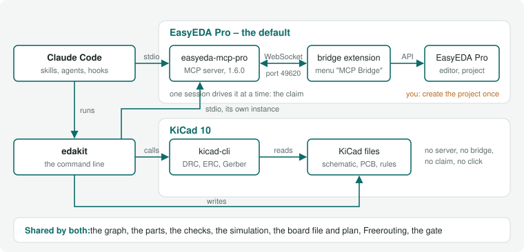
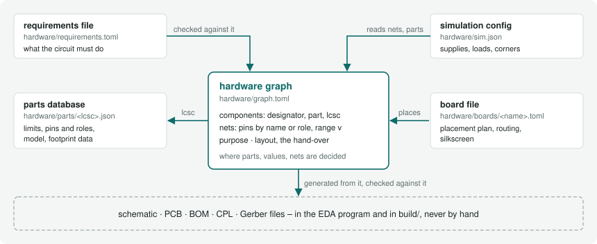

# 2 Setup

For everyone who installs edakit. After this chapter the tool chain runs, `edakit doctor` finds it ready, and a first
project is set up. The short way: [Install the tools](../docs/steps/01-install.md) and [Start a
project](../docs/steps/02-start-a-project.md).

Tested on Linux (Ubuntu) with Python 3.11–3.14, ngspice 45, Freerouting 2.4.1 and Claude Code 2.1.3xx; on EasyEDA with
EasyEDA Pro 3.2.209, easyeda-mcp-pro 1.8.0 and Node 24, on KiCad with KiCad 10.0.6. Windows and macOS should work for
everything except the bundled Freerouting download (set `FREEROUTING_JAR`) – untested.

## 2.1 What talks to what



Claude Code starts easyeda-mcp-pro from the plugin manifest (`edakit/easyeda/mcp-server.sh`), edakit starts its own
instance on the same bridge connection, and the bridge listens on 127.0.0.1:49620.

EasyEDA Pro has no command line and no HTTP API; only its **extension API**, inside the running editor, automates
it. [easyeda-mcp-pro](https://github.com/oaslananka/easyeda-mcp-pro) brings an extension that connects to a local MCP
server with 115 tools plus a controlled generic call into the extension API. edakit uses the same server.

**On KiCad:** edakit writes KiCad's files and calls kicad-cli in the session – no server and no bridge in between
(kicad-cli, 16.5).

## 2.2 Install

1. **The EDA program**, for a board – one of the two; when to take which is in 16.1:
   - **EasyEDA Pro**, the default (desktop, not the web version): from easyeda.com. Create or open your project once.
     With it **Node 24** (easyeda-mcp-pro 1.8.0 requires it): `nvm install 24`. Started from a desktop client without
     nvm in PATH, the launcher sources nvm itself. Then the MCP server, the bridge and the window, sections 2.4 to 2.6.
   - **KiCad 10**, the other choice, from KiCad's PPA – Ubuntu's own packages are older:
     `sudo add-apt-repository ppa:kicad/kicad-10.0-releases && sudo apt install kicad`. No Node, no server, no bridge:
     `edakit doctor` asks kicad-cli for its version (the KiCad setup, 16.2).
2. **uv** (runs edakit with its dependencies): <https://docs.astral.sh/uv/>.
3. **ngspice** (stage E): `sudo apt install ngspice` (or your package manager).
   **pdftotext** (optional, poppler-utils): with it `edakit part fetch` (datasheets, 4.6) checks whether a datasheet
   has a text layer and names its part number.
4. **Freerouting**: nothing to do on Linux x64 – `edakit route` downloads the pinned release (with its own Java)
   to `~/.local/share/freerouting/` and checks its SHA-256. Elsewhere: download `freerouting-2.4.1.jar`, install
   Java 21+ (Java 17 is too old for Freerouting 2.x), set `FREEROUTING_JAR`.
5. **For ordering** (the skill cart, 8.4): Chrome with Claude in Chrome, signed in at the makers and allowed on their
   domains only – best a Chrome profile of its own, without a saved card –, on the computer that holds the release's
   files. `edakit cart actual --from` a PDF invoice needs pdftotext.

## 2.3 Claude Code: the plugin

```text
/plugin marketplace add tgd1975/edakit
/plugin install edakit@edakit
```

The VS Code extension has no `/plugin`: run `claude plugin marketplace add tgd1975/edakit` and
`claude plugin install edakit@edakit` in a terminal. With only the extension installed, `claude` is
`~/.vscode/extensions/anthropic.claude-code-<version>-linux-x64/resources/native-binary/claude`.

To update, refresh the marketplace and update the plugin, then start a new session (VS Code: a new Claude session or
*Developer: Reload Window*):

```text
/plugin marketplace update edakit
```

```bash
claude plugin marketplace update edakit && claude plugin update edakit@edakit
```

An update brings the newest version of edakit. Auto-update for the edakit marketplace can be switched on under
`/plugin` → Marketplaces (off by default for marketplaces outside Anthropic).

The plugin brings the skills (`/edakit:start`, `/edakit:hardware-change`, …), the agents, the MCP server `easyeda`
(tools `mcp__plugin_edakit_easyeda__*`), the EasyEDA claim hook and the command `edakit` on the Bash PATH. Its session
hook brings the working agreements (11.4) and the project's own scripts and agents (8.6) into every session of an
edakit project. Confirm the MCP server when Claude Code asks (or `/mcp` → easyeda).

Where a session does not find `edakit` – a sandbox, an eval, a Claude Code that leaves the plugin's `bin/` off the
PATH –, the command is the plugin's `bin/edakit`: in a project with an edakit.toml the session start names its path
(11.4), before that every skill that runs `edakit` names it.

For the plugin in every session of a project, put this into the project's `.claude/settings.json`:

```json
{
  "extraKnownMarketplaces": {
    "edakit": { "source": { "source": "github", "repo": "tgd1975/edakit" } }
  },
  "enabledPlugins": { "edakit@edakit": true }
}
```

Without Claude Code (CI, a terminal): `uvx --from git+https://github.com/tgd1975/edakit edakit <command>`,
or from a clone `uv run --project /path/to/edakit edakit <command>`.

### Versions

Every change to edakit comes as a version with its own number, and the plugin installs the newest one. The minor
number goes up when a project has to act on an update: its lines in [CHANGELOG.md](../CHANGELOG.md) begin with
**When updating:** and say what to do, such as which sign-offs to renew. The patch number goes up for everything else –
a new rule, a new command, a fix. The major number marks a milestone of edakit itself.

`edakit --version` prints the version that runs; from a git clone away from the version's tag it adds the commit, as
in `0.2.0+g1a2b3c4`. Every gate run writes the same string into its manifest, under `tools.edakit`.

`edakit version` (the skill `/edakit:version`) shows more: the plugin's installation per scope – user and each
project – with the one in effect here, the newest version on GitHub, the changelog's sections in between with their
**When updating:** lines first, and the pins below with whether they agree. It prints the update command for the scope
in effect and exits 2 when there is something to act on; it changes nothing.

A project that stays on one version says so with `edakit version pin` (the skill `/edakit:version`):
`edakit = "==1.0.9"` under `[project]` in every edakit.toml, and the same tag in every call in CI and scripts,
`uvx --from git+https://github.com/tgd1975/edakit@v1.0.9 edakit <command>`. Without `--write` it lists what it would
change. `current` takes the edakit in effect here, `latest` the newest version, or name one. `edakit version unpin`
turns `==` into `>=` and takes the tags out of the calls, so the project follows the updates again.

The plugin itself cannot be held per project: Claude Code keeps one marketplace "edakit" per user, and a `ref` in a
project's `.claude/settings.json` replaces it for every project of that user. `pin` and `unpin` take such a `ref` out.
The plugin keeps following its updates; where it no longer meets the pin, the session start and `edakit check` say so
(STRUCT.edakit), and `edakit version` names the mismatch. To move up: read the changelog, `edakit version pin latest
--write`, run the gate and commit.

A project can also say which edakit it needs: `edakit = ">=0.4"` under `[project]` in edakit.toml (10.1). When the
running edakit does not meet it, `edakit check` notes STRUCT.edakit, and the session hook says so at the start of a
session. The first line of the working agreements names the edakit that runs.

## 2.4 The MCP server

Sections 2.4 to 2.6 set up EasyEDA Pro; on KiCad they have nothing to do.

`edakit/easyeda/mcp-server.sh` installs easyeda-mcp-pro **pinned** to 1.8.0 into
`~/.easyeda-mcp-pro/runtime/1.8.0` (once) and starts `node` directly, with safe defaults:

| Setting | Value | Why |
|---|---|---|
| `TOOL_PROFILE` | `full` | schematic/PCB write tools and `easyeda_api_call` (writes need `confirmWrite: true`) |
| `JLCPCB_MODE`, `JLCPCB_ENABLE_ORDERING` | `disabled`, `false` | nothing can be ordered from Claude – orders are placed by a human |
| `BRIDGE_RAW_EXEC_ENABLED` | `false` | no arbitrary JavaScript in the editor |
| `ARTIFACT_DIR` | `$PWD/build/easyeda-mcp` | exports land in the project, not in the home directory |
| `BRIDGE_TIMEOUT_MS` | `120000` | DRC and pour fills of a large board take longer than the default 15 s. The same value in every server: the one that holds the bridge port drops pending requests after its own timeout, also those another server passes through; `edakit doctor` warns when they differ |

edakit's own servers – those its commands start – run the profile `experimental` instead of `full`: only there does
the server register `easyeda_export_odb`, the ODB++ export for a maker that assembles from it (AISLER; ordering, 8.4;
SYNC.odb), which easyeda-mcp-pro marks experimental (EasyEDA's API for it is a beta). Raw JavaScript stays off in both.
edakit reads every `easyeda_api_call` answer 12 levels deep (`maxDepth`, 9.1): DRC details and the rule set lie that
deep.

**Pinned, not npx:** the tool set and the extension must match, and npx does not pass SIGTERM on – an orphaned server
then blocks the bridge port. Update deliberately: raise `EASYEDA_MCP_VERSION`, import the extension of the same
version (2.5), restart EasyEDA, restart every server. Since 1.5.1 a server whose extension has another version refuses
every write, export and `easyeda_api_call` and answers only reads – server and extension change together.

The bridge listens on 127.0.0.1 only. The only online calls are read-only part lookups (LCSC product data, JLCPCB's
public assembly catalogue): only part numbers leave the machine.

## 2.5 The bridge extension

The server brings its EasyEDA extension, the bridge; copy it out of the pinned server:

```bash
bash <plugin or clone>/edakit/easyeda/mcp-server.sh extension --copy .      # -> ./easyeda-bridge-extension*.eext
```

Import in EasyEDA: *Settings → Extensions → Extension Manager → Import*; it asks for the permission "External
Interaction" itself. Then the menu **MCP Bridge** appears; choose **Enable Auto-Connect**.

Re-importing (update): EasyEDA does not take an import over an installed copy with the same UUID. **Uninstall the old
one, import, restart EasyEDA**; until the restart the old copy keeps running. After that restart the menu is sometimes
missing, but Auto-Connect stays on and connects. Until edakit 1.0.6 edakit built a patched extension of 1.6.0, named
"MCP Pro Bridge (depth 12, schematic PDF, ODB++)" in the extension manager; since 1.7.0 the original does all three
(upstream M-2 to M-4) – uninstall the patched one the same way.

Check with `edakit doctor`: "bridge extension 1.8.0 = server 1.8.0", and "return depth" – it asks
`DMT_Project.getCurrentProjectInfo` 12 levels deep, whose answer then shows the pages written out instead of
`[MaxDepth]`; an extension older than 1.7.0 ignores the depth asked. It probes the depth only while EasyEDA is free or
claimed by you; the version and registry lines come from `easyeda_health_check`, which needs no claim.

## 2.6 EasyEDA without background throttling

Chromium throttles timers of covered windows, and EasyEDA computes DRC, pour fills and exports in many small timer
steps. With VS Code covering EasyEDA, the DRC of a 120-part board took longer than 120 s and failed; unthrottled it
takes 1–4 s. Make the desktop launcher start it unthrottled (Linux):

```bash
sed 's|^Exec=.*|Exec=/opt/apps/easyeda-pro/easyeda-pro %f --no-sandbox --gtk-version=3 --disable-background-timer-throttling --disable-renderer-backgrounding --disable-backgrounding-occluded-windows|' \
  /usr/share/applications/easyeda-pro.desktop > ~/.local/share/applications/easyeda-pro.desktop
```

From a shell inside VS Code or Claude Code start it only like this – VS Code's shells carry `ELECTRON_RUN_AS_NODE`,
and EasyEDA then behaves like Node:

```bash
env -u ELECTRON_RUN_AS_NODE setsid /opt/apps/easyeda-pro/easyeda-pro --no-sandbox --gtk-version=3 \
  --disable-background-timer-throttling --disable-renderer-backgrounding --disable-backgrounding-occluded-windows
```

Check: `edakit doctor` ("EasyEDA unthrottled").

## 2.7 A project

```bash
cd my-project
/edakit:new-project my-project        # in Claude Code – or copy the example's files and adapt
edakit doctor                         # tool chain ready?
edakit check && edakit sim            # offline, seconds
```

The skill sets the project up from an interview, not from the example's defaults. It asks for the boards – one or
several, a bought board on a cable or a hand-wired one (own parts, 4.5), variants –, how each board's schematic is
drawn (`style`, 6.5: with labels, every connection a wire, or mixed), who assembles, the order, a budget, the purpose,
the requirements, firmware that follows the graph, documents that quote values, and the project's own scripts and
agents.

Each answer sets its keys; the skill proposes every file and key with its reason and writes only after your OK. In
Claude Code the interview is a form with options – up to four questions at a time, your own words for the rest –,
elsewhere one decision round in text.



The graph it writes is `hardware/graph.toml`, with the resolved `hardware/graph.json` generated beside it (the graph's
format, 3.1). The pre-commit hook comes from `edakit hook install`: it writes edakit's block into `.githooks/pre-commit` – or
into the hook the repository has, after its header, the project's own steps kept – and sets `git config
core.hooksPath`, which every clone needs once. On every commit that touches a configuration's files – its edakit.toml,
its `hardware/`, the main project's `hardware/`, a file it names – the block runs `edakit check`, `edakit sim` and,
with a TOML graph, `edakit graph json --check` – which fails when the generated file no longer matches the TOML
(`edakit graph json --write` brings it along) –, with `[firmware]` also `edakit firmware --check`, with `[docs]`
`edakit docs`. A failing step blocks the commit.

The block finds edakit itself – `$EDAKIT`, the PATH inside Claude
Code, else the plugin in effect for the repository – so a commit by hand needs no script of the project's own. Where
the hook is missing, has no block or an older one, or git does not run it, the session start says so in one line
(`edakit hook check`); `edakit hook install` again renews it.

Where the session may not write `.claude/settings.json` or set `core.hooksPath` – Claude Code guards both, a sandbox
may refuse them –, nothing else depends on them: the skill writes the other files and names the two steps in its
report for you, the settings as the block above and `edakit hook install` in a terminal of your own. `edakit hook
install` says which step failed and exits 1.

**By hand, without the skill.** A circuit without a board of its own – hand-wired, or the board not decided yet –
starts from three files: this edakit.toml, a graph with its name and purpose (3.1) and the requirements file (3.6):

```toml
[project]
name = "battery-leds"                         # the project
graph = "hardware/graph.toml"                 # the circuit as text (3.1)
requirements = "hardware/requirements.toml"   # what it must do (3.6)

[boards.main]
wired = true                                  # hand-wired: no PCB, no EasyEDA (4.5)
```

On a hand-wired board every part has `bom = false` (STRUCT.board), and every net its voltage range `v` (STRUCT.net).
`[boards.main]` without `wired` is a board to be laid out later: the checks and the simulation are the same, its board
file comes with the PCB designer (10.2). A part's entry comes from the parts library (`edakit part add`, 4.1), from
the shop (`edakit part import` and its datasheet, the skill part-search, 4.2) or, for a part nobody sells, from your
notes (4.5); the simulation's supplies and switch positions from `hardware/sim.json` (5.2). Every key: 10.1.

The purpose – private, a gift or for sale – decides how deep the regulatory review M-6 goes (chapter 15); the review is
support, not legal advice: nothing in it is legally guaranteed, and it claims no correctness.

### Moving a project to edakit

A repository without edakit.toml but with hardware files, scripts or agents of its own – a netlist, parts, a board,
gate runs, `.claude/agents/` – takes the same skill. First the agent `project-surveyor` makes the inventory, beside the
agent `requirements-engineer`. Per place – hardware data, the EasyEDA project and released runs, scripts, agents,
skills, documents with values, decisions, hooks and CI – it names what it found and where, the proposal (a key, an
entry of `[scripts]` or `[agents]`, a file) and its reason. It adds the contradictions between the project's documents
and what it could not read.

Its proposals are the interview's answers to confirm. The project's files stay where they lie and edakit.toml names
them. The project's own skills are listed with their edakit counterpart and what they do beyond it – keeping or
deleting each is your decision, the setup deletes none.

### The EasyEDA project

After the skill, create the EasyEDA project by hand (File → New → Project, named as `[project] name`); edakit finds
it in EasyEDA's project folder, remembers its UUID and reopens it after an EasyEDA restart (editor state, 9.2). Then
follow chapters 6–8. Daily: start EasyEDA → open the project → work.

**On KiCad:** there is nothing to create. edakit writes the KiCad project of each board into
`<artifacts>/kicad/<board>/` at the first `schematic create` or `pcb apply` – the KiCad project (16.3).

## 2.8 Licences of the parts you combine

edakit itself is MIT licensed ([LICENSE](../LICENSE)). It uses, without bundling them: **easyeda-mcp-pro**
(MIT since 1.7.0; 1.1.0 to 1.6.0 were PolyForm Noncommercial 1.0.0), **EasyEDA Pro**
(proprietary, free), **Freerouting** (GPL-3.0, downloaded at first use), **ngspice** (BSD).
