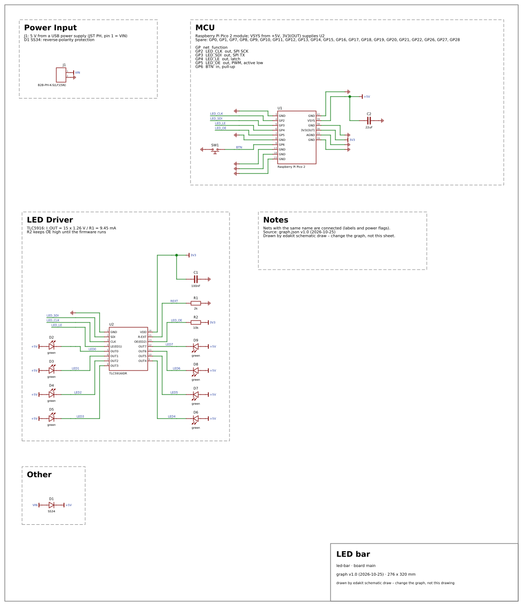
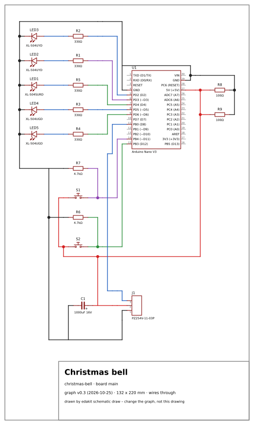

# 6 Schematic (stage S)

For you when a board's schematic is generated, checked or laid out in the EDA program, or drawn without one. After it
you can build and check both schematics, draw one as an SVG and quote design values in notes and documents. The short
way: [Draw and hand over](../docs/steps/07-draw-and-hand-over.md).

In EasyEDA, two schematics per board, both generated:

| | name (default) | made by | content | edited by hand |
|---|---|---|---|---|
| template | `generated_<board>` | `edakit schematic create` | every part, every net as short stubs with net labels – exact, ugly | never; rebuilt on every run |
| board schematic | `layout_<board>` | `edakit schematic copy` + `layout` | readable sheet: blocks with titles and notes, real wires, power flags, GPIO table | never; rebuilt by `layout` |

The PCB hangs on the board schematic. Once it does, the board schematic cannot be replaced – the PCB would lose its
schematic –, and `layout` syncs the parts in place instead of copying.

**On KiCad:** one schematic per board, `<board>.kicad_sch`. `schematic create` and `layout` write it and check it at
once, `copy` has nothing to do, and `schematic check` holds kicad-cli's netlist and KiCad's ERC to the graph – the
KiCad flow (16.4).

Without an EDA program, `edakit schematic draw` draws the schematic as an SVG (the drawing, 6.5): for a project
without a PCB, for the documentation, for a look at a design before the EDA program is involved.

A bought board on a cable (`bought = true`) or a hand-wired one (`wired = true`, 4.5) has no schematic in EasyEDA:
`--board` of such a board is refused with one line, and without `--board` the one made board is taken. `schematic
draw --board` draws a hand-wired board – the drawing is its build document; a bought one stays refused.

## 6.1 Generate the template

```bash
edakit schematic create --dry-run          # graph and placement only, no EasyEDA
edakit schematic create --only U3,R10,C5   # partial build to try a part
edakit schematic create --save             # everything, then save
```

The steps, each with its duration and EasyEDA's memory:

1. Bridge.
2. Project. It must exist: the local desktop client refuses `DMT_Project.createProject`, so create a new project by
   hand once. edakit finds it in EasyEDA's project folder, remembers its UUID and goes on only when the open project
   has the configured name.
3. Delete and recreate the template – never a schematic that belongs to a board.
4. Close other schematic tabs; EasyEDA sometimes switches to them by itself.
5. Search every LCSC number once (cache `<artifacts>/device_cache.json`; `--refresh-devices` searches again).
6. Place in blocks of 40 (`batch_write`); bigger blocks crashed EasyEDA.
7. Set designators and compare the symbol pins with the graph.
8. Connect the nets as stubs (longer stubs on collisions), then the leftover pins one by one; mark no-connects.
9. Compare the netlist with the graph, run ERC, save.
10. With `--save`: close the template's tab, open it again from the save and compare once more (6.2) – the drift
    shows where it starts, and the run exits 2.

The template's name is read again after its page got its title and once more before the end, and put back if it
changed. A panel of the template's name is named in the output, not touched.

`--save` of `create` and `layout` saves only a schematic whose netlist equals the graph: no differing net, no failed
connection, no symbol pin mismatch, no part skipped. Otherwise the run says "not saved: 2 differing nets, 0 failed
connections, 0 pin mismatches – fix and run again, or save in EasyEDA by hand" and exits 2; the schematic stays open
in EasyEDA as it was written. EasyEDA can return an empty netlist after many writes, so an empty one is read ten
times; if it stays empty, every net counts as differing and nothing is saved. `layout --force` writes despite
geometry conflicts; it does not force the save.

Timing on real projects: 13 parts 12–41 s; 123 parts 6 minutes (placing 2.1 min, connecting 3.7 min).

## 6.2 Check against the graph

```bash
edakit schematic check                                  # the template
edakit schematic check --schematic layout_main --no-pins
```

Read only (it closes the saved schematic tabs and activates its pages, though), about 10 s. It checks parts (missing, extra,
duplicate, LCSC), nets (every graph pin on its net, no foreign pins, no unknown nets), pin numbers **and names** and
no-connect markers.

It reads the schematic **as saved, with no other schematic open**: every saved schematic tab is closed first – the
PCB's stay –, then every page of this one opened again. While another schematic of the project is open, the bridge
can list a pin on a second net: pytree's template showed U4.11 on V_LED whenever the board's schematic `layout_tree`
was open – stage F focuses it last –, because a V_LED flag of `layout_tree` sits on the end of the template's wire
from U4.11 and the bridge takes the flags of every open schematic but the wires of one (M-11 in `upstream/README.md`,
#117). So the same template passed or failed by what ran before.

A tab with unsaved changes stays open – closing it would throw them away –; the check reads this schematic's as drawn,
and names either in a finding of its own (`saved`): save it, or close its tab without saving.

A name that differs from the symbol (`D11/MOSI` in the graph, `D11` in the symbol) fails. Either the graph assumed
another pinout – the error to catch here – or the library part disagrees with itself: an LED symbol names pin 1 `K`
while its footprint prints `+` at pad 1. Names follow the symbol; the meaning sits in the roles.

The gate runs the check for every board (SYNC.schematic). Run it also at the start of every EasyEDA session and before
every gate run: a saved template can get a pin on two nets once it is opened again, and generating it again
(`schematic create --save`) fixed it so far – the run then says whether the save, opened again, still matches.

## 6.3 Copy and lay out

```bash
edakit schematic copy                      # template -> board schematic, seconds (only while no PCB hangs on it)
edakit schematic layout --dry-run          # plan + <artifacts>/layout_preview_<schematic>.svg, offline after the first run
edakit schematic layout --save             # rebuild the board schematic (1–2 min for 120 parts)
edakit schematic check --schematic layout_main
```

`copy` renames the copy only when it holds the source's parts, designator for designator, on all its pages.
`DMT_Schematic.copySchematic` can copy another project's schematic instead – the bell's ESP32 THT template, 19 parts
for a graph of 17. Such a copy is deleted where it is a free schematic of the open project. The run names what EasyEDA
made – its page, the company and graph version of its title block, the parts more and missing – and exits 1. A source
drawn from another graph version than the current one is named before the copy. `layout` builds the board schematic
without a copy: in a new project it renames the default board's schematic.

`layout` deletes all wires, flags, rectangles and texts of the page, moves and rotates the parts and wires them again.
What it arranges stands in the schematic file `hardware/schematic.toml` (10.3):

- **Blocks** (`[layout] rows`): rows → columns → blocks with a title and start parts (connectors, ICs, the MCU). Every
  block gets a dashed frame, its title and notes (`[layout.notes]`).
- **Placement:** all other parts attach by breadth-first search over signal nets (not over power nets, not past
  another start part). The MCU goes last, so it collects only what is left (buttons, LEDs on GPIOs).
- **Capacitors** that touch only supply nets go to the part in `[layout] near`.
- **Orientation:** every child is rotated so its connecting pin points at the parent pin; children of one pin are
  stacked; the branches of one side are spread without overlaps and without crossings (isotonic regression keeps the
  order).
- **Connections:** a net inside a block is one branched wire with its name; to other blocks a labelled stub; power
  nets get flags (`power_flags`).
- **Page:** the smallest landscape standard size that holds the content and leaves the title block free (A4 … A0).
- **GPIO table** (`[layout.pin_table]`): pin → net → function, generated from the graph into the MCU block, plus the
  spare pins.
- **Before writing** the plan is checked for shorts: wires of different nets touching, wires over foreign pins,
  four-branch crossings, which EasyEDA refuses. `--force` writes anyway.
- **After writing:** netlist against the graph, ERC.

The symbol geometry (pins and body per part) is cached per schematic; `--dry-run` works offline with it, `--reread`
reads it again.

If the board schematic is linked to a PCB, `layout` first syncs parts with the graph: missing ones are placed, extra
ones deleted, swapped ones (other LCSC number) replaced – a swapped part keeps its UniqueId and with it the link to its
footprint. New parts reach the PCB with `edakit pcb parts --write` (chapter 7).

## 6.4 What made this hard (and is handled)

- `modifySchematicName` renames the **active** schematic, not the one passed by UUID; right after creation it does
  nothing. edakit activates first and compares all names afterwards; it never deletes on a mismatch.
- Texts deleted with `SCH_PrimitiveText.delete` come back after a reload; edakit deletes them through another
  primitive class.
- Deleting parts or flags leaves their attribute texts as orphans on the page; edakit removes them.
- Moving a part does not move its wires; edakit deletes wires, moves, draws again.
- A big page takes minutes to open; a timeout while opening does not mean failure.
- The sheet frame (title block) may be missing; edakit creates it from the system library.

The API calls behind each: [9.3 Schematic](09-easyeda-api.md#93-schematic).

## 6.5 Drawn without an EDA program

The drawing is a result on its own, without EasyEDA or KiCad: the graph and the parts database are enough – no
bridge, about a second. A project without a PCB – a development board and hand wiring – never needs an EDA program:
checks, simulation and this drawing work from the graph alone. For a PCB, the EDA program's schematic stays the one
that counts – EasyEDA's board schematic, KiCad's `<board>.kicad_sch` –; the PCB hangs on it.

```bash
edakit schematic draw                          # <artifacts>/schematic_<board>.svg
edakit schematic draw --out docs/schematic.svg
```

Every gate run draws it too, as SVG and PNG beside its protocol (the gate protocol's section 12, 8.3). The arrangement
is the one of `layout` (copy and lay out, 6.3): blocks with titles and notes, placement by topology, real wires,
flags, GPIO table. Only the symbols come from the parts database instead of EasyEDA's library:



| kind | symbol |
|---|---|
| resistor, capacitor, inductor, fuse, diode, LED, buzzer, battery holder, button | two terminals; anode, plus or pin 1 on the left; `+` at a polarised capacitor |
| switch, potentiometer | common or wiper between the two other pins |
| npn, pnp, nmos, pmos | base or gate on the left, collector/drain and emitter/source up and down, with pin numbers |
| ic, module | a box with the connected pins in the order of their numbers, down the left side and up the right one as on a DIP package |
| connector, relay, RGB LED, DIP switch, anything else | a box with every pin (a connector in one column, a relay's coil on the left) |

A parts entry can arrange its box itself – a module whose pin numbers do not run like a DIP package:
`"symbol": {"left": ["1", …, "20"], "right": ["40", …, "21"], "bottom": ["41", "42", "43"]}`. Left and right run from
top to bottom, top and bottom from left to right; connected pins not listed go to the right.

A box names its pins as the symbol does, the names the check holds (6.2). Where a pin of the parts entry has `print`
– its name as the board prints it (the parts fields, 4.1) – and the two differ, the drawing writes it beside the
symbol's name in brackets: `PD2 (D2)` on a Nano whose library symbol names the ATmega ports. Only this drawing reads
it; EasyEDA's schematic and SYNC.schematic keep the symbol's names.

**Without the schematic file** the drawing arranges itself:

- every IC, module, connector, relay and battery holder starts a block, the power inputs first; title: designator and
  label, the block's note: the part's `notes`;
- ground symbols for the ground and every net with a ground pin; supply flags for every supply net (a supply output or
  an IC supply pin on it) and every net with ten or more pins – drawn as a wire, a rail behind a diode would gather
  half the board into one block;
- a capacitor between flagged nets sits at the IC or module that takes its supply in.

`rows`, `power_flags`, `near` and `notes` in the schematic file replace each of these.

Before the file is written, the drawing is checked like a plan for EasyEDA – no wire touches another net or a foreign
pin – and every connected pin must end in a wire or a flag of its own net; otherwise nothing is written (exit 2,
`--force` writes anyway). The page is as big as the drawing plus the title block and to scale: one unit is 10 mil,
designators are 1.8 mm high. `--no-frame`, or `frame = false` in the schematic file (10.3), leaves out the sheet
border and the title block for a drawing embedded in a document; the page is then the drawing and its margin.

### Wired through

`style` in the schematic file (10.3) chooses the drawing per board:

- `"labels"`: the drawing above, and the default;
- `"wires"`: every connection a wire from pin to pin, as the maker scene draws it (Fritzing's schematic view);
- `"mixed"`: wires, with labels for the buses.



A board takes the style its project interview chose: labels for a board of any size, wires through for a maker-size
circuit or a hand-wired board, mixed for a module with headers.

```toml
style = "wires"                          # every board; or by board: style = {main = "labels", panel = "wires"}
```

Wired through, the blocks are the ones above, with four changes:

- a pin without a part on it gets a lead of one grid cell instead of a labelled stub, and no flag;
- no frames, titles and notes;
- a module shows every pin as the board does, the open ones grey;
- a button's pins joined inside it show once per side.

The blocks are not set in rows but around the module, or around the block with the most nets to the others. Each next
block – the one with the most nets to those placed – goes on the side and the way round (as it is or turned by 180°)
where its wires to them come out shortest, with the fewest crossings and through no part, its pins level with theirs.
A channel as wide as the wires it brings stays free around it. A block without a wire to the others goes where the
drawing grows least. The rows of the schematic file still say which parts form a block.

Then a router on the schematic grid joins every net by the cheapest path from piece to piece. A step costs 1, a bend
4, crossing another net 12, running beside one 1, and each of the two cells in front of another net's open lead 12, so
that the lead keeps its way out. The router never runs through a part or along its outline, never along another net's
wire or through its ends, bends, junctions and pin tips. The ground runs along a rail below the drawing and the
supplies along rails above when at least two pieces join there.

Every net gets a colour – ground black, the supplies red, orange, dark yellow and pink (the fourth and every further one
pink), the rest from ten colours, so that nets that cross or run side by side differ. A dot marks every junction; two
wires crossing without a dot are not connected. A net the router cannot join, or one with a single pin on the board (it
goes on elsewhere), is named at its pieces as in the labelled drawing.

`"mixed"` keeps the labelled stubs for the nets that are nothing but pass-throughs and buses – only modules, ICs and
connectors on them, or six pins or more (a key matrix, a shared line) – and wires the rest. The output line counts
crossings and wire; the title block names the style:

```text
drawn (wires through): 19 parts, 19 wires, 4 crossings, 1.2 m of wire, 122 x 220 mm
```

How far it goes is the structure, not the number of parts: the bell (19 parts) has 4 crossings, the LED bar 18, the
TS/Rat pedal with 86 parts 36. A module whose headers mirror its pins (the ESP32 DevKitC: 183) or a key matrix is a
mesh – mixed brings the DevKitC to 30, a matrix stays one. A second for the bell, a quarter of a minute for a keyboard
half.

The check then tells a crossing – two nets' wires meeting inside both – from a T, which is a short, and refuses a
crossing at a junction, a bend or a pin tip and a net crossing itself without a dot. The style reaches the SVG only:
EasyEDA's board schematic and the KiCad schematic keep their labels (concept wired-schematic, decision 1).

## 6.6 Values quoted from the design data (DOCS.quote)

A number in a note or a document goes stale when the circuit changes: R1 swapped from 2 k to 4.7 k, the simulation
gives 4.02 mA, and the note still says "I_OUT = … = 9.45 mA". So a note or a document names the source of the number
and edakit fills it in – a requirement's sentence the same way.

- **Schematic notes** (`[layout.notes]`, 10.3) hold placeholders: `"I_OUT = {sim:max SIM.state * D2 LED current*}"`.
  `schematic draw` and `schematic layout` fill them in when they draw; one that cannot be filled stays as written,
  with a warning. Only braces that start with a source are read – `{R1}` stays as it is.
- **Markdown documents** listed in `[docs] files` (10.1) hold blocks, invisible when rendered:
  `LED current <!--edakit sim:max SIM.state * D2 LED current*-->9.45 mA<!--/edakit--> per output`. A file that is not
  listed is never read.

| Source | Value |
|---|---|
| `graph:<key>` | a key of the graph itself: `graph:version`, `graph:date` |
| `graph:<part, net or cable>.<key>` | `graph:R1.value`, `graph:+5V.v` (a net's range, in V), further keys with dots |
| `part:<parts entry>.<path>` | `part:C90107.values.vrext_v` – the unit follows the key's ending (`_v`, `_a`, `_ohm`, `_w`, `_f`, `_h`, `_hz`, `_c`, `_mm`, `_s`) |
| `sim:max\|min\|one <pattern>` | the numeric actual of the simulation rows whose `ID scenario item check` matches the pattern – the key the sign-off file's `match` uses (8.2); `one` wants exactly one row |
| `req:<ID>` | the `text` of a need or requirement of `[project] requirements` (3.6): `req:R-1`, `req:N-2` – on one line |

A format after the source – `{sim:max SIM.state * D2 LED current* %.1f mA}` – formats the number, scaled to the prefix
written after it; without one: three significant digits and the unit of the source (`4.02 mA`). `[docs] decimal =
","` writes a decimal comma. The simulation result is the one `edakit sim` saved last
(`<artifacts>/sim/result.json`) while its inputs are unchanged; otherwise edakit simulates once.

**Requirements.** The README and the circuit description go on telling the story; where they say what the circuit
must do, they quote the requirements file (3.6) by ID instead of copying the sentence:

```markdown
- **R-1** <!--edakit req:R-1-->Runs from the USB port of a laptop with all eight LEDs on.<!--/edakit-->
```

The quote is the entry's `text`, a line break in it as a space – a block is one line. A draft is quoted as it stands;
when its text changes, the quote is stale like any other. A dropped entry is not quoted: it no longer holds, and a
document that quotes it reads as if it did. DOCS.quote names it with its reason; quote the entry that holds now, or
drop the block. Its text stays in the requirements file, where `edakit req` shows it.

Without `[project] requirements` a `req:` source is DOCS.quote that names the key; a requirements file that does not
read, DOCS.quote with what is wrong in it. The requirements file is in the circuit hash (8.2), the documents are not:
a changed requirement voids M-1 and M-6, `edakit docs --write` then brings the quotes along without voiding anything.

```bash
edakit docs            # DOCS.quote for every block that differs from its source and every source that does not exist; exit 2
edakit docs --write    # fill in the current values
```

DOCS.quote also runs in the gate's stage G on the gate's own simulation, an error like STRUCT.lock for a pin table.
Documents and the schematic file are in no hash (8.2): correcting a quoted number voids no sign-off. Put `edakit docs`
into the pre-commit hook next to `edakit check` and `edakit sim`.
