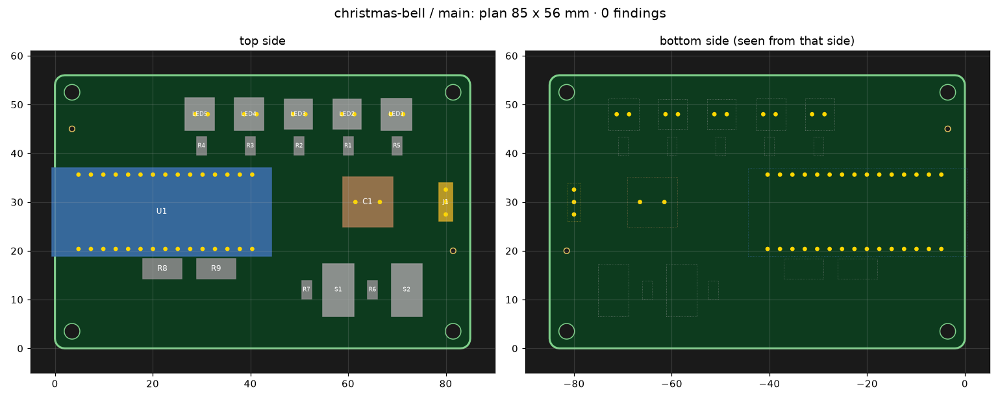
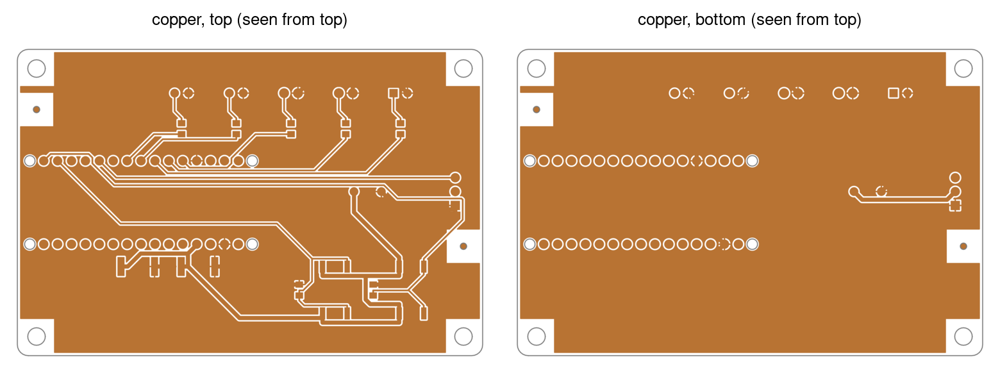
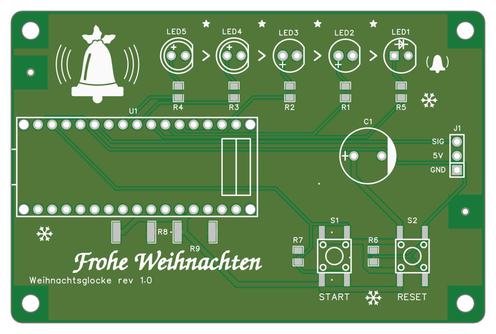

# 7 PCB (stage L)

For whoever lays out a board – you or the assistant. After it you can write the placement plan, route with Freerouting,
pour the copper, place the silkscreen and read what each step reports. The short way: [Lay out the
board](../docs/steps/09-lay-out-the-board.md).

**In short.** The PCB is built in layers, each repeatable and each checking itself. `edakit pcb parts` brings the parts
and nets of the board schematic over without a dialog (parts and nets, 7.3). The placement plan in the board file fixes
what matters, `edakit pcb plan` checks it offline – overlaps, outline, polarity, mated plugs, pad spacing –, and
EasyEDA's auto-layout or `pcb place --rest` places the rest (the placement plan, 7.4). `edakit route all` routes with
Freerouting, checks before it writes, pours the copper and runs the DRC (routing, 7.5; pours, 7.6). `edakit silk apply`
places the designators and checks the silkscreen on the Gerber files (silkscreen, 7.7). On KiCad the commands are the
same.

The PCB is built in layers, each repeatable and each checking itself: parts and nets from the board schematic (without
dialogs), a **placement plan** for what matters (in the board file `hardware/boards/<name>.toml`, 10.2), EasyEDA's
auto-layout for the rest – its positions go into the placement plan (7.4) too –, **Freerouting** for the tracks, then
pours and silkscreen.

A bought board on a cable (`bought = true`) or a hand-wired one (`wired = true`, 4.5) has no PCB: `pcb`, `route`,
`silk`, `fab` and `export` refuse it with one line when `--board` names it, and without `--board` take the one made
board; `handover` and `export` over all boards leave it out. A hand-wired board built on a perfboard has a layout of
its own all the same – the plan of the perfboard in its board file, checked and drawn by `edakit perfboard` (7.9).

**On KiCad:** the commands are the same and work on KiCad's files. `pcb parts` writes into the file without a dialog,
`pcb place --rest` places the parts without a row where EasyEDA's auto-layout does, and `route apply` writes the tracks
into the file – the KiCad flow (16.4).

```bash
edakit handover              # what the circuit hands over: state, sign-offs, what the plan must keep (14.1)
edakit pcb parts --write     # parts of the board schematic -> PCB (no "Import Changes" dialog)
edakit pcb dump              # footprint geometry -> hardware/boards/<board>.geometry.json, beside the board file
edakit pcb plan              # offline: check the plan, preview PNG, net classes, mechanical model
edakit pcb place --write     # offline: decoupling capacitors, pull and series resistors next to their host
edakit pcb apply             # outline, holes, tooling holes, fixed parts locked; pads verified
edakit pcb autolayout        # EasyEDA: the parts without a row; once they stand still, their rows into [place]
edakit pcb place --rest      # KiCad: edakit places the parts without a row (autolayout is EasyEDA's)
edakit route all             # Freerouting -> the PCB, pours, DRC (exit 0 = DRC 0)
edakit silk apply            # designators where there is room, silkscreen check on the Gerber, DRC
```

## 7.1 Coordinates

- **Plan** (board file): mm, any origin, seen from the board's `view` side. `side` of a part is the EasyEDA side it
  sits on (`top`/`bottom`).
- **EasyEDA:** mil, y up, seen from the top. With `view = "bottom"` edakit mirrors x and turns rotations into
  180° − rotation – for a board whose visible side is the bottom, e.g. LEDs on the bottom and electronics on top,
  because EasyEDA's auto-layout places only on TOP.
- **Footprints on the bottom:** EasyEDA mirrors the local y of a footprint, then rotates; `Board.transform` does the
  same. `pcb apply` compares the pads EasyEDA reports with the plan (largest deviation below 0.05 mm) – one part per
  footprint, side and rotation, or all with `--verify-all`.

## 7.2 Outline, holes, tooling holes

```toml
[outline]
rect = [90, 40]            # or polygon = [[x, y], …] (only straight segments; arcs as point lists)
corner_radius = 2

[[holes]]                  # non-plated mounting holes, drawn as circles on the outline layer
x = 3.5
y = 3.5
d = 3.2
keep = 3.2                 # radius free of parts and copper (screw head)

[tooling]                  # JLCPCB Economic PCBA tooling holes
holes = [[3.5, 36.5], [86.5, 3.5]]
```

**Tooling holes:** JLCPCB's Economic assembly wants 2–3 non-plated holes of 1.152 mm, the solder mask 0.148 mm larger,
in opposite corners; without them it drills its own, maybe somewhere visible. Its form says "Added by Customer" only
when order.md tells it: the board needs an `[order]` or the project a `[cart]` (ordering, 8.4). Parts stay out of the
holes' keep-out, except parts the assembler leaves out (`bom: false`): fitted by hand afterwards, they are not there
while the holes hold the board – the 555 blinker's battery holder covers one (chapter 18).

edakit creates tooling holes as free pads without copper ring, so they land in the NPTH drill file. Two EasyEDA quirks:
while a free pad is in the PCB, pour fills fail – edakit takes them out before every fill and puts them back; and a pour
polygon with a hole is not filled – the pour follows the outline, and a `NO_POURS` region keeps the keep circle of each
mounting and tooling hole free (E-13). On KiCad a rule area does the same, and KiCad fills right up to it.

A keep-out of `[[routing.keepouts]]` keeps tracks (and with `what = "all"` vias) out, not the pour – the pour fills it,
as a board under a print may need. With `pour = false` the pour stays out too: `pcb pour` and `route pours` set a
`NO_POURS` region over its rect or polygon on its layer (both without `layer`), KiCad a rule area there that keeps out
zones – an area a datasheet keeps free of copper, between a battery holder's pads say. The region takes the area as
written; `windows` open it for tracks only. The computed pours of `route check` and the bare area of GEO.pour leave it
out on that layer.

## 7.3 Parts and nets without dialogs

`PCB_Document.importChanges` always opens a confirmation dialog, so edakit does the same through the API:

- **`pcb nets [--write]`** sets every pad's net to the graph (`PCB_PrimitivePad.modify`) – enough for pure net changes.
- **`pcb parts [--write]`** compares the board schematic with the PCB: missing parts are created from the project
  library, swapped ones (other LCSC number or footprint) replaced, extra ones deleted, unlinked ones linked (the link is
  the UniqueId shared by schematic and PCB part), and properties copied **from the schematic** (otherwise the DRC still
  reports "Netlist Error"). New parts are parked next to the board (`park`), their geometry is measured, pad nets set,
  PCB and schematic saved.

A new project comes with one empty default board (Board1 = Schematic1 + PCB1). The first `edakit schematic layout`
renames it to the board of edakit.toml (board name, `schematic`, `pcb`) and fills the schematic from the graph; any
other setup is left alone and must match edakit.toml.

A part freshly placed in the schematic from the library once left the DRC at "Netlist Error – Import Changes" until
the import view was opened in the GUI: the import compares the Channel ID, which a part placed through the API lacks.
`pcb parts --write` writes the PCB part's Channel ID into the schematic part as well, so no click is needed (E-2,
Import Changes in 7.5).

### Swapping a part

Before a swap – another part for the same place, because the old one is out of stock or not in JLCPCB's library –
`edakit part diff OLD NEW` (LCSC numbers or parts-entry keys) compares the footprints offline. The geometry is
the dump of a placed part, else the footprint data of the parts entry (4.5), else the library footprint of
`edakit part import`.

Pads are matched by position only: for each turn of 0, 90, 180 and 270° on the same side, and for the mirror image
(the other side), the nearest assignment after laying origins and centroids on each other, with the shift that lays the
assigned pads over each other best. A turn fits when every pad of OLD lies on the copper of its new pad (shape, size
and rotation from the library; for a dump without pad sizes within half the smallest pad distance). Every other fit
within 0.05 mm RMS of the best one with another map is reported – "symmetric: the numbers decide". The report:

- the turn and shift that lay NEW over OLD, the residual per pad, whether the mirror image fits as well – or "mirror
  image only – not on the same side", or "no turn fits"
- the map old → new by position, the roles of the two entries that change under it (`old 1 throw_a → new 3 throw_b`)
- the pitch per row, the hole or slot per pad old → new, and with `lead` in NEW's entry GEO.hole's verdict (`hole_ok`)
  and the 0.5 mm minimum for plated slots; the box w × h old → new
- the graph change it implies for every component that uses OLD (`SW5: BAT_SW 1 → 3`)

Exit 0 is a drop-in – same side, 0°, every pad keeps its number and role, holes fit (a shift is reported, the plan
moves the part); 2 is something to decide. It writes nothing but `--json F`. On a real project, XUNPU SS-12D11G9 for
the slide switch G-Switch SS-12D11-G090 gives: turned 180°, the mirror image fits equally (symmetric), map 1→3, 2→2,
3→1, 4→4, 5→5, pitch 4.70 → 4.80 mm, the 0.40 mm tab slots below 0.5 mm, `SW5: BAT_SW 1 → 3`.

### Formed leads (GEO.formed)

The same matching of a board footprint against itself is GEO.formed (3.3): when the project's footprint moves holes
away from the library's – leads formed for the board, a part fitted by hand – `edakit check` fails if a turn of 90°,
180° or 270° lays the formed holes onto themselves with a pin in another net's hole. Offset the leads so that none
does: two in opposite directions, one only, or by different amounts.

That keeps the right bend from fitting turned, not every wrong one: a row turned by 180° is a row again, so the same
offsets at the mirrored legs – the bend of a solderer who holds the part turned and bends by position – go in turned.
That counter-bend is a note of GEO.formed naming its legs and where each pin lands; no pattern of one row avoids it.
Name the reference lead in the assembly instruction (the longest lead or the flat into the hole with the polarity sign,
then bend) and accept `GEO.formed/counter` with it.

## 7.4 The placement plan

```toml
[place]                  # hardware/boards/main.toml
U1 = { x = 29, y = 19.8, rot = 0, side = "top" }
J1 = { x = 87.4, y = 12, rot = 90, side = "top" }

[near]                   # the layout's own: fixed parts within near_mm of the host
C2 = "U1"
```

Fix everything the auto-layout must not decide: connectors and anything at the edge, controls, ICs with their
decoupling capacitors and pull resistors, LEDs and anything visible, parts with mechanical constraints. EasyEDA's
auto-layout places only unlocked parts, only on TOP, and knows nothing about belonging – it once put a decoupling
capacitor 24 mm from its IC. So `near` holds only between fixed parts: an entry for a part the auto-layout places is a
finding – `edakit pcb place` (below) gives such a part a spot next to its host.



### Footprint geometry

The plan works with footprint boxes and pads relative to the part origin: from `edakit pcb dump` once the parts are in
the PCB – the project's footprints as placed. For a planned part that is not in the dump yet they come from the
footprint data of its parts entry (4.5), else from the library footprint `edakit part import <LCSC>` cached (4.2);
`pcb plan` names those parts ("footprint data of the parts entry", "library geometry") and takes their pad nets from
the graph. The dump wins. Without a dump and without a cached footprint a planned part stays a finding – unless its
parts entry has footprint data.

The dump keeps the hole of every through-hole pad (`hole` [w, l] in mm, `plated`), and `pcb plan` runs GEO.hole on the
plan's geometry: a hole that does not take its lead is a plan finding
(`GEO.hole D31 (pads 1, 2, 3, 4, library geometry …): hole 0.70 mm for diagonal 0.71 mm …`), a tight hole or a missing
`lead` is printed. An older geometry file has no holes – dump again (it changes the layout hash once). Library and
EasyEDA Pro agree on the pads within 0.1 mil (eleven footprints of a real project; one switch 1 mil); the boxes differ
by up to 0.3 mm, because EasyEDA Pro measures the silkscreen of the placed part.

The dump of a part whose parts entry has footprint data (4.5) gives every pad its shape, size, rotation and layer as
well (`shape`, `w`, `h` in mil, `rot`, `layer`, the form of the library cache), so that SYNC.footprint holds the copy to
the data; every other part is measured as before, its lines in the file unchanged.

The dump lies beside the board file, with its name: `hardware/boards/main.toml` has
`hardware/boards/main.geometry.json`. Commit it with the board file: it is in the layout hash (8.2), and with it CI and
a fresh clone get the same hash and GEO.hole and GEO.formed judge the project's footprints there too.

An older `pcb dump` wrote it among the artifacts, which are not versioned: `<artifacts>/pcb_geometry_<board>.json`.
The plan, the checks, stage L and the layout hash still read such a file until it is moved, and `edakit check` (a note
to GEO.hole), `pcb plan` and the gate say how:

```text
NOTE    GEO.hole  build/edakit/pcb_geometry_main.json: footprint geometry of board main among the artifacts, which are not
             versioned – move it beside the board file and commit it: mv build/edakit/pcb_geometry_main.json
             hardware/boards/main.geometry.json (the layout hash changes once, sign-offs with scope 'layout' lapse)
```

`pcb dump` moves it as well, and so does `pcb parts --write` when it measures new parts. When both files exist, the
one beside the board file counts.

### What the circuit hands over

The hand-over (14.1) comes first: the circuit designer writes it into the graph, the PCB designer keeps it (SYNC.plan),
`edakit handover` lists it. A JSON graph has the same keys (`"layout": {"fixed": […], …}`, 3.1):

```toml
[layout]
fixed = ["SW1", "D2"]
edge = ["J1"]
near = {R1 = "U2"}
loops = [{a = "C5.1", b = "U3.VIN", max_mm = 8, what = "buck input loop"}]
notes = ["D2 to D9 form the bar: one row, in this order"]
```

- `fixed` parts need a position in `place`; `edge` parts also a box within `edge_mm` of the outline (default 1 mm);
  `near` parts sit within `near_mm` of their host.
- Every IC with a supply pin gets a capacitor of its own from that supply to ground within `near_mm` – derived from
  the graph, matched one capacitor per IC, so two ICs cannot share one while another sits far away. An IC whose
  capacitor is elsewhere on purpose carries `accept: {"SYNC.plan": "…"}`.
- `loops` join the board file's `[[loops]]` for GEO.loop on the routed board – REQ.missing wants one on every net of a
  switching regulator's hot loop (its `hot_loop` pins and the net behind its diode).
- `notes` are for the PCB designer and the layout review.

A requirement the plan cannot keep goes back to the circuit as a written request – the layout does not change the
graph.

### The plan check

`edakit pcb plan` checks offline:

- overlaps per side – under a module on pin headers only its pins, SMD parts within a silkscreen tolerance (both
  below);
- the outline (0.3 mm margin; `edge_ok` for connectors), the keep-outs of holes and tooling holes;
- THT pins of one side under parts of the other;
- `near` distances and the circuit's layout requirements (SYNC.plan);
- **polarised parts that point the same way** – by default LEDs side by side with their anode towards the same side;
- **mated plugs** clear of the other parts and out through the outline;
- **pads of different parts** as `route check` measures them on the PCB (GEO.spacing, below).

It prints the airline length of the fixed parts (a number to compare placements) and writes
`<artifacts>/pcb_plan_<board>.png` and the mechanical model `<artifacts>/mech_<board>.json`. Look at the picture before
`apply`.

### Polarised parts

Whoever solders a bag of LEDs, diodes or buzzers by hand turns each by its "+" mark or flat side and should not have to
turn every other one – and the library footprints of one LED series may put the mark on different pads. `uniform` in
the board file says, per `kind` of the parts entry, how the parts of that kind are turned. The direction
is read from the pin roles: the pin `anode` or `plus…` against the pin `cathode` or `minus…`. A part with not exactly
one of each (an RGB LED, a holder of several cells) is skipped, and `pcb plan` names it once.

- `"row"` compares parts of the kind side by side on one side of the board (centres on one line within 1 mm, rows and
  columns): the plus pins point towards the same side.
- A direction – `"+x"`, `"-x"`, `"+y"`, `"-y"` in plan coordinates – holds for every part of the kind on the whole
  board, alone or in a row: its cathode or minus pin points that way, seen from the side the part sits on (a part on
  the other side than `view` is seen mirrored in x).

Without the key it is `{ led = "row" }`; a table names every kind it checks, so a table without `led` leaves the LEDs
alone. `pcb place` takes the check like every other: a part it places gets a rotation that keeps it.

```toml
view = "bottom"                                # the LED side is the front
uniform = { led = "+x", buzzer = "-x" }        # every LED cathode right seen from the front; the buzzer (on the
                                               # back) plus right seen from the back, its minus left
```

A part that points elsewhere reads `BZ1 (buzzer): minus points +x, uniform -x – turn it by 180° (rot = 0)`, with the
rotation for `[place]`; a row `diodes in a row (D2, D3): cathode of D3 points the other way than D2 – turn it by 180°`.
LEDs in a row keep their words: `LEDs in a row (…): anode of D3 points the other way than D2 – turn them by 180°`.

### Parts under a module

`on_headers` names modules standing on pin headers – a Pico, an RP2040-Zero –, which leave the board under them free but
for the plastic of the headers. An SMD part of the same side may sit under one while its box stays `header_keep_mm`
(1.27 mm, half the 2.54 mm pitch) clear of every through-hole pin of the module, measured from the pin centre as a
square.

A through-hole part under it stays an overlap; a part on the other side over its pins stays a finding (THT pins
underneath). The boxes are the footprints' bounding boxes from `pcb dump`, silkscreen included, so a project may set the
keep-out smaller by its silkscreen margin. Height is not checked: what sits under the module has to be lower than its
headers lift it.

```toml
on_headers = ["U1"]          # in hardware/boards/<b>.toml, above the tables
header_keep_mm = 1.27        # the square around each through-hole pin of U1 that SMD parts stay out of
```

A part too close reads `D1: on the pins of U1 (top) – 0.00 mm from pin 5 (header_keep_mm 1.27)`: the gap between its
box and the nearest pin centre. An `on_headers` part whose footprint has no through-hole pins is a finding of its
own, and its overlaps count as usual.

### Overlaps and pad spacing

**Silkscreen tolerance.** The boxes include the silkscreen, so two small SMD parts with pads well apart overlap as soon
as their printed outlines touch – a decoupling capacitor close to its IC, a base resistor next to its transistor.
`silk_overlap_mm` lets the boxes of two SMD parts of one side reach that far into each other.

Per axis the plan check measures how far one box has to move to clear the other; the pair is a finding only when both x
and y are beyond the tolerance. For parts side by side that is the width of the strip they share; a small part inside a
larger box lies as deep as its way out, so the tolerance does not hide it.

The tolerance does not apply if either part has through-hole pads; under a module in `on_headers`, its pins decide. The
default 0 keeps every overlap a finding. With the key, an overlap gives its depth:
`R1 / R2: overlap (top) – 1.00 mm (silk_overlap_mm 0.8)`, or
`J1 / C1: overlap (top) – 0.30 mm (J1 through-hole: silk_overlap_mm does not apply)`.

```toml
silk_overlap_mm = 0.8        # in hardware/boards/<b>.toml, above the tables
```

**Pads of different parts (GEO.spacing).** The pads are compared on their own: boxes that only touch may still bring two
pads too close. A module's castellated pads end at its box, an 0805's pads lie 0.19 mm inside theirs – side by side 0.2
mm, half the paste gap.

`pcb plan` measures the pads of the plan as `route check` measures them on the PCB before routing writes anything (the
check before writing, 7.5): pads of different parts on different nets at least the routing clearance apart, SMD pads on
an assembled side at least the paste gap, pads of other nets `hand_solder_keep_mm` from a joint soldered by hand – the
nets of the graph, an `accept` GEO.spacing in the graph as there. A pair reads
`GEO.spacing R2.1 (3V3) – U1.41 (no net): 0.233 mm apart on TOP, below the paste gap 0.400 mm`.

The shapes come from the geometry where it has them – footprint data, the library footprint, a dump on KiCad –, else
from the library footprint `edakit part import` cached, its pad of the same number at the same place. An EasyEDA dump
measures places only, so without the cache `pcb plan` names the parts whose pads it cannot judge, and `route check`
measures them on the PCB.

### Mated plugs

A connector's footprint box ends where the plug begins, yet the plug with its strain relief or overmould and the cable
behind it need room. The parts entry of a connector can carry its mated plug (`mate`, 4.1): a box in footprint mm, its
height and the direction the cable leaves it. `pcb plan` turns and places the box with the part and checks, for every
placed part with `mate`:

- the plug runs into no other part's box on its side – into an SMD part's box at most `silk_overlap_mm`, as two SMD
  boxes may (the plug is a body without silkscreen, the other box has its margin) – and into no other part's plug
- a plug whose cable leaves sideways (`+x`, `-x`, `+y`, `-y` in footprint coordinates) reaches the outline in that
  direction, measured from the middle of its far end: a cable that leaves across the board is a finding

`edge_ok` lifts neither: it lets the connector's own box touch or overhang the outline, nothing more. A plug whose
cable is bent away from the board right behind it is `exit = "+z"`, with the bend in its box; then only the first
check applies.

```json
"mate": {"box": [-2.5, -6.6, 2.5, -4.6], "h_mm": 5.0, "exit": "-y"}
```

A finding reads `J1: mated plug reaches into U2 (top)` – with `silk_overlap_mm`, how deep: `J1: mated plug reaches
into D32 (top) – 1.01 mm (silk_overlap_mm 0.8)` –, `J1: mated plug reaches into the mated plug of J2 (top)`, or
`J1: mated plug leaves towards -x but ends 69.8 mm inside the outline` (a plan direction). A `body`, `lead`
`length_mm` or `mate` that is not as the parts fields (4.1) say is named with its parts entry. Without `mate` nothing
changes.

### The mechanical model

`pcb plan` writes `<artifacts>/mech_<board>.json` on every run for the project's mechanics check (a `[scripts.<name>]`
of kind `check` or a `[[release.stages]]`, 8.1) and its enclosure scripts, which read the board from it instead of
keeping part boxes, heights, plug sizes and board thickness as constants. Plan coordinates in mm, seen from `view`:

| Key | Content |
|---|---|
| `board`, `units` (`"mm"`), `view` | the board, and the side the coordinates are seen from (`bottom`: x mirrored) |
| `thickness_mm` | the board file's `thickness_mm` (default 1.6) |
| `outline` | the outline polygon `[[x, y], …]` |
| `holes`, `tooling` | `[{x, y, d}]` mounting holes and tooling holes |
| `parts` | per part in `[place]`, below |
| `unplaced` | the parts the plan leaves to the auto-layout: the model does not know where they go |

An entry of `parts` holds `side` (the side it sits on), `x`, `y`, `rot` and `box` `[x0, y0, x1, y1]` (the
footprint's, silkscreen included). Where its parts entry knows them, it adds:

- `h_mm` (`body`);
- `leads` – `[{pad, x, y, protrusion_mm}]` per through-hole pad with a lead `length_mm`; the protrusion is
  length − `thickness_mm`, out of the other side – with the largest as `protrusion_mm`;
- `mate`: `box` in plan mm, `h_mm` and `exit` – `+x`, `-x`, `+y`, `-y` in plan coordinates or `+z` away from the
  board; for a part turned by an angle that is no multiple of 90° the unit vector `[dx, dy]`.

Unknown values are left out, not guessed. The file holds no limits: how high a part may stand, how far a lead may
stick out, what the enclosure needs – that is the project's, from these numbers.

### Parts next to their host

`edakit pcb place` works out a spot, offline, for every part that `[place]` lacks but the circuit or the board file
ties to a host: `layout.near` of the graph, `[near]` of the board file, and the decoupling of SYNC.plan – an IC without
a capacitor of its own within `near_mm` gets the first free capacitor between its supply and ground that has no
declared host of its own, matched one per IC as SYNC.plan matches them. Declared hosts come first (graph, then board
file, each by designator), then the decoupling; each placed part is an obstacle for the next. Parts without a host
stay with the auto-layout.

The spot lies on the host's side, within `near_mm` of every host, at 0, 90, 180 or 270° on a 0.1 mm grid: the part's pad
on a net it shares with the host (ground only when that is all they share) as close as possible to the host's pin on
that net.

For a decoupling capacitor that is its supply pad to the IC's supply pin, and within 0.1 mm of that the ground pad
nearest to the IC's ground pin. A spot counts only where the plan check (`check_plan`, SYNC.plan and GEO.spacing)
reports nothing new – every check above, `silk_overlap_mm`, `on_headers` with `header_keep_mm` and `edge_mm` as they are
–, so `route all` does not turn a spot down for its pads.

```text
$ edakit pcb place
  R1 = { x = 60.5, y = 13.8, rot = 180, side = "top", auto = true }   # next to U2: pad 1 1.8 mm from U2.15 (REXT)
  C1 = { x = 64.8, y = 10.7, rot = 0, side = "top", auto = true }   # decoupling of U2 on 3V3: pad 1 1.9 mm from U2.16 (3V3)
```

`--write` adds the rows as new lines at the end of `[place]`; every other line and comment stays as it is. A later run
may move a row with `auto = true` (its part is placed anew; one that has no host any more stays), never a row written
by hand – delete `auto = true` to keep a spot. To every other command an `auto` row is a fixed, locked part, as are the
auto-layout's rows (below). `--only C1,R1` places only those. A part without a spot is named
with its host and pin – `C1: no free spot within near_mm 6 of U2 (pin 16, 3V3)` – and the command exits 2. It reads the
geometry as `pcb plan` does (footprint geometry, above).

### Every other part (--rest)

> **State:** the airline length is the only score so far, and `edakit pcb autolayout` (below) stays until this placer
> has placed a real board that routed and passed the gate.

`edakit pcb place --rest` places every part of the board that has no row in `[place]`, or a row with `auto = true` –
not only the parts with a host. It works offline, from the board file, the geometry and the graph.

- **Order.** The parts with a host come first, as above. Then the part with the most pins on nets of placed parts goes
  next, ground left out; a tie goes by designator. A part that names a placed part as its host follows that part at
  once. An IC takes a spot only where its decoupling capacitor finds one next to it, and a capacitor that may decouple
  an IC waits until the IC stands.
- **Spots.** They lie on the plan grid inside the outline, on a side that is assembled (`[release] assembly sides`,
  top first; without the key both), at 0, 90, 180 or 270°. A spot counts only where the plan check reports nothing
  new, as for the parts next to a host – mated plugs, `uniform` and GEO.spacing included.
- **Score.** Of these spots the part takes the one where its pads add the least airline length: the minimum spanning
  tree of each net over its pads, the nets of the graph, ground left out. Side, rotation, y and x break ties. The board
  is searched on a 0.5 mm grid first, then on the 0.1 mm grid around the best spots.
- **Improvement.** Each part placed by airline length then moves to a spot where the airline length is shorter, and
  each pair of them swaps rows where that shortens it – only where the plan check stays clean. A part that another
  part was placed next to stays. The pass repeats until nothing changes, four times at most. No random numbers are
  used: the same files give the same rows, and a second run changes nothing.

```text
$ edakit pcb place --rest
  R1 = { x = 60.5, y = 13.8, rot = 180, side = "top", auto = true }   # next to U2: pad 1 1.8 mm from U2.15 (REXT)
  R2 = { x = 57.2, y = 15.7, rot = 0, side = "top", auto = true }   # by airline length: adds 0.0 mm on 3V3, LED_OE
  D1 = { x = 23.5, y = 33.0, rot = 0, side = "top", auto = true }   # by airline length: adds 3.3 mm on +5V, VIN
  J1 = { x = 24.7, y = 36.3, rot = 0, side = "top", auto = true }   # by airline length: adds 3.3 mm on VIN
  improvement: no move or swap shortens the airline length (without GND) of 550.9 mm
  1 part next to its host, 3 by airline length – --write puts them into [place]
```

The comment gives what a part adds to the airline length of the finished plan, and the nets it shares with other
parts; R2 adds nothing, its pads lie on the way from U1 to U2 on both its nets. `--write` and `--only` work as above,
and an `auto` row without a host is placed anew as well. A part the circuit wants fixed (`layout.fixed`) gets a row
too, with the note `layout.fixed: check the spot, then drop auto = true`: whatever someone presses or looks at is the
PCB designer's choice, and only a row without `auto` stays where it is.

A part without a spot is named with the first new finding of its best spot, or with its box when no spot is free –
`SW1: no free spot on the top side – its box (60.0 x 30.0 mm) fits nowhere clear of the placed parts, the holes and
the outline` – and the command exits 2. Where routing shows that a plan walls nets in (`edakit route diagnose`, 7.5),
that may become a second score.

### The auto-layout's positions

`edakit pcb autolayout` lets EasyEDA place the parts `pcb apply` left unlocked – every part without a row – and waits
until positions, rotations and sides stay the same for two readings. Then it writes a row with `auto = true` for every
part of the board without one, where EasyEDA put it, as a new line at the end of `[place]`; every other line stays as
it is, and the rows are read back:

```text
$ edakit pcb autolayout
   0.2 min: moving
   …
   1.4 min: stable
  D1 = { x = 86.4, y = 18.3, rot = 270, side = "top", auto = true }
  R2 = { x = 57.2, y = 15.7, rot = 0, side = "top", auto = true }
  2 rows written into hardware/boards/main.toml [place] with auto = true
```

From then on they are plan like any row: `pcb plan` checks them and puts them into the mechanical model, `pcb apply`
puts them back after a dump and locks them, SYNC.plan holds the PCB to them, and the layout hash covers them – commit
them with the board file.

The next auto-layout places only parts without a row: delete a row to have its part placed anew, change it to move the
part; `pcb place` may still move an `auto` row next to the part's host.

The rows are plan coordinates to 0.001 mm and 0.001° – what `pcb apply` writes back is what EasyEDA reported. A part
of the board that is not in the PCB is named (`! R2: not in the PCB – …`, exit 2); a part in the PCB that the graph
does not put on the board gets no row (SYNC.pcb names it). Not settled within 20 minutes: nothing is written, exit 2.

### A board placed before

A board placed by hand or by the auto-layout before edakit wrote its positions back – and maybe routed – takes over
its positions once:

```bash
edakit pcb takeover            # the rows it would write
edakit pcb takeover --write    # written into [place]
```

Every part of the board without a row gets a fixed row (no `auto`) where EasyEDA has it, so that `pcb apply` locks it
there and the tracks stay on its pads; a new auto-layout would move the parts off them. Rows the board file holds
stay as they are – SYNC.plan compares them with the PCB. Run it before any `pcb dump`: the dump turns every part to 0°
on TOP, and only the rows bring rotation and side back.

### Every part in the plan

Stage L of the gate fails for every part the graph puts on the board that has no row in `[place]` – by hand, from
`pcb place`, or written back by the auto-layout (SYNC.plan). Parts on a bought or hand-wired board (4.5) – off the
made boards, at the far end of a cable – are on none of them and need no row.

`edakit pcb dump` turns every part it measures to 0° on TOP to read its geometry and **leaves it there** – run `apply`
afterwards: it puts every part with a row back; the auto-layout is needed again only for parts without one.

## 7.5 Routing with Freerouting

### Why Freerouting

**Why not EasyEDA's autorouter:** it keeps its result only when the whole run succeeds – otherwise every track is
gone; fixed 900 s limit; runs past the bridge timeout; sometimes does not start; leaves nets open; routes nothing on
nets that are partly routed.

**Why our own DSN:** EasyEDA's DSN export returned null over the bridge, and its SES import needs a `File` object the
bridge cannot pass. edakit writes the Specctra DSN itself from pads and outline read through the API, runs Freerouting
headless, reads the SES, and creates every track and via through the API.

`edakit route all`, steps: read → dsn → route → check (up to `attempts` times with a reshuffled DSN) → apply → pours →
(reload, only with `[routing] drc_rules = "write"`) → drc. About 3–7 minutes for 120 parts.



### Rules in the board file

```toml
[routing]
clearance_mil = 6.5          # above EasyEDA's DRC (pad 0.152 mm) and JLCPCB (SMD pads 0.15 mm); 8 mil left 18 links open
signal_mil = 10
via = [24, 12]               # diameter, drill
edge_clearance_um = 400      # tracks and vias from the outline; the pours keep pour_inset_mm (7.6)
layer_cost = { TOP = [1.0, 1.8], BOTTOM = [2.2, 3.0] }   # preferred / against preferred direction: keep a side calm
classes = { POWER = { width_mil = 18, nets = ["VIN", "+5V"] }, GND = { width_mil = 18, nets = ["GND"] } }
widths = "classes"           # or "sim": every class at least the IPC-2221 width of the simulated currents (below)
hand_solder_keep_mm = 0.5    # GEO.spacing: vias and pads of other nets this far from hand-soldered joints (0 = off, below)

[[routing.keepouts]]               # no tracks (vias allowed) on a side or in an area
layer = "BOTTOM"
what = "wire"                      # or "all"
rect = [-80, 110, 80, 200]         # plan mm; windows = ["D1"] keeps those pads reachable
# pour = false                     # no pour in the area either (default true: the pour fills it)

[[routing.fixed_wires]]            # protected tracks Freerouting routes around (e.g. a short switching loop)
net = "SW"
layer = "TOP"
width_mil = 24
points = [[10, 5], [14, 5]]

[[pours]]
net = "V_LED"
layers = ["BOTTOM"]
plane = true                       # the net's pads on BOTTOM (and through-hole pads) count as joined by the plane
fanout = true                      # its SMD pads on TOP get a via to the plane – Freerouting places none

[[pours]]
net = "GND"
layers = ["TOP"]
pour_only = true                   # no tracks: the pour between the tracks connects this net (7.6)
```

Class widths must be at least the minimum of the matching EasyEDA net class rule, or the DRC complains.

### EasyEDA's DRC rule set

GEO.drc asks for a DRC without findings – with the rules EasyEDA holds, set in its GUI and in no file. With
`drc_rules = "check"` in `[routing]`, the gate reads the rule set the DRC ran with and holds it to the board file, in
a third row of GEO.drc (8.1) that names it:

- the clearance `clearance_mil` from track to track, pad and via, and from via to pad and via (EasyEDA's Safe Spacing);
  pads among themselves are the footprints' – GEO.spacing measures pads of different parts;
- the edge clearance `edge_clearance_um` of tracks and vias;
- the least width of every net's tracks: `width_mil` of its class in `classes`, `signal_mil` without one – a narrower
  fixed wire of the class lowers it, the board file prescribes it; with `widths = "sim"` the classes keep their
  `width_mil` here, wider tracks pass, and GEO.width holds each track to its current;
- the least via `via`, and the net classes of `classes` with their nets in the PCB.

Equal means within 1 µm – in every rule a net of the PCB uses, the default one too, and in every layer entry of a rule.
The row lists each difference with both numbers, e.g. `clearance Track–Track: EasyEDA 0.102 mm (Safe Spacing
'copperThickness1oz'), the board file 0.165 mm (clearance_mil 6.5)` – a real project's DRC ran with that. Set what it
names in EasyEDA (Design → Design Rule: Safe Spacing, Track, Via Size, the net classes), or change `[routing]`.

The name in the row is the one EasyEDA reports – the template the rules came from, or the client's "Custom Config" once
anything was written (the PCB API, 9.4) –, so the name alone says nothing about the values. Without the key nothing is
read and GEO.drc is as it was.

With `drc_rules = "write"`, `route all` writes the board file's rule set into EasyEDA before its DRC – the net classes
of `classes`, the clearance and edge cells of Safe Spacing, the least width of every class, the least via –, saves and
reloads the PCB, reads it back and stops with exit 2 if anything differs; nothing else of EasyEDA's rules changes.

Then the DRC runs with the rules the board was routed with, and the gate checks them as with `"check"` – it writes
nothing. The rules are the PCB's own: another PCB of the project keeps its rules. After the first write EasyEDA calls
the PCB's configuration "Custom Config" ("自定义配置") and lists that name among the named configurations of every project;
the API cannot put a PCB back on a named one (Design → Design Rule can).

### Widths from the simulation

`widths = "classes"` (the default) writes the widths of `classes` and `signal_mil` into the DSN as they are. With
`widths = "sim"`, `route dsn`, `route`, `check`, `diagnose` and `all` read `<artifacts>/sim/net_currents.json`
(`edakit sim`) and give every net at least its IPC-2221 width for 1.5 × its simulated current – the width GEO.width of
the gate asks for. A class is widened to the largest need of its nets, and a net outside the classes that needs more
than `signal_mil` gets a class of its own, named after the net.

Widths are rounded up to 0.1 mil; `route dsn` prints what it widened
(`widths = "sim": class POWER: 18 -> 53.9 mil (+5V 2.00 A, VIN 2.00 A)`). Without the currents it stops. Fixed wires
keep their `width_mil` – the check names them (below). One source of widths then: the simulation, not a table that
drifts from it.

### Freerouting 2.4.1 pitfalls

All handled in the DSN writer:

- Resolution `mil 1000` computes wrongly on a 170-mm board (unreachable pads, phantom violations) – edakit writes
  `mil 100`.
- A **concave outline as boundary**: nothing routed above a certain height. edakit uses a rectangle as boundary and
  the area outside the board (moved in by the edge clearance) as convex keep-out strips.

  The outline is moved in with round joins: around an inner corner (a notch) the keep-out is an arc of
  `edge_clearance_um`, in chords of at most 16.875° (8 per quarter circle; an arc under 16.875° is one chord). It
  reaches at least 0.989 of the clearance into the board: 0.3957 mm with 0.4 mm, 4.3 µm short of the arc. Mitred joins
  reached d / sin(θ/2) into the board there – 0.57 mm at a 90° corner, 1.3 mm at a 36° notch with 0.4 mm. Tracks that
  kept the clearance were reported, and Freerouting lost that room in every notch. `route check` and the fanout vias
  use the same strips.

  Every strip Freerouting can read is kept, however small: at a sharp notch tip the cuts leave slices under 1 mil²,
  and without them the keep-out reached only 0.3 mm into the board there. Only a strip with no area on the DSN's grid
  of 0.01 mil is left out – Freerouting skipped it with "Keepout zone … was skipped because its geometry is
  degenerate".

  On the round board of chapter 17, read back from EasyEDA, mirrored corners lie up to 1e-4 mil apart in height; the
  cuts at both left 16 slices of 4e-6 to 7e-5 mil among 66 strips. The seam such a slice leaves is thinner than the
  grid, no copper passes it, and the 50 strips left cover the same band.
- `autoroute_settings` after the keep-outs: no parts read at all. A `plane` placed before the keep-outs: no
  connections read. Order matters.
- Fanout is on by default and puts a via at every SMD pad: `--router.fanout.enabled=false`. It does not connect an
  SMD pad to a plane on the other layer either – neither does the router: such a pad gets a track to another pad of
  its net, or stays open. edakit's `fanout` does it (below).
- Layer costs in the DSN are partly overridden by Freerouting itself; the optimiser stops at score 999.98/1000.
- **Deterministic but order-dependent:** a part recreated in EasyEDA moves to the end of its list, and the same plan
  can then leave a link open on every run. edakit sorts parts, pins and nets, and reshuffles them reproducibly
  (seed = attempt) when nets stay open.
- With a whole side as wire keep-out and one power net on it as a plane, Freerouting routes everything on the other
  side – a calm visible side. The plane joins the net's pads on its layer and its through-hole pads; its SMD pads on
  the routed side need `fanout = true`, or Freerouting routes them to another pad of the net with a track, and where
  a keep-out is in the way they stay open. Choose as the plane the net whose pads are spread over the side.

### Fanout to a plane

With `fanout = true` on a `plane` entry of `[[pours]]`, every SMD pad of the net on a layer without its plane gets a
via next to it and a stub from the pad's centre at the net's class width, written into the DSN as protected wiring:
Freerouting routes around them and keeps them, they come back in the SES, `route check` counts them, and `apply`
creates them like any routed via. Freerouting's own score counts a fanout via inside a wire keep-out as a violation;
edakit's check allows vias there, as `what = "wire"` says.

The spot: the nearest distance first – half the pad's larger side + via radius + clearance, then in 5 mil steps up to 60
mil further – and at each distance 16 directions 22.5° apart, the one closest to the direction away from the part's
centre first.

Via and stub keep the routing clearance from foreign pads, fixed wires and other fanouts, and the fanout vias of a net
one diameter + clearance from each other. The via stays inside the edge clearance and off the keep-outs of mounting and
tooling holes and of `what = "all"`, the stub off those and off every keep-out on its layer (a `windows` entry keeps the
pad's surroundings free). A pad without a spot stops the DSN (`route dsn`, `route`, `all`) with its name: `R1.1 (V): no
room for a fanout via to the V plane – …`.

### The check before writing

Independent of Freerouting's own score, the check step measures:

- pads of different parts on different nets at least the clearance apart on every layer both are on (GEO.spacing:
  pads of one part belong to the footprint; a pad without a net is a net of its own; `accept` GEO.spacing on a part or
  net accepts a pair);
- SMD pads of different parts on different nets at least the paste gap apart on every side that is assembled
  (GEO.spacing: `[release] assembly` – `sides`, `paste_gap_mm` 0.4 mm – so that the stencil keeps a web between the
  two prints; through-hole pads get no paste; `accept` GEO.spacing);
- every net connected through pads, tracks and vias (planes count, and the computed pour of a pour-only net, 7.6);
- every track and via at least the clearance from foreign copper;
- nothing in keep-outs (the edge strips above: `edge_clearance_um` from the outline, in inner corners too).

Freerouting cannot move a pad, so pads too close stop `route all` after one attempt, without the reshuffled ones: move
or turn one of the two parts in the plan. The gate measures the same on the pads of the last `route read`
(GEO.spacing, 8.1). Preview: `<artifacts>/route/<board>_routing.png`, open connections dashed yellow. Nothing is
written to EasyEDA until the check passes.

### Hand-soldered joints (GEO.spacing)

`hand_solder_keep_mm` (0, off, by default) guards the joints soldered by hand: such a joint gets an iron and wire
solder, not a stencil print of fixed volume, and a tented via or a foreign pad a few tenths of a
millimetre away can take a bridge that only shows at assembly. The joints are the pads of every part with `bom: false`
in the graph (8.4), each on its solder side – for a through-hole pad the copper layer its part does not sit on, for an
SMD pad its own layer, the side the part sits on: a tab soldered with an iron, such as a coin cell holder's, bridges to
a via as a through-hole joint does.

On that side no via and no pad of another net comes closer than the keep, copper to copper; a pad without a net is a
net of its own, the part's own pads are not compared, and tracks do not count – they run under the solder mask,
between the pins of a 2.54 mm part too. Pads too close stop `route all` like pads closer than the clearance
(Freerouting cannot move them); a via gets the reshuffled attempts.

`route dsn` keeps vias away from the start: around every joint a via keep-out on its solder side, the pad grown by the
keep (Specctra `via_keepout`, which Freerouting reads). It keeps out vias of the joint's own net as well, which reaches
the joint by track, and the fanout vias of a plane keep the same distance. `accept` GEO.spacing on the joint's part or
net, or on the other part or net, accepts a pair:

```text
hand-soldered joints (GEO.spacing): 2 on their solder side, 1 vias of other nets closer than hand_solder_keep_mm 0.5
    J1.1 (VIN) – via GND at (84.00, 9.70): 0.30 mm apart on BOTTOM, the solder side of J1, below hand_solder_keep_mm 0.5
```

At an SMD joint the line names the part's own side: `D1.2 (VIN) – via GND at (77.20, 13.45): 0.30 mm apart on TOP,
the side D1 sits on, below hand_solder_keep_mm 0.5`.

On a real project the layout reviews found a via 0.25 mm from an LED joint, a via 0.26 mm between two potentiometer
pins and a resistor pad 0.37 mm from an LED joint, each after every check had passed; 0.5 mm finds all three and passes
the released board. The gate measures the same on the PCB (GEO.spacing, 8.1).

### Track widths (GEO.width offline)

With the gate's own widths (stages, 8.1) the check holds the narrowest SES track of every net and every
`[[routing.fixed_wires]]` entry against IPC-2221 for 1.5 × the simulated current – below it fails, and stops
`route all` before anything is written as open nets do (a new attempt routes no wider) – and against the practical
width of the net class (`[net_classes]`) – below it warns:

```text
    GEO.width (offline) VIN: 0.46 < 1.37 mm
    GEO.width (offline) fixed wire GND (84, 15)–(80, 15): 0.41 < 0.42 mm
    GEO.width (offline) 3V3: 0.30 < 0.40 mm – below the practical width of its class (warning)
```

Without `net_currents.json` one line says so and nothing fails. Tracks that pass GEO.width in the gate pass here.

### The visible side

A front panel, a display side or a decorative board has a side people look at. A wire keep-out, a plane with `fanout`
and layer costs keep it calm; `[looks]` in the board file gives them a target and a number. With it `route check`
prints the track length per side of the SES and its vias, and the visible side's row – a via counts on both sides, it
shows through:

```toml
[looks]
visible = "bottom"           # the side people look at: "top" or "bottom" (EasyEDA sides)
max_track_m = 0.1            # optional: more track on it is a warning
max_vias = 4                 # optional: more vias on the board is a warning
```

```text
tracks: TOP 0.04 m, BOTTOM 0.18 m; vias 2
BOTTOM (visible): 0.18 m of track, 2 vias
    BOTTOM (visible): 0.18 m of track, limit 0.1 m – warning
```

The lengths are those of the routing preview's titles. A warning changes no exit code: the routing is not wrong, only
the look is not what the board file asked for. Stage L of the gate gives the same row from the PCB itself (8.1), and
GEO.silk holds the side's print to the board file (silkscreen, 7.7).

Without `[looks]` nothing is printed. A board with `[looks]` is ordered without the maker's order number
(`mark = "remove"`, edakit's default there, 10.2) unless `[order]` says otherwise.

### Why a connection stays open

Run `edakit route diagnose [--net N]` before relaxing rules, moving parts or starting another long run; it works offline
from `route/<board>_board.json`, the board file's rules and the last SES. A connection is the closest pad pair
between the largest group of an open net and each other group (the yellow airline). The net is judged with its class
width and the clearance, as Freerouting routes it; a pour-only net with its pour's `min_width_mm` and `clearance_mm`,
on its pour layers, without vias.

- **unreachable:** even on the empty board no way joins the two groups. The free area per layer is the board inside
  the edge clearance, without hole, tooling-hole and keep-out areas (a wire keep-out only for tracks) and every
  foreign pad grown by the clearance, shrunk by half the track width; vias join the layers wherever one fits on both.
  The line names what walls in the side that reaches less: `the edge`, a `hole at (x, y) mm`, a `keep-out K<i>` (the
  i-th `[[routing.keepouts]]` entry, counted from 0) with its layers, or the foreign `pads` around it.
- **blocked:** a way exists on the empty board, but not between the routed copper of the other nets. The line names
  the nets whose copper lies on the shortest way of the empty board (a raster of at most 0.1 mm, a via counted as 1 mm
  of way), and the highest congestion along it.
- **free way left:** the routed board still has room – Freerouting did not find it; more passes or another order.

```text
$ edakit route diagnose
[ 0.0 min] diagnose: 1 open connection in 1 net
    GND J1.2 – C2.2: unreachable – J1.2 enclosed by keep-out K0 (TOP, BOTTOM)
$ edakit route diagnose            # the origin, one-sided, with GND routed as tracks
    V_LED U1.23 – D32.1: blocked by GND_B1 – utilisation 0.04 at (-4, 2) mm
    U4_OUT7 U4.12 – D8.2: blocked by STAR_B_K, U4_OUT6 – utilisation 0.23 at (-6, 88) mm
```

**Congestion** (RUDY): each routed net's wire demand – half the perimeter of its pads' bounding box over its area – is
spread on a 1 mm grid and set against the capacity of each cell, the layers tracks may use there times cell / (signal
width + clearance); both are averaged over 3 × 3 mm, because single cells at the edge give outliers. Above 1 an area
needs more track than fits; a blocked connection at a low utilisation is a crossing, not a lack of room – a bridge,
the other layer or another placement, not more passes.

`route/<board>_diagnose/` holds one cropped picture per open connection (the net's free area on the empty board green,
keep-outs red, the blocking nets' copper orange, the shortest way yellow), `congestion.png` and `diagnose.json` (per
connection `net`, `a`, `b`, `verdict`, `line`, and `enclosed`, `enclosed_by` or `blocked_by`, `utilisation`, `at`,
`way_mm`; the highest congestion). Exit 0 when nothing is open, 2 when open connections are explained. No new key.

### Writing into EasyEDA

All copper is generated, so it is deleted first – deleting sometimes needs several passes. Points closer than 0.5 mil
are snapped together (EasyEDA drops tiny pieces and connects track to track only through coinciding ends), pieces are
split at T junctions, straight continuations merged (EasyEDA does that anyway), pieces inside a via dropped.
Afterwards a **geometric** comparison plan ↔ PCB (counting is no check because EasyEDA merges), and anything unplanned
is deleted – old tracks have come back after a reload before.

**Reload when the DRC asks:** right after API changes the DRC once reported false connection errors that a save and
reload cleared. On 3.2.209 not seen (E-7) – `route all`, `silk apply` and the gate run the DRC at once and save, close
and reopen the PCB only when it reports Connection Errors, then run it once more.

**Import Changes.** EasyEDA's DRC reports "Netlist Error – Import Changes" when schematic and PCB differ – and when a
schematic part lacks its PCB part's Channel ID, also with both equal: a part placed through the API before edakit
wrote it (E-2). `route drc` (and `route all`, `silk apply`/`check`, the gate's GEO.drc) then compares them itself, as
`pcb parts` and `pcb nets` do without `--write`, writes the result to `route/<board>_netlist_diff.json` and says which
case it is:

- differences → the parts and pads with `pcb parts --write` or `pcb nets --write`, exit 2;
- no difference → `route` and `silk` write every PCB part's Channel ID into its schematic part, reload the PCB and run
  the DRC once more (live on 3.2.209: clean); only if the item is still there "EasyEDA waits for the import
  acknowledgement: open Design → Import Changes once, it shows no changes", exit **3** when that is the only item.

The gate writes nothing: its GEO.drc fails then, and `edakit route drc` before it fixes that.

## 7.6 Pours

`[[pours]]` of the board file: net, layers, `plane` (with `fanout`, 7.5), `stitch`, `pour_only`. Filled with
`easyeda_pcb_rebuild_copper`, a net's fresh pours in one call (easyeda-mcp-pro 1.7.0, M-10) – after an unverified
rebuild (`readback-mismatch`) the bridge refuses every further one until EasyEDA restarts, and `route` stops with that. With
`stitch = "BOTTOM"` edakit fills once keeping islands, puts a via into every loose island on that side where it
overlaps the pour of the other side (with clearance), then fills again without islands.

EasyEDA drops every piece of a pour that touches no pad of its net: where the pour net has no pad, that side stays bare
– it looks the same as a pour that was never filled. The gate measures it in the Gerber files (GEO.pour). Inside the
pour outline of a poured layer it warns about a copper-free circle above `[copper] max_bare_mm` (5 mm), a copper-free
piece above `max_bare_mm2` (20 mm²) – a long strip between two pin rows, an island walled in by other nets, that the
circle misses –, and a copper piece without pad, via or hole.

Give such an area a net that reaches it – a second pour net with `pour_regions` below, or a pad or via of the pour net.

### Distance from the edge

Every pour gets the board outline set in by `pour_inset_mm` from the top of the board file – without it by the tracks'
`routing.edge_clearance_um` + 0.1 mm (0.5 mm with 400; EasyEDA itself keeps only about 0.26 mm). The computed pours
below start from the same outline. The key keeps the pours further from the milled edge than tracks that have to run
along it, through a notch of the outline say; the tracks keep the edge clearance in the DSN and in Freerouting either
way:

```toml
pour_inset_mm = 0.55               # in hardware/boards/<b>.toml, above the tables; tracks 0.4 mm (edge_clearance_um)
```

Along a tab zone of `[order]` (`tab_zones`, 8.4) the pours keep `tab_copper_mm` + 0.05 mm from the edge instead – the
distance the order check measures on the Gerber copper there, with room for its rounding –, the computed pours and the
bare area of GEO.pour too; elsewhere `pour_inset_mm` holds. Tracks are not moved: one that runs along a tab zone is the
layout's to move.

### Pour-only nets

On a board where ground is the pour between the tracks – all tracks on one side, say – a net with `pour_only = true`
gets no tracks: the DSN leaves it out of the network, so its pads are pins without a net that Freerouting keeps clear
of. `route check` computes the pour offline from the board file and the routes: the pour outline of `pcb pour`, without
the pads (also those without a net), tracks and vias of other nets on that layer grown by `clearance_mm`, without necks
narrower than `min_width_mm` (EasyEDA does not fill them).

The net counts as connected when one piece holds all its pads; pieces on two pour layers join through the net's
through-hole pads and vias, and its own tracks count as well. Otherwise it is reported like an open net,
`GND (pour-only): 2 groups – C1.2 | C2.2`, and the preview shows the computed pour. Fixed wires of the net
(`routing.fixed_wires`) stay in the result although Freerouting leaves a net outside the network out of its SES. A
plane, by contrast, is taken as connected whatever the tracks do to it – use it for a layer the net has to itself,
reached through its through-hole pads and vias (`fanout`, 7.5), not for a pour that tracks cut.

### Several nets on one layer

`pcb pour` gives every pour the same outline, and where pours overlap EasyEDA fills only the one with priority – a
second net on a layer gets nothing. With `pour_regions = true` at the top of the board file, each net on a layer that
several nets pour on gets an outline of its own area instead:

```toml
pour_regions = true                # in hardware/boards/<b>.toml, above the tables

[[pours]]
net = "GND"
layers = ["BOTTOM"]
pour_only = true                   # priority 1: claims first

[[pours]]
net = "V_LED"
layers = ["BOTTOM"]
priority = 2
```

The nets claim their area in `priority` order (1 first, ties in the order of the file). A net takes the pieces of its
computed pour (as for pour-only nets, with its `clearance_mm` and `min_width_mm`) without what the nets before it fill,
kept away from that by its clearance – the pieces that hold its own copper (pads, tracks, vias; EasyEDA drops the others
as islands) and have more than `pour_min_piece_mm2` (2.0) outside that copper grown by the clearance; EasyEDA would
leave a smaller one empty.

Its outlines are those pieces without their holes, grown by 0.2 mm, simplified by 0.03 mm, within the pour outline and
without the outlines of the nets before it: one pour per outline (`GND_BOTTOM_1`, `GND_BOTTOM_2`, …), with the entry's
priority. A layer with one net keeps the full outline.

The outlines come from the board file and the SES, so `route pours` computes them (`route all` at its end); `pcb pour`
stops with a hint while there is no routing. EasyEDA does not fill an outline with a hole, so a piece of one net inside
the outline of another is an error naming the place – `GND_B BOTTOM: its pour at (10.0, 10.0) mm lies inside the pour
of GND` – and nothing is poured; `route check` reports it as a finding first, and `route all` tries another routing.
A pour-only net on a shared layer is connected by what it claims, not by the whole outline, and the preview draws the
outlines dashed. A plane takes the whole layer, so with `pour_regions` it needs a layer of its own.

**Stitch on a shared layer.** A piece that holds no copper of any pour net – a channel between tracks of other nets
– is claimed by no net, so it lies in no outline and stays bare, and the fill with islands of `stitch` never reaches
it. With `stitch` naming the shared layer on an entry of a net there (`stitch = "TOP"` on V_LED's TOP entry, say),
that net also takes the pieces nobody claims, in claim order, each larger than `pour_min_piece_mm2`.

For each such piece `route pours` computes a via of the net where it has room – inside the piece, inside the net's
computed pour on the other side (the pieces holding its copper there), `routing.clearance_mil` from foreign copper on
both layers, out of the hole keep-outs. It sets the via before the first fill, writes it to `route/<b>_stitch.json`
with the other stitching vias and adds the piece to the net's outline. A piece without room stays bare; a second run
sets no via twice. `pcb pour` alone pours the same outlines without setting vias; KiCad (chapter 16) fills such a piece
and drops it as an island.

Without `pour_regions`, the computed pour of a pour-only net assumes the layer to itself: when another net pours on
the same layer, `route check` says so. The gate's GEO.copper (connectivity) and GEO.pour (bare areas, loose copper) on
the Gerber copper have the last word either way.

## 7.7 Silkscreen



`edakit silk apply`:

1. hides the designators of the configured sides and exports Gerber, so the silk layer shows only the footprints' own
   print;
2. places every designator of the `designators` side at its fixed spot (`[silk.place]`, below) or at the first free
   spot – above, below, right, left, then vertical, then at the corners; not on pads, footprint print, parts or other
   labels; over a tented via only as last resort; test points first;
3. exports again and checks that no own silkscreen lies on a solder-mask opening (JLCPCB cuts it off there) – target
   0 mm²;
4. runs the DRC.

Pictures per side in `<artifacts>/silk_<board>_<side>.png`. The export stays in `<artifacts>/gerber_<board>/`
(`edakit silk check` writes it again without placing anything): the copper of every layer as EasyEDA filled it, which
the layout review at the end of the round reads (skill pcb-round) – the routing picture shows the pours edakit
computed, not what EasyEDA made of them.

### Bodies and the solder side

**A body larger than its footprint.** A part's box is its footprint, but a coin cell stands out of its holder. A
designator placed beside such a footprint lies under the body once the part is in. Where the parts entry gives the body
seen from above (`body.box`, 4.1), `silk apply` takes it as part of the part's box on its side: the designator goes
beside the body, and no other label or the board label goes under it.

A fixed designator (below) under a body is a finding – `R1: fixed designator under the body of R1 (top) – 2.36 mm² of
its box, hidden once the part is in (body.box of its parts entry)`. The gate warns about any print under the body beyond
the footprint box (GEO.silk, grade body, 8.1). The example's BT1 has no `body.box` (its entry gives the height only);
the walkthrough fixed its designator with `[silk.place]` (the walkthrough's layout, 17.11).

**Through-hole parts of the other side** are soldered from the `designators` side – LEDs on the front of a board whose
electronics and designators are on the back. With `solder_side = true` in `[silk]` they are labelled there too: next to
their box, where their solder joints are, by the same free-spot search, and their box blocks other labels like a part of
that side.

A part's designator prints only on its own side, so the name is a free text in the designators' stroke font and height,
remembered and replaced like the board label. A part counts as through-hole with at least one through-hole pad; SMD
parts of the other side get no label. `hide = ["bottom"]` (or `"top"`) keeps the part's own side free of designators. A
large through-hole part there – a module on pin headers – blocks label spots over its whole box.

### Fixed designators

`[silk.place]` fixes a designator as `[place]` fixes a part: `x`, `y` in plan mm (the centre of the text), `rot` (0; the
rotation EasyEDA gets, as for `[[silk.texts]]`: 0 and 180 lie, 90 and 270 stand) and `side` (the side the name prints
on; default the `designators` side).

`silk apply` writes it there in the designators' font and height and places the rest around it – the free-spot search,
the group labels and the board label keep clear of it. On the side its part sits on, the part's own designator moves
there and shows, on a side in `hide` too; on the other side the name is a free text, remembered and replaced like a
group label, as with `solder_side`. It prints there and nowhere else, and it leaves its group:

```toml
[silk.place]                                     # hardware/boards/main.toml
R4 = { x = 30, y = 41.5, rot = 90 }              # left of its part, standing
LED5 = { x = 30, y = 44, side = "bottom" }       # on the LED's solder side
```

No spot is searched for it, so `silk apply` checks it as the search checks a spot: on a pad (within 0.15 mm of a
solder-mask opening), beyond the printable board (the outline less 0.5 mm, the holes) or on a text (within 0.3 mm of a
`[[silk.texts]]` entry of its side, within 0.2 mm of another fixed designator) it is a finding – `R4: fixed designator
on a pad (top) – 0.42 mm² of its box within 0.15 mm of a solder-mask opening` – and the exit code is 2; it is written
all the same. A row for a designator the board does not have is a finding too.

`edakit silk preview` draws the fixed designators as blue boxes onto the last Gerber export and reports the same
findings offline (exit 2), so a spot can be tuned without the EDA program.

In the gate a fixed designator is edakit's print like any other (GEO.silk). A part of the `designators` side whose name
goes to the other side has none on its own side: GEO.silk warns unless `unlabelled` gives the reason. With `[looks]`,
GEO.silk does not know `[silk.place]` yet: a fixed designator on the visible side while `designators` names the other
side is a finding there – a part's own designator can be accepted on the part (`accept` GEO.silk), a free text not.

### The board label

`silk apply` also prints the **board label** – title and revision, `"{title} rev {revision}"` by default – at the free
spot nearest to the bottom-left corner of the printed side (`board_label_corner`), clear of pads, parts, labels, vias
and the keep-outs of mounting and tooling holes.

The revision comes from `revision` in the board file; without it there is no label. Before it prints, `silk apply`
removes every free text and fill on the silkscreen layers: all of it is its own, the board file says what is printed,
and the footprints' print is no free text. So a board never carries two revisions, also after a fresh clone. What the
record of its last run (`<artifacts>/silk_strings_<board>.json`, build output) did not name – a run from another clone,
a text drawn in EasyEDA by hand – it lists as it removes it: a text belongs in `[[silk.texts]]` of the board file.

The label goes on the `designators` side unless `board_label_side = "bottom"` (or `"top"`) names the other one. There
it keeps clear of that side's mask openings and print (+0.15 mm), the boxes of its parts, its artwork and texts, vias
and hole keep-outs. `board_label_region = [[x, y], …]` (plan mm) gives the part of the board it must lie in – the part
a stand or an enclosure covers, say; `board_label_corner` is then the corner of that region. Without a free spot there
the label is left out: "board label …: no free spot in board_label_region". Both keys leave the label as it was when
they are missing:

```toml
[silk]
designators = "top"
board_label_side = "bottom"                                # the LED side, without designators
board_label_region = [[0, 0], [60, 0], [60, 34], [0, 34]]  # the lower 34 mm, inside the stand
```

### Artwork and texts

Artwork and labels come first: `[[silk.art]]` places an SVG (filled shapes and strokes, scaled to `width_mm`, centred at
`x`, `y` in plan mm) and `[[silk.texts]]` free texts – "START" at a button, "GND 5V SIG" at a connector. With
`fit = "viewbox"` the SVG's viewBox – the frame it is drawn in – is what is scaled to `width_mm` and centred, not the
bounds of what is drawn.

Art drawn in a frame the size of the board (`width_mm` the board's width, `x`, `y` its centre) then prints where it was
drawn and stays there when a shape near the frame's edge comes or goes. Without `fit` (`"content"`) a new star at the
top moves and rescales all of it; an SVG without a viewBox cannot use `"viewbox"`.

edakit cuts the artwork free of pads and solder-mask openings (+0.15 mm), drops everything thinner than 0.15 mm (JLCPCB
does not print it) and mirrors graphics on the bottom side (EasyEDA does that only for texts). Designators and the board
label keep clear of artwork and texts.

`edakit silk preview` draws them onto the last Gerber export offline (`<artifacts>/silk_preview_<board>_<side>.png`), so
a design can be tuned without the EDA program. Draw motifs in mm with lines of 0.2 mm or more; script text works as
outlines (embolden it a little). The SVGs are in the layout hash like the board file: a changed motif voids the
sign-offs with scope `layout`, and M-5 with scope `fab` lapses with the silkscreen of the next gate run
(sign-offs, 8.2).

### Good to know

- Minimum text height at JLCPCB: 1.0 mm; stroke ≥ 0.15 mm (a regular 1.5-mm font had 0.12 mm – use bold). All heights
  in the board file (`label_h_mm`, `board_label_h_mm`, `h_mm` of texts) are **printed capital heights**: EasyEDA's font
  size is the em height, and capitals print at about 0.69 of it – a size of 1.0 gave 0.71-mm letters including the
  stroke. edakit converts with 0.68 for some margin.
- Mounting holes: the pour leaves the `keep` circle free (screw head, washer); EasyEDA alone keeps only 0.26 mm.
- On the bottom silk layer EasyEDA mirrors texts by itself (`mirror = false`), but **not** graphics – mirror fills and
  lines yourself.
- JLCPCB prints no order number any more: its form offers "Remove Mark" or a 2D barcode with a serial number
  (`barcode`, `serial_number` in `[order]`, 10.2), as ordering step 0 found on the form (8.4). A `JLCJLCJLCJLC` left
  on the silkscreen is printed as text; FILES.order warns about it at every maker. PCBWay prints its product number
  somewhere unless you place its placeholder `WayWayWay` and choose "Specify a location": a `[[silk.texts]]` entry and
  `mark = "specify"` in `[order]` of the board file – FILES.order checks that both are there. Another maker's
  placeholder on the board is printed as text, and FILES.order finds it.
- The print colour follows the solder mask: JLCPCB prints white, on a white mask black. Artwork drawn for one colour
  says so with `silkscreen` next to `mask` in `[order]`; FILES.order fails a pair JLCPCB does not print (ordering, 8.4).
- Run `silk apply` again after every auto-layout and routing – spots depend on parts and vias.

### In the gate

The gate's GEO.silk (8.1) checks the silkscreen as the fab gets it. `silk apply` keeps the silk files of its
first export – the print it found before placing anything: footprints, and texts it did not make – in
`<artifacts>/silk_footprints_<board>/`; whatever else lies on a solder-mask opening is edakit's own print and fails
(run `silk apply` again). The footprints' print on an opening, print beyond the outline, a text height below 1.0 mm and
a part of the `designators` side without a visible designator are warnings. A part that is left without a designator
on purpose goes into `unlabelled` with the reason, so the warning does not come back with every run:

```toml
[silk]
designators = "top"
unlabelled = { R21 = "no room between the star tracks" }
```

With `[looks]` (the visible side, 7.5) the gate also holds the visible side to the board file (GEO.silk): its PCB texts
are the board label of that side, the `[[silk.texts]]` of that side and – when `designators` is that side – the
designators and group labels; and while `designators` names the other side, no part on the visible side shows its
designator. A part placed again after `silk apply` (a swap, a footprint rebuilt) comes back with its designator shown:
run `silk apply` again. A text placed by hand that belongs there goes into `[[silk.texts]]`; a designator wanted there
is accepted on the part.

## 7.8 Export for documentation

`edakit export` writes per board the schematic as vector PDF (bridge extension 1.7.0 or later; otherwise stitched canvas tiles), the PCB
PDF, Gerber, BOM, pick and place, netlist, plus a consistent copy of the project file (SQLite backup). Orders are made
from the gate's files, not from these.

## 7.9 A perfboard

A hand-wired board (`wired = true`, 4.5) soldered on a perfboard – a Euro board with a pad per hole, or with a pad
over three holes – gets its build plan as text, as a PCB gets its placement plan: where each part sits on the grid,
where the bridges of bare wire run on the bottom and the insulated wires on top.

edakit builds the nets the plan makes and holds them to the graph, checks grid, bodies, mounting holes and wires, and
draws the board from both sides with the lists the person who solders it works from. The plan is the board's layout:
stage L of the gate, in the layout hash, reviewed in M-5 (concept [perfboard-layout](../docs/concepts/new/perfboard-layout.md)).

```bash
edakit perfboard               # check the plan, draw top and bottom, write cut, build and test lists (offline)
edakit gate                    # a project of hand-wired boards: S, L and F run without EasyEDA
```

### The kinds

A kind is a file of data in `edakit/perfboards/`: pitch, hole, pad, copper, the groups of holes the copper joins, the
usual sizes, the bend a lead takes and the allowances of the cut list. Two come with edakit – `pad-per-hole`
(Lochraster, no holes joined) and `3-hole-strips` (Lochstreifen, runs of three along each row, from column A). A
value without a datasheet is marked an assumption there; a current rating only with its source (`copper.max_a`,
`copper.source`) – none of the two has one yet. Another kind – a stripboard, the pattern of a breadboard – is another
file with its `groups`.

### The plan

In the board file of the hand-wired board, `hardware/boards/<board>.toml` (10.2). Holes are named by column letter
and row number as the board prints them, A1 at the top left seen from the top – "R8" is a hole even where a resistor
has that name; the lists say "hole R8".

```toml
[perfboard]
kind = "pad-per-hole"                       # edakit/perfboards/pad-per-hole.toml – or "3-hole-strips"
holes = [33, 22]                            # the piece used: 33 columns (A to AG) x 22 rows

[[holes]]                                   # mounting holes in mm, as on a PCB
x = 2.91                                    # x right, y up from the lower left corner seen from the top
y = 3.44
d = 3.2

[place]
U1 = { at = "P9", rot = 270 }               # the hole of pin 1 and the rotation, counterclockwise from the top
R4 = { at = "H8", rot = 90, span = 5 }      # an axial part with its lead span in holes
LED3 = { anode = "L3", cathode = "L2" }     # a part with two leads by the holes of its roles

[[wire]]
net = "GND"
path = ["N16", "AF16"]                      # side = "bottom" (default): a straight row of bridges, one per step

[[wire]]
net = "LED_Y2"
path = ["K10", "Q10", "Q8", "P8"]           # an insulated wire on top: its ends, and the bends between them
side = "top"
color = "yellow"
```

- **A part** sits by the hole of its pin 1 and `rot` (0, 90, 180, 270), or with two leads by the holes of its roles
  (`anode`/`cathode`, `plus`/`minus`, any two roles of its pins): edakit derives the rotation. By role a yellow LED
  with its cathode on pin 1 and a green one with its anode there read alike. `span` bends an axial part's leads to that
  many holes.
- **Its footprint** comes from where a PCB's comes from (7.4): the geometry beside the board file, `footprint_data` of
  the parts entry (4.5), else the library footprint `edakit part import` cached. Its body is `body.box` of the entry,
  else round where the footprint's name says so (`LED-TH_BD5.0`, `CAP-TH_BD10.0`), else the footprint's box; an axial
  part's body between its leads, by `body.box` or the name (`RES-TH_BD2.5-L6.5`). A module (kind `module`) sits on
  sockets: its sockets are its bodies, the module above them is raised.
- **Pins a part joins inside** – a module's two GND pins – count as one node with `joined = [["4", "29"]]` in the
  parts entry (4.1); a button's pins that share a role are joined without it. A free pin joined so to a pin of a net is
  on that net.
- **Wires.** On the bottom only straight rows of bridges between neighbouring holes; two rows meet at a lead or in the
  middle of another row. Everything else is an insulated wire on top; each end goes through a free hole beside its pin
  and is joined to it by a bridge below – a lead and a wire do not fit into one hole. Wires may cross and may run under
  a module on sockets; their colours follow the net (ground black, a supply red) unless `color` names one.
- **The hand-over** holds as on a PCB: the graph's `layout.edge` and `.near`, a decoupling capacitor next to its IC,
  and `[near]` of the board file, measured as the gap between the bodies' boxes (`near_mm`, `edge_mm`).

### What it checks

<!-- edakit:generated table PERF -->
| Code | Title | Severity |
| --- | --- | --- |
| [`PERF.net`](../docs/catalog/perf.html#PERF.net) | perfboard plan = graph | error, open: error, short: error, meet: error, label: error, joined: error, inside: note |
| [`PERF.place`](../docs/catalog/perf.html#PERF.place) | every part in its holes | error, unplaced: error, unknown: error, offboard: error, two: error, role: error, span: error, geometry: error |
| [`PERF.grid`](../docs/catalog/perf.html#PERF.grid) | leads on the grid | error, bent: note, smd: error |
| [`PERF.body`](../docs/catalog/perf.html#PERF.body) | bodies apart, spans long enough | error, span: error, under: note |
| [`PERF.mount`](../docs/catalog/perf.html#PERF.mount) | mounting holes free | error |
| [`PERF.wire`](../docs/catalog/perf.html#PERF.wire) | bridges straight, wires into free holes | error, corner: error, end: error |
| [`PERF.current`](../docs/catalog/perf.html#PERF.current) | copper carries the current | error, unknown: note |

Rule, why, fix and sources of each: `edakit explain CODE`, or the code on its page of the catalog.
<!-- edakit:end -->

- **PERF.net** builds the nets from the holes, the groups the kind joins, the bridges, the wires and the pins joined
  inside, and names where it goes wrong: open, short, a wire labelled with another net, the hole or strip where two nets
  meet (meet – where the soldering iron goes), pins that reach their net only inside a plugged-in module (inside).
- **PERF.place** wants every part of the board placed, its leads on the board, one per hole, a part by role in the
  holes named; **PERF.grid** every pad on a hole within `tolerance.lead_bend_mm`, and no SMD part.
- **PERF.body** keeps bodies apart and off the leads and wire ends, an axial span long enough; **PERF.mount** the nuts
  of the mounting holes free (`keep`, default 1.875 × d); **PERF.wire** the bridges straight and the wire ends in free
  holes; **PERF.current** the currents of `edakit sim` within the kind's copper rating.
- **SYNC.plan** holds the hand-over: edge, near, decoupling and `[near]`.

```text
error   PERF.net/short   GND: +5V (9 pins) and GND (12 pins) and LED_Y1_A (LED3.anode in L2) in one piece of copper
error   PERF.net/open    LED_Y1: open between R2.1 in L8 | U1.PD2 in L9
error   PERF.net/meet    L2: joins GND bridges F2 … R2 with LED3.anode (LED_Y1_A)
```

### What it draws and writes

`edakit perfboard` writes into `<artifacts>/perfboard/<board>/`:

- `top.svg` – the parts from above with their designators and polarity, the insulated wires in their colours with
  dots where they enter the board, a module on sockets see-through over the wires beneath it, the hole names at the
  edges, the nuts of the mounting holes;
- `bottom.svg` – the bottom side seen through the board from above, in the orientation of the top view, A1 at the top
  left in both: the soldered leads clearly stronger than the empty holes, the bridges as bars coloured by net, a ring
  where a wire comes through from the top, the strips of a kind that has them;
- `build.md` – the findings, then four lists:
  - the **cut list**: the insulated wires by colour with their lengths, the pieces of bare wire grouped by length – a
    straight row of bridges is one piece, a single bridge beside a wire's end is that wire's stripped end –, every
    length rounded up to the kind's step or `cut_step_mm`;
  - the **build list** from low to high, each part with its holes and its polarity, the bridges once the leads they
    join are in, the test before a module is plugged in;
  - the **test list** for the multimeter: a supply to ground first with what it should read, per net the holes that
    must beep, next to each bridge the neighbouring pads of other nets that must not;
  - the **material**, with the board and the wire as `[[extra]]` lines for `edakit order` (8.4).

The drawings are on a white ground of their own and read alike in the light and the dark theme.

### In the gate

The plan is the hand-wired board's stage L (8.1): every finding a row of its own, the plan clean a passed row
`PERF.net`. The board file is in the layout hash, with the footprint data of the board's parts (8.2).

The three files above are its manufacturing files: the gate writes them into `fab/<board>/` of the run, the manifest lists them, and
the fab hash – what M-5 signs – covers them. A project whose boards are all bought or hand-wired, with at least one
plan, runs stages S, L and F without `--eda`: there is nothing in EasyEDA to compare.

Claude writes the plan as the PCB designer of the round (skill pcb-round): the hand-over, `[perfboard]`, `[place]` and
the wires as text, `edakit perfboard` until no finding is left, the drawings to you; the agent pcb-reviewer
reviews it for M-5.
