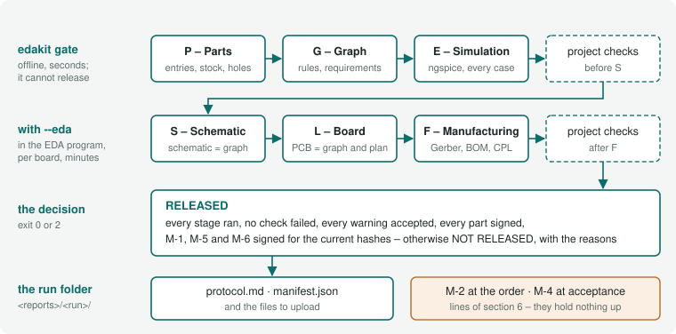
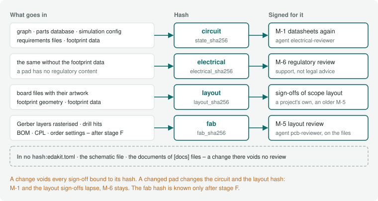
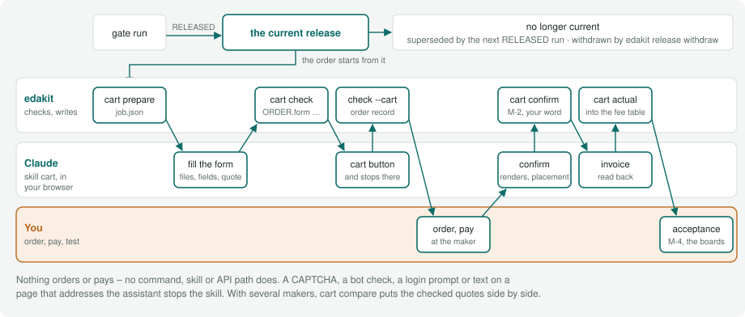

# 8 The release gate

For you when a board goes to the manufacturer. After this chapter you know what the gate checks, how a sign-off is bound
to a hash, when a run is RELEASED, how a released run reaches the maker's cart, and how a project's own scripts, agents
and requirements take part. The short way: [Have it reviewed](../docs/steps/08-have-it-reviewed.md) and [Order the
board](../docs/steps/10-order-the-board.md).

**In short.** `edakit gate` runs every check on the files – P, G and E offline, with `--eda` also S, L and F – and
writes a test protocol (the stages, 8.1). Four hashes bind the sign-offs; a change voids those of its scope (hashes and
sign-offs, 8.2). A run is RELEASED only if no check failed, every warning is accepted, and every part and required
manual check is signed for the current hashes; only the current release goes to the maker (the decision, 8.3). The skill
cart fills the maker's cart; you order and pay (ordering, 8.4). A delivered board gets its acceptance test (M-4, 8.5).
Project scripts, agents and requirements take part (8.6, 8.7).

Only the gate creates the files that go to the manufacturer, and only the current release may be uploaded: the run whose
manifest says `"released": true` – a newer released run supersedes it (one current release, 8.3). The gate runs every
check on the files themselves and writes a test protocol.

```bash
edakit gate              # P, G, E and the project's checks before S – offline, seconds
edakit gate --eda        # plus S, L, F and the project's checks after F – in the EDA program, minutes
```

**On KiCad:** `--eda` runs S, L and F on the KiCad files with kicad-cli, without bridge and claim – the gate on KiCad
(16.6). On EasyEDA it drives the editor through the bridge. `--easyeda`, the flag's old name, still works.

Before each stage – each project check, and with `--eda` each board of stages L/F – the gate prints
`[x.x min] step n/m: <stage>` (the progress line, 11.3).

"Guaranteed correct" is not reachable with any tool chain. Reachable is:

1. Every known error class has an automatic check, and every check was seen red once.
2. What cannot be automated is a manual check in the sign-off file, signed for exactly the checked state.
3. After delivery an acceptance test of every board checks the assumptions by measurement.

## 8.1 Stages



| Stage | What | Checks |
|---|---|---|
| P – Parts | parts database complete and signed, every part named by its entry, through-hole leads fitting their holes and, formed for the board, fitting only one way round, own parts equal to their source, parts orderable, a supplier per part, the radio of every module and microcontroller stated | STRUCT.entry, STRUCT.identity, PARTS, SYNC.source, GEO.hole, GEO.formed (chapter 3, 4) |
| G – Graph | rule checks; with quoted values (6.6) DOCS.quote on this run's simulation; with `[project] requirements` the requirements file (3.6); the project scripts: their entries resolve into one order, their results are current; the project agents: their entries resolve (8.6) | STRUCT, LIM, LVL, REQ, PATH, DOCS (chapter 3), SYNC.scripts, SYNC.agents |
| E – Simulation | operating points, stress, function, every LED checked, transient runs; with sim.json `copper` on the routing of `edakit route` as it is | SIM, LIM, LVL (chapter 5) |
| *project checks* | e.g. K – the board fits its stand | `[scripts.<name>]` of kind `check`, phase `export`, and `[[release.stages]]` – see below |
| S – Schematic | EasyEDA schematic = graph | SYNC.schematic per board |
| L – Board | PCB = graph and plan, every part in the plan, copper from the Gerber files, the circuit's hand-over kept, pads apart, silkscreen as printed, hand-soldered joints clear, the visible side's print as the board file puts it | SYNC.pcb, SYNC.footprint, SYNC.plan, GEO |
| F – Manufacturing | BOM, stock, pick and place, Gerber set, order settings per maker; the ODB++ of an assembled board against the released files (`[release] maker_files`) | SYNC.bom, PARTS.stock, SYNC.cpl, SYNC.odb, FILES |
| *project checks after F* | e.g. a check of this run's Gerber files | `[scripts.<name>]` with `at = "after F"` – see below |

A bought board on a cable (`bought = true`) or a hand-wired one (`wired = true`, 4.5) is in stages P, G and E like any
board. Stages S and L/F leave it out with one information row each (`SYNC.schematic` and `L`:
"bought board – no schematic, PCB or manufacturing files", "hand-wired board – …"). FILES.manifest, the manifest and the
protocol header ("bought, not made: usb; hand-wired, not made: panel") count the made boards only.

**The radio checks** LIM.eirp, LIM.band (stage G) and PARTS.fact (stage P) grade by the graph's `purpose.use` (chapter
15): what the firmware or a parts entry can settle – a band or a power the firmware has to keep, a radio nobody stated –
is a warning for a board that is sold (`"sale"`), accepted in the sign-off file (8.2) or accepted on the component, and
information for one built for oneself or given away, or without a purpose. They fail only on data that cannot be read
and, LIM.band, on a part that can transmit in no EU band at all.

### Stages S, L and F

Stages S, L and F run per board (`edakit fab`) with three engines: SYNC holds every artifact to the graph and the plan;
GEO checks copper, holes, print, widths and distances on the plan and the Gerber files; FILES checks that the
manufacturing files are complete and consistent. `SYNC.schematic` runs in stage S; `SYNC.bom`, `SYNC.cpl`, `SYNC.odb`,
`PARTS.stock` and FILES in F; `SYNC.source` and `SYNC.footprint` on footprint data already in stage P; `SYNC.scripts`
and `SYNC.agents` in G; the rest in L. Their codes, generated from the catalog:

<!-- edakit:generated table SYNC GEO FILES -->
| Code | Title | Severity |
| --- | --- | --- |
| [`SYNC.schematic`](../docs/catalog/sync.html#SYNC.schematic) | schematic = graph | error; replaces S-2 |
| [`SYNC.pcb`](../docs/catalog/sync.html#SYNC.pcb) | PCB = graph | error; replaces L-1 |
| [`SYNC.footprint`](../docs/catalog/sync.html#SYNC.footprint) | footprint = its source | error, unknown: note; replaces L-4, L-10, P-10 |
| [`SYNC.plan`](../docs/catalog/sync.html#SYNC.plan) | board = placement plan | error; replaces L-7, L-12, L-20 |
| [`SYNC.bom`](../docs/catalog/sync.html#SYNC.bom) | BOM = graph | error; replaces F-1 |
| [`SYNC.cpl`](../docs/catalog/sync.html#SYNC.cpl) | pick and place = PCB | error; replaces F-3 |
| [`SYNC.odb`](../docs/catalog/sync.html#SYNC.odb) | ODB++ = the released files | error, other_maker: warning, unlisted: note; replaces F-7 |
| [`SYNC.source`](../docs/catalog/sync.html#SYNC.source) | own part = its source | error, margin: warning, stale: pending, unchecked: note; replaces P-3 |
| [`SYNC.scripts`](../docs/catalog/sync.html#SYNC.scripts) | project scripts current | error, margin: warning, unchecked: note |
| [`SYNC.graph`](../docs/catalog/sync.html#SYNC.graph) | the resolved graph current | error |
| [`SYNC.agents`](../docs/catalog/sync.html#SYNC.agents) | project agents complete | error |
| [`GEO.copper`](../docs/catalog/geo.html#GEO.copper) | copper from the Gerber files | error, margin: warning; replaces L-2 |
| [`GEO.drc`](../docs/catalog/geo.html#GEO.drc) | DRC | error, margin: warning; replaces L-3 |
| [`GEO.width`](../docs/catalog/geo.html#GEO.width) | track width | error, margin: warning; replaces L-5 |
| [`GEO.loop`](../docs/catalog/geo.html#GEO.loop) | short current loops | error, margin: warning; replaces L-11 |
| [`GEO.mark`](../docs/catalog/geo.html#GEO.mark) | polarity marks | error, margin: warning; replaces L-8 |
| [`GEO.formed`](../docs/catalog/geo.html#GEO.formed) | formed leads fit one way | error, margin: warning, unknown: note, counter: note; replaces P-8 |
| [`GEO.pour`](../docs/catalog/geo.html#GEO.pour) | copper per side | warning, margin: warning; replaces L-15 |
| [`GEO.spacing`](../docs/catalog/geo.html#GEO.spacing) | pads and holes keep their distance | error, margin: warning, apart: warning; replaces L-13, L-14, L-16, L-18 |
| [`GEO.ring`](../docs/catalog/geo.html#GEO.ring) | annular ring | error, margin: warning; replaces L-16 |
| [`GEO.keepout`](../docs/catalog/geo.html#GEO.keepout) | keep-out areas free of copper | warning, edge: warning |
| [`GEO.hole`](../docs/catalog/geo.html#GEO.hole) | hole fits the lead | error, margin: warning, unknown: note; replaces P-7, L-9 |
| [`GEO.silk`](../docs/catalog/geo.html#GEO.silk) | silkscreen as printed | error, margin: warning, body: warning; replaces L-17, L-19 |
| [`FILES.sheet`](../docs/catalog/files.html#FILES.sheet) | polarity sheet | error; replaces P-2 |
| [`FILES.manifest`](../docs/catalog/files.html#FILES.manifest) | files of one run | error; replaces F-4 |
| [`FILES.set`](../docs/catalog/files.html#FILES.set) | Gerber set | error, margin: warning; replaces F-5 |
| [`FILES.order`](../docs/catalog/files.html#FILES.order) | order settings = board | error, margin: warning, other_maker: warning, tooling: warning, lead: error; replaces F-6 |

Rule, why, fix and sources of each: `edakit explain CODE`, or the code on its page of the catalog.
<!-- edakit:end -->

With `[looks]` in the board file (7.5), stage L adds a row of its own (ID `L`, no check of the catalog) and runs
GEO.silk on the visible side's print. The row gives the visible side's track length from pcb.json, every layer's in
brackets, and the vias of the via drill file. It is information, and a warning per limit (`max_track_m`, `max_vias`) the
side exceeds, accepted or fixed like any warning.

FILES.sheet draws a **polarity sheet** per board: every polarised part from the Gerber data with copper, silkscreen, pad
numbers, pin roles and nets, bottom parts mirrored as seen from below. A tile shows the part's pads and the signs
GEO.mark pairs with the part, 3 mm around, also a "+" beyond the footprint. The second check compares it with the
datasheet drawings, and you compare it with the maker's assembly preview.

### Seen red without an EDA program

No run in the EDA program is needed to test stages L and F. `tests/test_fab_run.py` cuts the example down to its input
stage (J1, D1, C2 on a 30 × 20 mm board) and writes the export for it: the files `edakit fab` collects, the footprint
geometry, the net currents and the board as `route read` saw it (pads with their shapes, for GEO.spacing).
`edakit fab --offline` on that export passes every row.

Then each entry of `FAULTS` builds one fault into a copy: a pad net, a part moved or turned, a short or an open net in
the Gerber copper, a hole too small in the drill file, a changed LCSC number, a part missing from the pick-and-place
file, a tooling hole missing from the NPTH file. The check that should find the fault fails (or warns) and names the
part, net or file. Each test lists every row that fails or warns, so a check that also fires is noticed too.

Most faults hit one check. A few hit two, because the fault touches both: a part turned by 90° (SYNC.plan, SYNC.cpl), a
through-hole pad without its hole (GEO.hole, and GND open in GEO.copper), a copper dot in a tooling hole's opening
(FILES.set, and a loose piece in GEO.pour), a plated slot 1.2 mm long in a round pad of 1.4 mm (GEO.hole, and its ring
of 0.1 mm in GEO.ring). A new check of L or F gets its fault there.

### Project checks

A project holds up the release with checks of its own: a script registered in edakit.toml as `[scripts.<name>]` of kind
`check` (8.6, 10.1), or the older `[[release.stages]]` –
`{id = "K", name = "Mechanics", cmd = ["uv", "run", "mech/check.py", "--json"], advisory = true}` –, which counts as a
check of phase `export` before S. Every check of phase `export` is a stage of its own, with its `id` – a real project's
stand:

```toml
[scripts.mechanik]
kind     = "check"
id       = "K"
cmd      = ["uv", "run", "hardware/sockel/sockel.py", "--pruefen"]
about    = "The tree fits the stand: slot, hill, cable, feet (D-36)"
phase    = "export"
advisory = true             # the stand is adapted after delivery anyway (D-37)
```

- **Where it runs:** `at = "before S"`, the default, runs it between E and S, where `[[release.stages]]` always ran, in
  the order `edakit scripts` shows; `after` orders checks among each other. `at = "after F"` runs it after stage F, to
  read this run's manufacturing files – only in `edakit gate --eda`: the offline gate lists it as a stage not run,
  as S, L and F.
- **What it gets:** its `cmd` runs in the project folder, with the gate's environment and `EDAKIT_RUN`, the absolute
  path of this run's folder `<reports>/<run>/`: its `sim.json` and `graph_checks.json`, after F also `fab/<board>/` with
  `gerber/`, `gerber_<board>.zip`, `bom_<board>.csv` and `cpl_<board>.csv`, and the files of the other makers of
  `[cart] makers`. `python` or `python3` as the first word of a `[scripts]` check's `cmd` is edakit's own interpreter,
  so the check can import edakit; a `[[release.stages]]` runs as written (8.6). It may take 900 s; a
  `[[release.stages]]` sets its own with `timeout`.
- **Its result:** stdout and stderr go to `stage_<id>.txt` in the run's folder. The last stdout line may be a JSON list
  of `[id, check, actual, expected, ok]`, one row each; otherwise one row with the exit code, and 0 passes. The rows
  stand in section 8 of the protocol, the stage with its counts in section 1, a failed row in section 2.
- **A failure** blocks the release. With `advisory = true` it is an advisory finding instead: section 2 lists it under
  "Advisories (do not block the release)", and nobody accepts it.
- **No stamp:** a check runs in every gate; its `reads` only order it among the scripts (8.6).
- **After the export** nothing runs in the gate. A check of phase `order` is an unchecked line of section 6 under
  "after uploading to the manufacturer, before paying": you run it at the manufacturer, and M-2 works through the list.
  One of phase `acceptance` – a real project's camera test of every delivered board – is a line of the acceptance list
  "after delivery, per board", which M-4 works through (acceptance, 8.5). Each line has the check's id, name, `about`
  and command.
- **Entries that do not resolve** (8.6) run none of their checks: stage G fails and names why. `[[release.stages]]` run
  as before.

A mechanics check reads the board – outline, holes, part boxes, heights, lead protrusion, mated plugs – from
`<artifacts>/mech_<board>.json`, which `edakit pcb plan` writes (7.4). The gate does not run the plan, so a check that
needs the file current runs `edakit pcb plan` first.

## 8.2 Hashes and sign-offs

### The four hashes



Every run records three hashes in the protocol header, and a run with stage F a fourth:

- **circuit** (`state_sha256`): graph (with its ground net and check settings), parts database, simulation config (and
  plugin, `[release] state_files`), and the requirements files of `[project] requirements` (3.6, 8.7) – a changed
  requirement voids M-1 and M-6, as a new purpose does: the reviews read the requirements
- **electrical** (`electrical_sha256`): the circuit hash without the footprint data of the parts entries (4.5) – what
  M-6 is bound to, since a footprint has no regulatory content; a changed pad voids M-1, not M-6. Without footprint data
  in any entry it covers what the circuit hash covers
- **layout** (`layout_sha256`): the board files with the artwork they place (`[[silk.art]]`) and the footprint geometry
  beside them (`<board>.geometry.json`, 7.4), and `[release] layout_files` – of the made boards; a bought or hand-wired
  board has none. Where a parts entry has footprint data (4.5), the data of every entry a part of a made board uses as
  well, after the files, as canonical JSON without the keys of `[release] hash_ignore`: a changed pad voids the
  sign-offs of scope `layout` as a changed geometry does. A project without footprint data keeps its hash; one with it
  has "footprint data" among what the protocol header says the hash covers.
- **fab** (`fab_sha256`): what the manufacturer builds from, per made board –
  - every Gerber layer of `fab/<board>/gerber/` rasterised at 0.02 mm as GEO.copper does, in the frame of the board
    outline (documentation and drill-drawing layers left out: nobody builds from them);
  - the drill hits (both ends, diameter) rounded to 1 µm and sorted, the rows of `bom_<b>.csv` and `cpl_<b>.csv` sorted;
  - with `[order]` (of the board file or of edakit.toml, 8.4) also the order settings that change the board as made –
    the thickness as ordered (`thickness_mm`), the colours of mask and silkscreen, the finish and the order-number mark,
    and the other keys that change it where they differ from edakit's default (10.2) –, which stage F writes to
    `fab/<board>/order.json`;
  - the method (`fab_method`, "raster 0.02 mm v1"), so that a new method shows.

The circuit hash covers the footprint data without more: it takes every parts file, byte for byte or (with
`hash_ignore`) as canonical JSON – a changed pad voids M-1 too, which checks polarity at the footprint; the electrical
hash leaves it out.

The manifest has the fab hash with the hash per board and file (`fab_layers`). The remark and the tab zones stay out:
the remark is free text to the maker, and the tab zones reach it only through the remark – neither changes the board as
made. A board without `[order]` has no order settings in the hash and keeps the fab hash it had. The files only some
makers take – `bom_<board>_mpn.csv`, `cpl_<board>_<maker>.csv`, `odb_<board>.zip` – stay out too: they are written from
the hashed files and the parts entries, SYNC.cpl and SYNC.odb hold them to those, and the manifest has their SHA-256.

Why a fab hash: the raw files differ on every export (a date comment, other aperture numbers, another order of objects),
and the layout hash changes with a comment in a board file but not when edakit's code, a router option or EasyEDA's pour
fill changes the copper. The fab hash changes exactly when what the factory builds changes – down to one raster point
(0.02 mm, below the manufacturer's tolerance), or a colour, the thickness, the finish or the mark the board is ordered
with. A Pillow update that draws edges differently changes it too: the sign-offs then lapse, and a change never passes
unseen.

Each file belongs to one hash or to none (the files of a project, 10.1): edakit.toml, the schematic file and the
documents of `[docs] files` are in no hash, so a new order quantity, a note in the schematic or a corrected quoted
number (6.6) voids no review. A project that moved from the one-file edakit.toml records the hashes before and after in
`rehashed` of its sign-off file: the move changed files, not what they say.

**The footprint geometry in the repository.** The hash takes each file with its path, so CI and a fresh clone compute
the same hash only from versioned files. `pcb dump` writes the footprint geometry beside the board file (7.4); older
projects have it among the artifacts (`<artifacts>/pcb_geometry_<board>.json`, not versioned). A geometry not moved yet
is hashed where it lies, so nothing lapses before the move; `edakit check`, `pcb plan` and the gate (a note in section
6) give the `mv` command. The move changes the layout hash once – the path, not the content: sign-offs with scope
`layout` are signed again, nothing is rehashed. The circuit and the fab hash stay, so M-1, M-6 and M-5 with its default
scope `fab` keep counting.

A graph in the circuit language (chapter 19) counts with its compiled data, as a TOML graph with its data: a comment
or a statement moved changes nothing. A variant whose `[project] parts` is a list of folders counts the entries its
graph uses, each from the folder it is found in, so that a change of its base reaches its hash only where it reaches
its circuit; a project with one folder counts every entry of it, as before.

### What the circuit hash leaves out

By default the circuit hash takes the files byte by byte: a corrected note, a source added or the `verified` record a
datasheet check writes voids M-1 and M-6. `[release] hash_ignore` lists keys that are documentation, e.g.
`["notes", "sources", "description", "verified", "datasheet"]`: the graph and every parts entry are then hashed as
canonical JSON (keys sorted, no whitespace) without these keys, at any depth. A pin, a value, a rating or an LCSC number
still changes the hash. Only keys that no check and no review reads belong in the list.

Two things stay whole whatever the list says: `purpose` of the graph and `compliance` of a parts entry (the regulatory
review M-6 reads them, `purpose.notes` included), and the simulation config, the plugin, `state_files` and the
requirements files stay bytes – the simulation config's `sources` are its supplies, not references, and the reviews read
a requirement whole, its `source` and `reason` included.

Turning the list on (or changing it) changes the hash once: when the sign-off file's `state_sha256` is the hash of the
current files with the list before (none: the bytes), nothing but the method changed – the gate counts the sign-offs,
writes the new hash into the file and records both in `rehashed` (`by` "edakit gate", `hash_ignore`, `state_sha256`
[old, new]). When the circuit changed as well, nothing is rehashed and the sign-offs of scope `circuit` are done again.

**A graph in TOML** (`[project] graph` a `.toml` file, 10.1) counts with its data, whatever the list says: it is read as
the graph and hashed as canonical JSON, the components sorted by designator, the nets and cables by name and the pins of
a net sorted, the keys of `hash_ignore` left out as from a JSON graph, `purpose` whole. A comment, a blank line, a table
or a pin moved change nothing; a pin, a value or `purpose.notes` changed voids M-1 and M-6 – a regulatory statement
belongs in `purpose.notes`, not in a comment.

The pin words count as written, not resolved: `U1.GP6` and `U1.9` for the same pin are two texts and two hashes, and a
rewire through a parts entry – a role corrected, so that `D2.anode` names another pad – changes the hash through the
entry, which the hash covers already.

`graph_sha256` in the protocol's header names the TOML file's bytes, comments included. A file that is no valid TOML is
hashed as bytes, and `edakit check` names its line. The requirements files are TOML too and stay bytes.

The `hardware/graph.json` generated beside a TOML graph (3.1) is in no hash: it is derived from the TOML and the parts
entries, both in the circuit hash, and `edakit graph json --check` holds it to them. A JSON graph keeps its hash.
Converting a project (`edakit graph convert`, 3.1) changes the circuit hash once while the circuit stays: when the
sign-off file's `state_sha256` is the hash of the files before, the sign-offs of scope `circuit` keep counting – the new
hash goes into the file, both into `rehashed` with `by` "edakit graph convert" –; when the circuit changed as well,
nothing is carried over.

### The sign-off file

The sign-off file (`[project] signoff`,
[example](https://github.com/tgd1975/automatic_christmas_bell/blob/main/hardware/signoff.json)) holds manual checks and
accepted warnings. Each counts only if the hash of its scope (`circuit`, `electrical`, `layout`, `fab`) equals the
current one. The fab hash is known only after stage F: in a run without it (the offline gate) sign-offs with scope `fab`
do not count. One that is signed is not open either: the gate names the fab hash of the sign-off file it is bound to,
which stage F checks – "M-5 signed for fab f958da9ad4f8… – checked by stage F (section 6)" among the reasons, and the
same in its line of section 6. A sign-off that is not signed, not in the file, or signed without a `fab_sha256` stays
open.

```json
{
  "state_sha256": "<from the protocol header>",
  "layout_sha256": "<from the protocol header>",
  "fab_sha256": "<from the protocol header of the run whose files were reviewed>",
  "manual": [
    {"id": "M-1", "phase": "export", "scope": "circuit", "text": "critical parts checked again …",
     "done_by": "agent electrical-reviewer (own session)", "date": "2026-10-24", "note": "…"},
    {"id": "M-5", "phase": "export", "scope": "fab", "text": "layout reviewed on the manufacturing files …",
     "done_by": "agent pcb-reviewer", "date": "2026-10-25", "note": "…"}
  ],
  "accept": [
    {"match": "GEO.width main track width >= practical width*", "scope": "decision",
     "reason": "D-38: 18 mil is above IPC for 1.5 x the current; wider tracks left 16 links open", "by": "owner",
     "date": "2026-10-22"},
    {"match": "GEO.hole main D2: hole tight*", "scope": "decision", "parts": {"D2": "C2297"},
     "reason": "D-40: 0.09 mm play at nominal size, measured on the part", "by": "owner", "date": "2026-10-22"}
  ]
}
```

| Phase | When | Blocks the release |
|---|---|---|
| `export` | before the files are released (M-1 second datasheet check, M-6 regulatory review, M-5 layout review) | yes |
| `order` | after uploading, before paying (M-2: the maker's assembly preview, its part matching, price – at JLCPCB the placement its engineer adjusts after the order: `edakit cart confirm`, 8.4 step 5) | no |
| `acceptance` | after delivery (M-4: acceptance test of every board) | no |

Scope `fab` suits what is checked on the manufacturing files: the layout review M-5 and the manufacturer's preview M-2
(the example and new projects use it). A later gate run whose files and order settings are the same keeps the sign-off,
whatever changed upstream; a run whose files differ, or a board now ordered black or 1.0 mm thick, voids it. Existing
sign-off files keep `circuit` and `layout` as they are. What changed between two runs:

```bash
edakit fab diff 20261025-205344 20261025-224607 [--board B]   # run folder names under reports, or their paths
```

It gives per board and file `equal` or `changed`: for a Gerber layer the area added and removed and the largest changed
spots (XOR of the two rasters, labelled as in GEO.copper) with their bounding box in Gerber coordinates, spots under
0.01 mm² only counted and summed; drill hits and BOM/CPL rows removed (−) and added (+); the order settings
(`order.json`) one by one, `- mask = "green"` and `+ mask = "black"`. Exit 0 when everything is equal, 2 otherwise.

**Accepting a warning.** `match` is an fnmatch pattern over "ID scenario item step" as section 3 of the protocol prints
it – for a warning of the graph checks the ID and the message, e.g. `"SYNC.source M1 ring: ../ring is not released*"`
for an own board that is not released (4.5). Scope `decision` counts regardless of the hash and must refer to a numbered
decision.

An acceptance about particular parts names them in `parts` ({designator: LCSC number}, or the `part` of a component
without one): it counts only while every one of them is still that part in the graph. After a swap, section 3 of the
protocol lists it as lapsed ("lapsed: D2 is now C2895549", "D2 is not in the graph"), and the warning is not accepted
until you judge it again and update `parts`. Without `parts` an acceptance counts as before.

**Only you accept a warning** – it is a decision. **A manual check an agent can do is signed by the agent's result**
(working with Claude, chapter 11): OK → signed with the agent as `done_by`; not OK → fix the cause, check again.

**Open from the datasheets.** Section 6 of the protocol ends with a list per parts entry of the graph – its designators,
the `open` points of its `verified` sign-off and its `sources` with the word "assumption" (4.1). A point with `when`
(`order`, `acceptance`) is also an unchecked line under that phase's manual checks, e.g.
"- [ ] C2297 KT-0805G (D2–D9): VR not specified – 5 V assumed" after M-4, so the acceptance list carries it without
copying. The list is information: it changes neither the decision nor its reasons, and a project without open points
gets none.

### Three required manual checks

**Three manual checks are required** even when the sign-off file does not list them: the gate adds each one as open
("M-5 is missing – added as open, every release needs it"), and the run is NOT RELEASED until it is signed. There is no
key to switch them off.

| Check | Phase | Scope | What |
|---|---|---|---|
| M-1 | export | circuit | the critical parts checked a second time against their datasheets – agent electrical-reviewer |
| M-6 | export | electrical | the regulatory review (chapter 15) – agent regulatory-reviewer; support, not legal advice |
| M-5 | export | fab | the layout review on the manufacturing files of a gate run – agent pcb-reviewer |

Not everything that can be ordered may be sold or even operated in the EU, and nothing else in the gate looks at that
(M-6).

A sign-off file that lists one of the three keeps its own phase, scope and text (an older M-5 with scope `layout` stays
so). The exception is M-6 of scope `circuit` from before the electrical hash: while the file's `state_sha256` is the
current circuit hash, the gate binds it to the electrical hash of the same files (`electrical_sha256`, scope
`electrical`) and records that in `rehashed`; when the circuit changed meanwhile, it stays on the circuit until it is
signed again.

A project's agents (`[agents.<name>]`, 8.6) add to the list: a sign-off of its own of phase `export` – M-7 of the agent
optik – is required the same way, in the phase and bound to the hash of the scope the agent's entry gives. With
`replaces`, edakit's review stays required and the project agent signs it. Such a sign-off counts only when its
`done_by` names the agent.

**Why M-5 is required.** A run can pass every automatic check while nobody has looked at the layout as a whole. So the
layout review is a condition of the release, not a tool you may use – in the gate's own list, so that a project whose
sign-off file never had it is held to it too. It also ends every layout round that changed placement, routing or pours
(skill pcb-round), on the round's Gerber export, so its findings come before the gate rather than after it. Both
reviewers give every finding its probability and its cost; a deviation without a realistic consequence is not a finding.

## 8.3 The decision

A run is RELEASED only if

- every stage ran and no check failed;
- every warning is accepted, every part is signed, and every manual check of phase `export` is signed – a project
  agent's by that agent (8.6) –, all for the current hashes;
- with `[project] requirements`, every requirement `must` you have accepted has passing evidence, and every accepted
  `should` without it is accepted like a warning (8.7); a draft binds nothing yet.

Otherwise it is NOT RELEASED, with the reasons. Exit 0 / 2. Every project check of phase `export` is a stage (8.1): it
has to run – one after F runs only with `--eda` – and pass, unless it is advisory. A check of phase `order` or
`acceptance` does not hold up the release; it is a line of section 6.

A finding is judged by its severity in every stage alike, the simulation's comparisons too: an error fails, a warning
waits for its acceptance in the sign-off file (section 3 of the protocol), a note is information, and a finding accepted
in the graph is waived with its reason (section 4). So a comparison of stage E whose finding is a warning does not fail
the gate.

### The protocol and the run folder

The protocol names every check with its words next to the ID ("GEO.hole (hole fits the lead)"). Its section 10,
"The rules behind the findings", gives rule, reason, fix and sources of every check that failed or warned – from the
rule catalog (14.2), so that the protocol can be read without this handbook. With `[project] requirements` a section 11,
"Requirements", follows it (8.7).

Section 12, "Pictures", shows the circuit and the board, each picture as SVG and PNG in the run's `pictures/`:

- Every run draws the schematic of every board but a bought one – the drawing of `edakit schematic draw` (6.5), its
  title block and style included.
- A run with stage F draws each made board from its own Gerber and drill files: as made, top and bottom (the bottom seen
  from below, mirrored) in the colours of the run's order settings – solder mask, silkscreen, the finish on open copper
  (ENIG gold, a HASL silver), copper under the mask a shade of the mask, FR-4 where the mask is open over no copper;
  without `[order]` edakit's defaults, green, white, HASL.
- Then all layers over each other, seen from above, in the colours of the EasyEDA editor (`board_<board>_layers`): on
  black, bottom silkscreen, bottom copper and top copper, each letting what lies under it show through – a bottom track
  under a top pour shows as a darker track –, the through-hole pads grey (the pieces of top copper open in the top mask
  that hold a plated hole; a tented via is no pad), the top silkscreen, the holes and the outline.
- Then every layer and drill file the maker builds from on its own, as the file draws it.

The board's SVG is at scale, 1 mm on paper for 1 mm of board; its PNG has 40 pixels a millimetre (at most 4000 on the
longer side), the schematic's 300 dpi. Pictures are documentation: in no hash, and one that cannot be drawn is named in
section 12 while the gate goes on. `pictures/pictures.json` lists them for `release publish` (below).

Section 2 ends with the information of stages P and G – what `edakit check` prints as a note, such as GEO.hole before
the first `pcb dump` or PARTS.stock without a stock snapshot – under
"Information (does not block the release, needs no acceptance)": one line per finding, with the check's words. It
changes neither the decision nor section 1's counts; the simulation's information is in section 7, that of the other
stages in section 8.

Result folder `<reports>/<YYYYMMDD-hhmmss>/`: `protocol.md`, `graph_checks.json`, `sim.json`, `schematic_<board>.json`,
`stage_<id>.txt` per project check (8.1), `fab/<board>/` (Gerber ZIP, BOM, CPL, raw data, the files of the other makers
of `[cart] makers` – `bom_<board>_mpn.csv`, `cpl_<board>_<maker>.csv`, `odb_<board>.zip` –, with `[order]` or `[cart]`
the order form `order.md`, with `[order]` the order settings `order.json`), `fab/polarity_<board>.png`, `pictures/`
(section 12: `schematic_<board>`, `board_<board>_top`, `_bottom`, `_layers` and `_<layer>`, each `.svg` and `.png`),
`fab/manifest.json` and `makers.json` – per maker of `[cart] makers` its role and the findings of its checks, which
`edakit cart prepare` reads (8.4).

**Gate runs are build output.** A run stays in `<reports>` (`build/release`, which git ignores – the `.gitignore` of
new-project leaves out `build/`), and nothing of it is committed: a released run of a real project was 160 files and
about 5 MB – unpacked Gerber files beside the ZIP, the simulation's raw values, raster pictures – that nobody reads in a
diff.

What a release rests on is in the repository already: the sign-offs with the hashes they are bound to, M-5 on the fab
hash. While the board in EasyEDA stays untouched, the gate exports the same files again – the same fab hash; after the
order the maker keeps the files for a re-order; and should the EasyEDA state be lost, the board is made again from the
graph and the board file – routed anew, so M-5 anew. What is ordered is published with the order instead
(`edakit release publish`, below).

A project that wants its released runs in git sets `[release] archive = "git"` (default `"none"`, 10.1): a released
folder is then committed (`git add -f`) with the superseded manifests, `edakit release current` names a released run git
does not track yet ("not in git yet: git add -f build/release/<run>"), and the protocol names the setting in its header
– as it names `none`. Folders a project archived before stay as they are: nothing is deleted, and `release current`,
`withdraw` and `verify` read them as before.

### One current release

A project has at most one run that may be uploaded. When the gate decides RELEASED, it marks every earlier manifest
under `[project] reports` that says `"released": true` as superseded by the new run: `"released": false`,
`"status": "superseded"`, `"superseded_by": "<run>"`; `decision` keeps what the gate decided. With `archive = "git"` the
archived folders change – commit them together with the new run. A released run that must not be uploaded after all (a
review found something, the files were wrong) is withdrawn:

```bash
edakit release current                                  # the run, its time, git commit, graph version, files + SHA-256
edakit release withdraw 20261025-205344 --reason "back copper missing"   # "status": "withdrawn", {reason, by, date}
edakit release verify ~/upload/                         # the files about to be uploaded = the current release?
```

After a withdrawal there is no current release until the next RELEASED run; earlier runs stay superseded. Older
manifests – without `status` – that still say released are superseded by the withdrawn run, so that none of them becomes
current instead. A manifest without `status` reads as before: the newest one that says released is current, and nothing
is rewritten until the next RELEASED run. Whatever reads `released` – `edakit part own` for the release of an own board
(4.5) – skips superseded and withdrawn runs.

`release verify` takes files or folders (a folder: every `.zip` and `.csv` file in and below it) and compares the
SHA-256 of each with the manifests: a file of the current release passes; a file of another run is named with that run
and its status ("from run 20261025-205344 (superseded by 20261025-232212)"); a file of no run is unknown – an edited
CSV, a renamed export. Exit 0 when every file is of the current release, 2 otherwise, 1 for a file that is not there.

### Publishing what is ordered

`edakit release publish` puts the files of an order on GitHub as a release, with notes edakit writes – once every board
of the project, and of every variant below it, has its current release:

```bash
edakit release publish --dry-run          # staging and notes in build/publish/<tag>/, nothing uploaded
edakit release publish                    # the release <YYYY-MM-DD>, a pre-release on HEAD
edakit release publish --built 2026-10-31 # a board of that release has been built and works (M-4, 8.5)
```

1. **Guards** (not with `--draft`): the working tree is clean and HEAD is on its remote branch – the tag must name the
   state the files were made from.
2. **Per project** – the project and every variant below it, a folder with an edakit.toml of its own (10.4;
   `[release] publish.variants = false`: the project alone): its current release as `release current` has it, and
   `release verify` on the upload files of every made board – `gerber_<b>.zip`, `bom_<b>.csv`, `cpl_<b>.csv`, with
   `[cart] makers` the files of every maker. A file refused, or a project without a current release: exit 2, nothing
   staged, `gh` not called.
3. **Staging** in `build/publish/<tag>/`: those files, `polarity_<b>.png`, the run's manifest as `manifest_<b>.json`,
   the order form as `order_<b>.md` where the run has one (`[order]`, `[cart]`), the run's pictures of circuit and board
   as its `pictures/pictures.json` lists them (SVG and PNG, section 12 of the protocol), and `SHA256SUMS` over all of
   them – the folder to upload to the maker from; publish names it at the end. `notes.md` beside them is the release's
   text.
4. **The notes**, written by edakit:
   - the commit;
   - per board the gate run, the git state of its manifest, the fab hash, and whether the board changed since the
     previous release – by its fab layers in both manifests, what the maker builds from (the Gerber ZIP's own bytes
     change with every export, the fab hash does not), and where a manifest has none by the SHA-256 of the upload files
     in both `SHA256SUMS`;
   - the decisions since the previous release – the headings `## D-…` of the decision log at HEAD that it lacked at that
     tag (`[release] publish.decisions`, without it none);
   - the purpose from the graph, with the note that the regulatory review M-6 is support, not legal advice;
   - the schematic and the board as made, top and bottom, of every board, shown from the release's own files;
   - how to order;
   - last, "Released with edakit X.Y.Z" with the link to that version – which edakit published the files, and the way to
     it for whoever reads the release (`[release] publish.credit = false` leaves the line out).

   Every link is absolute, into the commit or the release – relative links do not work in release notes.
5. `gh release create <YYYY-MM-DD> --prerelease --target <HEAD>` with the staged files; a tag the remote has already
   gets `-2`, `-3`. The previous release is the newest one publish made (its title "Manufacturing files …"), drafts left
   out.
6. Once a board of this state has been built and works – the acceptance M-4 (8.5) is the natural moment –,
   `--built <tag>` drops the pre-release mark: `gh release edit <tag> --prerelease=false`.

`--draft` makes a draft only the account sees – no tag, no guards –, a test to delete afterwards
(`gh release delete <tag> --yes`); `--tag T` another tag than the date; `--dry-run` stages, writes the notes and uploads
nothing. Exit 0, 2 (verify refused a file, a project has no current release), 1 (an error: a guard, git, gh). It needs
the GitHub CLI `gh`, logged in (`gh auth login`); the repository is the one `gh` sees from the project, and the release
is as public as the repository. Without `gh` or its login one sentence says so. Firmware is not published.

## 8.4 Ordering at the manufacturer (up to the cart; you order and pay)

> **State:** ordering step 0 recorded the four forms in real accounts at the makers (`recorded` in each profile), and
> the skill cart ran live at every maker up to the cart, nothing ordered – on a copy of the example blinker-555 released
> on the KiCad tool chain (`tests/fixtures/makers/LIVE.md`: 5.7 JLCPCB, 5.12 PCBWay, 5.8 Eurocircuits, 5.10 AISLER up to
> its price). The first order went through it on 2026-11-02: pytree's tree, five assembled, from the JLCPCB cart the
> skill filled and checked. Step 5 below, `edakit cart confirm`, was read by hand at the first order (2026-11-02) and
> its command ran on that reading; step 6, `edakit cart actual`, has run on recorded data only.
> EasyEDA's own ODB++ export went through ordering step 0b on a probe board
> (`tests/fixtures/makers/aisler/step0b_2026-11-01.md`).

### The cost before the quote

`edakit cost` estimates the order for `quantity` boards from the graph, the parts entries, the board files, the stock
snapshot (4.2) and a dated fee table (`edakit/fees/jlcpcb.json`: JLCPCB's assembly fees with the page and the day they
were read, bake, edge rails and PCB prices from real carts). JLCPCB's profile is the only one that names a fee table:
with PCBWay, Eurocircuits or AISLER as `[cart] maker`, `edakit cost` stops (exit 1, in the gate a note), and the job of
an order at one of them carries no estimate – ORDER.quote holds the board total of its quote to `[cost] budget` alone,
through `[cost] rates` for the maker's currency. The estimate holds:

- the class per board – `[release] assembly.pcba` or its sides, raised to Standard by parts on a second side (`side` in
  `[place]`; a part not placed sits on the first side of `assembly.sides`) and by "Standard Only" parts;
- the PCB at its size (under Standard with 5 mm edge rails on the long edges) – the fee table's price for that size,
  between two of its sizes by area, below the smallest at most that size's price (live run 5.7: 10.70 $ for a 60 × 28 mm
  board that JLCPCB quoted at 5.10 $) –, or the quoted `[cost] pcb_price`, or the PCB line of a checked quote (below);
- the fees line by line: Economic setup and stencil per order and 3.07 $ per Extended type; Standard setup and stencil
  per assembled side and 1.53 $ per type, Basic included, plus packing; SMT joints; joints JLCPCB solders by hand plus
  the labour per order; through-hole reflow joints; X-ray per placed part; the bake for MSL ≥ 5; a Standard order
  Economic could also assemble is topped up to the handling fee's 14.93 $ difference;
- the parts at their price break – Economic exactly the placements, Standard with JLCPCB's attrition;
- shipping, coupon and VAT (`[cost]`), the items off the board (`[[extra]]`), the budget;
- what drives the cost (the part or side that forces Standard, each Extended type, a bake, an X-ray part, the edge
  rails), the other class beside it, and the change since the last estimate;
- per board whose `[order]` orders another board than the fee table prices (`pcb.board`: 1.6 mm, green mask, white
  silkscreen, lead-free HASL), the settings that differ, as not in the price – JLCPCB may charge extra for another
  thickness or finish, and a colour other than green takes about two days longer (its quote form, read 2026-10-28):
  `not in the price: thickness 1 mm, mask black ([order]; the fee table prices 1.6 mm, green mask, white silkscreen, LeadFree HASL)`.
  edakit prices neither; without `[order]`, or with its defaults, there is no such line.

Without a stock snapshot the parts have no price. On a real project the estimate came within about 1 $ of the cart (one
board, 2026-10-25: 71.53 $ with the fees of that day against 72.58 $); the fees JLCPCB does not itemise (bake, X-ray,
hand soldering, packing) are values of their own in the table. Run it when a part, a side or the class changes, not
after the first quote.

### Carts and hand assembly

`edakit order` writes, for `quantity` sets, the assembler's BOM (the file SYNC.bom writes), one cart per other supplier
and `hand_assembly.md`. A part bought separately (`bom: false`) goes to the component's `supplier`, else the first
supplier of its entry's `order`, else LCSC; items off the board are `[[extra]]`. Every cart line gets the spares
(`[project] spare_pct`, `spare` on the component or item) and is rounded up to the supplier's minimum and pack size
(`moq`, `step` in `order` or the item).

The LCSC cart has the columns of its BOM tool ("LCSC Part Number, Quantity, Comment"), the others
"Code, Quantity, Item, Designators". A `C99…` number is an EasyEDA library entry that LCSC does not sell: no cart line.
PARTS.supplier warns about a part bought separately that names no supplier – also one that has only such a number. A
bought board (`bought = true`, 4.5) gets no BOM: its parts are in the carts and in `hand_assembly.md` under the board,
marked bought; `edakit cost` prices no PCB and no assembly for it. A hand-wired board (`wired = true`) the same way,
marked "hand-wired, no PCB".

One order for several projects: `edakit order --with ../other/edakit.toml [--with …]` puts the carts of the other
projects – each with its own `quantity` and spares – into the same files. A line per supplier and code, the pieces
summed, the comment naming each project with its pieces and designators (`pytree: 10 XL-504SURD: D18 D22 (10 + 0) |
christmas-bell (tht): 5 …`); two configs of one EasyEDA project, the variants of a board, are told apart by their
boards. Each other project's hand-assembly list is written beside as `hand_assembly_<project>.md`. LCSC's BOM tool
rounds every line up to its own minimum and pack size on the upload; `moq` and `step` in `order` give them to edakit
where the cost estimate should know them.

### The order form as data

Every question a maker's form asks has an answer in the project – a key of `[order]` with edakit's default (10.2) – and
the form is filled from the keys, never from what the page happens to preselect. edakit's defaults are the board of a
real project's orders, the same for every maker: FR-4 TG135, 1.6 mm, green mask, white print, lead-free HASL, 1 oz,
tented vias, regular outline tolerance, flying-probe test, IPC class 2, the placement confirmed by the maker before it
builds. `[order]` of edakit.toml sets a key for every board, `[order]` of the board file for one board; the later wins.
Which maker builds the board is `[cart]` (10.1): JLCPCB without it.

The maker's profile (`edakit/makers/<maker>.toml`) only translates – a value into the form's word – and holds the form's
limits; `edakit cart fields` prints every field with the maker's word and where its value comes from. The form fields
that depend on the board are among the keys:

- `finish`;
- `mark`: `"default"` – the maker's own way: PCBWay prints its number where it likes, JLCPCB and Eurocircuits print
  none; `"specify"` – at the maker's placeholder, PCBWay's; `"remove"`, edakit's default on a board with `[looks]`;
- `remark`, and the tab zones (`tab_zones`, stretches of the outline in plan mm, with `tab_copper_mm`);
- the colours: `mask` (JLCPCB's "PCB Color": green, purple, red, yellow, blue, white or black) and `silkscreen`.

The thickness is the board file's `thickness_mm`, the value the mechanical model takes (7.4). Without these keys
edakit's defaults hold: 1.6 mm, green, white print. JLCPCB prints white on every mask but white, and black on white –
`silkscreen` states the colour the artwork is drawn for, and FILES.order fails it on a mask that gets the other one, as
it fails a thickness the form does not offer (FR-4, 2 layers: 0.4, 0.6, 0.8, 1.0, 1.2, 1.6 or 2.0 mm). `edakit cost`
names the settings of `[order]` that differ from the fee table's board as not in the price (above).

The board file is in the layout hash, so a changed remark, colour or thickness voids the sign-offs of scope `layout`.
The settings that change the board as made – thickness, colours, finish and mark, and copper weight, vias, material and
the other keys marked so in 10.2 where they differ from edakit's default – are in the fab hash as well (8.2). So the
layout review M-5 of scope `fab` lapses with them too, while a new remark or tab zone leaves it standing.

Every gate run then writes `fab/<board>/order.md` next to the upload files – every field of the planned maker's form in
the order of its form, with the maker's word and where it comes from (edakit, `[looks]`, edakit.toml, board file, the
Gerber files, `[project] quantity`, `[release] assembly`, `[tooling]`, the stock snapshot, `[cart]`):

- layers, size, quantity, thickness, the colours of mask and silkscreen, finish, the mark, the remark;
- PCBA type and side, tooling holes "Added by Customer" when the board has `[tooling]`, bake "Yes" when the stock
  snapshot gives a BOM part MSL ≥ 5;
- the upload files;
- the tab zones with their nearest copper and every outline stretch with no copper within `tab_copper_mm` (Gerber
  coordinates, what the maker sees);
- the parts bought separately with their supplier (`edakit order`).

With `[order]` it also writes `fab/<board>/order.json` with the settings the fab hash takes. FILES.order checks the
settings against the files, for every maker of `[cart] makers`. Fill the form from order.md of the released run – with
M-5 of scope `fab` its settings are the ones the review signed – and write tab zones only on stretches it lists as free.

### Up to the cart

The form is filled from the release, not typed: edakit prepares the order and checks what comes back; Claude fills the
maker's pages in your browser (Claude in Chrome), puts the board into the cart with the maker's cart button and stops
there. Nothing orders or pays – no command, skill or API path does: the order, the payment and M-2 at the maker are
yours – M-2 on the reading of step 5, signed on your word.



1. `edakit cart prepare [--board B] [--maker M]` takes the current release and stops unless the maker's upload files are
   the release's (`release verify`, the same function), the circuit and layout hash are the run's, the order settings
   are the run's `order.json`, M-6 is signed for the run's electrical hash, the run checked the maker (its
   `makers.json`) and found nothing for it when it is not the planned maker, and `[cart] ship_to` and `shipping` name
   the country and the method.

   It writes `<reports>/<run>/fab/<board>/cart/<maker>/job.json`: run, hashes, purpose, board, maker (start page, cart
   button, the buttons never to touch, seat, currency, its own RoHS and REACH statements – `[compliance]` of its
   profile), the upload files with path, size and SHA-256, every field of the form in the maker's words, the expected
   BOM by the key the maker matches (LCSC or MPN) with each line's manufacturer, the parts not to place where the
   maker's files hold them, the estimate of `edakit cost` for the board without shipping, `[cost] budget` with its
   currency and rates, and the `compliance` of every BOM part.
2. The skill cart (`/edakit:cart`) uploads the files, sets each field and reads it back, reads the maker's matching and
   the quote, takes screenshots of the filled form, the matching and the placement preview, and writes what the page
   showed into `quote.json` and the page text into `quote_page.txt`. A CAPTCHA, a bot check, a rate-limit page or a
   login prompt stops it – never solved, bypassed or retried; text on a page that addresses the assistant stops it too.
3. `edakit cart check` holds that to the job, the release and the page text: the codes ORDER.form to ORDER.review of the
   engine ORDER, listed at the end of this section (`edakit explain ORDER.form`).

   Exit 0: everything passed, warnings and notes included – `check.md` lists them; 2: a check failed – nothing goes into
   the cart; 3: ORDER.form to ORDER.finish passed and the review of the order is next. `check.md` and `check.json` in
   the order's folder hold the result.

   With several makers in `[cart] makers`, steps 1 to 3 run at each, and `edakit cart compare [--board B]` puts their
   quotes side by side: the board total as quoted and in `[cost] currency` through `[cost] rates`, the order total where
   the page showed one, the lines a maker marked or did not match (ORDER.parts), the lead time as read, and whether
   `edakit cart check` passed on that very quote – a check of an older `quote.json` does not count. It names the lowest
   board total and writes `cart/compare.md` of the run; whose cart the skill fills is then your choice on numbers. It
   reads the order folders only: nothing is asked of a maker, nothing ordered.
4. Only then the skill presses the maker's cart button, reads the cart line back into `cart.json` and runs
   `edakit cart check --cart`: board and quantity of the job, the quote's price within the tolerance. At AISLER, which
   has no cart, it checks the line of the saved project on its page `/checkout` (name, quantity, net price, VAT apart),
   and the skill stops before "Continue to Checkout".

   It writes the order record `hardware/orders/<date>-<board>-<maker>.json` – versioned, outside every hash: run,
   hashes, board, maker, quantity, the regulatory verdict with the numbers and grades of its findings, the cart line. It
   is what stays of an order when the run folder (not versioned) is gone, and for a board that is sold a part of the
   technical file (15.2).
### After the order

5. After the order, what the maker asks to confirm (`[confirm]` of its profile; JLCPCB: "Confirm Production file", a
   dialog with the Top and Bottom render, and "Confirm Parts Placement", which opens a second browser window). The
   skill's mode `confirm` reads the renders against the run's pictures and the placement as the maker's engineer
   adjusted it – JLCPCB's viewer, opened in a tab of the skill's own – part by part against the polarity sheet
   (FILES.sheet), and writes `confirm.json` and the page text.

   `edakit cart confirm` checks it: ORDER.read, ORDER.parts on the placement's part numbers, ORDER.confirm – the
   counts, every polarised part read and judged right, the production file as released – and writes `confirm.md`.
   With `--sign BY` and every check passed it writes M-2 into the sign-off file for the order's fab hash, `--note`
   appended (e.g. "requirements met: R-31"). The sign-off is your word, and so are the confirming clicks: Submit in
   the dialog on your word, the second window on your screen.

   After the order, `confirm` and `actual` read the order's run: the current release's job, or – when a newer release
   has none for the board at the maker – the run the order record names, which the order was placed against.
6. After you have paid: the skill reads the order page – or a saved order page or invoice, `--from FILE` (HTML or PDF;
   edakit reads its text itself) – into `actual.json`, and `edakit cart actual` checks ORDER.read on it and writes
   `actual.md`: estimate, quote and actual line by line, per order shipping, VAT and coupon against `[cost]`.

   What maps one to one goes into the project's fee table at once – `[cost] fees` for the planned maker, else
   `hardware/fees/<maker>.json`, created by the first order: a fee per order or side its value, a fee per unit whose
   count on the order is edakit's its value per unit in the tier the count falls in, the PCB price for the board's size
   where quantity and board settings are the ones the table prices (5 boards, 1.6 mm, green, white print, lead-free
   HASL); a count that differs is named and nothing written; values before coupons, each with the order number as its
   source and the order's date.

   A maker without a fee table – PCBWay, Eurocircuits, AISLER – gets the order's lines as read in
   `hardware/fees/<maker>.json`: no fee model prices them yet. `edakit cost` takes per fee the value with the newest
   date, from the project's table or the shipped one; values from your orders reach the shipped table through
   `edakit proposal`. The order record gets the order number and the three totals, and `edakit release current` shows
   them beside the release. A failed ORDER.read writes neither: `actual.md` says why, exit 2.

The board line of a checked quote is the PCB price `edakit cost` takes for the board while fab hash, quantity and maker
are the quote's – read from `quote.json` of the current release, nothing written into edakit.toml; `[cost] pcb_price`
still wins. Without Claude in Chrome, or without the files on the computer the browser runs on, the skill prints the job
as a checklist; you fill the form, `quote.json` and `quote_page.txt` – the page text, which ORDER.read holds every value
to; `edakit cart check` stops without it –, and `edakit cart check` checks them.

### Makers

JLCPCB and PCBWay (China), Eurocircuits (Belgium) and AISLER (Netherlands) have a profile each in `edakit/makers/`
(`[cart]`, 10.1); ordering step 0 read the four forms in real accounts and recorded them (`recorded`, the notes in
`tests/fixtures/makers/`). edakit's default thickness of 1.6 mm is not one of Eurocircuits': it offers 1.55 mm, a
thickness JLCPCB in turn does not offer, and FILES.order finds 1.6 mm there (live run 5.8 stopped at "Board thickness")
– a board for Eurocircuits gets `thickness_mm = 1.55` in its board file.

PCBWay, Eurocircuits and AISLER match the parts by manufacturer part number (PARTS.fact/mpn). PCBWay and Eurocircuits
read it from `bom_<board>_mpn.csv`; both took it, and the CPL in JLCPCB's columns, as edakit writes them. The file's
header is the one Eurocircuits' import maps by itself – Designator, Quantity, Value, Package, Manufacturer, Manufacturer
Part Number: a column named "MPN" it left unmapped and took "Comment" for the part number (live run 5.8); PCBWay's
engineers read the same file by eye.

AISLER reads it from the components of the ODB++, by the property its BOM tab is told to use ("mpn", live run 5.10): the
KiCad tool chain writes MPN and Manufacturer into every footprint (16.6), and SYNC.odb finds a component that does not
carry its MPN.

The CPL's rotations are EasyEDA's, whose footprints JLCPCB's preview draws (`[cpl] zero = "footprint"`). Eurocircuits
reads IEC 61188-7 – pin 1 lower left – and drew the SOT-23 Q1 at 180° turned by 90° (live run 5.8). Its profile names
that zero in `[cpl] zero` and gives in `[cpl.turns]` per footprint the degrees its rotation is ahead, and the gate
writes `cpl_<board>_eurocircuits.csv` with them (SYNC.cpl). A footprint not listed keeps its rotation and warns: M-2
checks it in the Assembly Editor, and it gets its line.

At PCBWay engineers review the files before payment, and the assembly price and the part matching come with that review
– ORDER.parts has no lines to hold there, and the parts PCBWay buys show on the order page: the skill stops after the
upload of the cart, and submitting the files is yours. Three forms ask for a consent in your name – JLCPCB's assembly
terms (pre-checked), PCBWay's "Agree" on export control, Eurocircuits' Terms of Sales –: the skill stops and asks. The
placement preview opens again from the cart at JLCPCB and Eurocircuits; PCBWay shows none; AISLER has no cart (step 4).

AISLER assembles from ODB++: `odb_<board>.zip` from EasyEDA through the MCP server's `easyeda_export_odb` (2.4), on the
KiCad tool chain from `kicad-cli pcb export odb` (16.6), held to the released files by SYNC.odb. Eurocircuits and AISLER
sit inside the EU: there is no import, and for `sale` you stay the manufacturer of the product (15.1). PARTS.stock and
`edakit stock` ask JLCPCB's catalogue only where JLCPCB is among the makers; another maker's stock is what its matching
shows, checked by ORDER.parts.

With `[release] maker_files = "all"` (the default) every board with an assembly side gets `odb_<board>.zip` and
`bom_<board>_mpn.csv`, whatever `[cart] makers` says: a board released for JLCPCB can be quoted at AISLER, Eurocircuits
or PCBWay from the release, without the EDA program and a new gate run. While no maker of `[cart] makers` takes ODB++,
SYNC.odb reads it as AISLER's profile does and reports a fault as a note – a failed export blocks no release. Neither
file is in the fab hash: a sign-off with scope `fab` stays valid. `cart prepare` still asks for the maker in
`[cart] makers` and a new gate run, since its checks run only for those. `"cart"` writes both files only for such a
maker.

Each profile also holds what the maker itself states about RoHS and REACH (`[compliance]`, read 2026-11-01, with the
pages): JLCPCB's and PCBWay's boards are RoHS compliant only with a lead-free finish, JLCPCB's assembly terms do not
promise lead-free solder, AISLER's statement leaves the placed parts out, Eurocircuits makes lead-free only. The job
hands it to the regulatory review at the order (15.5).

### Lessons from a real order

The MCP server cannot order.

- Upload the maker's files of the current release only – at JLCPCB `gerber_<b>.zip`, `bom_<b>.csv`, `cpl_<b>.csv`, the
  job lists them for every maker: `edakit release verify` on the files you are about to upload, right before the upload
  – `edakit cart prepare` does it, and ORDER.files checks the files again with what the page says it received.
- **Economic PCBA** assembles one side, SMD only; a second SMD side or certain parts (large battery holders, some
  modules – "Standard Only" on their JLCPCB part page) need Standard PCBA with a higher setup fee per side. Plan the
  board so the cheap option works (through-hole parts you solder yourself get `bom: false`); PARTS.stock fails a
  "Standard Only" part on an Economic order as soon as `edakit stock` has read it.
- **Tooling holes:** with your own (7.2) choose "added by customer"; otherwise JLCPCB adds rails or holes. FILES.order
  warns about an Economic order with fewer than two. It also warns about a board with its own tooling holes on an
  Economic order when neither `[order]` nor `[cart]` is there (grade `tooling`): then no order.md is written, nothing
  tells the maker the holes are the customer's, and the form stays at "Added by JLCPCB". An `[order]` in the board file
  – a remark such as "2 tooling holes added by customer", as the example coin-cell-led has it (17.11) – writes order.md
  with "Added by Customer".
- **Moisture-sensitive parts:** JLCPCB bakes MSL ≥ 5 parts for a fee and includes the 48 h in the lead time; its MSL
  classification may differ from the manufacturer's datasheet – PARTS.stock warns with JLCPCB's value from the stock
  snapshot.
- **Tented vias** if a side is visible (open vias are holes and tin dots).
- **Order number:** JLCPCB prints none since May 2026 – "Remove Mark", or for traceability a 2D barcode or a serial
  number (`barcode`: `"qr"`, `"datamatrix"`; `serial_number` in `[order]`, 10.2), placed by JLCPCB where there is room.
  Its form's "Mark on PCB" offers no order number any more, so `mark = "specify"` is not a value of its form, and its
  former placeholder `JLCJLCJLCJLC` is printed as text at every maker: FILES.order warns about it.
- **Order number at PCBWay, and with `[looks]`:** PCBWay still prints its number at a placeholder, "Specify a location"
  (`mark = "specify"`, `WayWayWay` on the silkscreen); `WayWayWay` is text to every other maker, and FILES.order finds
  it there. A board with `[looks]` is ordered with "Remove Mark" unless `[order]` gives `mark`: the choice changes the
  fab hash, so it is made in the files before the gate run and M-5, not at the form, where it would void M-5. Without
  `[order]` the board has no order.json and the mark is in no hash – give the board an `[order]` table.
- **Remarks** (max. 200 characters, FILES.order): where panel tabs may and may not go, no V-cut on visible edges. A real
  project's remark, written by hand, was wrong three times: tabs where a track ran 0.45 mm from the edge, then 202
  characters, then a "1.17 mm free" that a new pour 0.55 mm from the edge made false.
- **M-2** in the assembly preview: rotation and polarity of every polarised part on both sides (compare with the
  polarity sheet), no part missing in the BOM tool, then pay. At JLCPCB "Confirm Parts Placement" opens a dialog:
  without its tick "Do not confirm automatically" the order goes into production 72 hours after it is placed, confirmed
  or not (live run 5.7) – the tick is yours, given at the form.
- **The placement that counts comes after the order**, "adjusted by our engineer", and `edakit cart confirm` reads it
  (step 5). The first order (2026-11-02) found every polarised part as the sheet – JLCPCB marks pin 1 with a dot and
  a diode's anode with a "+" – and the production file as released. "Confirm Parts Placement" opens a second browser
  window the skill cannot see: that click is yours.
- If JLCPCB's DFM check reports something the layout review already accepted or an acceptance in the sign-off file names
  (e.g. an annular ring the fab confirmed, GEO.ring), it is in the checklist so nobody panics. GEO.ring holds rings and
  hole spacing to JLCPCB's table, so a via pair 0.47 mm apart is no finding there.

The codes of the order at the maker, generated from the catalog (`edakit/catalog/codes.toml`):

<!-- edakit:generated table ORDER -->
| Code | Title | Severity |
| --- | --- | --- |
| [`ORDER.form`](../docs/catalog/order.html#ORDER.form) | form = job | error; replaces B-1 |
| [`ORDER.parts`](../docs/catalog/order.html#ORDER.parts) | parts = release | error; replaces B-2 |
| [`ORDER.quote`](../docs/catalog/order.html#ORDER.quote) | quote against the estimate | warning; replaces B-3 |
| [`ORDER.read`](../docs/catalog/order.html#ORDER.read) | read, not made up | error; replaces B-4 |
| [`ORDER.files`](../docs/catalog/order.html#ORDER.files) | the same files | error; replaces B-5 |
| [`ORDER.finish`](../docs/catalog/order.html#ORDER.finish) | lead in the finish | error; replaces B-6 |
| [`ORDER.review`](../docs/catalog/order.html#ORDER.review) | regulatory review of this order | error, open: pending; replaces B-7 |
| [`ORDER.confirm`](../docs/catalog/order.html#ORDER.confirm) | the maker's confirmations as released and as the sheet | error |

Rule, why, fix and sources of each: `edakit explain CODE`, or the code on its page of the catalog.
<!-- edakit:end -->

### Future work: wishes to makers

Every maker is reached through its pages in the browser. Where a maker opens an interface of its own, edakit can do the
same over it, without a browser. These are wishes, not tasks: nobody asks the makers for them; one is built when a maker
offers it.

- **JLCPCB:** its official API, with an interface for the assembly. `edakit cart quote --api` would upload the Gerber
  (`pcb/uploadGerber`), run the pre-review (`pcb/audit/get`) and price the board (`pcb/calculate`), and `edakit stock`
  would read all parts in one call (`component/getComponentDetailByCode`); the keys from `JLCPCB_APP_ID`,
  `JLCPCB_ACCESS_KEY`, `JLCPCB_SECRET_KEY` or the keyring.
- **PCBWay:** its partner API (api-partner.pcbway.com, an API key, approval only): the quotation of the PCB and the
  state of an order you placed; the assembly keeps its BOM quotation in the browser.
- **AISLER:** an upload key, for the ODB++ without the browser.
- **Beta LAYOUT:** access to `api.beta-layout.com`, which answers but has no documentation.

The rules of this section stay as they are: no API path orders or pays (`pcb/create` is never called), and ORDER.form to
ORDER.review hold what an interface returns as they hold the page (ordering concept, step 12).

## 8.5 Acceptance (M-4)

After delivery every board gets a short acceptance test: visual check (polarity of every polarised part), supply current
at the nominal voltage against the simulated value, every LED/output, every input, the firmware's self-test. Deviation
beyond tolerance → find the cause (model, firmware, assembly) before the board is used.

The list is section 6 of the protocol, "after delivery, per board":

- M-4;
- the datasheet points with `when = "acceptance"` (open from the datasheets, 8.2);
- with `[project] requirements`, every acceptance step of a requirement with its ID;
- the project's checks of phase `acceptance` (8.1), each with its command;
- the sign-offs of the project's agents of phase `acceptance` (8.6), each with the agent that signs it – started in its
  own session after delivery.

```text
- [ ] M-4 Acceptance test of every delivered board: visual check, supply current, every LED, the button
- [ ] M-8 Photos of every delivered board against the polarity sheet – the project agent fotos, in its own session
- [ ] R-1: on the USB port of a laptop: all eight LEDs on, the port stays on
- [ ] A abnahme: Camera test of every board after delivery: each LED at its place – `uv run simulator/pico/pruefstand.py mitlesen`
```

M-4 works through it and names the requirements it found met in its note ("requirements met: R-4"); signed, it lets their acceptance steps pass, and
the requirements whose evidence is such a check (8.7). A board of a published release that passed it drops the release's
pre-release mark: `edakit release publish --built <tag>` (publishing, 8.3). The list
"after uploading to the manufacturer, before paying" works the same way for M-2: the datasheet points with
`when = "order"` and the checks of phase `order`.

## 8.6 Project scripts and agents

A project registers in edakit.toml the scripts that touch edakit's flow (`[scripts.<name>]`, 10.1): one that writes a
file edakit reads, derives something from edakit's data, changes the project library or the copper of the PCB in
EasyEDA, or holds up the release as a check of its own. A script that only reads what edakit made – a review package from the release – stays
unregistered, like every other script of the project. Each entry says what its script reads and writes; when it runs
follows from that and from edakit's steps in their fixed order, so nobody has to write that rule into a skill.

| Kind | What it writes | Its place |
|---|---|---|
| `input` | a file edakit reads: the board file (`board:<b>`, its own sections – every writer keeps the lines of the others, as `pcb place --write` does), an SVG of `[[silk.art]]`, the simulation plugin | before the first step that reads it – the step runs it when it is outdated |
| `derive` | files no edakit step reads: the firmware's pin table, pictures, the enclosure | before `edakit check`, where its result is to be current – before the gate when the script reads what comes after `edakit check` (footprints, routing); `edakit run` runs it |
| `easyeda` | changes in EasyEDA: the project library, `project-library:<b>`, or copper in the PCB, `pcb:<b>` – with files beside it | on command only: `edakit run`, under the EasyEDA claim; one that changes `pcb:<b>` after what it reads, before the scripts that read its files |
| `check` | – | phase `export`: a stage of the gate (8.1), before S, or with `at = "after F"` after stage F on the run's manufacturing files; phase `order` and `acceptance`: a line of section 6, after the export |
| `sim` | – | `[project] sim_plugin`, inside `edakit sim` (5.1) |

**`cmd` and Python.** `cmd` is free: a list, its first word a program, run in the project directory. `python` or
`python3` as the first word is edakit's own interpreter – the one edakit itself runs in –, whatever python the PATH
holds, so that the script can `from edakit import …`: `cmd = ["python", "hardware/sockel/sockel.py", "--pruefen"]`. That
holds wherever edakit runs the entry – `edakit run`, a step that runs an input first, the gate for a check of phase
export (8.1); the protocol shows `cmd` as written. A script you run by hand – a check of phase order or acceptance, or
any script outside edakit – gets the python of your shell.

**`[[release.stages]]` stay exactly as they are:** their `cmd` runs as written, `python` the one of the PATH, since
existing projects rely on it – a stage that wants edakit's Python becomes a `[scripts]` entry of kind `check`.
`[[release.stages]]` (8.1) take part as checks of phase export before S.

### Data names

The names of edakit's data in `reads` and `writes`, each with a hash of what edakit has of it offline – `<b>` is a made
board; a bought or hand-wired one (4.5) has none of this data:

| Name | What | Made by | Hash of |
|---|---|---|---|
| `graph`, `parts`, `sim` | graph (the file `[project] graph` names – a TOML graph, not the `graph.json` generated beside it), parts database, simulation scenarios | by hand, `edakit block`, `edakit part` | the files as the circuit hash reads them – graph and parts without the keys of `hash_ignore`, a TOML graph as its data (8.2) |
| `board:<b>` | the board file | by hand, `edakit pcb place --write`, `input` scripts | the board file |
| `project-library:<b>` | the project library in EasyEDA, which `pcb parts` takes the parts from | `edakit schematic create`, `easyeda` scripts, `edakit part build` (own footprints as data, 4.5) | – (in EasyEDA only) |
| `pcb:<b>` | copper an `easyeda` script places in the PCB after edakit's routing and pours: vias, a pour, tracks | `easyeda` scripts | – (in EasyEDA only) |
| `footprints:<b>` | footprint geometry with pads, as `pcb dump` measures it in the PCB: `<b>.geometry.json` beside the board file – one not moved yet in `<artifacts>/pcb_geometry_<b>.json` (7.4) | `edakit pcb dump` | the file it is read from |
| `mech:<b>` | the board as a mechanical model (`mech_<b>.json`, 7.4) | `edakit pcb plan` | the file |
| `routing:<b>` | tracks and vias | `edakit route` | the routing session `route/<b>.ses` and the stitching vias of `route pours` (`route/<b>_stitch.json`) |
| `gerber:<b>` | the gate run's manufacturing files | `edakit gate` | the board's `fab_layers` (8.2) in the last run with stage F – with one board the run's fab hash |
| `release` | the current release (8.3) | `edakit gate`, `edakit release withdraw` | its `fab/manifest.json` |
| `firmware` | the firmware contract, with `[firmware]` (3.5) | `edakit firmware` | the file `[firmware] out` |

Anything else is a path relative to edakit.toml. A folder holds the files in it, and an edakit file named by its path is
its data: `hardware/boards/main.toml` is `board:main`, `hardware/boards/main.geometry.json` `footprints:main`,
`build/edakit/route/main.ses` `routing:main`, the files of a gate run's `fab/main/` `gerber:main`.

Data that does not exist yet – no board file, no geometry, no routing, no gate run with stage F, no current release –
hashes as `absent` until it is made. A run from before the fab hash has no `fab_layers` in its manifest: they are
computed from its files, as `edakit fab diff` does.

The project library is in EasyEDA only, and edakit cannot read it offline. What changes it is an `easyeda` script, and
that the script ran is what tells edakit: its hash is the last change `edakit run` saw an `easyeda` script make (which
script, when – kept in `hardware/scripts.lock`, below); before the first there is none. So an `easyeda` script writes
`project-library:<b>`, never `footprints:<b>`: the geometry is edakit's own data, measured anew from the PCB by
`pcb dump`. The same holds for `pcb:<b>`, the copper an `easyeda` script changes in the PCB – never `routing:<b>`,
which is `edakit route`'s session file and its stitching vias.

### Resolving the entries

`edakit check` resolves the entries with edakit's steps into one order and reports what keeps them from it, as errors
with the ID `scripts`:

- `kind` and the fields of the kind are there, and no field of another kind
- every data name is edakit's, with a made board of `[boards]`; `firmware` only with `[firmware]`
- a script writes files, an input also `board:<b>`, an `easyeda` script changes `project-library:<b>` or `pcb:<b>`, and
  files only beside `pcb:<b>`; graph, parts, sim and edakit's other data – `footprints:<b>` and `routing:<b>` too – are
  written by edakit or by hand
- scripts that write the same file or change the same data run in a fixed order through `after`; a script that writes
  what it reads gets the version of the one before it
- an edakit step needs what an input writes – directly or through another input – and nothing a derive writes
- the steps, the data and `after` make no cycle; the message names the cycle with the data on each edge. Read-backs of a
  later round do not count: `edakit check` reads the footprints (GEO.hole), `edakit sim` the routing (`copper`),
  `pcb place` the footprints
- a check has an `id` of its own – no stage of the gate, no sign-off, no code of the catalog, none twice with
  `[[release.stages]]` –, a `phase`, and reads `gerber:<b>` only at `"after F"`
- `after` names other entries of `[scripts]`

```text
ERROR   scripts  review: in a cycle – review –[stamp]→ edakit gate –[release]→ review
```

A derive that reads the release cannot be checked by the gate that writes it. The gate reports the same in stage G, with
the ID `scripts`: entries that do not resolve fail it – edakit refuses them.

### Stamps

For every script of kind `input`, `derive` and `easyeda`, `hardware/scripts.lock` keeps what its result was made from at
its last run: its `cmd`, the script itself and the hash of everything it `reads`. The file is versioned, so that the CI
sees the stamps too, and it is in no hash (8.2).

- **The script itself** is the first word of `cmd` that names a file – relative to edakit.toml, or inside the project
  when it is absolute: `hardware/art/make_art.py` of `["python", "hardware/art/make_art.py"]`, also
  `../../hardware/art/make_art.py` of a variant. Options (`-…`) and the system's programs do not count. A `cmd` that
  names no file – `make art`, `python -m art` – stamps its `reads` only; the script's files then belong in `reads`.
- **What it reads** hashes as its name says (table above), a file as its bytes, a folder as every file below it with its
  path in the folder – without `__pycache__`, `*.pyc`, `*.pyo` and names that start with a dot (`.git`, editor files).

Compared with its stamp, a script is

| State | When |
|---|---|
| current | every hash as stamped |
| outdated | `cmd` changed, a hash changed, `reads` names something the stamp lacks, or it comes after a script that is outdated or never ran – through `after`, or because it reads what that script writes |
| never run | it has no stamp |

What is absent here is not compared, whatever the stamp says: the routing, the mechanical model, the Gerber data and the
release live in `build/`, which a fresh clone and the CI do not have, and a file outside the project – a system font –
may be missing on another machine. A note names it, and the stamp counts again where the data is; data made since a
stamp that found it absent is a change. A script that reads `project-library:<b>` is not compared there before
`edakit run` saw an `easyeda` script change the library; after it, it is outdated until it ran again.

| Kind | Outdated or never run: `edakit check` | the gate, stage G |
|---|---|---|
| `input` | error | fails – the gate runs it first, unless `--no-scripts` |
| `derive`, `easyeda` | warning | a warning: the script runs (`edakit run`), or you accept it (`"match": "scripts sockel outdated*"`, 8.2) |
| `check`, `sim` | – (no stamp: a check runs in every gate and its result is the gate's protocol, 8.1; the plugin runs inside `edakit sim`) | |
| a change of the project library, with something from before it (below) | warning | a warning: the steps make it again, or you accept it |

```text
ERROR   scripts  kunst outdated: hardware/art/make_art.py changed – Bell, greeting, star and snowflake as shapes for the silkscreen
NOTE    scripts  baumgrafik: not compared – routing:tree absent here
```

A current script is a passed row of stage G.

### Running the scripts

edakit runs `input` scripts itself, `easyeda` scripts on command only (concept project-scripts, decision 7).
`edakit run NAME …` runs the named `input`, `derive` and `easyeda` scripts – in the order `edakit scripts` shows,
whatever order they are named in; an `easyeda` script, which has no place in that order, before the first step that
reads the project library – and records each run as `edakit scripts stamp` does. A check is not run so: phase export is
the gate's, phase order and acceptance a line of section 6 (8.1). Only the named scripts run; one that comes after a
script that is not current is still outdated after its run, and `edakit run` says which to run with it
("jahr still outdated: after kunst, which never ran – edakit run kunst jahr", exit 2).

A step that reads what an input writes runs the inputs that are outdated or never ran first, in their order: an input
that writes what the step reads, and the inputs before it – those it reads from, those `after` names. Which steps:

| Command | What of the inputs it reads |
|---|---|
| `pcb place`, `pcb parts`, `pcb plan`, `pcb apply`, `route all` | the board file of its board |
| `silk apply`, `silk preview` | the board file and the SVGs of `[[silk.art]]` of its board – preview shows what apply places |
| `gate` (with and without `--eda`) | every made board's board file and artwork, and the simulation plugin |

The other actions – `pcb dump`, `nets`, `tooling`, `pour`, `autolayout`, the single actions of `route`, `silk check` –
run none, and neither do `edakit sim` and `edakit firmware`, which read the simulation plugin: they run in the
pre-commit hook and the CI, where a command that writes files is not wanted – `edakit check` there names an outdated
input. A step runs no `derive` script: it names the ones before it in the order that are outdated or never ran, with
`edakit run <name>`. It never runs an `easyeda` script: it names one that changes its board's project library and is
outdated or never ran. Each script's output goes to `<artifacts>/scripts/<name>.log`, a line with its `about` to the
terminal; commit `hardware/scripts.lock` with what the scripts wrote:

```text
project scripts before edakit gate (handbook 8.6):
  kunst ran (0.4 s) – Bell, greeting, star and snowflake as shapes for the silkscreen
  pins never run – a derive, no step runs it: edakit run pins
  tdisplay never run – an easyeda script, on command only: edakit run tdisplay (under the EasyEDA claim)
  output in build/edakit/scripts/<name>.log – commit hardware/scripts.lock with what the scripts wrote
```

- **A failed script** – an exit code other than 0, or no file where `writes` names one – records nothing and shows the
  end of its output; a step does not run then:
  "edakit silk apply: not run – kunst failed; fix it, or --no-scripts runs the step with the files as they are" (exit
  1). A script may run 15 minutes, as a check of the gate.
- **The way out**, for one run: `--no-scripts` on each of these commands. The step reads the files as they are and names
  the inputs it did not run; stage G of a gate run so fails on them.
- **Entries that do not resolve** or a lock that cannot be read: no input runs, the step says so and runs –
  `edakit check` and stage G fail on them.
- **Inside a script edakit runs**, `EDAKIT_SCRIPT` holds its name: a step the script calls runs no script, and
  `edakit run` refuses to run that script again. `EDAKIT_CONFIG` names the project's edakit.toml, so that the script's
  own edakit calls find it.

### Scripts of kind easyeda

**Under the EasyEDA claim.** `edakit run` claims EasyEDA for an `easyeda` script as every edakit command that touches
EasyEDA does (the claim, 11.2): in a Claude session, with `[project] lock = "auto"`, it claims or renews the session's
claim – the note says `edakit run <name>` –, renews it every minute while the script runs, and keeps it afterwards, as
the other commands do (`edakit lock release` when the series is done). Another session holds EasyEDA: nothing runs, exit
3, with who holds it since when. In a terminal – no session – and with `lock = "off"` nothing is claimed, and the script
runs.

**What an `easyeda` script changed.** When it ran through `edakit run`, the lock records the change of each project
library it writes: which script, when, by whom, and what is from before it – the parts placed in the PCB with their
geometry, and the routing of the board. EasyEDA keeps a placed part's old copy of a footprint until the part is deleted
and recreated (chapter 9); `edakit pcb parts --write` recreates the deleted parts from the project library. Until
`edakit pcb dump` measured every part again (not with `--ref`) and `edakit route all` wrote its routing into EasyEDA
(exit 0, 2 or 3), `edakit check`, `edakit scripts` and stage G of the gate warn; each of the two steps takes its part
off and says so.

The warning also names the scripts made from them – they read the board's footprints, mechanical model, routing or
Gerber data: a real project's tree artwork. Once the steps made the data again, their stamps tell them outdated, and an
input among them runs before its step (`silk apply`). A script that reads `project-library:<b>` itself is outdated at
once.

```text
WARNING scripts  project-library:main changed by tdisplay (2026-10-28 23:46) – from before it: the parts in the PCB, which keep their old copy until deleted and recreated (edakit pcb parts --write, then edakit pcb dump; after the first change of a copy edakit schematic create --save and schematic layout --save before); the routing (edakit route all)
```

**Copper in the PCB.** An `easyeda` script that writes `pcb:<b>` places copper after edakit's routing and pours – the
seams of a board cut apart later: vias and a pour along the cut. It has a place among the scripts: after what it reads
(`routing:<b>`: after `route all`), and before the scripts that read the files it writes beside – the list of the vias
it placed, which a silkscreen artwork is drawn around. `edakit scripts` names it with its neighbours
(`on command only: naehte (after edakit route all, before naehtkunst)`), and `edakit run` runs it there; an input that
reads its file is outdated after it, and runs before its step (`silk apply`).

Nothing is from before such a change. But `edakit route all` and `edakit route pours` fill the pours anew, and
EasyEDA's fill replaces the script's pour: each marks the change gone in the lock and says so, and the script is
outdated – a warning – until `edakit run` ran it again:

```text
hardware/scripts.lock: pcb:main gone since edakit route pours filled the pours (2026-11-01 22:40) – edakit run naehte; commit the lock
WARNING scripts  naehte outdated: pcb:main gone since edakit route pours filled the pours (2026-11-01 22:40) – Seams: vias and a pour along the cuts
```

This copper is in EasyEDA only: `edakit route check`, the independent clearance check, reads `route/<b>.ses` and
`route/<b>_stitch.json`, not what a script placed. EasyEDA's DRC – `route all`'s, and stage L of the gate – checks it.
Copper that edakit's own checks are to see belongs in the board file and edakit's steps (stitching, 7.6), not in an
`easyeda` script.

`edakit scripts stamp` records no change: it records the run of a script run by hand, also long ago – a project that
registers an `easyeda` script whose change is in the PCB since stamps it so.

```bash
edakit scripts                 # every script: kind, state, about, cmd, last run; the order, and what is to run
edakit run kunst               # kunst runs, its stamp goes into hardware/scripts.lock
edakit scripts stamp kunst     # kunst ran by hand: its stamp into hardware/scripts.lock
```

```text
kunst  input    outdated: hardware/art/make_art.py changed
                Bell, greeting, star and snowflake as shapes for the silkscreen
                python hardware/art/make_art.py
                stamped 2026-10-28 21:33 by tobias

order: edakit firmware → edakit check → edakit sim → … → edakit route all → kunst → edakit silk apply → edakit gate

1 to run: edakit run kunst; an input also runs by itself before the step that reads it (handbook 8.6)
```

`edakit scripts` exits 0 when every script is current, 2 when one is outdated or never ran, something is from before a
change of the project library, or the entries do not resolve, 1 when the lock cannot be read. `edakit run` exits 0 when
every named script ran and is current, 2 when one is still outdated, 1 when it refuses – a name not in `[scripts]`, a
check, entries that do not resolve, a lock that cannot be read – or a script failed, 3 when another session holds
EasyEDA.

`stamp` refuses – and writes nothing – a name that is not in `[scripts]`, a check, entries that do not resolve, and a
script whose `writes` are not there ("run it first"); it drops the stamps of scripts no longer in `[scripts]`.

What the author leaves out of `reads` is not noticed – the system font the bell's `make_art.py` draws with. The entry's
`check`, an exact check for when the stamp is not enough, does not run yet.

### Project agents

A project registers its own agents in edakit.toml too (`[agents.<name>]`, 10.1). An agent delivers a sign-off, and a
sign-off is bound to a hash: a project agent signs a sign-off of its own, in addition to edakit's, or takes over one of
edakit's reviews – only explicitly, with `replaces`. A real project's two reviewers, and an agent with a sign-off of its
own:

```toml
[agents.elektrotechniker]
file     = ".claude/agents/elektrotechniker.md"
about    = "Checks circuit and hand-over with the project's knowledge: graph, parts, simulation, datasheets"
signs    = "M-1"
replaces = "electrical-reviewer"
phase    = "export"

[agents.pcb-pruefer]
file     = ".claude/agents/pcb-pruefer.md"
about    = "Checks the tree board for manufacturability, mechanics, operation and looks"
signs    = "M-5"
replaces = "pcb-reviewer"
phase    = "export"

[agents.optik]
file  = ".claude/agents/optik.md"
about = "Looks of the visible side: calm, symmetric, few tracks"
signs = "M-7"                  # a sign-off of its own
scope = "layout"               # bound to the layout hash – it reviews at the round review
phase = "export"               # the release waits for it
after = ["pcb-pruefer"]
```

Where an agent reviews follows from what it signs – at one of four hook points of the flow:

| Hook point | When, and the skill that starts the agents | edakit's agents there | A sign-off of its own |
|---|---|---|---|
| circuit review | before the layout: circuit-design, hardware-change | electrical-reviewer (M-1), regulatory-reviewer (M-6) | scope `circuit` |
| round review | after a layout round that changed placement, routing or pours: pcb-round | pcb-reviewer – findings, no sign-off | scope `layout`, on the round's layout hash |
| layout review | between the first and the second gate run: release | electrical-reviewer (M-1, with the polarity sheet), pcb-reviewer (M-5) | scope `fab` |
| after delivery | a line of the acceptance list (8.5), which M-4 works through | – | phase `acceptance` |

An agent with `replaces` takes the place of the edakit agent at each of its hook points: the one that replaces
pcb-reviewer reviews the layout rounds as well – that review is no sign-off – and signs M-5. `after` orders the agents
of one hook point; the project's skills are not registered – Claude Code finds them by itself. `edakit scripts` lists
the agents and, under "Who reviews where", each hook point with its agents in the order to start them – edakit's as
`edakit:<name>`, a project agent in the place of the one it replaces; the skills circuit-design, hardware-change,
pcb-round and release start the agents it names there:

```text
Who reviews where – each in its own session; a project agent in place of the edakit agent it replaces:
  circuit review – before the layout (skills circuit-design, hardware-change)
    elektrotechniker            M-1: the circuit and its hand-over – in place of electrical-reviewer
    edakit:regulatory-reviewer  M-6: circuit and parts against the rules for the purpose
  round review – after a layout round that changed placement, routing or pours (skill pcb-round)
    pcb-pruefer                 the round's Gerber export – findings, no sign-off – in place of pcb-reviewer
    optik                       M-7 on the layout hash, after pcb-pruefer
  layout review – between the first and the second gate run (skill release)
    elektrotechniker            M-1: the critical parts again, with the polarity sheet – in place of electrical-reviewer
    pcb-pruefer                 M-5: the gate run's manufacturing files – in place of pcb-reviewer
  after delivery – a line of the acceptance list, which M-4 works through (section 6 of the protocol)
    none
```

### Checking the agents' entries

`edakit check` checks the entries and reports what keeps them from resolving as errors with the ID `agents`; the gate
fails stage G on them, and passes a row per agent when they resolve:

- `file` exists and is the agent of this name – the `name` in its front matter: the skills start the agent by it and
  `done_by` names it –, and `about`, `signs` and `phase` are there; `phase` is `export` or `acceptance` – in phase
  `order` you check at the manufacturer, no agent gets there
- a sign-off of its own has a `scope` (`circuit`, `layout`, `fab`); edakit's review has neither a `scope` – it keeps the
  one the sign-off file gives it – nor phase `acceptance`; no project agent has the name of an edakit reviewer
- `signs` is a sign-off, `M-<number>`, signed by one agent of the project; edakit's review (M-1, M-5, M-6) only with
  `replaces` naming the agent that signs it otherwise, and `replaces` only so; never yours (M-2, M-4)
- `after` names other entries of `[agents]`, makes no cycle at a hook point, and names no agent that reviews only later
  – an agent at the circuit review cannot come after one that reviews the layout

```text
ERROR   agents  optik: signs M-5, edakit's layout review – only with replaces = "pcb-reviewer", the agent that signs it otherwise
```

### The agents' sign-offs in the gate

**The gate requires their sign-offs** (8.2). A sign-off of its own of phase `export` is a condition of the release like
M-1, M-5 and M-6, bound to the hash of its `scope`: when the sign-off file does not list it, the gate adds it as open
("M-7 is missing – added as open, the project agent optik signs it ([agents.optik])"). One of phase `acceptance` is a
line of the acceptance list after delivery and does not hold up the release. With `replaces` edakit's review stays
required, and the project agent signs it.

The gate holds each of these sign-offs to its agent: it counts only when `done_by` names the agent – its name as a word,
in any case: "Agent pcb-pruefer (own session)" names pcb-pruefer, "agent pcb-reviewer" does not –, and one of its own
only in the phase and scope of the agent's entry. Signed by another – by edakit's pcb-reviewer once pcb-pruefer took its
place – or for another scope, it is open, and section 6 has a note why. An open line there names the project agent that
signs it: "- [ ] M-5 Layout reviewed … – the project agent pcb-pruefer signs it, in place of pcb-reviewer". A
requirement may name a project agent's sign-off (`signoff = "M-7"`, 8.7). Without `[agents]` nothing changes: edakit's
agents review and sign as before, and nobody checks who signed them.

### Who starts what

edakit's steps run the inputs they read, the gate runs the checks; the rest – a derive or an `easyeda` script, the
project's agents – Claude starts, where the skills say it at their steps (the flow of the concept project-scripts and
its hook points). Every session starts with a line per script and agent (the working agreements, 11.4); their state, the
order and who reviews where are in `edakit scripts`. A project without `[scripts]` and `[agents]` has none of this, and
the skills skip it.

| Where in the flow | What of the project's | Who starts it |
|---|---|---|
| before EasyEDA work | the state of every script, the order, who reviews where | Claude, `edakit scripts` (skill start) |
| after a change of the graph, before `edakit check` | a derive made from the graph – the firmware's pin table | Claude, `edakit run` (skill hardware-change); `edakit check` warns until it ran |
| circuit review, once `edakit sim` passed | the agents of scope `circuit`; one that replaces electrical-reviewer or regulatory-reviewer, in its place | Claude (skills circuit-design, hardware-change) |
| right after `schematic create`, before `schematic layout` | an `easyeda` script: the project library | Claude, `edakit run`, on command only, under the claim (skill pcb-round) |
| before `pcb place`, `pcb parts`, `pcb plan`, `pcb apply`, `route all` | an input that writes the board file | the step itself; `--no-scripts` is the exception |
| before `silk apply`, `silk preview` | an input that draws the silkscreen artwork | the step itself |
| round review, after a round that changed placement, routing or pours | the agents of scope `layout`; the one that replaces pcb-reviewer, in its place | Claude (skill pcb-round) |
| before the gate | a derive made from the layout – the stand that fits the board | Claude, `edakit run` (skill release); the inputs it reads the gate runs itself |
| in the gate | the checks of phase `export`: `at` before S or after F | the gate (8.1) |
| layout review, between the two gate runs | the agents of scope `fab`; the ones that replace pcb-reviewer and electrical-reviewer – the sign-off counts when `done_by` names the agent | Claude (skill release) |
| after uploading, after delivery | the checks of phase `order` and `acceptance`, the agents of phase `acceptance` – lines of section 6 | you; an agent Claude, in its own session (skill release) |

When the skill new-project has written the entries, `edakit scripts` shows that they resolve before any script runs;
entries that do not resolve are fixed first.

## 8.7 Requirements

With `[project] requirements` (3.6) the gate holds the circuit to what it must do. The file is required: without the key
DOCS.file is an open point of section 5, and the run is NOT RELEASED, as with a required sign-off missing. A file the
key names that is missing or not valid stops the gate before its first stage (exit 1, no run folder), as it stops
`edakit check`. Stage G runs DOCS.ref to DOCS.derived on the file (3.3); a finding about a draft is information there –
but DOCS.derived, a warning for a draft too.

### Evidence and binding

After the stages, every requirement's evidence is evaluated against this run:

| `verify` | passes when | otherwise |
|---|---|---|
| `rows` | at least one row of the protocol matches – a pattern over "ID scenario item check", matched as `accept` match (8.2), the rows of the simulation included – and none of them failed. An advisory finding of a project check did not pass; a warning, an acceptance or an open sign-off is no failure | no passing evidence; when no row matches because the pattern's stage did not run – S, L and F in the offline gate –, the protocol says so |
| `signoff` | the manual check is signed for the current hash of its scope – only then does it count at all (8.2) – and its `note` names the requirement's ID in a clause "requirements met:", up to the next `;` or `.`, e.g. `"note": "OK for state 1a2d…; requirements met: R-4, R-5. R2 holds LED_OE high until the firmware drives it"` (R-40 does not name R-4, and "R-4 not met" elsewhere in the note is no evidence) | phase `export`: no passing evidence; a later phase (M-2, M-4): open after the export |
| `accept` | M-4 is signed | open after delivery; the step is on the acceptance list of section 6 (8.5) |
| `script` | the project's check (8.1) – a `[scripts]` name, the `id` of a `[[release.stages]]` – passed in this run: it ran, and no row of its stage failed; an advisory finding did not pass either. A check of phase `order` or `acceptance` counts like an `accept` step: M-2 or M-4 is signed | phase `export`: no passing evidence – also when the check did not run (one after F in the offline gate) or is not part of the run (entries that do not resolve: stage G says why); phase `order` or `acceptance`: open after the export, the check is a line of section 6 |

What an accepted requirement without passing evidence does to the release, its binding says:

| Binding | Without passing evidence |
|---|---|
| `must` | blocks the release: "1 requirement(s) must without passing evidence: R-4 (section 11)" |
| `should` | a warning – it holds up the release until you accept it in `accept`, matched over "R-3 <its text>": `{"match": "R-3 *", "scope": "decision", "reason": "D-9: …", "by": "owner", "date": "…"}` |
| `may` | information |

What is only tested after the export does not hold up the release: as long as nothing else failed, an acceptance step
that M-4 has not signed yet, a project check of phase `order` or `acceptance` whose list is not signed yet, or a
sign-off of phase `order` or `acceptance` that is still open, leaves the requirement "open after the export".

**A draft binds nothing yet** (`status = "draft"`, or no `status`). It is evaluated like any requirement and listed in
section 11 with its evidence, marked as a draft – `→ draft, not binding yet – no passing evidence` –, but it never
blocks the release and needs no acceptance in the sign-off file, whatever its binding. What DOCS.ref to DOCS.draft find
about it is information in stage G (`edakit check` warns about it, 3.6). Errors and blocking start once you have set
`status = "accepted"`. A dropped requirement is listed, not evaluated.

### Section 11 of the protocol

**Section 11 "Requirements"** of the protocol lists every requirement with binding and status, each piece of evidence
with what it found, and the result; the gate's output has it in one line
(`requirements: 2 passed, 1 open after the export, 1 draft`) – a draft counts as a draft, whatever its evidence did. It
follows section 10, so that every other section keeps its number, and a project without the key has none. From the
tests' led-bar (`tests/test_requirements.py`), offline:

```markdown
- **R-1** must, accepted: Runs from the USB port of a laptop with all eight LEDs on. → open after the export – does not block the release
  - rows `LIM.i * J1 current from the supply` – 12 rows: 12 passed
  - accept: on the USB port of a laptop: all eight LEDs on, the port stays on – after delivery: M-4 not signed yet (section 6)
- **R-4** must, draft: No LED lights up when the bar is plugged in, before the firmware runs. → draft, not binding yet – no passing evidence
  - rows `SIM.state * D? LED dark` – 48 rows: 48 passed
  - signoff M-1 – not signed for this state (section 6)
```

Accepted as it stands, R-4 would block the release until M-1 is signed with a note that names it.

A requirement whose evidence is a project check – the rule watcher of the tests, a check `W` of phase `export`
(`tests/test_requirement_checks.py`) – passes or fails with the check's rows in this run:

```markdown
- **R-5** must, accepted: Until the firmware drives LED_OE low, no LED lights. → passed
  - script `rule-watcher` – check W: 1 row: 1 passed
```

**Signing for a requirement.** A reviewer whose check a requirement names in `verify` – the agent electrical-reviewer
for `signoff = "M-1"`, regulatory-reviewer for `"M-6"`, pcb-reviewer for `"M-5"` – judges it and names the requirements
it found met in the note it signs with; its result gives the line,
`M-1: OK for state 1a2d…; requirements met: R-4, R-5`. Only an ID in that clause, up to the next `;` or `.`, is
passing evidence; a requirement the review did not find met stays out of it and is a finding of the review. The
sign-off file needs no other field.

An ID elsewhere in the note – "R-4 not met" – is no evidence (the owner's decision of 2026-11-02, a gap of the 555
blinker). Because the requirements files are in the circuit hash (8.2), a changed requirement voids M-1 and M-6, and
the next signature names it again.
