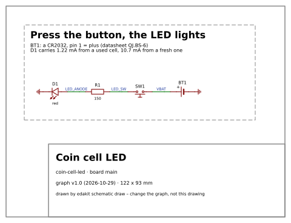
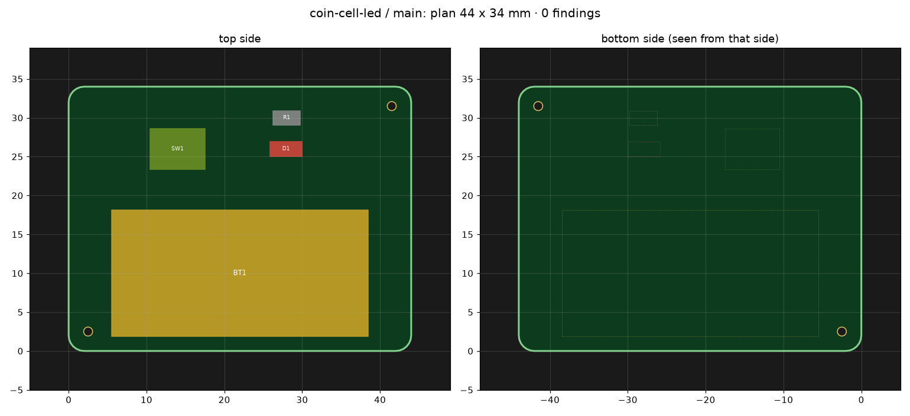

# 17 Walkthrough: a coin cell, a button, an LED

The smallest board edakit makes: press a button and a red LED lights, from a CR2032 coin cell. This chapter takes it
from the idea to the delivered boards, in the order things happen. Each step says who does it – you, Claude in a skill,
an agent in a session of its own, a command –, which file it writes, what is checked and what came out. The project is
[examples/coin-cell-led](../examples/coin-cell-led/).

The outputs are from real runs between 29 and 31 October 2026, shortened where a `…` stands. What happens after the
release – the order and the delivered boards (17.12) – is described instead of shown.

A finding names its code: the engine that found it and the relation it checks – `PATH.reverse` is about the paths a
reversed cell takes, `SIM.state` about what the simulation expects (chapter 14). `edakit explain <code>` gives the
rule, why it exists and its sources. The manual checks of the release keep their numbers, M-1 to M-6 (8.2).

## 17.1 The steps at a glance

| | Step | Who | How | Writes | Checked by |
|---|---|---|---|---|---|
| 1 | Set up | you answer, Claude writes | `/edakit:new-project` | `edakit.toml`, the graph with its `purpose`, `sim.json`, `signoff.json`, the decision log | – |
| 2 | What it must do | you and Claude | `/edakit:requirements` | `hardware/requirements.toml` | DOCS.ref to DOCS.draft |
| 3 | Parts | Claude: the skill part-search or the agent part-selector | `edakit part search`, `part import`, `part fetch` | `hardware/parts/*.json` | STRUCT.entry, STRUCT.identity, PARTS.verified |
| 4 | Circuit | Claude as the circuit designer | `/edakit:circuit-design`, `edakit block add` | `hardware/graph.json`, `hardware/sim.json` | `edakit check`, `edakit sim` |
| 5 | What the checks found | Claude proposes, you decide | – | graph, sim.json, decisions D-2, D-3 | the same |
| 6 | Stock and cost | Claude | `edakit stock`, `cost`, `order` | `hardware/stock.json` | PARTS.stock |
| 7 | Drawing and hand-over | Claude | `edakit schematic draw`, `edakit handover` | `hardware/schematic.toml`, the graph's `layout` | SYNC.plan, later |
| 8 | Reviews | the agents electrical-reviewer and regulatory-reviewer, each in a session of its own | – | `hardware/signoff.json`: M-1, M-6 | – |
| 9 | The gate without EasyEDA | Claude | `edakit gate` | `build/release/<run>/` | P, G, E |
| 10 | EasyEDA project | you, once (none with KiCad, chapter 16) | *File → New → Project* | – | – |
| 11 | Layout | Claude as the PCB designer, in a session of its own | `/edakit:pcb-round` | `hardware/boards/main.toml` | `pcb plan`, `route check`, round reviews |
| 12 | Release | Claude | `edakit gate --easyeda` | the manufacturing files | P to F, M-5 |
| 13 | Order | Claude up to the maker's cart, you order and pay | `edakit cart`, `/edakit:cart` | the order record `hardware/orders/` | ORDER.form to ORDER.review, M-2 |
| 14 | Acceptance | you | the boards in your hand | – | M-4 |

Steps 1 to 9 need no EasyEDA – checks, simulation and drawing work from the files alone. A board on a breadboard
would end at step 9.

## 17.2 Set up

`/edakit:new-project coin-cell-led main` asks its questions in one round – a form with options in Claude Code. The
answers here: a PCB, one board `main`, drawn in EasyEDA Pro (not KiCad, chapter 16), made by JLCPCB, which assembles
one side with SMD parts only (Economic), 5 sets, no budget, built for oneself in the EU, the requirements now, no
firmware, no documents that quote values, no scripts or agents of the project's own. The skill proposes every file
and key with the answer behind it and writes after your OK:

```toml
[project]
name = "coin-cell-led"           # EasyEDA project (friendly name); created by hand once, edakit never creates it
company = "edakit example"       # schematic title block
quantity = 5                     # boards per order: the stock check (PARTS.stock) needs this many sets
requirements = "hardware/requirements.toml"   # what the circuit must do (handbook 3.6)

[boards.main]
title = "Coin cell LED"          # EasyEDA documents and board file by default: generated_main, layout_main, PCB main,
                                 # hardware/boards/main.toml

[release]
assembly = { sides = ["top"], smd_only = true }   # Economic PCBA: one side, SMD only (SYNC.cpl)
```

The graph starts empty, with what the board is for: `"purpose": {"use": "private", "market": "EU", "notes": "…"}`. The
purpose decides how deep the regulatory review M-6 goes (chapter 15) – that review is support, not legal advice: it
claims no correctness, and nothing in it is legally guaranteed. The answers become decision D-1 in `docs/decisions.md`.
In a repository of its own the skill also writes the pre-commit hook (`edakit check` and `edakit sim` on every commit
that touches `hardware/`), `.gitignore` (`build/`) and `.claude/settings.json`, which gives every session the plugin.

## 17.3 What it must do

`/edakit:requirements` turns the idea into needs – who wants what, in their words – and requirements: one testable
sentence each, with a number, and what tests it (3.6). It asks back until vague words are numbers ("lights" becomes
1 mA, "a used cell" 2.5 V, the end voltage Rayovac rates the CR2032's capacity to):

```toml
[[requirement]]
id = "R-1"
text = "While SW1 is pressed, D1 carries at least 1 mA – from a fresh CR2032 down to one used to 2.5 V."
source = "N-1; Rayovac rates the CR2032's capacity down to 2.5 V (sim.json, cell 'used')"
from = ["N-1"]
binding = "must"
verify = [{ rows = "SIM.state * D1 LED on" },
          { accept = "press SW1 with a fresh cell: D1 lights; let go: D1 is dark" }]
status = "draft"
```

R-2 asks that D1 is dark and the cell idle while nobody presses – without a number yet, which the review will find
(17.9). Claude writes drafts, and every `edakit check`
warns about them (DOCS.draft) until you set `status = "accepted"` – only you do. `edakit req R-1` shows the chain:

```text
R-1  requirement, must, accepted – hardware/requirements.toml
  source  N-1; Rayovac rates the CR2032's capacity down to 2.5 V (sim.json, cell 'used')
  from    N-1  need, accepted: Press the button and the LED lights; let go and it is dark.
  text    While SW1 is pressed, D1 carries at least 1 mA – from a fresh CR2032 down to one used to 2.5 V.
  verify  rows SIM.state * D1 LED on
          accept press SW1 with a fresh cell: D1 lights; let go: D1 is dark
          not evaluated here – edakit req shows verify as written; the gate evaluates it (section 11 of its protocol)
```

The rows are simulation results the gate evaluates (8.7); the acceptance step lands on the list for the delivered
boards (17.12).

## 17.4 Parts

Every part needs an entry in the parts database before it goes into the graph (3.4). JLCPCB's catalogue knows part
words, not function words:

```text
$ edakit part search "CR2032 holder"
JLCPCB catalogue, "CR2032 holder", 2026-10-29: no hits, 4 C99… numbers dropped (user libraries, nobody sells them)
$ edakit part search "CR2032"
JLCPCB catalogue, "CR2032", 2026-10-29: 25 hit(s)
C70373     CR2032Bent Battery Contact Copper 3V  Q&J                     Extended     25013  - – Battery connector
C70377     CR2032-BS-6-1                         Q&J                     Extended     22494  - – Battery connector
C22363833  CR2032-BS-6                           Lian Xin Technology     Extended     15280  SMD – Button And Strip …
…
```

`part import` writes the entry from EasyEDA's library – pin numbers and names, footprint, class – and caches symbol and
footprint for the checks; `part fetch` keeps the datasheet beside the project:

```text
$ edakit part import C70377
hardware/parts/C70377.json: new entry – CR2032-BS-6-1 (QIJEY), footprint BAT-TH_CR2032-BS-6-1, Extended Part, 2 pins
  kind, pin types and roles, values and ratings are for whoever signs it off against its datasheet (handbook 4.3; …)
  library geometry: build/edakit/footprints/BAT-TH_CR2032-BS-6-1.json (2 pads, 33.0 x 16.3 mm)
  symbol: build/edakit/library/C70377.json – STRUCT.entry compares the graph with it
$ edakit part fetch C70377
C70377 CR2032-BS-6-1
  LCSC product data: no pdfUrl
  JLCPCB catalogue https://wmsc.lcsc.com/wmsc/upload/file/pdf/v2/lcsc/1811061923_Q-J-CR2032-BS-6-1_C70377.pdf: PDF behind
    the page's link https://datasheet.lcsc.com/datasheet/pdf/13f0f5570aed4b49bc6fd2928f41a905.pdf?productCode=C70377
  build/edakit/datasheets/C70377.pdf: 838 kB, 1 pages, text layer, sha256 760a7d67242a…
  NOTE    the text does not name CR2032-BS-6-1 – some vendors never print it; compare package, drawing and values with …
```

What the library cannot say, the datasheet does: the holder's pins are called `1` and `2`. Its drawing puts "+" at one
pad, and the library footprint draws "+" beside pad 1 on a document layer – pin 1 is plus. Signing the part off (4.3)
writes kind, roles and what was checked against which file; until then PARTS.verified holds the release (17.5):

```json
"kind": "battery_holder",
"pins": {"1": {"name": "1", "type": "passive", "role": "plus"},
         "2": {"name": "2", "type": "passive", "role": "minus"}},
"verified": {"by": "Claude (skill part-search)", "date": "2026-10-29",
             "datasheet": "Q&J QJ.BS-6 battery holder drawing, 2011-02-14",
             "datasheet_sha256": "760a7d67242a4548921d0d92e6f948c3aba7af8ed522d9fdf43bfe59c597a88f",
             "checked": ["pin 1 plus, pin 2 minus: the drawing's PCB layout and the document layer of the library …",
                         "two SMD tabs, no hole: JLCPCB places it on the top side (Economic)"],
             "open": [{"text": "BT1 turned by 180° swaps plus and minus: its orientation in JLCPCB's assembly preview",
                       "when": "order"}]}
```

An `open` point with `when` lands on the checklist of that phase (8.2): this one is looked at in JLCPCB's preview,
before paying. The push button, the resistor and the LED come with checked entries from edakit's block library.

## 17.5 Circuit

`/edakit:circuit-design` reads the requirements instead of asking for them. The cell and the button go into the graph
by hand; the LED with its resistor is the block `led`:

```text
$ edakit block add led --as LED --connect in=LED_SW
Added block led as LED:
  R1    C17471    150      LED: LED series resistor
  D1    C2297     green    LED: LED (green 0805)
  net LED_SW (exists) + R1.1
  net GND (exists) + D1.2
  net LED_ANODE (new, v [0, 3.3]): R1.2, D1.1
  parts entries copied from the block library: C2297, C17471
```

The simulation config gets the cell in two states – the values from the datasheets, an assumption marked as one – and
two loads, the button pressed and released:

```json
"cells": {
  "fresh": {"v": 3.2, "r": 20,
            "note": "off-load voltage of a fresh CR2032 at least 3.20 V (…); internal resistance at most 20 Ohm …"},
  "used": {"v": 2.5, "r": 40,
           "note": "Rayovac rates the capacity down to 2.5 V (220 mAh at 15 kOhm); 40 Ohm assumed – …"}
},
"supplies": {"fresh": {"BT1": "fresh"}, "used": {"BT1": "used"}},
"loads": {
  "pressed": {"about": "SW1 held down", "buttons": ["SW1"], "leds_on": ["D1"]},
  "released": {"about": "nobody presses", "leds_on": []}
},
"corners": ["min", "max"]
```

Then the check loop, seconds each. `edakit check` runs the rules over graph and parts (3.3), grouped by code –
stage, place, what against what, and the fix:

```text
$ edakit check
domains: core, power (suggested by the graph – edakit domains)
PATH.reverse – reverse polarity blocked: 1 error
  G  R1.1 on LED_SW: a reversed source reaches this pin without a blocking device   (catalog/paths.toml [reverse]) …
PARTS.verified – parts signed: 1 pending
  P  C70377 CR2032-BS-6-1 (BT1) not verified against its datasheet
DOCS.draft – draft not approved: 4 warning
  G  N-1: a draft – the user has not approved it (status "accepted", or "dropped" with a reason)
  …
HINT.bulk – bulk capacitor at the power input: 1 note
  G  BT1: bulk capacitor at the power input
HINT.lithium – lithium cells need protection: 1 note
  G  BT1: lithium cells need protection
PARTS.stock – parts orderable: 1 note
  P  no stock snapshot (hardware/stock.json) – edakit stock asks JLCPCB about the 4 assembled parts

What to do (edakit explain <code> for rule, why and sources):
  PATH.reverse: A Schottky diode in series, or a PMOS in the supply path with its gate to ground (block reverse-pmos).
  …
not checked for lack of data: LIM.t 2 parts – edakit check --coverage
4 components, 4 nets, 4 parts entries; 1 error, 1 pending, 4 warning, 3 note; requirements: 2 needs, 2 requirements
```

The first line says which rule sets are on: `core` always, and `power` because the graph has a battery holder
(`[project] domains` fixes the list, 10.1). The two HINT notes are design hints – a bulk capacitor at a power input,
protection of lithium cells –, patterns that need judgement rather than a number. The last line but one names what went unchecked for lack of data: `edakit check --coverage` says that the
entries of D1 and R1 have no thermal resistance, so no junction temperature is computed (LIM.t); what they carry and
dissipate is checked against their ratings all the same. `edakit sim` runs every scenario through ngspice
(chapter 5):

```text
scenario                           status      VBAT   LED_SW LED_ANODE   supply current
fresh/pressed/vf-min               ok        3.126V   3.126V   2.573V
fresh/pressed/vf-max               ok        3.175V   3.175V   2.991V
fresh/released/vf-min              ok        3.200V   0.000V   0.000V
fresh/released/vf-max              ok        3.200V   0.000V   0.000V
used/pressed/vf-min                fail      2.484V   2.484V   2.424V
used/pressed/vf-max                fail      2.500V   2.500V   2.500V
used/released/vf-min               ok        2.500V   0.000V   0.000V
used/released/vf-max               ok        2.500V   0.000V   0.000V

92 comparisons: fail 2, pass 90

SIM.state – the circuit does what the scenario expects: 2 error
  E  [used/pressed/vf-min] D1: LED on: 0.0003974 A, expected ≥ 1 mA
  E  [used/pressed/vf-max] D1: LED on: 1.166e-07 A, expected ≥ 1 mA
```

The column "supply current" is for the connectors of `sources`; a cell's current is not shown, and for R-2 the row "D1
dark" stands in – D1 is the only path.

## 17.6 What the checks found

Nothing goes on before every finding is fixed or accepted with a reason (3.4). Each decision gets its number.

**The block's LED stays dark on a used cell (SIM.state, D-2).** A green LED needs 2.6 to 3.1 V – as much as a used CR2032
has left. A red one needs 1.5 to 2.6 V at 20 mA:

```text
$ edakit part search "LED red 0805" --basic
JLCPCB catalogue, "LED red 0805", 2026-10-29: 1 hit(s)
C84256  NCD0805R1  Foshan NationStar Optoelectronics  Basic   2700112  0805 – LED Indication - Discrete
```

Its symbol numbers the pins the other way round – pin 1 is the cathode, called `-`. Changing only the LCSC number in
the graph is caught at once:

```text
STRUCT.entry – graph pins = parts entry: 2 error
  P  D1: pins differ from the library symbol of C84256 (build/edakit/library/C84256.json): pin 1: symbol '-', graph
     'A'; pin 2: symbol '+', graph 'K'
  P  D1: pins differ from parts entry C84256: graph {'1': 'A', '2': 'K'} vs parts {'1': '-', '2': '+'} – the library
     symbol agrees with the entry: the graph has the pins of another part
```

The fix of STRUCT.entry has its advice per case, under the words the finding starts with; for "pins differ from parts
entry" it is either the part number of the part whose pins the graph has, or – to keep the red LED – its pin names
and the nets on its pins swapped to the entry's. With the pins and nets swapped, the 150 Ω of the block stay: the simulation gives 1.22 mA from a used cell into the
LED at its highest forward voltage, 10.7 mA from a fresh cell at its lowest – LIM.i allows 20 mA, 80 % of its 25 mA, and
LIM.p holds the 14.75 mW it then dissipates (Vf × If) to 32.5 mW, half its 65 mW. The computation is in R1's `notes`,
the reason in D-2.

**A cell upside down (PATH.reverse, D-3).** The holder takes the cell either way round, and PATH.reverse wants a
blocking part behind it. A Schottky diode in series costs about 0.3 V – just the margin R-1 needs from a used cell; a P-MOSFET costs two
parts on a board without an IC. The LED blocks by itself, so the finding is accepted on the net, with the reason (in
full in the graph):

```json
{"name": "LED_SW", "pins": ["SW1.3", "R1.1"], "v": [-3.3, 3.3],
 "accept": {"PATH.reverse": "a cell upside down drives R1 and D1 backwards: D1 blocks, 3.2 V against its VR of 5 V – …"}}
```

A reason should hold, so the simulation shows it: a cell state `reversed` (−3.2 V) and an extra scenario with the
button pressed. Its first run failed – the nets were declared from 0 V, and a reversed cell is part of the worst case
`v` describes (3.2):

```text
reversed/pressed                   fail     -3.200V  -3.200V  -3.200V

104 comparisons: fail 3, pass 101

LIM.declared – net inside its declared range: 3 error
  E  [reversed/pressed] VBAT: net voltage inside the declared range: -3.2 V, expected 0 … 3.3 V   (v of net VBAT …)
  …
```

With VBAT, LED_SW and LED_ANODE declared from −3.3 V it passes: D1 sees 3.2 V in reverse, rated 5 V, and stays dark.

**The cell's current (LIM.i/cell, D-7).** A CR2032 is rated for 3 mA continuous and 15 mA in pulses (Jauch CR 2032
H2B). With `"i_max_a": 0.003` in the cell states `fresh` and `used`, LIM.i holds the current the cell gives:

```text
112 comparisons: fail 3, pass 109

LIM.i – current within its limit: 3 warning
  E  [fresh/pressed/vf-min] BT1: current from the cell 10.7 mA, allowed ≤ 3 mA   (i_max_a of cells.fresh in sim.json)
  …
```

SW1 is pressed for a moment, and held longer the cell loses capacity and voltage, nothing worse – the drop is in the
simulation through the cell's `r`. The finding is accepted on the holder, keyed by its grade, and the gate counts the
three rows as waived:

```json
"accept": {"LIM.i/cell": "SW1 is pressed for a moment: while it is held a fresh cell gives up to 10.7 mA, above its 3 mA continuous and below its 15 mA pulse current (Jauch CR 2032 H2B); …"}
```

**The design hints.** Each HINT note is accepted in the graph with a line – done, or why it does not apply – and the
reviewer checks the reason:

```json
"accept": {
  "HINT.bulk": "no cable and no plug: the cell sits in BT1 on the board, the only load is D1 (at most 11 mA)",
  "HINT.lithium": "a CR2032 is a primary Li-MnO2 cell, not Li-ion: nothing on the board charges it (LIM.backfeed) …"
}
```

Now: 0 errors, 3 accepted; of 112 simulation comparisons 109 pass and 3 are accepted (LIM.i/cell).

## 17.7 Stock and cost

`edakit stock` asks JLCPCB about every part it would assemble and keeps a dated snapshot; PARTS.stock reads it on
every `edakit check`:

```text
$ edakit stock
hardware/stock.json: 4 of 4 assembled parts asked, economic PCBA ([release] assembly.sides top: one side), 5 boards
  C17471      R1           0805W8F1500T5E, Basic Part, stock 698995 / 5 needed, MSL –, Economic and Standard, …
  C70377      BT1          CR2032-BS-6-1, Extended Part, stock 22499 / 5 needed, MSL –, Standard Only, …
  C84256      D1           NCD0805R1, Basic Part, stock 2700333 / 5 needed, MSL 3, Economic and Standard, …
  C318884     SW1          TS-1187A-B-A-B, Basic Part, stock 1140006 / 5 needed, MSL –, Economic and Standard, …
PARTS.stock – parts orderable: 1 error
  P  BT1 C70377 CR2032-BS-6-1: 'Standard Only' at JLCPCB, the order is Economic ([release] assembly.sides top: one
     side) – solder it by hand (bom: false), take another part, or order Standard (assembly.pcba)
```

What that means in money, `edakit cost` (8.4):

```text
board main, 44 × 34 mm: Standard PCBA ([release] assembly.sides top: one side, raised by 1 part)
  …
  board main                                         52.60 USD
  as Economic without BT1:                           20.65 USD (fees 9.77, parts 0.18)
what drives the cost:
  BT1 C70377 'Standard Only' – Standard PCBA
  edge rails: the PCB is priced as 44 × 44 mm
```

The size is that of the first plan, a rectangle; the round board of 17.11, Ø 44 mm, costs the same – 20.65 USD as
Economic.

Three ways out, as PARTS.stock says. The same BS-6 holder by Lian Xin (C22363833) is "Economic and Standard"
(`edakit stock --lcsc C22363833`), and `edakit part diff C70377 C22363833` lays its pads on the old ones without a
shift – but its drawing does not say which pad is plus. So BT1 is soldered by hand (D-4): `"bom": false` in the graph,
and `edakit order` writes what goes where:

```text
$ edakit order
bom_main.csv: 3 lines for the assembler (5 boards)
cart_lcsc.csv: 1 line, C70377 x 5
hand_assembly.md: 1 part by hand, 0 items off the board
```

The snapshot ages: after 14 days (`stock_max_age_days`) PARTS.stock is pending and holds up the release until `edakit stock`
asks again.

What the order form will say is data already: every field of JLCPCB's form has a key with edakit's default, and
`edakit cart fields` prints the field, the maker's word and where the value comes from (8.4):

```text
board main at JLCPCB (the planned maker; profile provisional) – no gate run yet: layers and size not known
PCB
  Base Material             FR-4                        edakit       material = 'FR-4'
  …
  PCB Thickness             1.6 mm                      edakit       thickness_mm = 1.6
  PCB Color                 Green                       edakit       mask = 'green'
  …
PCBA
  PCBA Type                 Economic                    [release] assembly.sides top: one side pcba
  …
  Tooling holes             Added by Customer – 2 x Ø 1.152 mm [tooling]    tooling
  Bake Components           No – no part with MSL >= 5  stock snapshot 2026-10-29 bake
```

## 17.8 Drawing and hand-over

`edakit schematic draw` draws the schematic from graph and parts alone, without EasyEDA. The note in the block quotes
the simulation – `{sim:min SIM.state used/* D1 LED on}` in `hardware/schematic.toml` – and changes when R1 or D1 change (6.6):



What the layout must know goes into the graph as `layout`, because the PCB designer works in a session of its own and
gets nothing else (14.1). Here: the three parts a person touches or looks at are fixed, and two notes:

```text
$ edakit handover
hand-over: coin-cell-led, graph 1.0 (2026-10-29), circuit 48984185a69a
  M-1 Critical parts (BT1, D1) checked a second time against the d…: open
  M-6 Regulatory review: circuit and parts against EU law for the …: open
board main – the plan keeps this (SYNC.plan: edakit pcb plan, the gate)
  fixed  BT1, SW1, D1
notes for the layout:
  - the cell (Ø 20 mm) stands 2 mm out of BT1 (16 mm wide) on both long sides: keep them free, with room to lever …
  - D1 next to SW1: the LED shows the press
```

## 17.9 Reviews

Two agents review the circuit before the layout, side by side, each in a session of its own – the session that
designed does not review (14.1). Neither changes a file; each returns numbered findings with what to do.

- **electrical-reviewer – M-1.** It checked the holder and the LED once more against the datasheets the sign-offs read
  (their SHA-256 matched), fetched the library footprints again, rebuilt the LED model by hand and judged the hints
  and the hand-over. Five notes, nothing critical: the holder's open point was aimed at JLCPCB's assembly preview,
  but BT1 is soldered by hand and never shows up there; R-1's margin (1.22 mA against 1 mA) rests on two assumed
  values – with a series resistance of 0 Ω the LED would get 0.48 mA, while the physics of a red LED says 30 Ω or more;
  R-2 had no number; the button's entry said 1.6 mm high where its drawing says 1.5; a comment in the board file was
  wrong.
- **regulatory-reviewer – M-6.** It checked circuit and parts against EU law for the purpose `private` (chapter 15).
  Nothing of placing on the market applies, nothing transmits, and the board is electromagnetically benign. Four notes,
  none blocking: the graph called the board "a toy" – who uses it, with a coin cell that comes out by hand?; giving one
  of the five away makes it a gift, with duties of its own; the parts' RoHS and REACH statements are open – asking for
  them now would be gold plating; board and cell go to separate collection at the end. Its result is support, not
  legal advice: it claims no correctness, and nothing in it is legally guaranteed.

Their notes went into one decision round: the holder's open point moved to the acceptance ("its ⊕ end on pad 1"),
R-2 got its number – at most 1 µA from the cell, with M-1 as its evidence –, the reasoning on R-1's margin went into
D-2, and D-5 says who uses the board: adults at a desk, out of the reach of small children. Those changes are in the
circuit hash, so both agents looked again – and M-1 found that R-2's reason was off by a factor of 100 (1 µA is
8.8 mAh a year, not 0.09). One more fix, one more look, then both signed.

A day later edakit renamed its checks into the codes of this chapter, and `edakit convert --write` turned the files
into the new form – `waive` and `hints` into `accept`, `ratings` into `limits` with the unit in every name. That
changed the circuit hash, so both agents looked once more: the same values, the same simulation – and M-1 found a hint
that repeated what PATH.reverse had already checked (17.13). The agent's result is the sign-off, bound to the circuit
hash (8.2):

```json
{"id": "M-1", "phase": "export", "scope": "circuit", "done_by": "agent electrical-reviewer (own session)",
 "date": "2026-10-31", "note": "M-1: OK for state e34902df3e31…; requirements met: R-2. …"}
```

The note names R-2, and that is R-2's passing evidence in the gate (8.7). Any later change to graph, parts, simulation
config or requirements changes the hash, and M-1 and M-6 no longer count. That happened once more the same day: the
accept of HINT.debounce left the graph – edakit no longer reports the hint without an MCU reading the button – and the
cell's current limit came in (17.6, D-7). Both agents looked again, M-1 checked the new accept's reason against the
cell's data sheet, and both signed for the new hash – and once more after BT1's entry got the outline of holder and
cell from its drawing (`body.box`, for the silkscreen check of 17.11).

## 17.10 The gate without EasyEDA

`edakit gate` runs stages P, G and E and writes the test protocol (chapter 8):

```text
$ edakit gate
[ 0.0 min] step 1/2: P/G parts and graph
[ 0.0 min] step 2/2: E simulation

NOT RELEASED
  - M-5 signed for fab f958da9ad4f8… – checked by stage F (section 6)
  - stages not run: S (Schematic), L (Board), F (Manufacturing)
requirements: 1 passed, 1 open after the export (section 11 of the protocol)
```

```text
| P Parts | parts database complete, graph pins = parts database, parts verified, … | 8 | 0 | 0 | 0 | 0 | passed |
| G Graph | structure, pin locks, voltage domains, inputs, drivers, decoupling, … | 36 | 0 | 0 | 3 | 0 | passed |
| E Simulation | ngspice operating points of all scenarios, stress of every part, … | 109 | 0 | 0 | 3 | 0 | passed |
```

In P and G every code without a finding counts once as passed – the codes the domains `core` and `power` switch on –,
G's three accepted findings are PATH.reverse and the two hints, E's three the cell's current with SW1 held (D-7). R-2 passed on its rows and on M-1's note;
R-1 has passed its rows too and waits for its acceptance step after
delivery. Section 6 of the protocol already holds the lists for later: what M-2 looks at before paying – D1's
cathode, from the `open` point of its parts entry – and what M-4 tests on the delivered boards, the holder's
orientation among them.

## 17.11 EasyEDA and the layout

EasyEDA cannot create a project through its API: you create `coin-cell-led` once by hand (*File → New → Project*) and
leave it open (6.1). A project with `toolchain = "kicad"` skips that: edakit writes the KiCad project itself, and the
same steps run on KiCad's files (chapter 16). Then a session of its own takes the layout – `/edakit:pcb-round`, the PCB
designer –, starting from `edakit handover`.

You want the board round, "so that it gets more exciting". That is a wish for the layout: it changes the board file,
not the circuit – the circuit hash stays, and M-1 and M-6 keep counting. A circle is a square whose corner radius is
half its side (D-6). The board file holds the outline, JLCPCB's tooling holes, a row in `[place]` for every part
(SYNC.plan) – here by hand, four parts; `edakit pcb place --rest` finds a spot for every part still without a row
(7.4) –, a "+" next to the holder, because the footprint's own ⊕ lies under the holder's body, and – after the
layout review, step 5 below – where BT1's designator and the board label go, which face people see, and a remark for
JLCPCB's form:

```toml
revision = "1"

[outline]                  # round, Ø 44 mm: a square whose corner radius is half its side
rect = [44, 44]
corner_radius = 22
arc_steps = 12             # 48 chords, 45 µm off the circle

[tooling]                  # JLCPCB Economic PCBA: two non-plated holes, diagonally opposite
holes = [[9, 36], [35, 8]]

[place]                    # the hand-over's fixed parts BT1, SW1, D1 – and R1, so that every part has its row (SYNC.plan)
BT1 = { x = 22, y = 24, rot = 0, side = "top" }    # the cell (Ø 20 mm) almost concentric; 10 mm free above it to lever it out
SW1 = { x = 28, y = 9, rot = 0, side = "top" }
D1  = { x = 19, y = 9, rot = 0, side = "top" }     # next to SW1: the LED shows the press
R1  = { x = 22, y = 5, rot = 180, side = "top" }   # R1.1 towards SW1, R1.2 towards D1's anode

[silk]
designators = "top"
place = { BT1 = { x = 22, y = 35.6, rot = 0, side = "top" } }   # above the cell: under it the cell hides it
board_label_region = [[11, 37.6], [33, 37.6], [33, 39.8], [11, 39.8]]   # centred above the designator

[looks]
visible = "top"            # the face people see: stage L holds its tracks and vias

[order]
remark = "Round board, no V-cut, no tabs. 2 tooling holes added by customer."

[[silk.texts]]             # the footprint's own ⊕ lies under the holder's body; this "+" stays visible – GEO.mark holds it to BT1.1
text = "+"
x = 40.3
y = 24
h_mm = 1.5
side = "top"
```

`edakit pcb plan` checks the plan offline, on the footprints `part import` cached – overlaps, outline, keep-outs, the
hand-over (SYNC.plan) – and draws it:

```text
$ edakit pcb plan
  library geometry (edakit part import, not yet from the PCB): BT1, D1, R1, SW1
  4 fixed parts, 0 for the auto-layout; airline length of the fixed parts (without GND): 0.02 m
```



In EasyEDA – after `/edakit:start`, which checks the bridge and claims EasyEDA for the session (11.2) – the round goes
as follows (chapters 6 and 7). Each command ran in less than half a minute:

1. `edakit schematic create --save`, `edakit schematic layout --save`: the template and the readable schematic, each
   saved only when its netlist equals the graph:

   ```text
   [ 0.4 min] step 9/11: netlist against the graph
     4/4 nets match the graph
   [ 0.4 min] step 10/11: ERC
     {"project_id": "current", "total_violations": 0, "error_count": 0, "warning_count": 0, "passed": true, …}
   …
   done: 4 placed, 0 skipped, 0 pin mismatches, 0 pin failures, 0 differing nets
   ```

2. `edakit pcb parts --write`: the four parts into the PCB, without the import dialog; `edakit pcb dump`: their
   footprints as placed, into `hardware/boards/main.geometry.json`; `edakit pcb apply`: outline, tooling holes, every
   part where the plan puts it:

   ```text
   [ 0.1 min] step 5/7: outline and holes
     outline: 48 points, 0 holes
   [ 0.1 min] step 6/7: tooling holes
     2 tooling holes Ø 1.152 mm (NPTH), 0 old ones replaced
   [ 0.1 min] step 7/7: pad check
     pad check (4 parts): largest deviation 0.001 mm (BT1.2)
   ```

3. `edakit route all`: Freerouting routes, the ground pours, DRC. The area outside the circle goes to Freerouting as
   50 keep-out strips:

   ```text
   [ 0.0 min] DSN: 4 nets with >= 2 pins, 12 pads, 5 padstacks, 2 hole keep-outs, 50 edge strips, 0 keep-out pieces, …
   [ 0.2 min] check: 4 nets routed, 16 track pieces, 2 vias; open: 0
   [ 0.2 min] track widths (GEO.width offline): 4 nets, 0 below IPC-2221 for 1.5 x the simulated current, 0 below the …
   [ 0.4 min] step 8/8: drc
   [ 0.4 min]   DRC: 1 findings – {('Netlist Error', 'Import Changes', None): 1}
   [ 0.5 min]   EasyEDA waits for the import acknowledgement: open Design → Import Changes once, it shows no changes …
   ```

   The parts came into the PCB without EasyEDA's import, and its DRC waits until the import view has been opened
   once. edakit has compared schematic and PCB beforehand – nothing differs –, so that is your one click (7.3):
   *Design → Import Changes*, it shows no changes, OK. It comes last, after the silkscreen; then `edakit route drc`:
   `DRC: 0 findings`.
4. `edakit silk apply`: designators where there is room, the board label, and the silkscreen checked on the Gerber
   files:

   ```text
     board label 'Coin cell LED rev 1' at (21.9, 38.2) mm
     top: 4 of 4 designators placed, fixed: BT1; without room: –
     top: silkscreen on mask openings 0.000 mm² (target 0), picture -> …/build/edakit/silk_main_top.png
   ```

   

5. The agent pcb-reviewer reviews the round, in a session of its own, on the manufacturing files of a gate run
   (17.12). Nothing blocked; it had four notes:
   - BT1's designator lay under the cell – GEO.silk did not see it then; since then BT1's entry has a `body.box`
     from the holder's drawing, and GEO.silk would (grade body, 8.1);
   - the board label sat 8 mm left of the axis;
   - without `[order]` no file said that the tooling holes are the customer's – JLCPCB might drill its own on the face
     people see (FILES.order warns about that now, grade tooling);
   - `hand_solder_keep_mm` was not set.

   You chose to move both texts above the cell, as it proposed – how the board looks is yours to decide. The
   designer took the remark for JLCPCB and `[looks]` too. The fourth note it answered: the key covered through-hole
   joints only then, and BT1 has SMD tabs – the reviewer withdrew it. Since then it covers the SMD tabs of a part
   with `bom: false` too, on the side the part sits on (7.5): set, it would hold BT1's tabs. A second `silk apply`, a second gate run, a second
   look: only the top silkscreen and the order settings had changed (`edakit fab diff`), and the reviewer signed M-5
   for that run's files.

## 17.12 Release, order, acceptance

`edakit gate --easyeda` runs every stage, the last ones on the files that go to JLCPCB: the schematic equals the graph
(SYNC.schematic), the copper of the Gerber files connects what the graph connects (GEO.copper), the "+" lies next to
BT1's plus pad (GEO.mark), the BOM leaves BT1 out (SYNC.bom), the pick-and-place file has every assembled part once
(SYNC.cpl), the order settings fit JLCPCB's form (FILES.order). The layout review M-5 is done by the agent
pcb-reviewer on a run's files and bound to their fab hash; the next run with the same files counts it, and only a run
whose protocol says **RELEASED** may be uploaded (8.3). Here it took three runs: the first passed every stage with M-5
open, the second followed the review's notes, the third counted M-5:

```text
$ edakit gate --easyeda
[ 0.0 min] step 1/4: P/G parts and graph
[ 0.0 min] step 2/4: E simulation
[ 0.0 min] step 3/4: S schematic against the graph
[ 0.0 min] step 4/4: L/F board and manufacturing files: main
RELEASED
requirements: 1 passed, 1 open after the export (section 11 of the protocol)
```

```text
| S Schematic | EasyEDA schematic = graph (parts, LCSC, nets, pins, no-connects) | 1 | 0 | 0 | 0 | 0 | passed |
| L Board | PCB = graph and plan, copper from the Gerber files, DRC, footprints, track widths, holes | 34 | 0 | 0 | 0 | 0 | passed |
| F Manufacturing | BOM from the graph = EasyEDA, JLCPCB stock, pick and place, Gerber set, outline, manifest | 18 | 0 | 0 | 0 | 0 | passed |
```

The offline `edakit gate` cannot compute the fab hash without stage F: from now on it says "M-5 signed for fab
f958da9ad4f8… – checked by stage F" instead of naming M-5 open (8.2).

The run's folder holds what goes to JLCPCB – `fab/main/gerber_main.zip`, `bom_main.csv`, `cpl_main.csv`, the form's
fields in `order.md` – and `fab/polarity_main.png` for M-2. A gate run is build output (`[release] archive`, default
`"none"`, 8.3): a new run makes the files again from the repository, and the sign-offs say which hashes they must
have. What is ordered, a project publishes with `edakit release publish` as a release on GitHub (8.3) – this example
lives inside edakit's repository and does not.

The order goes up to JLCPCB's cart, and no further – nothing in edakit orders or pays (8.4):

1. `edakit cart prepare` takes the current release and writes the job: the upload files with their SHA-256, every
   field of the form from `[order]`, the BOM JLCPCB will match. It stops unless M-6 is signed for the run's circuit
   and `[cart]` names the country and the shipping method – JLCPCB as the only maker needs nothing else there.
2. The skill cart (`/edakit:cart`) fills JLCPCB's pages in your browser with Claude in Chrome, reads every field back
   and writes what the page showed. `edakit cart check` holds that to the job and the release (ORDER.form to
   ORDER.finish): the fields, JLCPCB's matching of the three parts it assembles, the quote against `edakit cost`, the
   same files.
3. The agent regulatory-reviewer looks at what the order adds to M-6 (15.5) – finish, quantity against the purpose,
   where the maker sits –, and ORDER.review waits for its `Order: OK`. It is support, not legal advice: it claims no
   correctness, and nothing in it is legally guaranteed.
4. Then the skill presses the cart button and writes the order record `hardware/orders/…`. Ordering and paying are
   yours, after M-2 in JLCPCB's assembly preview – the list in section 6 of the protocol: D1's cathode. The five holders come from `cart_lcsc.csv` at LCSC; once paid, `edakit cart actual` puts the real
   prices beside the estimate and into the project's fee table.

When the boards arrive, BT1 is soldered by hand (`hand_assembly.md`), and M-4 works through the acceptance list of the
protocol:

```text
- [ ] M-4 Acceptance test of every delivered board: visual check (BT1 and D1 the right way round), D1 lights while SW1
      is pressed and is dark once it is released
- [ ] C70377 CR2032-BS-6-1 (BT1): soldered by hand: the holder's ⊕ end (its chamfered corner) on pad 1, at the
      silkscreen '+'
- [ ] R-1: press SW1 with a fresh cell: D1 lights; let go: D1 is dark
```

Signed, it lets R-1's acceptance step pass – every requirement then has its evidence.

## 17.13 What this example changed in edakit

Like the Christmas bell (13.6), this board found gaps on its way, and each one was closed in edakit:

- **`edakit part fetch` before the graph.** It failed with a traceback while the project had no graph yet; it reads
  only the parts database now.
- **A certificate kept as the datasheet.** LCSC's datasheet address now answers with a page of the shop whose only PDFs
  are the certificates in its footer; `part fetch` took the first link and kept LCSC's ISO 9001 certificate as the
  holder's datasheet. A page is now followed only to where it sends the browser, to its viewer or to a link that names
  the part or says datasheet, and LCSC's page is taken as the file behind it (4.6).
- **A push button stopped PATH.reverse and PATH.unfed.** A switch passes a reversed source on, and a supply; a push
  button passed neither, so PATH.reverse named SW1 itself and a supply behind a power button counted as unfed. A push
  button passes both now, as a switch does; the Christmas bell's results did not change.
- **The push button of the block library** called pins 2 and 4 `B (internal to A)` and `D (internal to C)`, its
  symbol `B` and `D`: STRUCT.entry failed as soon as `part import` had cached the symbol. The names follow the symbol now, and
  the notes and roles say that the pins are connected inside.
- **A polarity hint for a holder PATH.reverse had checked.** HINT.input_polarity said that nothing checks the
  polarity of a battery holder not marked reversible – but PATH.reverse starts from every holder by its kind. The
  electrical reviewer found it in M-1; the hint names unmarked supply connectors only now (JST packs, barrel jacks).
- **A round board had four points twice.** A corner radius of half the side makes a circle, and each of its four arcs
  began where the one before ended: four segments of length 0 in the outline EasyEDA and Freerouting got. The outline
  drops a point equal to the one before now.
- **The drawings of this chapter on the documentation site** linked to GitHub's page of the file, which is no image;
  the site carries the images now.
- `edakit order` said "1 parts by hand", and `edakit block add` still sent you to `edakit hints`, which had gone with
  the codes.
