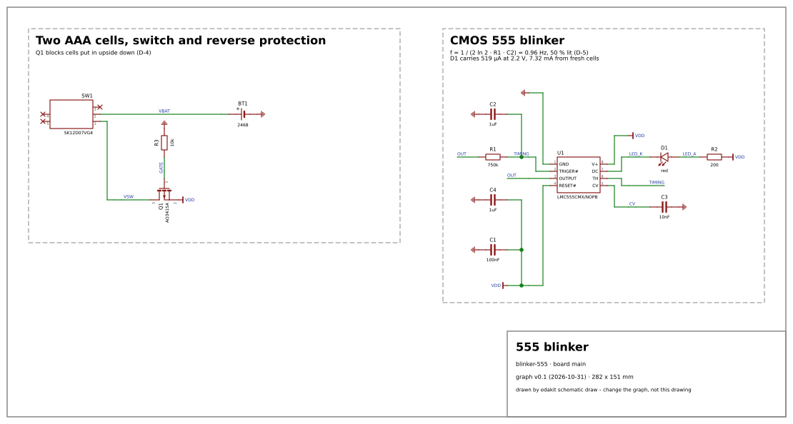
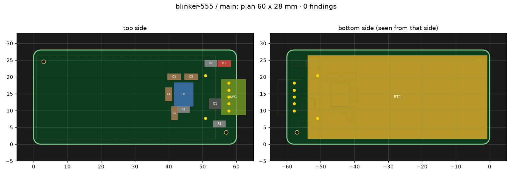
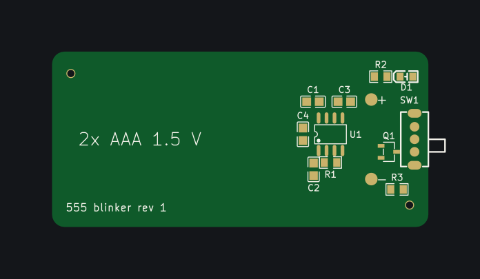
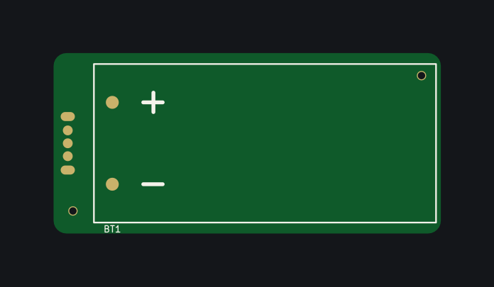

# 18 Walkthrough 2: a 555 blinker on KiCad

Switch it on and a red LED blinks about once a second, from two AAA cells; switch it off and the cells deliver
nothing. This chapter takes the board from the idea to the released manufacturing files the way chapter 17 took the
coin cell board – and tells only what differs. Chapter 17 stays the first reading: who does what, why each step comes
where it does. The project is [examples/blinker-555](../examples/blinker-555/).

What this chapter shows that 17 does not:

1. **KiCad end to end** (chapter 16): a real board through edakit's KiCad tool chain, with the real LCSC footprints –
   through-hole pins, a slide switch's pegs, a SOIC-8 –, up to RELEASED and `edakit export`.
2. **An IC with a supply range**, held to cells that run down.
3. **Cells in series, an end voltage and a power switch**: "off means off" with a number, a current budget per load.
4. **A circuit whose function is a time.** edakit evaluates what the board does at each DC state; the blink rate is
   computed in the decision log and counted on the finished board.
5. **The graph as TOML from the start** (3.1).

**State 2026-10-31:** the outputs are from real runs on a machine with KiCad 10.0.6, ngspice 47 and Freerouting
2.4.1, shortened where a `…` stands. As in chapter 17, every gap the run found was closed in edakit on its way
(18.13).

## 18.1 The steps at a glance

| | Step | Who | New compared to chapter 17 |
|---|---|---|---|
| 1 | Set up | `/edakit:new-project` | the tool chain answered with KiCad 10: `toolchain = "kicad"`, `graph = "hardware/graph.toml"` |
| 2 | What it must do | `/edakit:requirements` | an end voltage per cell; "off means off" with a number; a requirement on a time whose only evidence is `accept` |
| 3 | Parts | part-search | an IC chosen by its supply range; a through-hole holder and switch soldered by hand |
| 4 | Circuit | `/edakit:circuit-design` | the graph written as TOML; the 555 as behaviour `logic`, its lit phase in the component's `states` |
| 5 | What the checks found | Claude proposes, you decide | an LED that cannot light at the end voltage; reverse polarity at an IC; the timing as a decision |
| 6 | Stock and cost | `edakit stock`, `cost`, `order` | holder and switch by hand beside an Economic order for the SMD parts |
| 7 | Drawing and hand-over | `schematic draw`, `handover` | the holder on the bottom, the switch at the edge |
| 8 | Reviews | electrical-reviewer, regulatory-reviewer | M-1 found the lit-phase budget held only on paper (18.8) |
| 9 | The gate without a tool chain | `edakit gate` | – |
| 10 | EDA project | – | nothing to do: edakit writes `build/edakit/kicad/main/` |
| 11 | Layout | `/edakit:pcb-round` | `pcb place --rest` (KiCad has no auto-layout), `pcb apply`, `route all` with kicad-cli's zone fill and DRC, `silk apply` |
| 12 | Release | `edakit gate --eda`, `edakit export` | stages S, L, F on kicad-cli's netlist, ERC, DRC, Gerber, drill and position file |
| 13 | Order | – | decided at the release (18.12) |
| 14 | Acceptance | you | the blink rate counted at two voltages: the evidence the simulation does not give |

Steps 3 to 12 need ngspice, Freerouting and `kicad-cli` (2.2, 16.2). In this run one session did steps 1 to 12 – the
layout starting from `edakit handover` alone –, and the reviews ran as agents in contexts of their own.

## 18.2 Set up

The interview of `/edakit:new-project blinker-555 main` as in 17.2, with KiCad as the answer to the tool chain. The
board is made by JLCPCB, which assembles the SMD parts on the top side (Economic); the 2×AAA holder and the slide switch
are through-hole and soldered by hand, the holder on the bottom. Built for oneself in the EU. The answers are D-1:

```toml
[project]
name = "blinker-555"             # the KiCad project in build/edakit/kicad/main/ – edakit writes it, nothing by hand
toolchain = "kicad"              # KiCad 10 instead of EasyEDA Pro (handbook 16): no EasyEDA documents to name
quantity = 5
graph = "hardware/graph.toml"    # the graph as TOML; edakit graph json --write keeps hardware/graph.json beside it
requirements = "hardware/requirements.toml"

[boards.main]
title = "555 blinker"

[release]
assembly = { sides = ["top"], smd_only = true }   # Economic PCBA: one side, SMD only (SYNC.cpl)
```

`edakit doctor` names KiCad instead of Node, server and bridge: "OK    KiCad 10.0.6 (kicad-cli: /usr/bin/kicad-cli)".

The purpose is `private`. It covers the owner's own use only: a reader who builds the board from this chapter and
gives it away or sells it has another purpose and needs a review M-6 of their own (chapter 15). That review is
support, not legal advice: it claims no correctness, and nothing in it is legally guaranteed.

## 18.3 What it must do

Two needs and four requirements, every number put to you in one round (`hardware/requirements.toml`, D-2):

| | binding | text, as accepted | evidence |
|---|---|---|---|
| R-1 | must | With SW1 on, D1 carries at least 1 mA while it is lit – from two fresh alkaline AAA cells (3.2 V) down to two used to 1.0 V each (2.0 V). | rows `SIM.state * D1 LED on`; accept |
| R-2 | must | With SW1 on, D1 flashes 48 to 72 times a minute – at 3.2 V and at 2.0 V. | accept: count for 60 s from a lab supply |
| R-3 | must | With SW1 off, D1 is dark and the board draws at most 1 µA from the cells. | rows |
| R-4 | should | With SW1 on and D1 lit, the board draws at most 5 mA from the cells. | rows |

The end voltage is the owner's word: at 1.0 V per cell an alkaline AAA has given about 90 % of its capacity. R-2 is a
time, and nothing in edakit computes a time (decision T of the concept): its only evidence is the count at the
acceptance, so it waits until the boards are in your hand (`edakit gate`: "open after the export"). Two of the
numbers did not survive the run – R-1 in 18.6, R-4 in 18.8.

## 18.4 Parts

**The 555 by its supply range.** An NE555 needs 4.5 V; two AAA cells give 3.2 V fresh. JLCPCB's catalogue has the
CMOS ones:

```text
$ edakit part search "TLC555"
C6986      TLC555CDR        Texas Instruments       Extended     96600  SOIC-8 – 555 Timers / Counters
…
$ edakit part search "LMC555"
C90760     LMC555CMX/NOPB      Texas Instruments       Extended     18469  SOIC-8 – 555 Timers / Counters
…
```

Their datasheets settle it: the TLC555 runs from 2 V – exactly the end voltage, and the cells' internal resistance
takes the rest –, the LMC555 from 1.5 V (SNAS558M, "1.5 V supply operating voltage ensured"). U1 is the LMC555. Its
entry is behaviour `logic` (5.1): `icc_a` 250 µA, the supply range for LIM.range, THR, TRIG and CV as `analog`
comparator inputs, DIS an output with `drive = "open_drain"`:

```json
"7": {"name": "DC", "type": "output", "role": "dis", "drive": "open_drain", "v_min_v": -0.3, "v_rel_max_v": 0.3,
      "hint": "discharge: open drain, low in phase with the output (pin functions, p. 3); VDIS ≤ 150 mV at 1 mA with V+ 1.5 V, …"},
"8": {"name": "V+", "type": "power_in", "role": "vdd",
      "needs": [{"what": "capacitor", "c_min_f": 1e-07, "source": "TI SNAS558M, 10 Power Supply Recommendations: …"}]}
…
"values": {"behavior": "logic", "icc_a": 0.00025, "r_out_ohm": [15, 50, 150]},
"limits": {"vdd_max_v": 15, "vdd_op_min_v": 1.5, "vdd_op_max_v": 15, …}
```

`r_out_ohm` was one number, 150 Ω, until the review M-1 (18.8).

**Holder and switch by hand.** The holder is a Keystone 2468 – two AAA cells in series, PC pins Ø 0.79 mm, 53.0 ×
24.6 × 13 mm, 178 at LCSC (C254917); `body.box` gives its outline for the plan and the silkscreen check. The switch
is a horizontal SPDT slide switch, SK12D07VG4 (C393937): three terminals 2 mm apart and two pegs of its frame, which
the graph puts into `nc`. Both have a `lead` per pad for GEO.hole and are soldered by hand (`bom = false`). Their
open points go to the acceptance: which knob position closes pin 1, the holder's "+" in pad 2.

## 18.5 Circuit

The graph is TOML from the first line (3.1): components and nets as tables, pins by role.

```toml
[components.U1]
type = "ic"
label = "CMOS 555 timer"
part = "LMC555CMX/NOPB"
lcsc = "C90760"
states = { OUTPUT = "low", DC = "low" }
notes = "Runs from 1.5 V. The simulation holds the phase in which D1 is lit: OUTPUT low, DC (discharge) low. …"

[nets.LED_K]
pins = ["D1.cathode", "U1.dis"]
v = [0, 3.3]
```

`edakit graph json --write` writes the resolved `hardware/graph.json` beside it after every change.

The topology is the CMOS 555's 50 % astable: R1 from OUTPUT charges and discharges C2 between 1/3 and 2/3 of VDD,
and DIS is free to sink D1 from VDD through R2. A discharge pin is the strongest output a CMOS 555 has at a low supply,
and the classic astable's current through RA in the dark phase is gone. The simulation has no time: `states` holds U1
in the phase in which D1 is lit, for every scenario; the dark phase is computed in the decision log (D-7).

The cells in `sim.json` are two states of the holder, the switch one load each:

```json
"cells": {
  "fresh": {"v": 3.2, "r": 0.6, "note": "… 0.15–0.3 Ohm each fresh (Energizer E92 datasheet) – 0.3 Ohm each"},
  "used": {"v": 2.0, "r": 2.0, "note": "… 1 Ohm each assumed – …"}
},
"loads": {
  "on": {"about": "SW1 on, the 555 in the phase in which D1 is lit", "leds_on": ["D1"],
         "expect": {"BT1": {"i_max_a": 0.005}}},
  "off": {"about": "SW1 off", "throw": {"SW1": "throw_b"}, "leds_on": [], "expect": {"BT1": {"i_max_a": 1e-06}}}
}
```

`expect` on a battery holder is the current budget of R-3 and R-4 – the current from its cells in that load. The
first `edakit check` and `edakit sim`:

```text
PATH.reverse – reverse polarity blocked: 3 error
  G  U1.8 on VDD: a reversed source reaches this pin without a blocking device   (catalog/paths.toml [reverse]) …
LVL.undefined – input defined while the firmware is not running: 1 warning
  G  LED_K: driven only by outputs that let go (U1.7) and nothing holds it – released, it floats
…
$ edakit sim
244 comparisons: fail 13, pass 231

LIM.range – supplied inside the operating range: 4 error
  E  [fresh/off/vf-min] U1: supply voltage at V+ inside its operating range: 2.296e-25 V, expected 1.5 … 15 V
SIM.config – simulation config readable: 8 error
  E  [fresh/on/vf-min] expect of the load: BT1 is neither a source nor a net, …
SIM.state – the circuit does what the scenario expects: 1 error
  E  [used/on/vf-max] D1: LED on: 7.779e-06 A, expected ≥ 1 mA
```

Three of these were edakit's: a load's `expect` knew no battery holder, U1 with SW1 open counted as supplied below
its range instead of switched off, and LED_K was told to take a pull-up although nothing reads it – D1 is the
discharge pin's load. All three were fixed before going on (18.13); what stayed was the circuit's.

## 18.6 What the checks found

**The LED at the end voltage (SIM.state, D-3).** At 2.0 V and its highest forward voltage (2.6 V at 20 mA) D1 gets
8 µA. No red LED reaches 1 mA there by its datasheet with a series resistor: at the end voltage it has 0.1–0.2 V of
headroom, from fresh cells 1.5 V, and the current a resistor gives scales with it – ten times as much, where R-4 allowed
five.

You chose a low-current LED and a new number for R-1: D1 is a Kingbright APTD2012LSURCK, specified at 2 mA
(VF 1.5–2.1 V, 60–150 mcd), at 0.5 mA brighter on axis than the first LED at 1 mA, in a narrower beam; R-1 asks for at
least 0.5 mA down to 1.1 V per cell, 2.2 V for the pair. `sim.json` follows: the cell state `used` at 2.2 V,
`criteria.led_on_min_a` 0.0005. R2 became 200 Ω – 220 Ω gave 0.498 mA.

**Cells upside down (PATH.reverse, D-4).** Both cells reversed put −3.2 V on U1, rated −0.3 V. In 17.6 the LED
blocked by itself; here an IC takes it, through its substrate diode, with amps. A Schottky diode would cost 0.15–0.25 V
of the 2.2 V; a P-MOSFET costs nothing at these currents – if it is fully on at the end voltage. The block
`reverse-pmos` brings an AO3401A, specified from VGS −2.5 V; Q1 is an AO3415A (C133233), specified from −1.8 V
(65 mΩ), behind SW1, its gate through R3 to ground. An extra scenario holds it to its job:

```json
"reversed": {"v": -3.2, "r": 0.6, "note": "both fresh cells put in upside down – the holder takes them that way"}
…
"extra_scenarios": [{"name": "reversed/on", "supply": {"BT1": "reversed"}, "load": "on_reversed", "corner": "max"}]
```

Its first run showed VDD at −0.84 V – behind a blocking Q1 the net hung on 1 pA of leakage and the simulator's
1 TΩ shunt. A CMOS IC has a diode from its ground to its supply that holds such a node; the behaviour `logic` has it
now (18.13), and VDD sits at −0.15 V, D1 dark, 4 pA from the cells.

**The blink rate (D-5).** No check, a computation: with the thresholds at 1/3 and 2/3 of VDD each half period is
ln 2 · R1 · C2, independent of the supply, so T = 1.386 · R1 · C2.

The spread is the work: R1 ±1 %, C2 ±10 % (X7R; its
DC bias at 3.2 V on a 50 V part below 1 %), and U1's thresholds – the datasheet gives the monostable's timing accuracy
at 1.5 V (0.9–1.25 ms for 1.1 ms), an upper threshold between 0.593 and 0.713 of VDD. Worst case T between 0.798 and
1.204 times the nominal.

With 680 kΩ (no loading fee) that is 53 to 80 flashes a minute; you chose 750 kΩ (a loading
fee of about 3 USD per order): 57.7 nominal, 47.9 to 72.3 – both edges of R-2's window touched. The count at the
acceptance stays the evidence. The first period after switch-on is longer, 0.82 s dark instead of 0.52 s: C2 starts
at 0 V.

**The dark phase (D-7).** OUTPUT high, DIS released: D1 and R2 carry nothing, R1 at most 2.8 µA, U1 at most 250 µA.
Half lit and half dark, the mean is 3 to 4 mA from fresh cells – eleven to fourteen days of blinking.

**The hints**: HINT.bulk (no cable; C1 100 nF and C4 1 µF at U1, as its datasheet asks), HINT.lithium (alkaline
cells), HINT.gate (Q1's gate never switches) and HINT.thermal_copper on U1, Q1 and D1 are accepted with their reasons
(D-6). Then: 0 errors, 6 accepted.

## 18.7 Stock and cost

```text
$ edakit stock
hardware/stock.json: 9 of 9 assembled parts asked, economic PCBA ([release] assembly.sides top: one side), 5 boards
  C90760      U1           LMC555CMX/NOPB, Extended Part, stock 18469 / 5 needed, MSL 1, Economic and Standard, …
  …
```

The first `edakit cost` named five Extended parts at 3.07 USD loading fee each; the 10 nF at CV was one of them, and
a Basic 10 nF in 0805 (C1710) took its place. With the board's size known:

```text
board main, 60 × 28 mm: Economic PCBA ([release] assembly.sides top: one side)
  PCB                                                10.70  at most the price of the smallest size in the fee table, …
  …
  loading fee, 4 types                               12.28
  …
  board main                                         36.61 USD
what drives the cost:
  R1 C17817 Extended Part – 3.07 loading fee
  …
```

`edakit order` puts holder and switch into the LCSC cart and onto the hand-assembly list:

```text
bom_main.csv: 9 lines for the assembler (5 boards)
cart_lcsc.csv: 2 lines, C254917 x 5, C393937 x 5
hand_assembly.md: 2 parts by hand, 0 items off the board
```

## 18.8 Drawing, hand-over, reviews



```text
$ edakit handover
board main – the plan keeps this (SYNC.plan: edakit pcb plan, the gate)
  fixed  BT1, SW1, D1
  edge   SW1
  near   one of C1, C4 next to U1 – decoupling of VDD, a capacitor of its own (derived)
notes for the layout:
  - BT1 (Keystone 2468, 53.0 × 24.6 × 13 mm) on the bottom, the board about its size; its two PC pins are soldered on the top side
  - SW1 at the board's edge, its knob out over it; its terminals and pegs are soldered on the bottom – not under BT1's body
  …
```

The two reviews ran side by side, each in a context of its own.

- **electrical-reviewer – M-1.** Nothing blocked; one finding was important. R-4's rows passed only because U1's
  discharge pin was simulated at 150 Ω – the datasheet's maximum at 1.5 V. At 3.2 V the pin is far stronger (the
  typical part at 5 V: 15 Ω), and a real board draws 6 to 8 mA while D1 is lit. A logic part's `r_out_ohm` takes a
  range now, [min, typ, max] at the spread corner (5.1), and `sim.json` runs `"spread": ["min", "max"]`: 7.6 mA from
  fresh cells. R-1 and 5 mA cannot both hold with a series resistor; you set R-4 to 8 mA (D-9).
- **electrical-reviewer, its notes.** Eight, none blocking – among them the hand-over's note on C2, which named the
  wrong pin, and AAA-sized Li-ion cells (10440, 3.7 V each), which fit the holder and would overload Q1, R2 and D1:
  "2x AAA 1.5 V" is printed on the board now.
- **regulatory-reviewer – M-6.** For the purpose `private`: nothing of placing on the market applies, nothing
  transmits, the electromagnetic requirements are met in substance (an active part, so not "inherently benign"),
  spent cells and the board go to separate collection. Its result is support, not legal advice: it claims no
  correctness, and nothing in it is legally guaranteed.

Both looked again after D-9 and signed for the new circuit hash, M-1 with "requirements met: R-1, R-3, R-4".

## 18.9 The gate without a tool chain

`edakit gate` runs P, G and E as in 17.10; with the reviews signed only M-5 and the stages S, L, F are left. R-3 and
R-4 pass on their rows, R-1 waits for its acceptance step, R-2 has nothing else:

```text
| P Parts | parts database complete, graph pins = parts database, parts verified, parts orderable | 8 | 0 | 0 | 0 | 0 | passed |
| G Graph | structure, pin locks, voltage domains, inputs, drivers, decoupling, ratings, reverse polarity | 36 | 0 | 0 | 6 | 0 | passed |
| E Simulation | ngspice operating points of all scenarios, stress of every part, function limits | 679 | 0 | 0 | 0 | 0 | passed |
```

E counts 688 comparisons: 679 rows that pass and 9 of information – U1 with SW1 open is "unpowered below 0.5 V: off,
no range to hold", in each of the eight `off` scenarios and in `reversed/on`.

## 18.10 KiCad: no project to create

With EasyEDA, step 10 is a click: *File → New → Project*. With KiCad there is nothing: `edakit schematic create`
writes the schematic into `build/edakit/kicad/main/` and checks it at once with kicad-cli's netlist and ERC:

```text
$ edakit schematic create
graph v0.1: 12 parts; schematic main.kicad_sch: 12 parts, 10 nets
schematic = graph: yes
```

The KiCad project is build output, rewritten by every step and not versioned (16.3): what the board is, is the board
file, the plan and the graph.

## 18.11 Layout

### Placement

The board file starts with the hand-over's three fixed parts. The plan's frame is mm, origin at the outline's lower
left, y up; a part on the bottom is mirrored in its local y (16.3):

```toml
revision = "1"
edge_ok = ["SW1"]          # its knob reaches over the right edge

[outline]                  # about the holder's size (53.0 × 24.6 mm), with SW1 at the right end
rect = [60, 28]
corner_radius = 2

[place]
BT1 = { x = 50.9, y = 14, rot = 0, side = "bottom" }   # its body 0.7 … 53.8 mm under the board, the PC pins at the right end
SW1 = { x = 57.8, y = 14, rot = 90, side = "top" }     # body flush with the right edge, the knob over it
D1  = { x = 56.5, y = 24, rot = 0, side = "top" }      # beside SW1: on top, where it is seen
```

KiCad has no auto-layout; `edakit pcb place --rest --write` places the other nine by airline length (7.4), C1 as
U1's decoupling next to its V+. It put them around BT1's pins, which are soldered by hand on this side – moved by hand
5 mm to the left, and `[routing] hand_solder_keep_mm = 1` keeps other nets' pads that far from BT1's and SW1's joints
(GEO.spacing, D-8):



### Routing

`edakit pcb apply` writes the parts, the outline and the rules into `main.kicad_pcb`; `edakit route all` routes with
Freerouting, fills the ground pours with kicad-cli and runs KiCad's DRC with schematic parity:

```text
$ edakit route all
[ 0.0 min] DSN: 10 nets with >= 2 pins, 34 pads, …, 7 via keep-outs at hand-soldered joints (GEO.spacing), …
…
[ 0.2 min] check: 10 nets routed, 76 track pieces, 4 vias; open: 0
…
[ 0.3 min] pours: 2 zones written and filled by kicad-cli
[ 0.3 min] nothing to reload: the KiCad PCB is a file
[ 0.4 min]   DRC: no findings
```

It took three tries, each a gap of the KiCad chain or of the real footprints closed on the way (18.13): the first
`route check` found C1 on two of U1's pads – the library's box of the SOIC-8 ended inside its row of pads, and neither
`pcb place` nor `pcb plan` saw the overlap –; the second, two SMD pads within 1 mm of BT1's pins; the third DRC found
SW1's three free pins on a net "unconnected-(SW1-Pad3)" in KiCad's schematic and on none in the PCB.

### Silkscreen

`edakit silk apply` prints the designators, the board label and the texts of the board file – "+" and "−" beside
BT1's pins and "2x AAA 1.5 V" (D-9) – and checks the print on kicad-cli's Gerber files. D1's designator had no room
beside it and got a fixed spot below the LED (`[silk] place`):

```text
  top: 11 of 11 designators placed, fixed: D1; without room: –
  top: silkscreen on mask openings 0.000 mm² (target 0), picture -> …/silk_main_top.png
  DRC: no findings
```





The bottom carries the holder's outline with "+" and "−" from its library footprint. SW1's knob is drawn by its
footprint beyond the body and so beyond the outline; GEO.silk's warning on it is accepted in the sign-off file with D-8
– the maker prints nothing there.

### The layout review

The layout review M-5 – the agent pcb-reviewer, on a gate run's files – found nothing that blocks; six notes (D-10).
Two you chose to build: tooling holes of our own, else JLCPCB drills its own where it likes, likely on the empty left
of the visible top, with `[looks] visible = "top"` and a remark for the order form. One hole lies under the holder,
which is fitted after the assembly. Routed once more, Freerouting left two GND pads room for one thermal spoke, which
KiCad's DRC counted as starved (18.13). The rest are for the hand assembly: SW1 before BT1, a dab of glue under the
holder's free end, and at M-2 D1's cathode by the chamfer of its outline:

```toml
[tooling]                  # JLCPCB Economic PCBA: two non-plated holes of our own, else JLCPCB drills them where it likes (D-10)
holes = [[57.0, 3.5], [3.0, 24.5]]   # the second under BT1's body: the holder is fitted after the assembly

[looks]
visible = "top"            # the face people see: stage L holds its tracks, vias and texts

[order]
remark = "2 tooling holes added by customer."
```

## 18.12 Release

`edakit gate --eda` – `--easyeda` is the same flag – runs S, L and F on the KiCad files: SYNC.schematic on kicad-cli's
netlist and ERC, stage L on `pcb.json` read from the file and KiCad's DRC, stage F on kicad-cli's Gerber, drill and
position files (16.6).

It took five runs: the first warned about the knob's print and a rounding at BT1's body (18.13), the next ones waited
for M-1 and M-6, then for M-5 on their files, and the review's tooling holes gave a new fab hash and M-5 once more.
The last:

```text
$ edakit gate --eda
…
[ 0.0 min] step 4/4: L/F board and manufacturing files: main

RELEASED
requirements: 2 passed, 2 open after the export (section 11 of the protocol)
```

```text
| S Schematic | EasyEDA schematic = graph (parts, LCSC, nets, pins, no-connects) | 1 | 0 | 0 | 0 | 0 | passed |
| L Board | PCB = graph and plan, copper from the Gerber files, DRC, footprints, track widths, holes | 35 | 0 | 1 | 0 | 0 | passed with reservations |
| F Manufacturing | BOM from the graph = EasyEDA, JLCPCB stock, pick and place, Gerber set, outline, manifest | 18 | 0 | 0 | 0 | 0 | passed |
```

L's warning is the knob's print beyond the outline, accepted with D-8. R-3 and R-4 passed on their rows; R-1 and R-2
wait for the acceptance. The run's folder holds what goes to JLCPCB – `fab/main/gerber_main.zip`, `bom_main.csv`,
`cpl_main.csv`, the form's fields in `order.md` ("Tooling holes: Added by Customer – 2 x Ø 1.152 mm", "Mark on PCB:
Remove Mark") – and `fab/polarity_main.png` for M-2. `edakit export` writes the project's copy:

```text
$ edakit export
[main] -> …/blinker-555/build/edakit/export/main
  schematic_main.pdf                       106 kB
  …
  kicad_main.zip                           57 kB
```

`kicad_main.zip` keeps the KiCad project of the release, as an EasyEDA project keeps its `.eprj2` (16.3).

**Order and acceptance.** Whether boards are ordered was left for later at the release: it is yours, as in chapter
17, and this run's files are ready for `edakit cart prepare` (8.4). Ordered, M-2 looks at JLCPCB's assembly preview
with `polarity_main.png` – U1's pin 1, Q1, D1's cathode at the chamfer of its outline.

The hand assembly comes first: SW1, then BT1, its pins trimmed, a dab of glue under its free end (D-10). Then M-4 works
through the protocol's acceptance list: BT1 the right way round, D1 blinking while SW1 is on and dark once it is off,
and R-2's count – 48 to 72 flashes in 60 s from a lab supply at 3.2 V and at 2.0 V.

## 18.13 What this example changed in edakit

The first real board through the KiCad tool chain, and the first on cells behind a power switch, found these gaps;
each was closed in edakit with its test:

- **A load's budget on a battery holder.** `expect` in a load named sources and nets only; `{"BT1": {"i_max_a": …}}`
  was SIM.config. It holds the current from the holder's cells now (LIM.i) – R-3's 1 µA and R-4's budget.
- **A part switched off.** LIM.range held U1 at 0 V with SW1 open to its 1.5 V minimum. A supply within 0.5 V of
  ground – where the model's own loads are off too – is a row of information, "unpowered"; a part at 1.0 V is still
  below its range, and one at −0.9 V reversed.
- **An LED on an open-drain output.** LVL.undefined/open_drain wanted a pull-up on LED_K. A net that holds nothing but
  the outputs and LED cathodes is their load; nothing reads it.
- **A floating node behind a blocking MOSFET.** VDD sat at −0.84 V on 1 pA into the simulator's 1 TΩ shunt. The
  behaviour `logic` has a substrate diode from its ground to each supply pin; with the cells reversed and nothing to
  block them it carries the amps a real IC would.
- **A cell upside down delivered "charging" current.** A cell state below 0 V is counted in its own sense now.
- **The library footprint's box.** EasyEDA's BBox of the SOIC-8 of C90760 ends at 126 mil while its pads reach
  137.8 mil: the box `part import` caches covers every pad now.
- **KiCad's nets of no-connect pins.** KiCad nets a pin its schematic marks no-connect as "unconnected-(SW1-Pad3)",
  and its parity check wanted those nets on the pads. `pcb apply` takes them from KiCad's netlist export; read back
  they are no net, as the graph has it.
- **A body as large as its footprint.** BT1's `body.box` from the drawing (53.00 mm) and its library box (53.04 mm)
  differ by a rounding, and the footprint's own outline on the edge was a GEO.silk warning. 0.05 mm are rounding now.
- **One output resistance for every corner.** U1's discharge pin at its 1.5 V maximum hid R-4's real current
  (18.8). `r_out_ohm` of a logic part takes [min, typ, max] at the spread corner.
- **A tooling hole under a part fitted by hand.** `pcb plan` held BT1 to the keep-out of a tooling hole; a part with
  `bom: false` is not there while the tooling holes hold the board.
- **Thermal spokes on KiCad.** Freerouting left two GND pads room for one spoke each, and KiCad's DRC wants two by
  default. The KiCad project edakit writes asks for one: EasyEDA asks for none, and GEO.copper checks the connection.

Open, noted for later: a sign-off note counts every mention of a requirement's ID as passing evidence, also
"R-4 not met" (M-1, note 9) – the rule is documented (8.7) and tested, and changing it is a decision about edakit;
messages of `route all` still say "nothing written to EasyEDA" on KiCad, and stage S of the protocol "EasyEDA
schematic = graph"; `pcb plan` does not hold pads to `hand_solder_keep_mm`, `route check` does; the pours of the KiCad
tool chain keep EasyEDA's square notch around a tooling hole, where KiCad could fill around it (M-5, note 7); the LED
model fixes its ideality at 2, and a datasheet's IV curve gives D1 20–25 mV more at 0.5 mA than the model (M-1).
